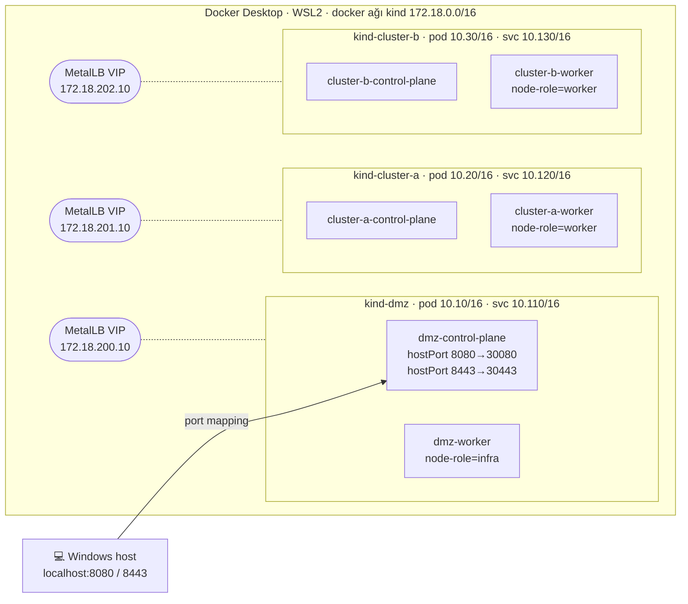
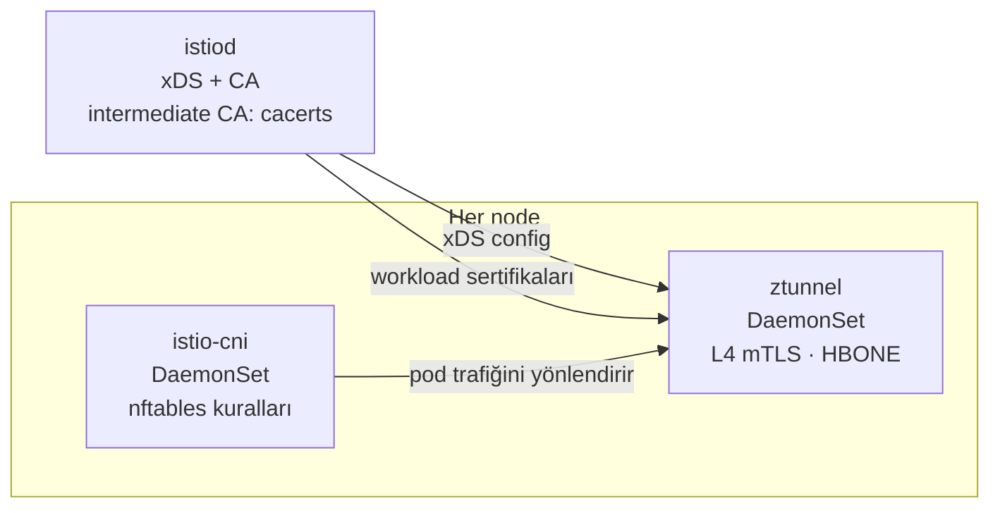
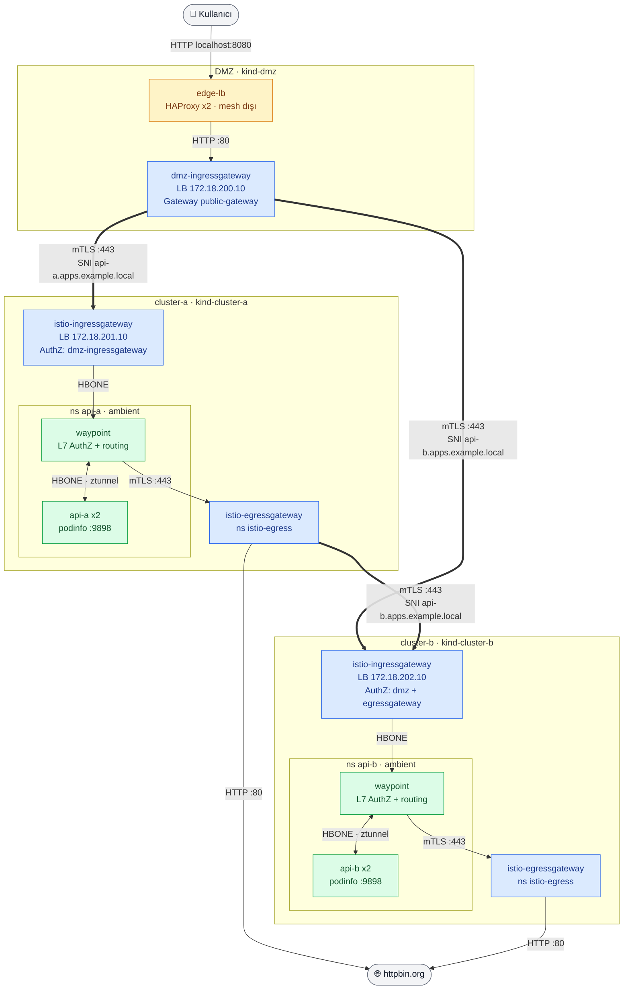
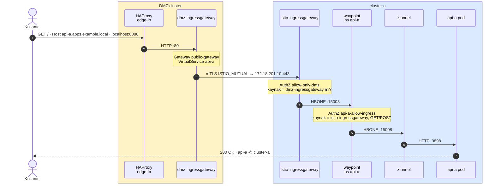
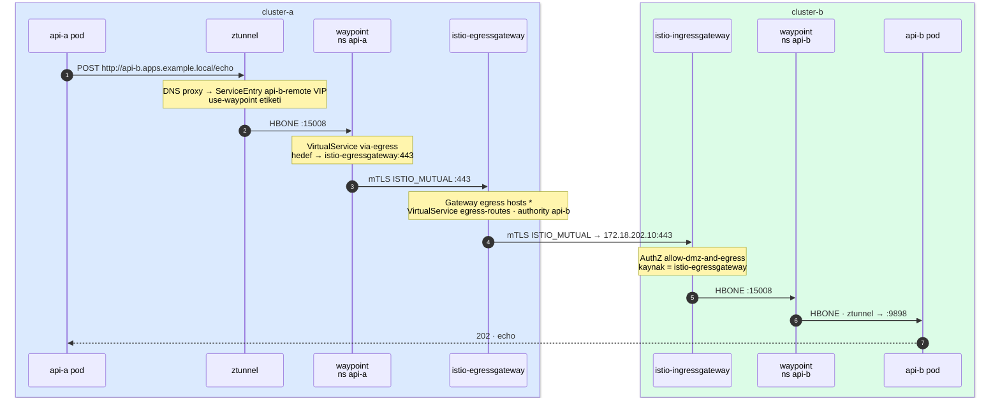
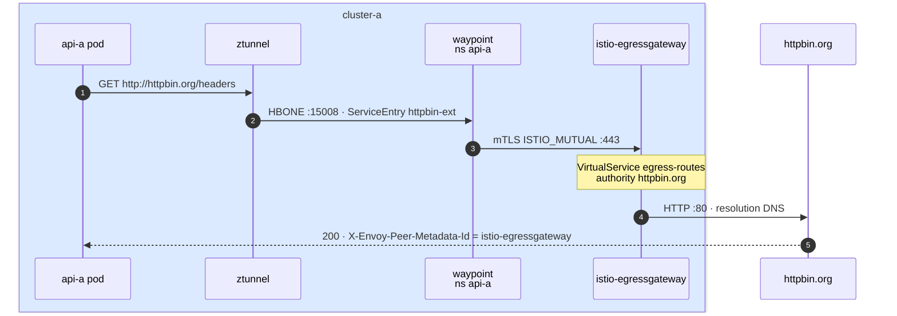
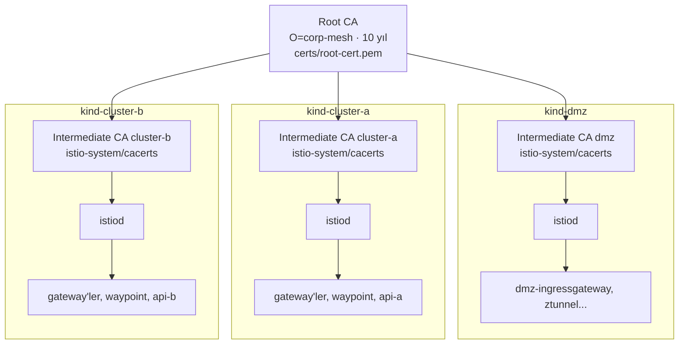
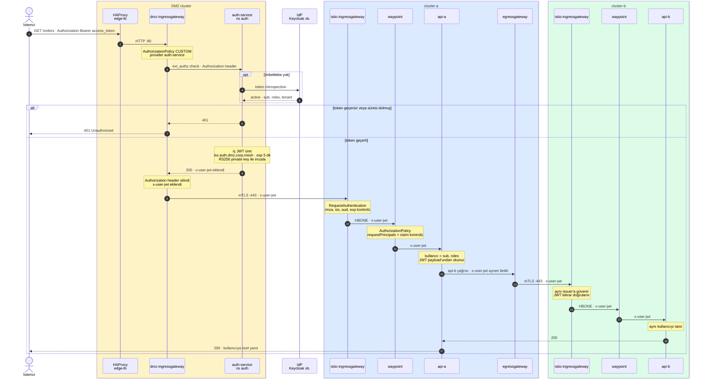

# Service Mesh Lab: OpenShift Benzeri Çoklu Cluster Ortamı

Bu proje, kurumsal bir OpenShift yapısını yerelde **kind** ile simüle eder:

- **DMZ cluster**: dış dünyaya açık tek katman. Edge load balancer ve public Istio ingress gateway burada çalışır.
- **cluster-a** ve **cluster-b**: internal cluster'lar. API'ler burada çalışır, dışarıdan doğrudan erişilemez.
- **Istio Ambient Mesh**: sidecar yoktur. L4 mTLS'i **ztunnel**, L7 politikaları **waypoint** üstlenir. Giriş trafiği **ingress gateway**, çıkış trafiği **egress gateway** üzerinden geçer.

## Mevcut durum

Ortam kuruldu ve aşağıdaki akışların hepsi uçtan uca doğrulandı (`scripts/07-verify.sh`):

| # | Akış | Sonuç |
|---|------|-------|
| 1 | İnternet → DMZ → cluster-a → api-a | ✅ |
| 2 | İnternet → DMZ → cluster-b → api-b | ✅ |
| 3 | api-a → cluster-a egress → cluster-b → api-b (cluster'lar arası) | ✅ |
| 4 | api-a → egress gateway → httpbin.org (internete çıkış) | ✅ |
| – | Mesh dışından internal gateway'e doğrudan erişim | ✅ reddediliyor (istemci sertifikası yok) |

Kullanılan sürümler:

| Bileşen | Sürüm | Not |
|---------|-------|-----|
| kind / Kubernetes | 0.33.0 / v1.36.4 | Her cluster 1 control-plane + 1 worker |
| Istio (kontrol düzlemi) | 1.30.7 | 1.31 GA chart'ları helm reposunda yok |
| istioctl | 1.31.3 | n-1 kontrol düzlemi desteği |
| Istio dataplane modu | ambient + **native nftables** | WSL2 kernel'inde iptables CONNMARK yok |
| Gateway API CRD | v1.6.0 | |
| MetalLB | v0.16.1 | L2 modu |
| Edge LB | HAProxy 3.0 | |
| Uygulama | podinfo 6.7.1 | |

---

## Mimari

> Diyagramlar Mermaid ile yazıldı. GitHub doğrudan gösterir; VS Code önizlemesi için
> "Markdown Preview Mermaid Support" eklentisi gerekir.

### Fiziksel yapı

Üç kind cluster'ı da Docker Desktop (WSL2) üzerinde, aynı `kind` docker ağında birer container olarak çalışır. Host'a yalnızca DMZ'nin portu açıktır.



Her cluster'da `istio-system` altında aynı Istio bileşenleri çalışır:



### Mantıksal yapı



Kalın oklar (`==>`) cluster'lar arası mTLS bağlantılarıdır. Cluster'lar birbirine yalnızca bu oklar üzerinden, LoadBalancer IP'leri aracılığıyla ulaşır.

### Ambient veri düzlemi nasıl çalışıyor?

- **istio-cni** (DaemonSet): `istio.io/dataplane-mode: ambient` etiketli namespace'lerdeki pod'ların ağ namespace'ine nftables kuralları yazar. Pod'un giren ve çıkan trafiği aynı node'daki ztunnel'e yönlendirilir. Uygulama container'ına hiçbir şey eklenmez; sidecar yoktur.
- **ztunnel** (DaemonSet, node başına bir tane): L4 proxy'dir. Pod'lar arası trafiği **HBONE** ile taşır (mTLS içinde HTTP CONNECT tüneli, port 15008). Her pod'un kimliği SPIFFE sertifikasıyla temsil edilir: `spiffe://corp.mesh/ns/<ns>/sa/<sa>`.
- **waypoint** (namespace başına bir Envoy deployment'ı): L7 proxy'dir. `istio.io/use-waypoint: waypoint` etiketi olan namespace'lerin ve ServiceEntry'lerin trafiği ztunnel'den waypoint'e gider. HTTP bazlı AuthorizationPolicy, VirtualService yönlendirmesi ve retry/timeout gibi kurallar burada uygulanır.
- **Gateway'ler** (ingress/egress): ambient'e dahil değildir, kendi Envoy'larıyla çalışırlar. Mesh içine HBONE ile, cluster dışına ise `ISTIO_MUTUAL` (Istio sertifikalarıyla mTLS) veya düz HTTP ile bağlanırlar.

### Tasarım kararları

- **Cluster'lar arasında düz ağ yok.** Her cluster kendi bağımsız ambient mesh'ini çalıştırır. Cluster'lar birbirine yalnızca gateway'ler üzerinden, LoadBalancer IP'leri aracılığıyla bağlanır; tıpkı DMZ ile internal zone arasında firewall bulunan gerçek yapılarda olduğu gibi. Bir cluster diğerinin pod IP'lerini veya servislerini bilmez.
- **Ortak güven zinciri.** Tek bir root CA vardır ve her cluster'ın istiod'u kendi intermediate CA'sıyla sertifika üretir (`istio-system/cacerts`, `scripts/03-generate-certs.sh`). Gateway'ler arasındaki `ISTIO_MUTUAL` bağlantısı bu ortak root sayesinde iki taraflı doğrulanır.
- **Ortak trust domain: `corp.mesh`.** Kimlikler servis hesabı (SA) adlarıyla ayrışır: DMZ'deki gateway `dmz-ingressgateway`, internal gateway'ler ise `istio-ingressgateway` adını taşır. AuthorizationPolicy'ler bu adlara göre yazılır.
- **Gateway kurulumu:** ingress ve egress gateway'ler `istio/gateway` Helm chart'ı ve klasik `Gateway` / `VirtualService` API'si ile, waypoint'ler ise Kubernetes Gateway API (`gatewayClassName: istio-waypoint`) ile kurulur.
- **OpenShift benzerlikleri:** `*.apps.example.local` route domain'i, `restricted` Pod Security, sayısal UID ile non-root container'lar, infra/worker node etiketleri ve HAProxy tabanlı edge router.

---

## Trafik akışları (adım adım)

### Akış 1: İnternet → api-a (north-south)



| Adım | Nereden → Nereye | Port / Protokol | Şifreleme | Tanımlayan kaynak |
|------|------------------|-----------------|-----------|-------------------|
| 1 | Windows host → dmz node | `localhost:8080` → `30080` | Yok | [clusters/dmz.yaml](clusters/dmz.yaml) `extraPortMappings` |
| 2 | NodePort → HAProxy pod | `30080` → `:8080` HTTP | Yok | [manifests/dmz/10-edge-lb.yaml](manifests/dmz/10-edge-lb.yaml) Service `edge-lb` |
| 3 | HAProxy → dmz-ingressgateway | `:80` HTTP, `X-Forwarded-Proto` eklenir | Yok (DMZ içi) | HAProxy `backend istio_ingress_http` |
| 4 | dmz-ingressgateway: Host eşleşmesi | `api-a.apps.example.local` | – | [manifests/dmz/20-public-gateway.yaml](manifests/dmz/20-public-gateway.yaml) `Gateway public-gateway` + `VirtualService api-a` (timeout 10s, 2 retry) |
| 5 | dmz-ingressgateway → cluster-a ingress gw | `172.18.201.10:443` | **mTLS** (`ISTIO_MUTUAL`, SNI `api-a.apps.example.local`) | [manifests/dmz/30-internal-clusters.yaml](manifests/dmz/30-internal-clusters.yaml) `ServiceEntry` + `DestinationRule cluster-a-gateway` |
| 6 | cluster-a ingress gw: kimlik kontrolü | istemci sertifikası `corp.mesh/ns/istio-ingress/sa/dmz-ingressgateway` olmalı | – | [manifests/cluster-a/30-internal-gateway.yaml](manifests/cluster-a/30-internal-gateway.yaml) `AuthorizationPolicy allow-only-dmz` |
| 7 | cluster-a ingress gw → waypoint | HBONE `:15008` | **mTLS** | `Service api-a` üzerindeki `istio.io/ingress-use-waypoint: "true"` etiketi |
| 8 | waypoint: L7 yetki kontrolü | kaynak `istio-ingressgateway`, metot `GET`/`POST` olmalı | – | [manifests/cluster-a/40-security.yaml](manifests/cluster-a/40-security.yaml) `AuthorizationPolicy api-a-allow-ingress` |
| 9 | waypoint → hedef node'daki ztunnel | HBONE `:15008` | **mTLS** | [manifests/cluster-a/20-waypoint.yaml](manifests/cluster-a/20-waypoint.yaml) |
| 10 | ztunnel → api-a pod | `:9898` HTTP (pod ağ namespace'i içinde) | – | [manifests/cluster-a/10-api-a.yaml](manifests/cluster-a/10-api-a.yaml) |

**Akış 2 (İnternet → api-b)** aynı yolu izler. Farklar: Host `api-b.apps.example.local`, hedef `172.18.202.10:443` ve kaynaklar `manifests/cluster-b/` altında.

### Akış 3: api-a → api-b (cluster'lar arası, egress gateway üzerinden)

Tetikleyici: `POST /api/echo` isteği api-a'ya gelir. podinfo bu isteği `--backend-url=http://api-b.apps.example.local/echo` adresine iletir.



| Adım | Nereden → Nereye | Port / Protokol | Şifreleme | Tanımlayan kaynak |
|------|------------------|-----------------|-----------|-------------------|
| 1 | api-a: `api-b.apps.example.local` DNS sorgusu | ztunnel DNS proxy, ServiceEntry için otomatik VIP | – | [manifests/cluster-a/50-egress.yaml](manifests/cluster-a/50-egress.yaml) `ServiceEntry api-b-remote` |
| 2 | api-a → ztunnel → waypoint | HBONE `:15008` | **mTLS** | ServiceEntry'deki `istio.io/use-waypoint: waypoint` etiketi |
| 3 | waypoint: hedefi egress gateway'e çevir | `VirtualService via-egress` | – | 50-egress.yaml |
| 4 | waypoint → istio-egressgateway | `:443` | **mTLS** (`ISTIO_MUTUAL`) | `DestinationRule egressgateway` |
| 5 | egress gw: TLS'i kabul et | Gateway server `hosts: ["*"]`. Waypoint, Istio'nun iç SNI'ını (`outbound_.443_._.istio-egressgateway...`) gönderdiği için host listesi kısıtlanamaz | – | `Gateway egress` |
| 6 | egress gw: Host'a göre yönlendir | `authority: api-b.apps.example.local` | – | `VirtualService egress-routes` |
| 7 | egress gw → cluster-b ingress gw | `172.18.202.10:443` | **mTLS** (`ISTIO_MUTUAL`, SNI `api-b.apps.example.local`) | `ServiceEntry` + `DestinationRule cluster-b-gateway` (istio-egress ns) |
| 8 | cluster-b ingress gw: kimlik kontrolü | `corp.mesh/ns/istio-egress/sa/istio-egressgateway` izinli | – | [manifests/cluster-b/30-internal-gateway.yaml](manifests/cluster-b/30-internal-gateway.yaml) |
| 9 | → waypoint → ztunnel → api-b | Akış 1'in 7-10. adımlarıyla aynı | **mTLS** | manifests/cluster-b/ |

### Akış 4: api-a → httpbin.org (internete çıkış)



1. ServiceEntry `httpbin-ext` (api-a ns, waypoint etiketli) dış hedefi mesh'e tanıtır.
2. Waypoint `VirtualService via-egress` ile trafiği `istio-egressgateway:443` adresine mTLS ile yollar.
3. Egress gateway'deki `VirtualService egress-routes`, `authority: httpbin.org` eşleşmesiyle isteği `ServiceEntry httpbin-ext` (istio-egress ns, `resolution: DNS`) üzerinden `httpbin.org:80` adresine düz HTTP olarak çıkarır.
4. Yanıttaki `X-Envoy-Peer-Metadata-Id: router~...istio-egressgateway...` header'ı, isteğin egress gateway'den çıktığını gösterir.

cluster-b'de de aynı yapı var (yalnızca httpbin.org için): [manifests/cluster-b/50-egress.yaml](manifests/cluster-b/50-egress.yaml).

### Şifreleme özeti

| Bölüm | Durum |
|-------|-------|
| Kullanıcı → HAProxy → dmz-ingressgateway | **Düz HTTP.** DMZ'de TLS terminasyonu yol haritasında |
| DMZ ↔ internal cluster gateway'leri | mTLS (`ISTIO_MUTUAL`, ortak root CA) |
| cluster-a egress ↔ cluster-b ingress | mTLS (`ISTIO_MUTUAL`) |
| Cluster içi (gateway ↔ waypoint ↔ ztunnel ↔ pod) | mTLS (HBONE); `PeerAuthentication STRICT` (cluster-a/b) |
| Egress gateway → httpbin.org | Düz HTTP (dış hedef) |

---

## Güvenlik modeli

### Güven zinciri



Her workload sertifikası `spiffe://corp.mesh/ns/<namespace>/sa/<serviceaccount>` kimliğini taşır. Sertifikalar farklı intermediate CA'lardan gelse de ortak root sayesinde her cluster diğerinin sertifikasını doğrulayabilir.

### Kimlikler (SPIFFE)

| Kimlik | Nerede | Kullanım |
|--------|--------|----------|
| `corp.mesh/ns/istio-ingress/sa/dmz-ingressgateway` | dmz | DMZ'den internal cluster'lara giden trafik |
| `corp.mesh/ns/istio-ingress/sa/istio-ingressgateway` | cluster-a, cluster-b | Internal gateway'den uygulamalara giden trafik |
| `corp.mesh/ns/istio-egress/sa/istio-egressgateway` | cluster-a, cluster-b | Egress üzerinden diğer cluster'a giden trafik |
| `corp.mesh/ns/api-a/sa/api-a`, `.../api-b/sa/api-b` | cluster-a / cluster-b | Uygulama pod'ları |

### Yetkilendirme matrisi

| Hedef | İzin verilen kaynak | Kural | Uygulandığı yer |
|-------|---------------------|-------|-----------------|
| cluster-a ingress gw | yalnızca `dmz-ingressgateway` | L4/L7 | gateway Envoy |
| cluster-b ingress gw | `dmz-ingressgateway` + `istio-egressgateway` | L4/L7 | gateway Envoy |
| api-a servisi | yalnızca `istio-ingressgateway`, `GET`/`POST` | L7 | waypoint |
| api-b servisi | yalnızca `istio-ingressgateway`, `GET`/`POST` | L7 | waypoint |
| cluster-a/b mesh geneli | – | mTLS `STRICT` | ztunnel |

### Bilinen kısıtlar

- **Ortak trust domain:** cluster-b'nin kendi `istio-egressgateway`'i, cluster-a'nınkiyle aynı kimliği taşır. Bu yüzden cluster-b ingress gateway'i ikisini birbirinden ayıramaz. Ayrım gerekiyorsa cluster başına ayrı trust domain veya farklı SA adları kullanılmalı.
- **Egress zorunlu değil:** `outboundTrafficPolicy` henüz `ALLOW_ANY`; ServiceEntry'si olmayan bir dış adrese pod'lar doğrudan çıkabilir (yol haritası: `REGISTRY_ONLY`).
- **DMZ'de PeerAuthentication yok:** HAProxy mesh dışında çalıştığı için DMZ'de `STRICT` mTLS uygulanmıyor.

---

## Bileşenler

| Bileşen | Cluster | Namespace | Kurulum |
|---------|---------|-----------|---------|
| MetalLB (LoadBalancer IP) | hepsi | metallb-system | manifest |
| istiod (profile=ambient) | hepsi | istio-system | helm `istio/istiod` |
| istio-cni (nftables) | hepsi | istio-system | helm `istio/cni` |
| ztunnel (DaemonSet) | hepsi | istio-system | helm `istio/ztunnel` |
| edge-lb (HAProxy) | dmz | edge-lb | `manifests/dmz` |
| dmz-ingressgateway | dmz | istio-ingress | helm `istio/gateway` |
| istio-ingressgateway (internal) | a, b | istio-ingress | helm `istio/gateway` |
| istio-egressgateway | a, b | istio-egress | helm `istio/gateway` |
| waypoint | a, b | api-a / api-b | Gateway API (`istio-waypoint`) |
| api-a / api-b (podinfo) | a / b | api-a / api-b | `manifests/cluster-*` |

## Dizin yapısı

```
service-mesh/
├── config.env                  # versiyonlar, mesh id, trust domain, IP planı
├── clusters/                   # kind cluster tanımları
│   ├── dmz.yaml                #   host 8080/8443 -> NodePort 30080/30443
│   ├── cluster-a.yaml
│   └── cluster-b.yaml
├── infra/
│   └── metallb/                # IP havuzu şablonu (cluster başına ayrı /24)
├── istio/
│   └── values/                 # helm values: istiod, cni, ztunnel, ingress/egress gw
├── manifests/
│   ├── dmz/
│   │   ├── 00-namespaces.yaml
│   │   ├── 10-edge-lb.yaml             # HAProxy
│   │   ├── 20-public-gateway.yaml      # Gateway + VirtualService (Host bazlı)
│   │   └── 30-internal-clusters.yaml   # ServiceEntry + DestinationRule (mTLS)
│   ├── cluster-a/
│   │   ├── 00-namespaces.yaml          # ambient + waypoint etiketleri
│   │   ├── 10-api-a.yaml               # podinfo, backend = api-b
│   │   ├── 20-waypoint.yaml            # waypoint + seccomp ConfigMap
│   │   ├── 30-internal-gateway.yaml    # ISTIO_MUTUAL gateway + AuthZ
│   │   ├── 40-security.yaml            # PeerAuthentication STRICT + L7 AuthZ
│   │   └── 50-egress.yaml              # ServiceEntry → waypoint → egress gw
│   └── cluster-b/                      # aynı yapı (api-b, sadece httpbin egress)
├── scripts/
│   ├── setup.sh                # hepsini sırayla çalıştırır
│   ├── lib.sh                  # ortak yardımcılar (__NET_PREFIX__ doldurma vb.)
│   ├── 00-check-prereqs.sh
│   ├── 01-create-clusters.sh   # kind + Gateway API CRD
│   ├── 02-install-metallb.sh
│   ├── 03-generate-certs.sh    # root CA + intermediate CA -> cacerts
│   ├── 04-install-istio.sh     # base, istiod, cni, ztunnel
│   ├── 05-install-gateways.sh  # ingress / egress gateway'ler
│   ├── 06-deploy-manifests.sh
│   ├── 07-verify.sh            # uçtan uca testler
│   └── 99-destroy.sh
└── certs/                      # üretilen sertifikalar (gitignore)
```

## IP planı

kind docker ağı genelde `172.18.0.0/16` olur. Scriptler bunu otomatik tespit eder; gerekirse `config.env` içindeki `NET_PREFIX` ile elle verebilirsiniz. Manifest'lerdeki `__NET_PREFIX__` yer tutucusu uygulama sırasında doldurulur.

| Cluster | Pod CIDR | Service CIDR | MetalLB havuzu | Ingress GW IP |
|---------|----------|--------------|----------------|---------------|
| dmz | 10.10.0.0/16 | 10.110.0.0/16 | 172.18.200.10-50 | 172.18.200.10 |
| cluster-a | 10.20.0.0/16 | 10.120.0.0/16 | 172.18.201.10-50 | 172.18.201.10 |
| cluster-b | 10.30.0.0/16 | 10.130.0.0/16 | 172.18.202.10-50 | 172.18.202.10 |

> Windows/Docker Desktop'ta MetalLB IP'lerine host'tan erişilemez. Bu IP'ler yalnızca cluster'lar arasında (aynı docker ağında) kullanılır. Host'tan giriş noktası `localhost:8080` adresidir.

## Gereksinimler

- Docker Desktop (en az 8 GB RAM önerilir; 3 cluster × 2 node çalışır)
- `kind`, `kubectl`, `helm`, `istioctl`, `openssl`
- Git Bash (scriptler bash ile yazılmıştır)

```powershell
winget install Kubernetes.kind Helm.Helm
# istioctl: https://github.com/istio/istio/releases
```

## Kurulum

```bash
# Hepsi birden
bash scripts/setup.sh

# veya adım adım
bash scripts/01-create-clusters.sh
bash scripts/02-install-metallb.sh
bash scripts/03-generate-certs.sh
bash scripts/04-install-istio.sh
bash scripts/05-install-gateways.sh
bash scripts/06-deploy-manifests.sh
```

## Test

```bash
bash scripts/07-verify.sh

# Manuel
curl -H "Host: api-a.apps.example.local" http://localhost:8080/
curl -H "Host: api-b.apps.example.local" http://localhost:8080/
curl -X POST -H "Host: api-a.apps.example.local" -d 'selam' http://localhost:8080/api/echo   # api-a -> api-b
```

Faydalı komutlar:

```bash
kubectl config get-contexts                                   # kind-dmz, kind-cluster-a, kind-cluster-b
istioctl --context kind-cluster-a ztunnel-config workloads     # ambient'e alınmış pod'lar
istioctl --context kind-cluster-a waypoint list -n api-a
kubectl --context kind-dmz -n istio-ingress logs deploy/dmz-ingressgateway -f
kubectl --context kind-cluster-a -n api-a logs deploy/waypoint -f
kubectl --context kind-cluster-a -n istio-egress logs deploy/istio-egressgateway -f
```

## Windows / Docker Desktop notları

Kurulum sırasında karşılaşılan ve repoda çözülmüş sorunlar:

| Belirti | Sebep | Çözüm |
|---------|-------|-------|
| Pod'lar `ContainerCreating`'de kalıyor, `CONNMARK revision 0 not supported` | WSL2 kernel'inde `xt_CONNMARK` yok, istio-cni iptables kuralları kurulamıyor | `global.nativeNftables: true` ([cni.yaml](istio/values/cni.yaml), [istiod.yaml](istio/values/istiod.yaml)). Cluster iptables ile kurulduysa yeniden oluşturulmalı (CNI kalıntı ipset görünce iptables'a döner) |
| Worker node `kubelet not healthy` | kubelet `node-role.kubernetes.io/*` etiketini kendine ekleyemez | kind config'te `node-role: <rol>` etiketi |
| `image has non-numeric user ... cannot verify user is non-root` | İmaj kullanıcıyı isimle tanımlıyor | `runAsUser` sayısal verildi (haproxy=99, podinfo=100) |
| Waypoint `PROGRAMMED=False`, `violates PodSecurity restricted` | Istio'nun ürettiği waypoint pod'unda seccomp yok | Gateway `infrastructure.parametersRef` → ConfigMap ile seccomp eklenir |
| Egress gw `filter_chain_not_found`, waypoint 503 | Waypoint iç SNI gönderir, Gateway server hosts eşleşmez | Egress Gateway server `hosts: ["*"]` |
| `chart base matching 1.31.x not found` | 1.31 GA chart'ları helm reposunda yayınlanmamış | `ISTIO_VERSION=1.30.7` |
| `kind` config dosyasını bulamıyor (`/c/Users/...`) | `MSYS_NO_PATHCONV=1` Windows exe'lerine giden yol çevirisini de kapatır | `lib.sh` içinde `ROOT_DIR` için `pwd -W` |

## Temizlik

```bash
bash scripts/99-destroy.sh           # cluster'ları siler
bash scripts/99-destroy.sh --certs   # sertifikaları da siler
```

## Gerçek OpenShift'e geçişte farklar

| Konu | Bu lab | OpenShift |
|------|--------|-----------|
| Istio kurulumu | Helm chart'ları | OpenShift Service Mesh 3 (Sail Operator): `Istio`, `IstioCNI`, `ZTunnel` CR'ları |
| CNI | kindnet + istio-cni (nftables) | OVN-Kubernetes + istio-cni (`global.platform=openshift`) |
| Edge LB | HAProxy pod + NodePort | OpenShift Router / harici F5 |
| LoadBalancer | MetalLB (L2) | MetalLB operator veya bulut LB |
| Güvenlik | Pod Security `restricted` + elle seccomp | SCC (`restricted-v2`, seccomp otomatik) |

## Planlanan: Kullanıcı kimliği yayılımı (token exchange)

> Henüz uygulanmadı; hedef tasarım.

Dışarıdan gelen access token DMZ'de bırakılır. İçeriye yalnızca kullanıcı bilgisini taşıyan, DMZ'nin imzaladığı kısa ömürlü bir JWT girer. Tüm internal servisler kullanıcıyı bu JWT'den tanır.

### Bileşenler

| Bileşen | Yer | Görev |
|---------|-----|-------|
| **auth-service** | dmz, ns `auth` (yeni) | Envoy ext_authz HTTP servisi. Access token'ı doğrular (IdP introspection veya imza kontrolü), kullanıcı bilgisini alır ve **RS256 ile imzalı iç JWT** üretir. Token → JWT eşlemesini token ömrü boyunca önbellekler. JWKS (public key) yayınlar |
| dmz-ingressgateway | dmz | `CUSTOM` AuthorizationPolicy ile her isteği önce auth-service'e sorar. İzin verilirse `x-user-jwt` header'ını ekler, `Authorization` header'ını siler |
| Internal gateway + waypoint | cluster-a, cluster-b | `RequestAuthentication` ile JWT'nin imzasını, issuer'ını ve süresini doğrular. `AuthorizationPolicy` ile JWT'yi zorunlu kılar ve claim'lere göre yetki verir |
| Mikroservisler | cluster-a, cluster-b | JWT'deki claim'leri okur (doğrulama mesh'te yapıldığı için yeniden doğrulaması gerekmez). Başka servisi çağırırken `x-user-jwt`'yi aynen iletir |

### İç JWT örneği

```json
{
  "iss": "auth.dmz.corp.mesh",
  "aud": "internal-apis",
  "sub": "u-12345",
  "name": "Ayşe Yılmaz",
  "roles": ["customer", "premium"],
  "tenant": "corp",
  "iat": 1793448000,
  "exp": 1793448300
}
```

### Akış



### Uygulama notları

- **İmza anahtarı yalnızca DMZ'de durur.** Internal cluster'lar sadece public key'i (JWKS) bilir. JWKS, `RequestAuthentication` içine **inline** yazılır; böylece internal zone'dan DMZ'ye doğru bir ağ çağrısı açmak gerekmez. Anahtar değiştirilirken eski ve yeni key bir süre birlikte yayınlanır.
- **Dış token içeri sızmaz.** `Authorization` header'ı DMZ gateway'de silinir (VirtualService `headers.request.remove`). Internal tarafta `x-user-jwt` dışında bir kimlik header'ı kabul edilmez.
- **Sahte header'a karşı koruma:** İstemci kendisi `x-user-jwt` gönderirse DMZ gateway bu header'ı auth-service'e gitmeden önce siler. İçeride ise imza doğrulaması, DMZ dışında üretilmiş JWT'leri zaten reddeder.
- **Kısa ömür:** JWT 5 dakika gibi kısa süreli olmalı; uzun süren iş akışları için yenilemeyi auth-service yapar.
- **Header aktarımı uygulamanın işi:** Mesh gelen header'ı giden çağrıya otomatik kopyalamaz. Her mikroservis, aldığı `x-user-jwt`'yi yaptığı çağrılara eklemeli (ör. HTTP client interceptor / middleware).

## Yol haritası

- [x] Cluster kurulumu ve Istio ambient'in uçtan uca doğrulanması (4 akış + mesh dışı erişim reddi)
- [ ] DMZ'de TLS terminasyonu (cert-manager + `*.apps.example.local` wildcard sertifikası)
- [ ] **DMZ'de token exchange: access token → iç JWT** (ayrıntılar: [Planlanan: Kullanıcı kimliği yayılımı](#planlanan-kullanıcı-kimliği-yayılımı-token-exchange))
  - [ ] DMZ'ye `auth-service` (ext_authz): access token'ı doğrular, kullanıcı bilgisini içeren JWT üretir
  - [ ] `dmz-ingressgateway`: `CUSTOM` AuthorizationPolicy ile auth-service'e yönlendirme; `Authorization` header'ını silip `x-user-jwt` ekleme
  - [ ] cluster-a/b: `RequestAuthentication` (issuer `auth.dmz.corp.mesh`, inline JWKS) + JWT zorunluluğu ve claim bazlı AuthZ
  - [ ] Header'ı bir sonraki çağrıya aktaran örnek mikroservis (podinfo bunu yapmıyor)
- [ ] Egress'te `REGISTRY_ONLY` ile izin verilmeyen hedeflerin engellenmesi
- [ ] Gözlemlenebilirlik: Kiali, Prometheus, Grafana, Jaeger
- [ ] Waypoint üzerinde L7 politikaları (rate limit, header bazlı yetkilendirme)
- [ ] Trafik yönetimi: canary (v1/v2), fault injection, circuit breaker
- [ ] Ambient multicluster (east-west gateway) senaryosu
