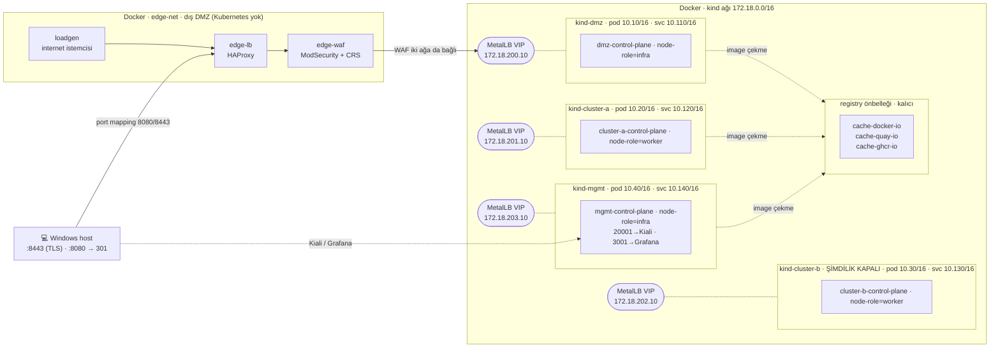
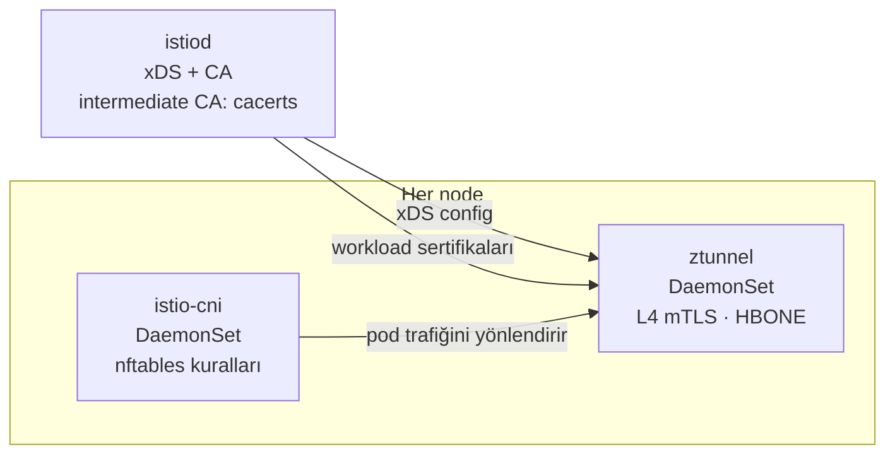
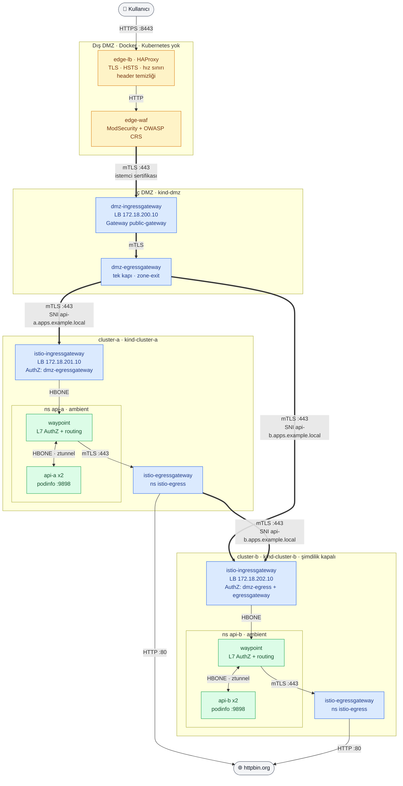
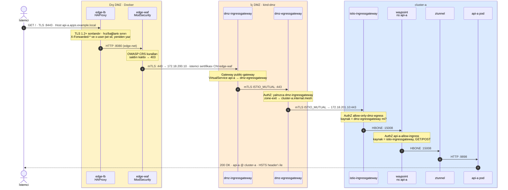
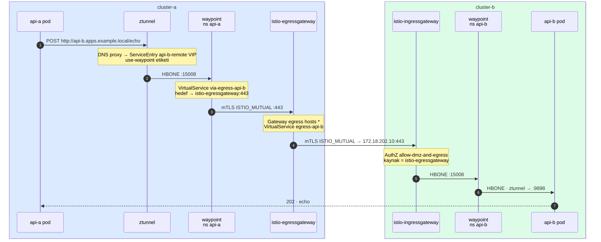
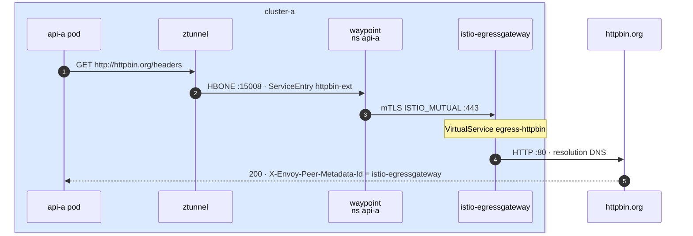
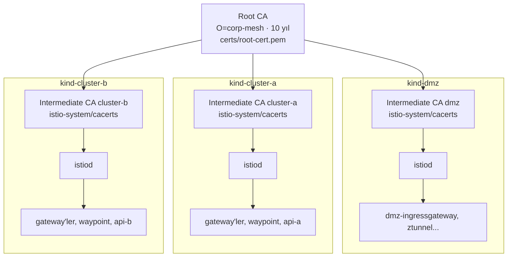
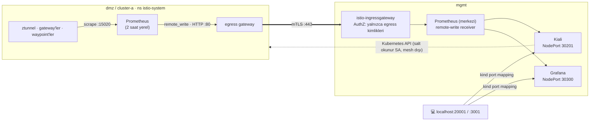
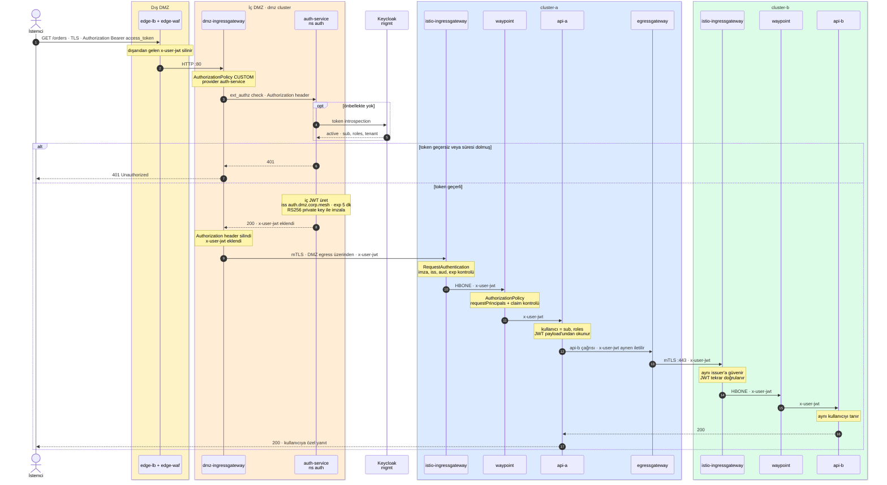

# Service Mesh Lab: OpenShift Benzeri Çoklu Cluster Ortamı

Bu proje, kurumsal bir OpenShift yapısını yerelde **kind** ile simüle eder:

- **DMZ cluster**: dış dünyaya açık tek katman. Edge load balancer ve public Istio ingress gateway burada çalışır.
- **cluster-a** ve **cluster-b**: internal cluster'lar. API'ler burada çalışır, dışarıdan doğrudan erişilemez.
- **mgmt**: paylaşılan ürünler. Şu an merkezi gözlemlenebilirlik (tek Kiali, tek Grafana, merkezi Prometheus); ileride veri, Keycloak, Vault.

> **Şu an aktif cluster'lar: `dmz`, `cluster-a` ve `mgmt`** (her biri tek node). **cluster-b RAM kısıtı nedeniyle şimdilik kapalı** ve yol haritasının son adımında (17 · `cluster-b`) geri gelecek. Bu README'deki mimari ve akış anlatımları cluster-b dahil hedef tasarımı gösterir; cluster-b'ye bağlı kısımlar *(cluster-b kapalı)* olarak işaretlidir. Bkz. [Kaynak kısıtları](#kaynak-kısıtları).
- **Istio Ambient Mesh**: sidecar yoktur. L4 mTLS'i **ztunnel**, L7 politikaları **waypoint** üstlenir. Giriş trafiği **ingress gateway**, çıkış trafiği **egress gateway** üzerinden geçer.

> **Adım adım geçmiş:** Her yol haritası maddesinin ayrıntılı dokümanı (yapılanlar, değişen dosyalar, sorunlar, doğrulama) [docs/](docs/README.md) altındadır.

## Mevcut durum

Giriş noktası: **https://api-a.apps.example.local:8443** (host'ta `--resolve ...:8443:127.0.0.1` ve `certs/edge/ca.pem` ile; bkz. [Test](#test)).

`scripts/08-verify.sh` ile uçtan uca doğrulananlar:

| # | Test | Sonuç |
|---|------|-------|
| 1 | İnternet → edge (HAProxy + WAF) → DMZ ingress → DMZ egress → cluster-a → api-a (HTTPS) | ✅ |
| – | Edge: HTTP → HTTPS (301), HSTS, TLS 1.1 reddi, TLS 1.2/1.3 kabulü | ✅ |
| – | Edge: WAF XSS ve SQL injection denemelerini engelliyor (403) | ✅ |
| – | Edge: sahte `X-Forwarded-For` ve `x-user-jwt` içeri geçmiyor | ✅ |
| – | Edge: IP başına hız sınırı (ani 150 istekte 429) | ✅ |
| – | Zone geçişi: DMZ ingress'ten cluster-a'ya **doğrudan** gidiş reddediliyor (403 RBAC), egress üzerinden kabul | ✅ |
| – | Edge: 5xx gövdeleri tek tip, `Server`/`x-envoy-*` header'ları yok | ✅ |
| – | Edge → DMZ karşılıklı TLS: sertifikasız HTTPS ve düz HTTP reddediliyor, WAF sertifikasıyla kabul | ✅ |
| – | Internal varsayılan reddet: pod IP ile waypoint'i atlama engelleniyor, yetkisiz kimlik 403, egress gateway'e waypoint dışından erişilemiyor | ✅ |
| – | Gateway namespace'leri `restricted` Pod Security, ihlal eden pod yok | ✅ |
| – | Pod'dan kayıtsız hedefe doğrudan çıkış | ⚠️ açık (NetworkPolicy bu lab'da uygulanamıyor; bkz. [docs/03-hardening.md](docs/03-hardening.md)) |
| 2 | İnternet → ... → cluster-b → api-b | ⏸️ cluster-b kapalı |
| 3 | api-a → cluster-a egress → cluster-b → api-b | ⏸️ cluster-b kapalı |
| 4 | api-a → egress gateway → httpbin.org | ✅ |
| – | api-a ambient mesh'te ve waypoint kullanıyor | ✅ |
| – | Merkezi gözlemlenebilirlik: tek Kiali ve tek Grafana (mgmt), merkezi Prometheus'ta dmz ve cluster-a metrikleri, Kiali üç cluster'ı görüyor, mgmt girişi mesh dışına kapalı | ✅ |

Adım adım doğrulama sonuçları: [docs/](docs/README.md).

Kullanılan sürümler:

| Bileşen | Sürüm | Not |
|---------|-------|-----|
| kind / Kubernetes | 0.33.0 / v1.36.4 | Her cluster **tek node** (control-plane, pod'lar da burada çalışır). RAM kısıtı nedeniyle; ileride 2 node'a çıkılacak (bkz. [Kaynak kısıtları](#kaynak-kısıtları)) |
| Istio (kontrol düzlemi) | 1.30.7 | 1.31 GA chart'ları helm reposunda yok. Image'lar `docker.io/istio`'dan (registry önbelleği uyumu) |
| istioctl | 1.31.3 | n-1 kontrol düzlemi desteği |
| Istio dataplane modu | ambient + **native nftables** | WSL2 kernel'inde iptables CONNMARK yok |
| Gateway API CRD | v1.6.0 | |
| MetalLB | v0.16.1 | L2 modu |
| Edge LB | HAProxy 3.0 | Docker container, Kubernetes dışında |
| WAF | OWASP ModSecurity CRS 4.25.2 (nginx, LTS) | ModSecurity v3, paranoia 1, engelleme modu |
| Uygulama | podinfo 6.7.1 | |
| Kiali | 2.26.0 | Istio 1.30 addon'undaki sürüm |
| Prometheus / Grafana | Istio 1.30 `samples/addons` | |
| Registry önbelleği | `registry:2.8.3` | docker.io, quay.io, ghcr.io için pull-through cache (bkz. [Registry önbelleği](#registry-önbelleği)) |

---

## Mimari

> Diyagramlar Mermaid ile yazıldı. GitHub doğrudan gösterir; VS Code önizlemesi için
> "Markdown Preview Mermaid Support" eklentisi gerekir.

### Fiziksel yapı

Her şey Docker Desktop (WSL2) üzerinde çalışır. kind cluster'ları `kind` docker ağında, edge (dış DMZ) container'ları ise ayrı bir `edge-net` ağındadır. Her cluster şimdilik **tek node**'dur (bkz. [Kaynak kısıtları](#kaynak-kısıtları)). Host'a uygulama trafiği için yalnızca **edge-lb**'nin portları (8080 → HTTPS'e yönlendirme, 8443 → TLS), yönetim için Kiali ve Grafana portları açıktır.



Her cluster'da `istio-system` altında aynı Istio bileşenleri çalışır:



### Mantıksal yapı



Kalın oklar (`==>`) mTLS bağlantılarıdır. Cluster'lar birbirine yalnızca gateway'ler üzerinden, LoadBalancer IP'leri aracılığıyla ulaşır. DMZ'den internal'a giden **tek kapı** `dmz-egressgateway`'dir.

### Ambient veri düzlemi nasıl çalışıyor?

- **istio-cni** (DaemonSet): `istio.io/dataplane-mode: ambient` etiketli namespace'lerdeki pod'ların ağ namespace'ine nftables kuralları yazar. Pod'un giren ve çıkan trafiği aynı node'daki ztunnel'e yönlendirilir. Uygulama container'ına hiçbir şey eklenmez; sidecar yoktur.
- **ztunnel** (DaemonSet, node başına bir tane): L4 proxy'dir. Pod'lar arası trafiği **HBONE** ile taşır (mTLS içinde HTTP CONNECT tüneli, port 15008). Her pod'un kimliği SPIFFE sertifikasıyla temsil edilir: `spiffe://corp.mesh/ns/<ns>/sa/<sa>`.
- **waypoint** (namespace başına bir Envoy deployment'ı): L7 proxy'dir. `istio.io/use-waypoint: waypoint` etiketi olan namespace'lerin ve ServiceEntry'lerin trafiği ztunnel'den waypoint'e gider. HTTP bazlı AuthorizationPolicy, VirtualService yönlendirmesi ve retry/timeout gibi kurallar burada uygulanır.
- **Gateway'ler** (ingress/egress): ambient'e dahil değildir, kendi Envoy'larıyla çalışırlar. Mesh içine HBONE ile, cluster dışına ise `ISTIO_MUTUAL` (Istio sertifikalarıyla mTLS) veya düz HTTP ile bağlanırlar.

### Tasarım kararları

- **Cluster'lar arasında düz ağ yok.** Her cluster kendi bağımsız ambient mesh'ini çalıştırır. Cluster'lar birbirine yalnızca gateway'ler üzerinden, LoadBalancer IP'leri aracılığıyla bağlanır; tıpkı DMZ ile internal zone arasında firewall bulunan gerçek yapılarda olduğu gibi. Bir cluster diğerinin pod IP'lerini veya servislerini bilmez.
- **Ortak güven zinciri.** Tek bir root CA vardır ve her cluster'ın istiod'u kendi intermediate CA'sıyla sertifika üretir (`istio-system/cacerts`, `scripts/03-generate-certs.sh`). Gateway'ler arasındaki `ISTIO_MUTUAL` bağlantısı bu ortak root sayesinde iki taraflı doğrulanır.
- **Ortak trust domain: `corp.mesh`.** Kimlikler servis hesabı (SA) adlarıyla ayrışır: DMZ'deki gateway'ler `dmz-ingressgateway` ve `dmz-egressgateway`, internal gateway'ler `istio-ingressgateway` ve `istio-egressgateway` adını taşır. AuthorizationPolicy'ler bu adlara göre yazılır.
- **Edge Kubernetes dışında.** Dış DMZ (LB, WAF, TLS) gerçekte bir appliance katmanıdır; lab'da Docker container'larıyla simüle edilir ve cluster'lara yalnızca WAF bağlanır. Edge sertifikası mesh CA'sından ayrı bir "public CA" ile imzalanır.
- **Zone geçişinde tek kapı.** DMZ ingress gateway internal'a doğrudan gitmez; her şey `dmz-egressgateway`'den çıkar. Internal gateway'ler yalnızca bu kimliği kabul eder.
- **Gateway kurulumu:** ingress ve egress gateway'ler `istio/gateway` Helm chart'ı ve klasik `Gateway` / `VirtualService` API'si ile, waypoint'ler ise Kubernetes Gateway API (`gatewayClassName: istio-waypoint`) ile kurulur.
- **OpenShift benzerlikleri:** `*.apps.example.local` route domain'i, `restricted` Pod Security, sayısal UID ile non-root container'lar, infra/worker node etiketleri ve HAProxy tabanlı edge (OpenShift Router / F5 karşılığı).

---

## Trafik akışları (adım adım)

### Akış 1: İnternet → api-a (north-south)



| Adım | Nereden → Nereye | Port / Protokol | Şifreleme | Tanımlayan kaynak |
|------|------------------|-----------------|-----------|-------------------|
| 1 | Windows host → edge-lb container | `localhost:8443` → `:8443` | **TLS 1.2+/1.3** (edge sertifikası, "Lab Public CA") | [scripts/06b-deploy-edge.sh](scripts/06b-deploy-edge.sh), [edge/haproxy.cfg](edge/haproxy.cfg) |
| 2 | edge-lb: kontroller | Hız (100/10 sn) ve bağlantı (50) sınırı, `Host` zorunlu, gövde ≤ 1 MB, slow-loris; header temizliği; HSTS | – | `frontend https_in` |
| 3 | edge-lb → edge-waf | `:8080` HTTP (`edge-net` ağı) | Yok (edge içi) | `backend waf` |
| 4 | edge-waf: OWASP CRS | Paranoia 1, engelleme modu | – | `WAF_MODE` ([config.env](config.env)) |
| 5 | edge-waf → dmz-ingressgateway | `172.18.200.10:443` (`kind` ağı) | **Karşılıklı TLS** (Edge-DMZ Zone CA; DMZ yalnızca WAF'ın istemci sertifikasını kabul eder) | `BACKEND`, [edge/waf-proxy-backend-ssl.conf.template](edge/waf-proxy-backend-ssl.conf.template), `Gateway public-gateway` (`MUTUAL`) |
| 6 | dmz-ingressgateway: Host eşleşmesi | `api-a.apps.example.local`; istemci IP'si `numTrustedProxies: 2` ile | – | [manifests/dmz/20-public-gateway.yaml](manifests/dmz/20-public-gateway.yaml) |
| 7 | dmz-ingressgateway → dmz-egressgateway | `:443` | **mTLS** (`ISTIO_MUTUAL`) | `DestinationRule dmz-egressgateway` |
| 8 | dmz-egressgateway: kimlik kontrolü ve yönlendirme | yalnızca `dmz-ingressgateway`; `zone-exit` → `cluster-a.internal.mesh` | – | [manifests/dmz/30-internal-clusters.yaml](manifests/dmz/30-internal-clusters.yaml) |
| 9 | dmz-egressgateway → cluster-a ingress gw | `172.18.201.10:443` | **mTLS** (`ISTIO_MUTUAL`, SNI `api-a.apps.example.local`) | `ServiceEntry` + `DestinationRule cluster-a-gateway` |
| 10 | cluster-a ingress gw: kimlik kontrolü | istemci sertifikası `corp.mesh/ns/istio-egress/sa/dmz-egressgateway` olmalı | – | [manifests/cluster-a/30-internal-gateway.yaml](manifests/cluster-a/30-internal-gateway.yaml) `allow-only-dmz-egress` |
| 11 | cluster-a ingress gw → waypoint | HBONE `:15008` | **mTLS** | `Service api-a` üzerindeki `istio.io/ingress-use-waypoint: "true"` |
| 12 | waypoint: L7 yetki kontrolü | kaynak `istio-ingressgateway`, metot `GET`/`POST` | – | [manifests/cluster-a/40-security.yaml](manifests/cluster-a/40-security.yaml) |
| 13 | waypoint → ztunnel → api-a pod | HBONE `:15008` → `:9898` | **mTLS** | [manifests/cluster-a/10-api-a.yaml](manifests/cluster-a/10-api-a.yaml) |

**Akış 2 (İnternet → api-b)** *(cluster-b kapalı)* aynı yolu izler. Farklar: Host `api-b.apps.example.local`, hedef `172.18.202.10:443` ve kaynaklar `manifests/cluster-b/` altında.

### Akış 3: api-a → api-b (cluster'lar arası, egress gateway üzerinden) *(cluster-b kapalı)*

Tetikleyici: `POST /api/echo` isteği api-a'ya gelir. podinfo bu isteği `PODINFO_BACKEND_URL=http://api-b.apps.example.local/echo` adresine iletir. Bu ayar ve akışın tüm tanımları `manifests/*/cluster-b/` klasörlerinde durur ve yalnızca cluster-b aktifken uygulanır; cluster-b kapalıyken api-a yalnızca echo yapar.



| Adım | Nereden → Nereye | Port / Protokol | Şifreleme | Tanımlayan kaynak |
|------|------------------|-----------------|-----------|-------------------|
| 1 | api-a: `api-b.apps.example.local` DNS sorgusu | ztunnel DNS proxy, ServiceEntry için otomatik VIP | – | [manifests/cluster-a/cluster-b/51-egress-cluster-b.yaml](manifests/cluster-a/cluster-b/51-egress-cluster-b.yaml) `ServiceEntry api-b-remote` |
| 2 | api-a → ztunnel → waypoint | HBONE `:15008` | **mTLS** | ServiceEntry'deki `istio.io/use-waypoint: waypoint` etiketi |
| 3 | waypoint: hedefi egress gateway'e çevir | `VirtualService via-egress-api-b` | – | 51-egress-cluster-b.yaml |
| 4 | waypoint → istio-egressgateway | `:443` | **mTLS** (`ISTIO_MUTUAL`) | `DestinationRule egressgateway` (50-egress.yaml) |
| 5 | egress gw: TLS'i kabul et | Gateway server `hosts: ["*"]`. Waypoint, Istio'nun iç SNI'ını (`outbound_.443_._.istio-egressgateway...`) gönderdiği için host listesi kısıtlanamaz | – | `Gateway egress` (50-egress.yaml) |
| 6 | egress gw: Host'a göre yönlendir | `authority: api-b.apps.example.local` | – | `VirtualService egress-api-b` |
| 7 | egress gw → cluster-b ingress gw | `172.18.202.10:443` | **mTLS** (`ISTIO_MUTUAL`, SNI `api-b.apps.example.local`) | `ServiceEntry` + `DestinationRule cluster-b-gateway` (istio-egress ns) |
| 8 | cluster-b ingress gw: kimlik kontrolü | `corp.mesh/ns/istio-egress/sa/istio-egressgateway` izinli | – | [manifests/cluster-b/30-internal-gateway.yaml](manifests/cluster-b/30-internal-gateway.yaml) |
| 9 | → waypoint → ztunnel → api-b | Akış 1'in 7-10. adımlarıyla aynı | **mTLS** | manifests/cluster-b/ |

### Akış 4: api-a → httpbin.org (internete çıkış)



1. ServiceEntry `httpbin-ext` (api-a ns, waypoint etiketli) dış hedefi mesh'e tanıtır.
2. Waypoint `VirtualService via-egress` ile trafiği `istio-egressgateway:443` adresine mTLS ile yollar.
3. Egress gateway'deki `VirtualService egress-httpbin` isteği `ServiceEntry httpbin-ext` (istio-egress ns, `resolution: DNS`) üzerinden `httpbin.org:80` adresine düz HTTP olarak çıkarır.
4. Yanıttaki `X-Envoy-Peer-Metadata-Id: router~...istio-egressgateway...` header'ı, isteğin egress gateway'den çıktığını gösterir.

*(cluster-b kapalı)* cluster-b'de de aynı yapı var (yalnızca httpbin.org için): [manifests/cluster-b/50-egress.yaml](manifests/cluster-b/50-egress.yaml).

### Şifreleme özeti

| Bölüm | Durum |
|-------|-------|
| İstemci → edge-lb | **TLS 1.2+/1.3** (edge sertifikası, "Lab Public CA"), HSTS |
| edge-lb → edge-waf | Düz HTTP (yalnızca `edge-net` içinde) |
| edge-waf → dmz-ingressgateway | **Karşılıklı TLS** (Edge-DMZ Zone CA) |
| dmz-ingressgateway → dmz-egressgateway | mTLS (`ISTIO_MUTUAL`) |
| dmz-egressgateway → internal cluster gateway'leri | mTLS (`ISTIO_MUTUAL`, ortak root CA) |
| cluster-a egress ↔ cluster-b ingress | mTLS (`ISTIO_MUTUAL`) |
| Cluster içi (gateway ↔ waypoint ↔ ztunnel ↔ pod) | mTLS (HBONE); `PeerAuthentication STRICT` (cluster-a/b) |
| Egress gateway → httpbin.org | Düz HTTP (dış hedef) |

---

## Güvenlik modeli

### Güven zinciri



Her workload sertifikası `spiffe://corp.mesh/ns/<namespace>/sa/<serviceaccount>` kimliğini taşır. Sertifikalar farklı intermediate CA'lardan gelse de ortak root sayesinde her cluster diğerinin sertifikasını doğrulayabilir.

### Kimlikler (SPIFFE)

| Kimlik | Nerede | Kullanım |
|--------|--------|----------|
| `corp.mesh/ns/istio-ingress/sa/dmz-ingressgateway` | dmz | Edge'den gelen trafiği karşılar, DMZ egress'e verir |
| `corp.mesh/ns/istio-egress/sa/dmz-egressgateway` | dmz | DMZ'den internal cluster'lara giden **tek** kimlik |
| `corp.mesh/ns/istio-ingress/sa/istio-ingressgateway` | cluster-a, cluster-b | Internal gateway'den uygulamalara giden trafik |
| `corp.mesh/ns/istio-egress/sa/istio-egressgateway` | cluster-a, cluster-b | Egress üzerinden diğer cluster'a giden trafik |
| `corp.mesh/ns/api-a/sa/api-a`, `.../api-b/sa/api-b` | cluster-a / cluster-b | Uygulama pod'ları |

### Yetkilendirme matrisi

| Hedef | İzin verilen kaynak | Kural | Uygulandığı yer |
|-------|---------------------|-------|-----------------|
| dmz-egressgateway | yalnızca `dmz-ingressgateway` | L4/L7 | gateway Envoy |
| cluster-a ingress gw | yalnızca `dmz-egressgateway` (cluster-b aktifken + `istio-egressgateway`) | L4/L7 | gateway Envoy |
| cluster-b ingress gw | `dmz-egressgateway` + `istio-egressgateway` | L4/L7 | gateway Envoy |
| api-a namespace'i (varsayılan) | hiçbiri (`allow-nothing`) | L4 | ztunnel |
| api-a pod'ları | yalnızca `api-a/sa/waypoint` | L4 | ztunnel |
| api-a servisi | yalnızca `istio-ingressgateway`, `GET`/`POST` | L7 | waypoint |
| cluster-a egress gw | yalnızca `api-a/sa/waypoint` | L4/L7 | gateway Envoy |
| api-b servisi | yalnızca `istio-ingressgateway`, `GET`/`POST` | L7 | waypoint |
| cluster-a/b mesh geneli | – | mTLS `STRICT` | ztunnel |

### Bilinen kısıtlar

- **Ortak trust domain:** cluster-b'nin kendi `istio-egressgateway`'i, cluster-a'nınkiyle aynı kimliği taşır. Bu yüzden cluster-b ingress gateway'i ikisini birbirinden ayıramaz. Ayrım gerekiyorsa cluster başına ayrı trust domain veya farklı SA adları kullanılmalı.
- **Pod'ların doğrudan çıkışı açık:** `REGISTRY_ONLY` açık, ama ambient'te yalnızca waypoint ve gateway'leri etkiliyor; pod'lar ServiceEntry'si olmayan adreslere doğrudan çıkabiliyor. Bunu kapatacak egress NetworkPolicy bu lab'da uygulanamıyor (kindnet desteklemiyor, WSL2 kernel'inde `CONFIG_NFT_QUEUE` yok). Referans: [infra/network-policies/reference/](infra/network-policies/reference/).
- **DMZ'de PeerAuthentication yok:** DMZ'de ambient workload olmadığı için henüz eklenmedi (`hardening` adımı).

Ayrıntılı tehdit analizi: [docs/02-zones.md → STRIDE](docs/02-zones.md#stride-tehdit-modeli) ve [Güvenlik boşluk analizi](docs/security-gap-analysis.md).

---

## Gözlemlenebilirlik (Kiali, Prometheus, Grafana)

Gözlemlenebilirlik **mgmt cluster'ında merkezi**dir (`04 · mgmt`). Her cluster'daki Prometheus metrik toplar ve kendi egress gateway'i üzerinden mgmt'e gönderir. Tek Kiali ve tek Grafana merkezi Prometheus'tan okur.

| Arayüz | Adres | Not |
|--------|-------|-----|
| **Kiali** | http://localhost:20001/kiali | Üç cluster tek arayüzde (çoklu cluster), salt okunur (`view_only_mode`) |
| **Grafana** | http://localhost:3001 | Istio dashboard'ları, merkezi Prometheus |



- **Metrik akışı:** Prometheus → egress gateway (`prometheus-mgmt.istio-egress`, düz HTTP; host/yol/metot ile sınırlı) → mTLS → mgmt girişi (yalnızca `dmz-egressgateway` / `istio-egressgateway` kimlikleri, yalnızca `POST /api/v1/write`) → merkezi Prometheus. Ayrıntılar: [docs/04-mgmt.md](docs/04-mgmt.md).
- **Kiali çoklu cluster:** Uzak cluster'larda salt okunur `kiali` ServiceAccount'u (`kiali-viewer` ClusterRole); mgmt'te bunların kubeconfig'leri `kiali.io/multiCluster=true` etiketli secret'larda.
- **Kimlik doğrulama:** Kiali `anonymous`, Grafana anonim admin kullanır. Bu ayar lab içindir; gerçek ortamda OpenID veya OpenShift OAuth kullanılmalıdır.
- **Sürekli trafik:** `loadgen` container'ı ([scripts/06b-deploy-edge.sh](scripts/06b-deploy-edge.sh)) bir internet istemcisi gibi `edge-net` ağından edge-lb'ye HTTPS istekleri atar: her saniye Akış 1'i (cluster-b aktifse 2 ve 3'ü de) tetikler, her 10 turda bir de `/status/500` çağırır. Böylece grafiklerde hata oranı da görünür. Akış 4 (httpbin.org) dış servisi yormamak için loadgen'e eklenmedi; elle tetiklenir.

Kiali'de görülen birleşik graph (workload görünümü, loadgen çalışırken ölçüldü; cluster-b kapalı):

| Kenar | Trafik |
|-------|--------|
| `dmz/dmz-ingressgateway` → `dmz/dmz-egressgateway` → `dmz/cluster-a-gateway` | Akış 1, ~1,5 rps |
| `cluster-a/istio-ingressgateway` → `cluster-a/waypoint` → `cluster-a/api-a` | Akış 1, mTLS |
| `dmz/dmz-egressgateway` → `dmz/mgmt-gateway` · `cluster-a/istio-egressgateway` → `cluster-a/mgmt-gateway` | Metrik gönderimi (~1 rps her biri) |
| `mgmt/istio-ingressgateway` → `mgmt/prometheus` | Merkeze gelen metrikler (~2 rps) |

Graph'ı okurken dikkat edilecekler:
- **Cluster'lar arası hedefler ServiceEntry adıyla görünür** (`cluster-a-gateway`, `mgmt-gateway`). Kiali bu kenarlarda mTLS kilidi göstermez, ama trafik `ISTIO_MUTUAL` ile şifrelidir. Karşı cluster'daki devamı (ör. cluster-a'nın ingress gateway'i) aynı graph'ta ayrı bir düğüm olarak görünür, ama iki düğüm arasında ok çizilmez: cluster'lar bağımsız mesh'ler.
- **Gateway'e gelen trafiğin kaynağı görünmez.** Gateway'ler yalnızca kendi giden trafiğini raporlar. Bu yüzden edge (HAProxy, WAF) ve Prometheus graph'ta kaynak olarak görünmez.
- **Aynı çağrı iki katmanda görünür:** ztunnel L4 (TCP bayt/sn), waypoint ise L7 (HTTP istek/sn) olarak raporlar.
- **Hata oranı** loadgen'in her 10 turda bir yaptığı `/status/500` çağrısından gelir.

---

## Bileşenler

| Bileşen | Cluster | Namespace | Kurulum |
|---------|---------|-----------|---------|
| MetalLB (LoadBalancer IP) | hepsi | metallb-system | manifest |
| istiod (profile=ambient) | hepsi | istio-system | helm `istio/istiod` |
| istio-cni (nftables) | hepsi | istio-system | helm `istio/cni` |
| ztunnel (DaemonSet) | hepsi | istio-system | helm `istio/ztunnel` |
| edge-lb (HAProxy) | – (Docker, `edge-net`) | – | `scripts/06b-deploy-edge.sh` |
| edge-waf (ModSecurity + CRS) | – (Docker, `edge-net` + `kind`) | – | `scripts/06b-deploy-edge.sh` |
| loadgen (internet istemcisi) | – (Docker, `edge-net`) | – | `scripts/06b-deploy-edge.sh` |
| dmz-ingressgateway | dmz | istio-ingress | helm `istio/gateway` |
| dmz-egressgateway | dmz | istio-egress | helm `istio/gateway` |
| istio-ingressgateway (internal) | a, b | istio-ingress | helm `istio/gateway` |
| istio-egressgateway | a, b | istio-egress | helm `istio/gateway` |
| waypoint | a, b | api-a / api-b | Gateway API (`istio-waypoint`) |
| api-a / api-b (podinfo) | a / b | api-a / api-b | `manifests/cluster-*` |
| Prometheus | hepsi (mgmt'te merkezi, diğerlerinde `remote_write` ile ileten) | istio-system | Istio `samples/addons` (script'te uyarlanır) |
| Grafana | mgmt | istio-system | Istio `samples/addons` |
| Kiali | mgmt (uzak cluster'larda yalnızca salt okunur SA) | istio-system | helm `kiali/kiali-server` |
| mgmt ingress / egress gateway | mgmt | istio-ingress / istio-egress | helm `istio/gateway` |

## Dizin yapısı

```
service-mesh/
├── config.env                  # versiyonlar, mesh id, trust domain, IP planı
├── clusters/                   # kind cluster tanımları
│   ├── dmz.yaml                #   host'a hiç port açmaz
│   ├── cluster-a.yaml
│   ├── cluster-b.yaml
│   └── mgmt.yaml               #   host'a Kiali (20001) ve Grafana (3001)
├── edge/
│   ├── haproxy.cfg             # edge LB: TLS, HSTS, limitler, header ve hata gövdesi temizliği
│   └── waf-proxy-backend-ssl.conf.template  # WAF -> DMZ karşılıklı TLS
├── infra/
│   ├── metallb/                # IP havuzu şablonu (cluster başına ayrı /24)
│   ├── network-policies/reference/  # NetworkPolicy referansı (bu lab'da uygulanmıyor)
│   └── observability/          # Grafana NodePort servisi
├── istio/
│   └── values/                 # helm values: istiod, cni, ztunnel, ingress/egress gw, kiali
├── manifests/
│   ├── dmz/
│   │   ├── 00-namespaces.yaml          # istio-ingress, istio-egress
│   │   ├── 20-public-gateway.yaml      # Gateway + VirtualService → dmz-egressgateway
│   │   ├── 30-internal-clusters.yaml   # egress: zone-exit Gateway, AuthZ, cluster-a ServiceEntry/DR/VS
│   │   ├── 40-security.yaml            # PeerAuthentication STRICT
│   │   ├── 60-metrics-exit.yaml        # Prometheus -> dmz-egressgateway -> mgmt (remote_write)
│   │   └── cluster-b/                  # yalnızca cluster-b aktifken: api-b rotası ve çıkışı
│   ├── cluster-a/
│   │   ├── 00-namespaces.yaml          # ambient + waypoint etiketleri
│   │   ├── 10-api-a.yaml               # podinfo (backend opsiyonel, ConfigMap'ten)
│   │   ├── 20-waypoint.yaml            # waypoint + seccomp ConfigMap
│   │   ├── 30-internal-gateway.yaml    # ISTIO_MUTUAL gateway + AuthZ
│   │   ├── 40-security.yaml            # STRICT mTLS, allow-nothing, L4/L7 AuthZ, egress gw AuthZ
│   │   ├── 50-egress.yaml              # ServiceEntry → waypoint → egress gw → httpbin.org
│   │   ├── 60-metrics-exit.yaml        # Prometheus -> istio-egressgateway -> mgmt (remote_write)
│   │   └── cluster-b/                  # yalnızca cluster-b aktifken: api-a backend, api-b'ye egress
│   ├── cluster-b/                      # cluster-b'nin kendisi (şimdilik kapalı): api-b, httpbin egress
│   └── mgmt/
│       ├── 00-namespaces.yaml          # istio-ingress, istio-egress (restricted)
│       ├── 10-metrics-entry.yaml       # mgmt girişi: Gateway + VS + AuthZ (yalnızca egress kimlikleri)
│       └── 40-security.yaml            # STRICT mTLS, mgmt egress varsayılan reddi
├── scripts/
│   ├── setup.sh                # hepsini sırayla çalıştırır
│   ├── lib.sh                  # ortak yardımcılar (__NET_PREFIX__ doldurma vb.)
│   ├── 00-check-prereqs.sh
│   ├── 01-create-clusters.sh   # kind + Gateway API CRD
│   ├── 02-install-metallb.sh
│   ├── 03-generate-certs.sh    # root CA + intermediate CA -> cacerts
│   ├── 04-install-istio.sh     # base, istiod, cni, ztunnel
│   ├── 05-install-gateways.sh  # ingress / egress gateway'ler
│   ├── 06-deploy-manifests.sh
│   ├── 06b-deploy-edge.sh      # edge-net, edge-waf, edge-lb, loadgen (Docker)
│   ├── 07-install-observability.sh  # merkezi Prometheus + remote_write, tek Grafana, tek Kiali (çoklu cluster)
│   ├── 08-verify.sh            # uçtan uca testler (✔/✘ özeti)
│   └── 99-destroy.sh           # --certs, --cache
├── tests/
│   └── zone-direct-path.yaml   # "tek kapı" negatif testi için geçici rota
├── docs/
│   ├── README.md               # adımların listesi
│   ├── 00-setup.md             # her adımın dokümanı: yapılanlar, değişen dosyalar,
│   ├── 01-kiali.md             #   sorunlar, doğrulama
│   └── security-gap-analysis.md  # 13 katmanlı güvenlik boşluk analizi
└── certs/                      # üretilen sertifikalar (gitignore)
```

## IP planı

kind docker ağı genelde `172.18.0.0/16` olur. Scriptler bunu otomatik tespit eder; gerekirse `config.env` içindeki `NET_PREFIX` ile elle verebilirsiniz. Manifest'lerdeki `__NET_PREFIX__` yer tutucusu uygulama sırasında doldurulur.

| Cluster | Pod CIDR | Service CIDR | MetalLB havuzu | Ingress GW IP |
|---------|----------|--------------|----------------|---------------|
| dmz | 10.10.0.0/16 | 10.110.0.0/16 | 172.18.200.10-50 | 172.18.200.10 |
| cluster-a | 10.20.0.0/16 | 10.120.0.0/16 | 172.18.201.10-50 | 172.18.201.10 |
| cluster-b *(kapalı, ayrılmış)* | 10.30.0.0/16 | 10.130.0.0/16 | 172.18.202.10-50 | 172.18.202.10 |
| mgmt | 10.40.0.0/16 | 10.140.0.0/16 | 172.18.203.10-50 | 172.18.203.10 |

> Windows/Docker Desktop'ta MetalLB IP'lerine host'tan erişilemez. Bu IP'ler yalnızca cluster'lar arasında (aynı docker ağında) kullanılır. Host'tan giriş noktası `localhost:8080` adresidir.

## Gereksinimler

- Docker Desktop. WSL'e en az 8 GB RAM ayrılmalı (bkz. aşağıdaki kaynak kısıtları)
- `kind`, `kubectl`, `helm`, `istioctl`, `openssl`
- Git Bash (scriptler bash ile yazılmıştır)

```powershell
winget install Kubernetes.kind Helm.Helm
# istioctl: https://github.com/istio/istio/releases
```

### Kaynak kısıtları

Lab, 15,7 GB fiziksel RAM'li ve 16 çekirdekli bir makinede geliştiriliyor. WSL'e 12 GB ayrılmış (`%USERPROFILE%\.wslconfig`: `memory=12GB`, `swap=4GB`).

`01-kiali` adımında 3 cluster × 2 node + cluster başına Prometheus/Grafana/Kiali + loadgen ile şu ölçüldü:

| Ölçüm | Değer |
|-------|-------|
| Windows'ta boş RAM | 0,2 GB |
| Docker VM'inde boş RAM | ~0,2 GB (4 GB önbellek) |
| Docker CPU kullanımı | ~%1100 (16 çekirdeğin ~11'i) |
| Etki | cluster-b'nin kube-apiserver'ı çöküp yeniden başladı; Kiali/Grafana 5-10 sn'de yanıt verdi |

Bu yüzden:
- **cluster-b şimdilik kapalı.** Aktif cluster'lar `dmz`, `cluster-a` ve `mgmt`. cluster-b, yol haritasının son adımında (17) geri gelecek. cluster-b'ye bağlı tanımlar `manifests/*/cluster-b/` klasörlerinde duruyor ve `CLUSTERS` listesinde cluster-b varsa otomatik uygulanıyor.
- **Her cluster şimdilik tek node.** Her node kendi kubelet, containerd, ztunnel, istio-cni ve kindnet'ini çalıştırdığı için node başına birkaç yüz MB tasarruf olur. kind, worker yoksa control-plane taint'ini kaldırır; tüm pod'lar o node'da çalışır. Zone ayrımı aynen korunur.
- **2 node'a çıkış** kaynak yeterli olduğunda yapılacak: her cluster dosyasına `- role: worker` eklenir.
- **Docker Desktop'ın kendi Kubernetes'i kapatılmalı** (Settings → Kubernetes); kapatıldı. Lab bunu kullanmaz, ama bellek ve CPU tüketir.
- `mgmt` adımında cluster başına Kiali/Grafana tek kopyaya indirildi; ancak mgmt cluster'ı eklendiği için kullanılabilir bellek ~6,7 GB'tan ~5,2 GB'a indi (`04-mgmt` ölçümü).
- Ek tasarruf gerekirse: loadgen yalnızca izlerken açık tutulur (`kubectl --context kind-dmz -n loadgen scale deploy/loadgen --replicas=0`), uygulama kopyaları 1'e indirilir.

## Kurulum

```bash
# Hepsi birden
bash scripts/setup.sh

# veya adım adım
bash scripts/01-create-clusters.sh
bash scripts/02-install-metallb.sh
bash scripts/03-generate-certs.sh
bash scripts/04-install-istio.sh
bash scripts/05-install-gateways.sh
bash scripts/06-deploy-manifests.sh
bash scripts/06b-deploy-edge.sh
bash scripts/07-install-observability.sh
```

## Test

```bash
bash scripts/08-verify.sh      # her test ✔/✘ olarak raporlanır, sonunda özet

# Manuel (Git Bash). --ssl-no-revoke: Windows curl'ü CRL kontrolü yapar, lab CA'sının CRL'i yok
H=api-a.apps.example.local
C="--ssl-no-revoke --cacert certs/edge/ca.pem --resolve $H:8443:127.0.0.1"
curl $C https://$H:8443/                                   # api-a
curl $C -X POST -d selam https://$H:8443/api/echo           # echo (cluster-b aktifse api-b'ye gider)
curl $C -s -o /dev/null -w '%{http_code}\n' "https://$H:8443/?id=1%27%20OR%20%271%27=%271"   # WAF: 403
curl -sI -H "Host: $H" http://127.0.0.1:8080/               # 301 -> https://...:8443/
```

Tarayıcıdan denemek için `certs/edge/ca.pem`'i güvenilir kök sertifika olarak ekleyin ve `hosts` dosyasına `127.0.0.1 api-a.apps.example.local` satırını yazın; ardından https://api-a.apps.example.local:8443 açılır.

Faydalı komutlar:

```bash
kubectl config get-contexts                                   # kind-dmz, kind-cluster-a, kind-mgmt (cluster-b kapalı)
istioctl --context kind-cluster-a ztunnel-config workloads     # ambient'e alınmış pod'lar
istioctl --context kind-cluster-a waypoint list -n api-a
kubectl --context kind-dmz -n istio-ingress logs deploy/dmz-ingressgateway -f
kubectl --context kind-cluster-a -n api-a logs deploy/waypoint -f
kubectl --context kind-cluster-a -n istio-egress logs deploy/istio-egressgateway -f
kubectl --context kind-dmz -n istio-egress logs deploy/dmz-egressgateway -f
docker logs -f edge-lb                                         # HAProxy erişim log'u
docker logs -f edge-waf                                        # nginx + ModSecurity (engellenenler JSON audit log)
```

## Windows / Docker Desktop notları

Kurulum sırasında karşılaşılan ve repoda çözülmüş sorunlar:

| Belirti | Sebep | Çözüm |
|---------|-------|-------|
| Pod'lar `ContainerCreating`'de kalıyor, `CONNMARK revision 0 not supported` | WSL2 kernel'inde `xt_CONNMARK` yok, istio-cni iptables kuralları kurulamıyor | `global.nativeNftables: true` ([cni.yaml](istio/values/cni.yaml), [istiod.yaml](istio/values/istiod.yaml)). Cluster iptables ile kurulduysa yeniden oluşturulmalı (CNI kalıntı ipset görünce iptables'a döner) |
| Worker node `kubelet not healthy` | kubelet `node-role.kubernetes.io/*` etiketini kendine ekleyemez | kind config'te `node-role: <rol>` etiketi |
| `image has non-numeric user ... cannot verify user is non-root` | İmaj kullanıcıyı isimle tanımlıyor | `runAsUser` sayısal verildi (haproxy=99, podinfo=100) |
| Waypoint `PROGRAMMED=False`, `violates PodSecurity restricted` | Istio'nun ürettiği waypoint pod'unda seccomp yok | Gateway `infrastructure.parametersRef` → ConfigMap ile seccomp eklenir |
| Egress gw `filter_chain_not_found`, waypoint 503 | Waypoint iç SNI gönderir, Gateway server hosts eşleşmez | Egress Gateway server `hosts: ["*"]` |
| `chart base matching 1.31.x not found` | 1.31 GA chart'ları helm reposunda yayınlanmamış | `ISTIO_VERSION=1.30.7` |
| `kind` config dosyasını bulamıyor (`/c/Users/...`) | `MSYS_NO_PATHCONV=1` Windows exe'lerine giden yol çevirisini de kapatır | `lib.sh` içinde `ROOT_DIR` için `pwd -W` |
| curl `exit 23` (`/tmp/...` veya `/dev/null`'a yazamıyor) | Git Bash'teki curl yerel Windows programı; aynı `MSYS_NO_PATHCONV` sorunu | Geçici klasör `pwd -W` ile; `http_code` yardımcısı curl'ü `env -u MSYS_NO_PATHCONV` ile çalıştırır |
| `kind delete` başarısız: `did not receive an exit event` | Docker Desktop container'ı zamanında durduramıyor | `99-destroy.sh` kalan container'ları etiketle bulup siler |
| Kurulum yavaş, Prometheus `timed out` | Her cluster image'ları internetten ayrı çekiyor | Registry önbelleği (pull-through cache). `kind load` denendi, çok yavaş |
| Registry önbelleği boş kalıyor | Node'lara `docker exec` ile yazılan `hosts.toml` boştu (`-i` yoktu) | `docker exec -i` |
| Istio image'ları önbelleğe girmiyor | Istio 1.30 `registry.istio.io` kullanıyor; `registry:2` proxy'si onunla çalışmıyor (Content-Length yok) | `hub: docker.io/istio` |
| Edge HTTPS testinde curl `000`, `CERT_TRUST_REVOCATION_STATUS_UNKNOWN` | Windows curl'ü (schannel) sertifika iptal kontrolü yapar; lab CA'sının CRL/OCSP'si yok | `--ssl-no-revoke`. TLS sürüm testleri `openssl s_client` ile (Windows istemcisi TLS 1.1'i zaten kapatıyor olabilir) |

## Temizlik

```bash
bash scripts/99-destroy.sh           # cluster'ları siler (registry önbelleği korunur)
bash scripts/99-destroy.sh --certs   # sertifikaları da siler
bash scripts/99-destroy.sh --cache   # registry önbelleğini de siler
```

### Registry önbelleği

Kurulum, Docker'da cluster'lardan bağımsız üç kalıcı registry container'ı çalıştırır: `cache-docker-io`, `cache-quay-io`, `cache-ghcr-io` (pull-through cache, `registry:2`). kind node'larındaki containerd image'ları önce bu önbelleklerden çeker, önbellek yoksa asıl registry'ye düşer. Böylece her image internetten yalnızca bir kez iner ve sıfırlamadan sonraki kurulumlar hızlanır. Ayrıntılar: [docs/01-kiali.md](docs/01-kiali.md).

## Gerçek OpenShift'e geçişte farklar

| Konu | Bu lab | OpenShift |
|------|--------|-----------|
| Istio kurulumu | Helm chart'ları | OpenShift Service Mesh 3 (Sail Operator): `Istio`, `IstioCNI`, `ZTunnel` CR'ları |
| CNI | kindnet + istio-cni (nftables) | OVN-Kubernetes + istio-cni (`global.platform=openshift`) |
| Edge LB / WAF | HAProxy + ModSecurity CRS Docker container'ları (Kubernetes dışı) | Harici F5 / Citrix ADC + WAF appliance; DMZ içinde OpenShift Router |
| LoadBalancer | MetalLB (L2) | MetalLB operator veya bulut LB |
| Güvenlik | Pod Security `restricted` + elle seccomp | SCC (`restricted-v2`, seccomp otomatik) |

## Planlanan: Kullanıcı kimliği yayılımı (token exchange)

> Henüz uygulanmadı; hedef tasarım.

Dışarıdan gelen access token DMZ'de bırakılır. İçeriye yalnızca kullanıcı bilgisini taşıyan, DMZ'nin imzaladığı kısa ömürlü bir JWT girer. Tüm internal servisler kullanıcıyı bu JWT'den tanır.

### Bileşenler

| Bileşen | Yer | Görev |
|---------|-----|-------|
| **auth-service** | dmz, ns `auth` (yeni) | Envoy ext_authz HTTP servisi. Access token'ı doğrular (IdP introspection veya imza kontrolü), kullanıcı bilgisini alır ve **RS256 ile imzalı iç JWT** üretir. Token → JWT eşlemesini token ömrü boyunca önbellekler. JWKS (public key) yayınlar |
| dmz-ingressgateway | dmz | `CUSTOM` AuthorizationPolicy ile her isteği önce auth-service'e sorar. İzin verilirse `x-user-jwt` header'ını ekler, `Authorization` header'ını siler |
| Internal gateway + waypoint | cluster-a, cluster-b | `RequestAuthentication` ile JWT'nin imzasını, issuer'ını ve süresini doğrular. `AuthorizationPolicy` ile JWT'yi zorunlu kılar ve claim'lere göre yetki verir |
| Mikroservisler | cluster-a, cluster-b | JWT'deki claim'leri okur (doğrulama mesh'te yapıldığı için yeniden doğrulaması gerekmez). Başka servisi çağırırken `x-user-jwt`'yi aynen iletir |

### İç JWT örneği

```json
{
  "iss": "auth.dmz.corp.mesh",
  "aud": "internal-apis",
  "sub": "u-12345",
  "name": "Ayşe Yılmaz",
  "roles": ["customer", "premium"],
  "tenant": "corp",
  "iat": 1793448000,
  "exp": 1793448300
}
```

### Akış



### Uygulama notları

- **İmza anahtarı yalnızca DMZ'de durur.** Internal cluster'lar sadece public key'i (JWKS) bilir. JWKS, `RequestAuthentication` içine **inline** yazılır; böylece internal zone'dan DMZ'ye doğru bir ağ çağrısı açmak gerekmez. Anahtar değiştirilirken eski ve yeni key bir süre birlikte yayınlanır.
- **Dış token içeri sızmaz.** `Authorization` header'ı DMZ gateway'de silinir (VirtualService `headers.request.remove`). Internal tarafta `x-user-jwt` dışında bir kimlik header'ı kabul edilmez.
- **Sahte header'a karşı koruma:** İstemci kendisi `x-user-jwt` gönderirse edge-lb (HAProxy) bu header'ı daha DMZ'ye girmeden siler (`zones` adımında uygulandı). İçeride ise imza doğrulaması, DMZ dışında üretilmiş JWT'leri zaten reddeder.
- **Kısa ömür:** JWT 5 dakika gibi kısa süreli olmalı; uzun süren iş akışları için yenilemeyi auth-service yapar.
- **Header aktarımı uygulamanın işi:** Mesh gelen header'ı giden çağrıya otomatik kopyalamaz. Her mikroservis, aldığı `x-user-jwt`'yi yaptığı çağrılara eklemeli (ör. HTTP client interceptor / middleware).

## Hedef katman modeli (planlanan)

> **Kısmen uygulandı.** `02 · zones` ile dış DMZ (edge Kubernetes dışında, WAF, TLS), DMZ egress gateway ve "internal yalnızca DMZ egress'ten" kuralı; `04 · mgmt` ile management zone'u ve merkezi gözlemlenebilirlik hayata geçti. Kanal gateway'leri (`dmz-channels`) ve veri (`data`) sonraki adımlarda.

| Katman | İnternet paketini doğrudan alır mı? | İçinde ne var |
|--------|-------------------------------------|---------------|
| **Dış DMZ (edge zone)** | Evet, yalnızca burası | LB, WAF, reverse proxy. Appliance olur, Kubernetes yok |
| **İç DMZ (uygulama DMZ'si) = dmz cluster** | Hayır, yalnızca edge'den gelen trafiği alır | Ingress GW, Mobile GW, Web BFF, Partner GW, Egress GW |
| **Internal (cluster-a / cluster-b)** | Hayır, yalnızca DMZ egress'ten mTLS ile | BFF'ler, domain servisleri |
| **Management (mgmt cluster)** | Hayır; dışarıya kapalı, dmz ve internal'dan erişilir | Veri (PostgreSQL, Redis), Keycloak, merkezi gözlemlenebilirlik |


Alınan kararlar:
- **Internal'a giriş yalnızca DMZ egress'ten.** Internal ingress gateway'ler `dmz-egressgateway` kimliğini kabul eder; `dmz-ingressgateway` artık doğrudan kabul edilmez.
- **cluster-a ↔ cluster-b trafiği internal zone içinde serbest.** Egress → ingress yolu, mTLS ile.
- **Tüm veri mgmt'te.** Domain veritabanları dahil PostgreSQL ve Redis mgmt cluster'ında durur. Internal servisler veriye mgmt'in gateway'i üzerinden, mTLS içinde TCP ile erişir.
- **Mobile GW ve Partner GW ayrı Istio gateway'ler.** Her kanalın kendi gateway deployment'ı ve kimliği olur; kanal bazlı politikalar (rate limit, JWT, partner mTLS) Istio ile uygulanır.
- **Metrikler mgmt'e gateway üzerinden, mTLS ile gider** (Prometheus `remote_write`).

## Yol haritası

Her adım ayrı bir branch'te yapılır; her branch bir önceki biten branch'ten açılır. Ayrıntılar: [docs/](docs/README.md).

| # | Branch | Adım | Durum |
|---|--------|------|-------|
| 00 | `setup` | Temel kurulum: 3 cluster, Istio ambient, gateway'ler, 4 akış | ✅ |
| 01 | `kiali` | Gözlemlenebilirlik: cluster başına Kiali, Prometheus, Grafana + loadgen; registry önbelleği | ✅ |
| 02 | `zones` | Edge'i Kubernetes dışına almak (HAProxy + ModSecurity/OWASP CRS WAF, ayrı Docker container'ları); TLS 1.2+/1.3 ve HSTS; X-Forwarded-* temizliği, istek/bağlantı limitleri; DMZ egress gateway; internal AuthZ'nin `dmz-egressgateway` + karşı internal egress ile sınırlanması | ✅ |
| 03 | `hardening` | `readOnlyRootFilesystem`; namespace başına `allow-nothing` AuthorizationPolicy; default-deny NetworkPolicy; gateway namespace'lerine `restricted`; DMZ'de STRICT mTLS; `REGISTRY_ONLY`; `server` header gizleme ve tek tip hata yanıtları | ✅ |
| 04 | `mgmt` | mgmt cluster'ı; merkezi Prometheus (`remote_write`, gateway üzerinden), tek Kiali, tek Grafana; cluster başına Kiali/Grafana kaldırılır | ✅ |
| 05 | `policy` | Kyverno: `latest` tag, privileged pod, hostPath reddi; cosign ile imzalı image zorunluluğu | ⏳ |
| 06 | `dmz-channels` | Mobile GW ve Partner GW (ayrı Istio gateway'ler), Web BFF; ingress host bazlı yönlendirme, internal'a egress üzerinden; kanal bazlı rate limit, CORS, güvenlik header'ları | ⏳ |
| 07 | `data` | mgmt'te PostgreSQL ve Redis; internal servislerden mgmt gateway üzerinden mTLS (TCP) erişim; servis başına DB kullanıcısı | ⏳ |
| 08 | `token-exchange` | DMZ'de auth-service (access token → iç JWT), Keycloak mgmt'te (MFA, kısa ömürlü token, kanal client'ları); header'ları aktaran örnek mikroservis; ayrıntılar: [Planlanan: Kullanıcı kimliği yayılımı](#planlanan-kullanıcı-kimliği-yayılımı-token-exchange) | ⏳ |
| 09 | `l7-policies` | Waypoint'te claim bazlı yetkilendirme (rol, kanal, `acr`) ve header kuralları; Redis ile kullanıcı ve partner bazlı global rate limit ve kota | ⏳ |
| 10 | `logging` | mgmt'te Loki + Fluent Bit; access log'lara `x-request-id`, `zone`, `channel`; Kubernetes audit log | ⏳ |
| 11 | `tracing` | mgmt'te Grafana Tempo + OpenTelemetry; gateway, waypoint ve servis span'leri; Grafana'da log ↔ trace geçişi | ⏳ |
| 12 | `traffic-mgmt` | Canary (v1/v2 ağırlıklı yönlendirme), fault injection (gecikme/hata), circuit breaker, outlier detection; etkiler Kiali ve Tempo'da izlenir | ⏳ |
| 13 | `secrets` | mgmt'te **HashiCorp Vault Community**: PKI (cert-manager + istio-csr ile Istio CA'nın Vault'a taşınması, root CA anahtarı diskten kalkar), KV v2 + External Secrets, Database motoru ile servis başına kısa ömürlü DB kullanıcıları, audit log. Cluster'lar Vault'a JWT/OIDC auth ile bağlanır | ⏳ |
| 14 | `pci-zone` | mgmt içinde sıkı izole namespace'ler olarak kart zone'u (CDE): yalnızca belirli servise mTLS ile erişim, default-deny AuthZ + NetworkPolicy, Vault Transit ile PAN tokenizasyonu (Enterprise'daki Transform yerine) | ⏳ |
| 15 | `ci` | GitHub Actions: Trivy (image + IaC), gitleaks, Semgrep, SBOM; branch protection | ⏳ |
| 16 | `gitops` | mgmt'te Argo CD; cluster'ların repo'dan yönetimi; isteğe bağlı Argo Rollouts ile otomatik canary | ⏳ |
| 17 | `cluster-b` | cluster-b'nin geri eklenmesi: `config.env` → `CLUSTERS`'a eklenir, `manifests/*/cluster-b/` otomatik uygulanır (Akış 2 ve 3). Önceki adımlarda cluster-a'ya eklenen her şeyin (hardening, policy, token, logging, tracing vb.) cluster-b'ye de uygulanması. RAM yeterliyse | ⏳ |

**Tehdit modelleme (sürekli):** `zones` adımından itibaren her adım dokümanına bir STRIDE bölümü eklenir. Mevcut dört akışın STRIDE analizi `zones` dokümanında yapılır.

Adımların gerekçesi ve kapattıkları güvenlik maddeleri: [Güvenlik boşluk analizi](docs/security-gap-analysis.md).

Sonraki adaylar:
- [ ] Cluster'ları 2 node'a çıkarmak (kaynak yeterli olduğunda; bkz. [Kaynak kısıtları](#kaynak-kısıtları))
- [ ] *(En son, opsiyonel)* Ambient multicluster (east-west gateway): cluster-a ve cluster-b'yi tek mesh'te birleştirmek, DMZ'yi izole tutmak. Mevcut tasarım bilerek multicluster değildir; her cluster bağımsız bir mesh'tir ve cluster'lar yalnızca gateway'ler üzerinden konuşur
