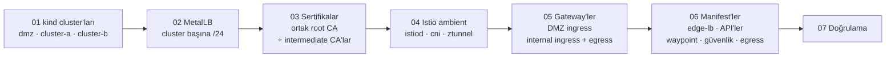
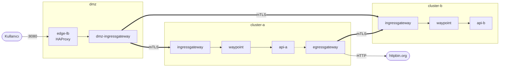

# 00 · Temel Kurulum

| | |
|---|---|
| **Branch** | `setup` (açıldığı yer: `main`) |
| **Commit'ler** | `cc9145e` temel kurulum · `2c13637` `.gitattributes` · `95ab362` README güncellemesi |
| **Durum** | ✅ Tamamlandı. Sorun 5-7'nin düzeltmeleri son tam kurulumdan sonra elle uygulanmıştı; sıfırdan doğrulaması [01-kiali](01-kiali.md) adımındaki sıfırlamayla yapıldı ✅ |

## Amaç

OpenShift benzeri bir kurumsal yapıyı yerelde simüle etmek: dış dünyaya açık bir DMZ cluster'ı, iki internal cluster ve Istio ambient mesh. Cluster'lar arası trafik yalnızca gateway'ler üzerinden, mTLS ile akar.

## Yapılanlar



| Adım | Script | Ne yapar |
|------|--------|----------|
| 1 | `01-create-clusters.sh` | 3 kind cluster'ı (her biri 1 control-plane + 1 worker; `01-kiali` adımında RAM nedeniyle tek node'a geçildi) ve Gateway API CRD'leri (v1.6.0) |
| 2 | `02-install-metallb.sh` | MetalLB v0.16.1; dmz `172.18.200.x`, cluster-a `.201.x`, cluster-b `.202.x` |
| 3 | `03-generate-certs.sh` | Ortak root CA ve her cluster için intermediate CA; `istio-system/cacerts` secret'ı |
| 4 | `04-install-istio.sh` | Istio 1.30.7 ambient: base, istiod, istio-cni (nftables), ztunnel |
| 5 | `05-install-gateways.sh` | `dmz-ingressgateway` (LB .200.10); cluster-a/b'de `istio-ingressgateway` (LB .201.10 / .202.10) ve `istio-egressgateway` |
| 6 | `06-deploy-manifests.sh` | `manifests/<cluster>/*.yaml` dosyalarını sırayla uygular |
| 7 | `07-verify.sh` | 4 trafik akışını uçtan uca test eder |

## Eklenen dosyalar

```
config.env                     # sürümler, mesh id, trust domain, IP planı
clusters/{dmz,cluster-a,cluster-b}.yaml
infra/metallb/ipaddresspool.yaml
istio/values/{istiod,cni,ztunnel,ingress-gateway,egress-gateway}.yaml
manifests/dmz/{00-namespaces,10-edge-lb,20-public-gateway,30-internal-clusters}.yaml
manifests/cluster-a/{00-namespaces,10-api-a,20-waypoint,30-internal-gateway,40-security,50-egress}.yaml
manifests/cluster-b/{00-namespaces,10-api-b,20-waypoint,30-internal-gateway,40-security,50-egress}.yaml
scripts/{lib,setup,00-check-prereqs,01..07,99-destroy}.sh
.gitignore  .gitattributes  README.md
```

## Ortaya çıkan yapı



Ayrıntılı akışlar ve güvenlik modeli: [README → Trafik akışları](../README.md#trafik-akışları-adım-adım).

## Karşılaşılan sorunlar ve çözümler

| # | Belirti | Sebep | Çözüm | Değişen dosya |
|---|---------|-------|-------|---------------|
| 1 | `kind` config dosyasını bulamıyor (`/c/Users/...`) | `MSYS_NO_PATHCONV=1`, Windows exe'lerine giden yol çevirisini de kapatıyor | `ROOT_DIR` için `pwd -W` | `scripts/lib.sh` |
| 2 | Worker node'da `kubelet not healthy` | kubelet `node-role.kubernetes.io/*` etiketini kendine ekleyemez | Etiket `node-role: infra/worker` yapıldı | `clusters/*.yaml` |
| 3 | `chart base matching 1.31.3 not found` | Istio 1.31 GA chart'ları Helm reposunda yayınlanmamış | `ISTIO_VERSION=1.30.7` | `config.env` |
| 4 | Pod'lar `ContainerCreating`'de kalıyor, `CONNMARK not supported` | WSL2 kernel'inde `xt_CONNMARK` modülü yok; istio-cni iptables kurallarını yazamıyor | `global.nativeNftables: true`. Ayrıca cluster'ların yeniden kurulması gerekti: CNI, iptables kalıntısı görünce nftables'a geçmiyor | `istio/values/cni.yaml`, `istiod.yaml` |
| 5 | `image has non-numeric user` | İmajlar kullanıcıyı isimle tanımlıyor, `runAsNonRoot` doğrulanamıyor | `runAsUser` sayısal verildi (haproxy=99, podinfo=100) | `10-edge-lb.yaml`, `10-api-*.yaml` |
| 6 | Waypoint `PROGRAMMED=False` | Istio'nun ürettiği waypoint pod'u `restricted` Pod Security'yi ihlal ediyor (seccomp yok) | Gateway `infrastructure.parametersRef` → ConfigMap ile seccomp | `20-waypoint.yaml` |
| 7 | Egress gateway'de `filter_chain_not_found`, waypoint 503 | Waypoint Istio'nun iç SNI'ını gönderiyor; Gateway server hosts eşleşmiyor | Egress Gateway server `hosts: ["*"]` | `50-egress.yaml` |

## Doğrulama

`07-verify.sh` (o zamanki adıyla) sonucu:

| # | Test | Sonuç |
|---|------|-------|
| 1 | `localhost:8080` → api-a | ✅ `"api-a @ cluster-a"` |
| 2 | `localhost:8080` → api-b | ✅ `"api-b @ cluster-b"` |
| 3 | api-a → egress → cluster-b → api-b (`/api/echo`) | ✅ `"merhaba"` |
| 4 | api-a → egress → httpbin.org | ✅ `X-Envoy-Peer-Metadata-Id` = istio-egressgateway |
| – | Mesh dışından internal gateway'e doğrudan erişim | ✅ TLS handshake reddedildi |

## Bilinen kısıtlar

- DMZ girişi düz HTTP; TLS yol haritasında.
- `outboundTrafficPolicy` = `ALLOW_ANY`; egress gateway'den geçmek zorunlu değil.
- Ortak trust domain yüzünden cluster-b, kendi egress gateway'ini cluster-a'nınkinden ayıramıyor.
