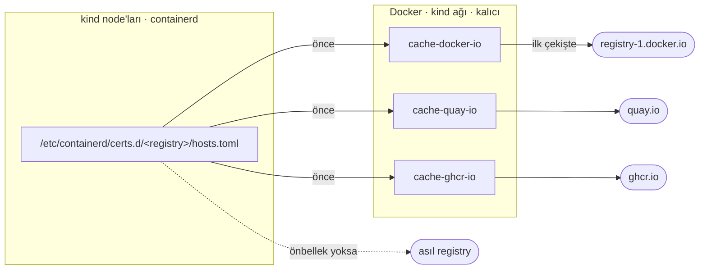
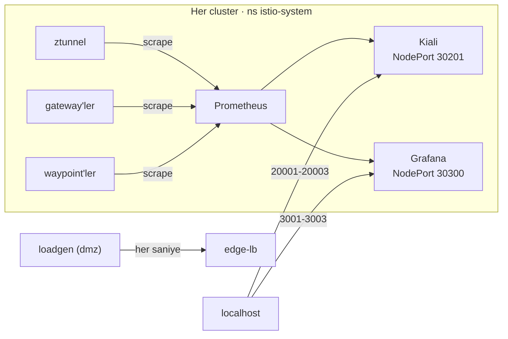

# 01 · Gözlemlenebilirlik: Kiali, Prometheus, Grafana

| | |
|---|---|
| **Branch** | `kiali` (açıldığı yer: `setup`) |
| **Durum** | ✅ Tamamlandı. İki kez sıfırdan doğrulandı: önce 3 cluster × 2 node, sonra tek node + cluster-b kapalı |

## Amaç

Mesh trafiğini görsel olarak izlemek: hangi servis kimi çağırıyor, istek/sn, hata oranı, mTLS. Sonraki adımlarda (token exchange vb.) sorun ayıklamayı da hızlandırır.

## Yapılanlar

- Her cluster'a Istio'nun **Prometheus** ve **Grafana** addon'ları kuruldu (Istio 1.30 `samples/addons`).
- Her cluster'a **Kiali 2.26.0** kuruldu (Istio 1.30 addon'undaki sürüm). Kimlik doğrulama `anonymous`, Prometheus ve Grafana bağlantıları yapılandırıldı.
- Kiali (NodePort 30201) ve Grafana (NodePort 30300), kind `extraPortMappings` ile host'a açıldı.
- DMZ'ye sürekli trafik üreten bir **loadgen** eklendi. Her saniye Akış 1, 2 ve 3'ü tetikliyor, her 10 turda bir `api-b /status/500` çağırıyor. (cluster-b kapatıldıktan sonra hedefler `LOADGEN_HOSTS` ile belirleniyor; varsayılan yalnızca api-a.)
- Doğrulama script'i `08-verify.sh` olarak yeniden adlandırıldı ve Kiali/Grafana erişim kontrolü eklendi.
- **Registry önbelleği (pull-through cache)** eklendi. Her cluster image'ları internetten ayrı ayrı çektiği için gözlemlenebilirlik kurulumu zaman aşımına düşüyordu (bkz. sorun 3). Docker'da cluster'lardan bağımsız 3 kalıcı registry container'ı çalışıyor (`cache-docker-io`, `cache-quay-io`, `cache-ghcr-io`) ve kind node'larındaki containerd image'ları bunlardan çekiyor. Önbellek sıfırlamalarda silinmediği için her image internetten yalnızca bir kez iniyor.
- `99-destroy.sh`, kind silemediği container'ları artık doğrudan kaldırıyor (bkz. sorun 4).
- **cluster-b şimdilik kapatıldı** (ara düzeltme, bkz. sorun 9). Aktif cluster'lar `dmz` ve `cluster-a`; mgmt 04. adımda, cluster-b yol haritasının son adımında (17) gelecek. Geri eklemeyi kolaylaştırmak için cluster-b'ye bağlı tanımlar ayrı klasörlere taşındı ve yalnızca `CLUSTERS` listesinde cluster-b varken uygulanıyor:

  | Taşınan | Nereden | Nereye |
  |---------|---------|--------|
  | DMZ'deki api-b rotası (VirtualService) | `dmz/20-public-gateway.yaml` | `dmz/cluster-b/21-api-b-route.yaml` |
  | DMZ → cluster-b gateway (ServiceEntry + DestinationRule) | `dmz/30-internal-clusters.yaml` | `dmz/cluster-b/31-cluster-b-gateway.yaml` |
  | loadgen'in api-b hedefi | `dmz/40-loadgen.yaml` (sabit) | `dmz/cluster-b/39-loadgen-targets.yaml` (`LOADGEN_HOSTS` ConfigMap) |
  | api-a'nın backend adresi | `cluster-a/10-api-a.yaml` (`--backend-url`) | `cluster-a/cluster-b/05-api-a-backend.yaml` (`PODINFO_BACKEND_URL` ConfigMap, `envFrom optional`) |
  | api-a → egress → cluster-b | `cluster-a/50-egress.yaml` | `cluster-a/cluster-b/51-egress-cluster-b.yaml` |

  `06-deploy-manifests.sh` ana klasörle `cluster-b/` alt klasörünü dosya numaralarına göre birlikte sıralar (ör. `05-api-a-backend.yaml`, `10-api-a.yaml`'dan önce uygulanır). `05-install-gateways.sh` ve `08-verify.sh` de cluster listesine bağlı hale getirildi.
- **Tek node'lu cluster'lara geçildi** (ara düzeltme, bkz. sorun 9). İlk doğrulamadan sonra makinenin belleği tükendi; her cluster'dan worker node kaldırıldı, `zone` ve `node-role` etiketleri control-plane'e taşındı. kind, worker yoksa control-plane taint'ini kaldırdığı için tüm pod'lar o node'da çalışıyor. Kaynak yeterli olduğunda 2 node'a çıkılacak.

### Erişim adresleri

| Cluster | Kiali | Grafana |
|---------|-------|---------|
| dmz | http://localhost:20001/kiali | http://localhost:3001 |
| cluster-a | http://localhost:20002/kiali | http://localhost:3002 |
| cluster-b | http://localhost:20003/kiali | http://localhost:3003 |

## Değişen dosyalar

| Dosya | Değişiklik |
|-------|------------|
| `config.env` | `KIALI_VERSION=2.26.0`; `kiali_port()` ve `grafana_port()` yardımcıları; `REGISTRY_IMAGE`, `REGISTRY_MIRRORS` |
| `clusters/dmz.yaml` | `extraPortMappings`: 30201→20001, 30300→3001; `containerdConfigPatches` (registry `config_path`); worker kaldırıldı, `node-role: infra` control-plane'e |
| `clusters/cluster-a.yaml` | `extraPortMappings`: 30201→20002, 30300→3002; `containerdConfigPatches`; worker kaldırıldı, `node-role: worker` control-plane'e |
| `clusters/cluster-b.yaml` | `extraPortMappings`: 30201→20003, 30300→3003; `containerdConfigPatches`; worker kaldırıldı, `node-role: worker` control-plane'e |
| `scripts/lib.sh` | `start_registry_caches`, `configure_node_mirrors`, `cache_name`, `http_code`, `has_cluster`, `internal_clusters` |
| `scripts/01-create-clusters.sh` | Cluster'lardan sonra önbellek container'larını başlatır, node'lara mirror tanımlarını yazar |
| `scripts/02-install-metallb.sh` | IP havuzu, MetalLB webhook'u hazır olana kadar yeniden deneniyor (sorun 10) |
| `scripts/05-install-gateways.sh` | Internal gateway'ler sabit liste yerine `internal_clusters` ile |
| `scripts/06-deploy-manifests.sh` | `cluster-b/` alt klasörleri yalnızca cluster-b aktifken, numara sırasıyla |
| `scripts/08-verify.sh` | Akış 2 ve 3 yalnızca cluster-b aktifken |
| `scripts/99-destroy.sh` | kind silemezse kalan container'ları doğrudan siler; `--cache` ile önbelleği de siler; `clusters/` altında tanımlı tüm cluster'ları (kapalı olanlar dahil) siler |
| `config.env` | `CLUSTERS="dmz cluster-a"` |
| `manifests/dmz/*`, `manifests/cluster-a/*` | cluster-b'ye bağlı kısımlar `cluster-b/` alt klasörlerine taşındı (yukarıdaki tablo) |
| `istio/values/kiali.yaml` | **Yeni.** Kiali Helm değerleri (anonymous, NodePort, Prometheus/Grafana URL'leri) |
| `istio/values/{istiod,cni,ztunnel}.yaml` | `hub: docker.io/istio` (registry.istio.io yerine; önbellek uyumu) |
| `infra/observability/grafana-nodeport.yaml` | **Yeni.** Grafana için NodePort servisi (addon ClusterIP geliyor) |
| `manifests/dmz/40-loadgen.yaml` | **Yeni.** `loadgen` namespace'i ve curl döngüsü |
| `scripts/07-install-observability.sh` | **Yeni.** Prometheus + Grafana addon'ları, NodePort, Kiali Helm kurulumu |
| `scripts/07-verify.sh` → `scripts/08-verify.sh` | Yeniden adlandırıldı; 6. test olarak Kiali/Grafana erişim kontrolü |
| `scripts/setup.sh` | `07-install-observability.sh` adımı eklendi |
| `README.md` | Gözlemlenebilirlik bölümü, sürüm tablosu, bileşenler, dizin yapısı, yol haritası |

## Kiali'de görülenler

Mevcut cluster'larda, loadgen çalışırken Kiali API'sinden alınan graph:

| Cluster | Kenar | Trafik |
|---------|-------|--------|
| dmz | `dmz-ingressgateway` → `cluster-a-gateway` | HTTP ~1.4 rps |
| dmz | `dmz-ingressgateway` → `cluster-b-gateway` | HTTP ~0.75 rps, ~%9 hata |
| cluster-a | `istio-ingressgateway` → `waypoint` | HTTP ~1.4 rps, mTLS |
| cluster-a | `istio-ingressgateway` → `api-a` | HTTP ~1.4 rps, mTLS |
| cluster-a | `api-a` → `waypoint` | TCP ~180 B/s, mTLS (ztunnel) |
| cluster-a | `api-a` → `istio-egressgateway` | HTTP ~0.7 rps, mTLS |
| cluster-a | `istio-egressgateway` → `cluster-b-gateway` | HTTP ~0.7 rps |
| cluster-b | `istio-ingressgateway` → `waypoint` → `api-b` | HTTP ~1.45 rps, ~%5 hata, mTLS |

Okurken dikkat edilecekler:
- **Cluster'lar arası hedefler ServiceEntry adıyla görünür** (`cluster-a-gateway`, `cluster-b-gateway`) ve mTLS kilidi taşımaz. Trafik yine de `ISTIO_MUTUAL` ile şifrelidir.
- **Gateway'e gelen trafiğin kaynağı görünmez.** DMZ'de HAProxy düğümü yoktur; cluster-b'de trafiğin bir kısmının cluster-a egress'inden geldiği ayrıca görünmez.
- **Üç cluster tek grafikte birleşmez.** Cluster'lar bağımsız mesh'ler olduğu için her Kiali yalnızca kendi cluster'ını gösterir.

## Karşılaşılan sorunlar ve çözümler

| # | Belirti | Sebep | Çözüm | Değişen dosya |
|---|---------|-------|-------|---------------|
| 1 | Kurulum çok uzun sürdü, Prometheus probe'ları zaman aşımına uğradı | İlk kurulumda image'lar her cluster'a ayrı ayrı çekiliyor (cluster başına ~5 dk) | Bekleme süreleri 300 sn'ye çıkarıldı | `07-install-observability.sh` |
| 2 | DMZ ve cluster-b Kiali'sinde graph boş, Prometheus'ta veri var | Büyük olasılıkla Kiali, Prometheus hazır olmadan açıldı; Kiali yeniden başlatılınca düzeldi | Script, Kiali'yi Prometheus ve Grafana hazır olduktan **sonra** kuracak şekilde sıralandı | `07-install-observability.sh` |
| 3 | Sıfırdan kurulumda cluster-a'nın Prometheus'u 300 sn'de hazır olmadı (`timed out`), Grafana "failed to load its application files" verdi | Her cluster aynı image'ları internetten ayrı ayrı çekiyor; o sırada CPU da çok yoğun (DMZ node'ları %130). Prometheus image'ı tek başına 2,5 dk sürdü | Önce image'ları `kind load` ile önceden yüklemek denendi: tek image 3 cluster'a 10 dk'da yüklenemedi, vazgeçildi. Bunun yerine **registry önbelleği** kuruldu | `lib.sh`, `01-create-clusters.sh`, `clusters/*.yaml`, `config.env` |
| 4 | Sıfırlamada `kind delete` başarısız: `did not receive an exit event` | Docker Desktop container'ları zamanında durduramadı; kalan container'lar yüzünden `setup.sh` cluster'ları "zaten var" sanıyordu | `99-destroy.sh` kalan container'ları `io.x-k8s.kind.cluster` etiketiyle bulup siliyor | `99-destroy.sh` |
| 5 | Registry önbelleği boş kaldı (4 KB); image'lar yine internetten çekildi | Mirror tanımları node'lara heredoc ile `docker exec` üzerinden yazılıyordu; `-i` olmadan stdin aktarılmadığı için **`hosts.toml` dosyaları boş** oluşmuştu. (Önce containerd 2.x'in transfer servisinden şüphelenildi; test sonucunda CRI `config_path` ayarının yeterli olduğu görüldü) | `docker exec -i` | `lib.sh` |
| 6 | `cache-docker-io` Istio kurulduktan sonra da boş | Istio 1.30 image'larını varsayılan olarak **`registry.istio.io`**'dan çekiyor. Bu registry için önbellek eklendi, ancak `registry:2` proxy'si onun yanıtlarında `Content-Length` olmadığı için blob'ları önbelleğe yazamadı | Istio image'ları **`docker.io/istio`**'dan çekiliyor (aynı image'lar orada da yayınlanıyor): `global.hub` (istiod, cni) ve `hub` (ztunnel). Gateway ve waypoint proxy'leri istiod'nin hub'ını kullanıyor | `istio/values/{istiod,cni,ztunnel}.yaml`, `config.env` |
| 7 | 07. adım `exit 23` ile durdu | Git Bash'teki `curl` yerel bir Windows programı (`/mingw64/bin/curl`). `MSYS_NO_PATHCONV=1` yüzünden `mktemp`'in verdiği `/tmp/...` yolu çevrilmedi, curl dosyayı yazamadı | Geçici klasör `pwd -W` ile Windows biçiminde alınıyor | `07-install-observability.sh` |
| 8 | `08-verify.sh` 6. testte `exit 23` | Aynı sebep: curl `-o /dev/null` yoluna yazamadı | `http_code` yardımcısı curl'ü `env -u MSYS_NO_PATHCONV` ile çalıştırıyor | `lib.sh`, `08-verify.sh` |
| 9 | Doğrulamadan ~2 saat sonra Kiali/Grafana 5-10 sn'de yanıt veriyor, zaman aşımına düşüyor; cluster-b'nin kube-apiserver'ı çöküp yeniden başladı | **Bellek tükendi.** Fiziksel RAM 15,7 GB, WSL'e 12 GB ayrılmış; Windows'ta 0,2 GB, Docker VM'inde ~0,2 GB boş kaldı. CPU ~%1100. 6 kind node'u + Docker Desktop'ın kendi Kubernetes'i (eski bir Istio ile) + cluster başına Prometheus/Grafana/Kiali + loadgen | Tek node'lu cluster'lar; **cluster-b şimdilik kapatıldı** (yol haritasının sonunda geri gelecek); Docker Desktop Kubernetes'inin kapatılması önerildi (kullanıcı yapar). README'ye "Kaynak kısıtları" bölümü eklendi | `clusters/*.yaml`, `config.env`, `manifests/`, `scripts/`, `README.md` |
| 10 | Tek node'la ilk kurulumda MetalLB IP havuzu oluşturulamadı: `failed calling webhook "ipaddresspoolvalidationwebhook.metallb.io"` | Image'lar önbellekten hızlı gelince controller `Available` oldu ama webhook henüz istek kabul etmiyordu (yarış durumu) | IP havuzu uygulaması 60 sn'ye kadar 2 sn aralıklarla yeniden deneniyor | `02-install-metallb.sh` |

## Doğrulama

Sıfırdan kurulum: `99-destroy.sh` → `setup.sh` (adım 1-6) → `07-install-observability.sh` → `08-verify.sh`.

> 07. adım ilk denemede curl'ün geçici dosya yolunu yazamaması yüzünden durdu (sorun 7). Düzeltildikten sonra 07 ve 08, aynı turda sıfırdan kurulan cluster'larda script ile çalıştırıldı; arada elle hiçbir değişiklik yapılmadı.

| Test | Sonuç |
|------|-------|
| Akış 1: `localhost:8080` → api-a | ✅ `api-a @ cluster-a` |
| Akış 2: `localhost:8080` → api-b | ✅ `api-b @ cluster-b` |
| Akış 3: api-a → egress → cluster-b → api-b | ✅ |
| Akış 4: api-a → egress → httpbin.org | ✅ `X-Envoy-Peer-Metadata-Id` = istio-egressgateway |
| Kiali erişimi (20001 / 20002 / 20003) | ✅ 200 / 200 / 200 |
| Grafana erişimi (3001 / 3002 / 3003) | ✅ 200 / 200 / 200 |
| Kiali graph'larının dolu gelmesi | ✅ dmz 2, cluster-a 6, cluster-b 3 kenar (Kiali, Prometheus'tan sonra kurulunca ilk seferde dolu) |
| Istio image kaynağı | ✅ üç cluster'da `docker.io/istio` |
| Registry önbelleği | ✅ docker.io 145 MB, quay.io 103 MB, ghcr.io 86 MB |

Süreler (önbellek ilk kez dolarken):

| Bölüm | Süre |
|-------|------|
| Adım 1-6 (cluster'lar → uygulamalar) | 20 dk |
| Adım 7 (Prometheus, Grafana, Kiali; image'lar ilk kez iniyor) | 15 dk |

### İkinci doğrulama: tek node + cluster-b kapalı

Sorun 9 ve 10'un düzeltmelerinden sonra yeniden sıfırdan kurulum (`99-destroy.sh` → `setup.sh`, tek seferde, elle müdahale yok). Docker Desktop'ın kendi Kubernetes'i de kapatılmıştı.

| Test | Sonuç |
|------|-------|
| Akış 1: `localhost:8080` → api-a | ✅ `api-a @ cluster-a` |
| Akış 2 ve 3 | ⏸️ cluster-b kapalı, atlandı. api-a `/api/echo` backend olmadan yanıt veriyor ✅ |
| Akış 4: api-a → egress → httpbin.org | ✅ |
| Kiali (20001 / 20002), Grafana (3001 / 3002) | ✅ 200, ~0,2 sn |
| Kiali graph'ları | ✅ dmz: `dmz-ingressgateway → cluster-a-gateway`; cluster-a: `istio-ingressgateway → waypoint → api-a` (mTLS) |

| Ölçüm | İlk doğrulama (3 cluster × 2 node) | İkinci doğrulama (2 cluster × 1 node) |
|-------|-----------------------------------|---------------------------------------|
| Kurulum süresi | 20 dk + 15 dk (önbellek ilk kez doluyordu) | **7 dk** (önbellekten) |
| kind node'larının belleği | ~5,6 GB | ~4,6 GB (gözlemlenebilirlik dahil; 2 node) |
| Docker VM'inde kullanılabilir bellek | ~4 GB (0,2 GB boş) | ~6,7 GB |
| Docker CPU | ~%1100 | ~%42 |
| Kiali/Grafana yanıt süresi | 5-10 sn, zaman aşımı | ~0,2 sn |

## Bilinen kısıtlar

- Kiali `anonymous` ve Grafana anonim admin yalnızca lab içindir.
- Dağıtık izleme (Jaeger/Tempo) bu adıma dahil değil. Uygulamaların trace header'larını aktarması gerektiği için token exchange adımından sonraya bırakıldı.
- Akış 4 (httpbin.org) dış servisi yormamak için loadgen'de yok.
