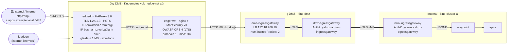

# 02 · Zone'lar: Edge, WAF, TLS ve Tek Kapı

| | |
|---|---|
| **Branch** | `zones` (açıldığı yer: `kiali`) |
| **Durum** | ✅ Tamamlandı, sıfırdan kurulumla doğrulandı (20/20 test) |

## Amaç

Hedef katman modeline geçmek ([README → Hedef katman modeli](../README.md#hedef-katman-modeli-planlanan)):

| Katman | Önce | Sonra |
|--------|------|-------|
| **Dış DMZ (edge)** | HAProxy, DMZ cluster'ının içinde bir pod; düz HTTP; WAF yok | Kubernetes **dışında** Docker container'ları: HAProxy (TLS, limitler, header temizliği) + WAF (ModSecurity + OWASP CRS) |
| **İç DMZ (dmz cluster)** | Host'a 8080/8443 açık; ingress gateway internal'a doğrudan gidiyor | Host'a uygulama portu yok; internal'a giden her şey **DMZ egress gateway**'den çıkıyor |
| **Internal (cluster-a)** | `dmz-ingressgateway` kimliğini kabul ediyor | Yalnızca **`dmz-egressgateway`** kimliğini kabul ediyor |

## Yeni yapı

**Ağ ayrımı:** `edge-lb` ve `loadgen` yalnızca `edge-net` Docker ağındadır, cluster'lara erişemezler. `kind` ağına (cluster'ların olduğu ağ) yalnızca `edge-waf` bağlanır. Bu, "edge'den DMZ'ye yalnızca ingress portu açık" ilkesinin lab'daki karşılığıdır.

## Adım sonundaki durum

| Konu | Durum |
|------|-------|
| Cluster'lar | Değişmedi: `dmz`, `cluster-a` (tek node); cluster-b kapalı |
| Dış DMZ (edge) | **Yeni:** Kubernetes dışında 3 Docker container'ı: `edge-lb` (HAProxy), `edge-waf` (ModSecurity + OWASP CRS), `loadgen`. Ayrı `edge-net` ağı |
| Giriş | **`https://api-a.apps.example.local:8443`** (TLS 1.2+/1.3, HSTS). `:8080` yalnızca HTTPS'e 301 yönlendirmesi yapıyor |
| DMZ cluster | Host'a uygulama portu yok. `dmz-ingressgateway` + **yeni `dmz-egressgateway`** |
| Zone geçişi | **dmz-ingress → dmz-egress → internal**, her iki aşama mTLS. Internal yalnızca `dmz-egressgateway` kimliğini kabul ediyor |
| Çalışan akışlar | 1 ve 4 (2 ve 3 cluster-b ile askıda) |
| Gözlemlenebilirlik | Değişmedi (cluster başına Kiali/Grafana) |
| Test kapsamı | `08-verify.sh` ✔/✘ özetli; edge, WAF, header, hız sınırı ve "tek kapı" negatif testleri eklendi |

## Önceki adıma göre değişenler

| Değişiklik | Neden |
|------------|-------|
| HAProxy DMZ cluster'ından çıkarılıp Docker container'ına taşındı | Hedef modelde dış DMZ "Kubernetes olmayan bir appliance". İnternet paketini yalnızca edge almalı; DMZ cluster'ı doğrudan internete açık olmamalı |
| WAF eklendi | OWASP Top 10 saldırı kalıplarını (SQLi, XSS vb.) uygulamaya ulaşmadan engellemek (güvenlik analizi katman 2) |
| Giriş HTTP'den HTTPS'e geçti; HSTS eklendi | Token ve kişisel veri düz metin taşınmamalı (katman 1-2) |
| Dış header'lar siliniyor, yeniden yazılıyor | İstemcinin sahte IP (`X-Forwarded-For`) veya sahte kimlik (`x-user-jwt`) göndermesini engellemek |
| IP başına hız/bağlantı sınırı, slow-loris ve boyut limitleri | Basit DoS ve kaba kuvvet denemelerine karşı edge'de ilk savunma |
| Ayrı `edge-net` Docker ağı | Edge'den DMZ'ye yalnızca tek yolun açık olması ilkesinin simülasyonu: HAProxy cluster'lara erişemez, yalnızca WAF erişir |
| `dmz-egressgateway` eklendi; DMZ ingress internal'a doğrudan gitmiyor | Zone geçişinde tek kapı: internal'a giden tüm trafik tek, denetlenebilir bir kimlikten çıksın |
| Internal AuthZ `dmz-ingressgateway` → `dmz-egressgateway` | Tek kapı kuralının internal tarafta zorlanması; DMZ'deki başka hiçbir bileşen internal'a giremez |
| loadgen DMZ cluster'ından edge-net'e taşındı | Gerçek bir internet istemcisi gibi edge'in önünden gelsin; DMZ'nin edge'e istek atması mantıksızdı |
| Edge için ayrı "public" CA | Gerçekte internet sertifikası genel bir CA'dan gelir; kurumsal mesh CA'sı dışarıya gösterilmez |
| `08-verify.sh` baştan yazıldı | Yeni güvenlik kontrollerinin her birinin, olumsuz senaryolar dahil, otomatik doğrulanması |

## Eklenen bileşenler

| Bileşen | Amacı | Neden gerekli | Muadilleri | Neden bu seçildi |
|---------|-------|---------------|------------|------------------|
| **edge-lb** (HAProxy 3.0, Docker) | Edge yük dengeleyici: TLS sonlandırma, HSTS, limitler, header temizliği | İnternetle DMZ arasındaki ilk katman | F5 BIG-IP, Citrix ADC, nginx, Envoy, Traefik | Kurumsal ortamlarda yaygın, açık kaynak, hafif; TLS, stick-table ile hız sınırı ve header yönetimi yerleşik |
| **edge-waf** (OWASP ModSecurity CRS 4.25 LTS, nginx) | Web uygulama güvenlik duvarı | Bilinen saldırı kalıplarını engellemek; kritik açıklar için sanal yama | Coraza (+ HAProxy SPOA veya Envoy WASM), F5 Advanced WAF, Imperva, Cloudflare WAF, open-appsec, NAXSI | OWASP'ın resmi, LTS sürümlü image'ı; ortam değişkenleriyle yapılandırılıyor. Coraza aynı CRS kurallarını kullanır, ama HAProxy entegrasyonu (SPOE) daha karmaşık. Ticari WAF'lar lab için uygun değil |
| **dmz-egressgateway** (Istio gateway) | DMZ'den internal'a giden tek kapı | Zone geçişini tek kimlik ve tek noktadan denetlemek, loglamak | DMZ ingress'ten doğrudan gitmek (önceki durum), egress olarak waypoint kullanmak | Istio'nun klasik egress kalıbı; internal tarafta tek kimlik üzerinden AuthZ yazılabiliyor |
| **edge-net** (Docker ağı) | Edge container'larının ayrı ağı | Edge'den DMZ'ye yalnızca WAF üzerinden yol olsun | Gerçek firewall, iptables kuralları, VLAN | Docker'ın yerleşik özelliği; ek araç gerektirmiyor |
| **Lab Public CA + `*.apps.example.local` sertifikası** | Edge TLS sertifikası | HTTPS için sunucu sertifikası | Let's Encrypt (gerçek alan adı gerekir), mkcert, cert-manager | Gerçek alan adı olmadan çalışır; mesh CA'sından bilinçli olarak ayrı |

## Yapılanlar

### 1. Edge Kubernetes dışına alındı (`scripts/06b-deploy-edge.sh`)

| Container | Image | Görev |
|-----------|-------|-------|
| `edge-lb` | `haproxy:3.0-alpine` | Host `8080` → HTTPS'e 301; host `8443` → TLS sonlandırma ([edge/haproxy.cfg](../edge/haproxy.cfg)) |
| `edge-waf` | `owasp/modsecurity-crs:4.25.2-nginx-alpine-…-lts` | ModSecurity v3 + OWASP CRS 4; DMZ ingress gateway'in LB IP'sine proxy |
| `loadgen` | `curlimages/curl:8.11.1` | İnternet istemcisi simülasyonu; DMZ cluster'ından çıkarıldı |

HAProxy'deki kontroller:

| Kontrol | Ayar |
|---------|------|
| TLS | `ssl-min-ver TLSv1.2`, yalnızca ECDHE + AEAD cipher'lar, TLS 1.3 suite'leri, `no-tls-tickets` |
| HSTS | `Strict-Transport-Security: max-age=63072000; includeSubDomains; preload` |
| HTTP → HTTPS | 301 yönlendirme |
| Header temizliği | `X-Forwarded-For/Host/Proto/Port`, `X-Real-IP`, `Forwarded`, `x-user-jwt` silinir; `X-Forwarded-For` ve `X-Forwarded-Proto: https` yeniden yazılır |
| Hız sınırı | IP başına 10 sn'de 100 istek → 429 |
| Bağlantı sınırı | IP başına 50 eşzamanlı bağlantı |
| Slow-loris | `timeout http-request 5s` |
| Boyut | `Content-Length` > 1 MB → 413; `Host` yoksa 400 |

### 2. Edge sertifikası (`scripts/03-generate-certs.sh`)

`*.apps.example.local` için sertifika, mesh CA'sından **ayrı** bir "Lab Public CA" ile imzalanır (`certs/edge/`). Gerçekte bu sertifika genel bir CA'dan gelir; kurumsal mesh CA'sı internete hiç gösterilmez. İstemciler `certs/edge/ca.pem` ile doğrular.

### 3. DMZ egress gateway: zone geçişinde tek kapı

- `dmz-egressgateway` (`istio-egress` namespace'i) kuruldu.
- DMZ ingress gateway'in VirtualService'i artık internal cluster'a değil egress gateway'e gidiyor ([20-public-gateway.yaml](../manifests/dmz/20-public-gateway.yaml)).
- Egress gateway'de `zone-exit` Gateway'i, host'a göre internal cluster'a yönlendiriyor ([30-internal-clusters.yaml](../manifests/dmz/30-internal-clusters.yaml)).
- Egress gateway'e yalnızca `dmz-ingressgateway` kimliği girebilir (AuthorizationPolicy).

### 4. Internal AuthZ sıkılaştırıldı

- cluster-a'nın ingress gateway'i yalnızca `corp.mesh/ns/istio-egress/sa/dmz-egressgateway` kimliğini kabul ediyor ([30-internal-gateway.yaml](../manifests/cluster-a/30-internal-gateway.yaml)).
- cluster-b aktifken onun egress'i ayrı bir ALLOW politikasıyla ekleniyor ([cluster-a/cluster-b/35-allow-cluster-b-egress.yaml](../manifests/cluster-a/cluster-b/35-allow-cluster-b-egress.yaml)); internal zone içinde A↔B serbest kararı.

### 5. İstemci IP'sinin doğru okunması

DMZ ingress gateway'in önünde iki proxy var (HAProxy + WAF). `numTrustedProxies: 2` ile Envoy, istemci IP'sini `X-Forwarded-For`'dan doğru okur ([ingress-gateway-dmz.yaml](../istio/values/ingress-gateway-dmz.yaml)).

## Değişen dosyalar

| Dosya | Değişiklik |
|-------|------------|
| `edge/haproxy.cfg` | **Yeni.** Edge LB yapılandırması |
| `scripts/06b-deploy-edge.sh` | **Yeni.** edge-net ağı, edge-waf, edge-lb, loadgen container'ları |
| `tests/zone-direct-path.yaml` | **Yeni.** "Tek kapı" negatif testi için geçici rota |
| `istio/values/ingress-gateway-dmz.yaml` | **Yeni.** `numTrustedProxies: 2` |
| `config.env` | Edge image'ları, `WAF_MODE`, `EDGE_NETWORK` |
| `scripts/03-generate-certs.sh` | Edge CA ve `*.apps.example.local` sertifikası |
| `scripts/05-install-gateways.sh` | `dmz-egressgateway`; DMZ ingress için ek values dosyası |
| `scripts/06-deploy-manifests.sh` | edge-lb bekleme satırı kaldırıldı |
| `scripts/08-verify.sh` | Baştan yazıldı: HTTPS, edge, WAF, header, hız sınırı ve tek kapı testleri; ✔/✘ özeti |
| `scripts/99-destroy.sh` | Edge container'larını ve edge-net ağını siler |
| `scripts/setup.sh` | `06b-deploy-edge.sh` adımı |
| `clusters/dmz.yaml` | 8080/8443 port mapping'leri kaldırıldı |
| `manifests/dmz/00-namespaces.yaml` | `edge-lb` namespace'i kaldırıldı, `istio-egress` eklendi |
| `manifests/dmz/20-public-gateway.yaml` | api-a → `dmz-egressgateway` + DestinationRule |
| `manifests/dmz/30-internal-clusters.yaml` | Egress tarafına taşındı: `zone-exit` Gateway, AuthZ, cluster-a ServiceEntry/DR/VS |
| `manifests/dmz/cluster-b/*` | api-b rotası ve cluster-b çıkışı egress üzerinden |
| `manifests/dmz/10-edge-lb.yaml`, `40-loadgen.yaml`, `cluster-b/39-loadgen-targets.yaml` | **Silindi** (Kubernetes dışına taşındı) |
| `manifests/cluster-a/30-internal-gateway.yaml` | AuthZ: yalnızca `dmz-egressgateway` |
| `manifests/cluster-a/cluster-b/35-allow-cluster-b-egress.yaml` | **Yeni.** cluster-b egress'ine izin (cluster-b aktifken) |
| `manifests/cluster-b/30-internal-gateway.yaml` | AuthZ: `dmz-egressgateway` + `istio-egressgateway` |

## Tasarım kararları

- **WAF olarak Coraza yerine OWASP ModSecurity CRS image'ı.** README'de "HAProxy + Coraza" planlanmıştı. Coraza'nın HAProxy entegrasyonu (SPOE agent) daha karmaşık; OWASP'ın resmi, LTS sürümlü nginx + ModSecurity v3 image'ı ortam değişkenleriyle yapılandırılıyor ve aynı CRS kurallarını kullanıyor. Sonuçta zincirde her katman farklı bir yazılım: HAProxy → nginx/ModSecurity → Envoy.
- **WAF modu `On`.** Testlerde engellemeyi göstermek için. Gerçek ortamda önce `DetectionOnly` ile yanlış pozitifler ayıklanır, sonra `On`'a geçilir (`config.env` → `WAF_MODE`).
- **Edge → DMZ arası düz HTTP.** TLS edge'de sonlanıyor; WAF → DMZ ingress arası `kind` ağında şifresiz. Gerçek ortamda yeniden şifreleme (re-encrypt) yapılmalı; `hardening` adımında değerlendirilecek.
- **Egress gateway'de `hosts: ["*"]`.** Ingress gateway Istio'nun iç SNI'ını gönderdiği için host listesi kısıtlanamıyor (cluster-a egress'indeki durumla aynı). Erişim AuthorizationPolicy ile, yönlendirme VirtualService ile kontrol ediliyor.

## STRIDE tehdit modeli

Mevcut akışlar için. ✅ karşılanıyor, ⚠️ kısmen, ❌ açık (ve hangi adımda kapanacağı).

### Akış 1: İnternet → api-a

| Tehdit | Senaryo | Kontrol | Durum |
|--------|---------|---------|-------|
| **S**poofing (kimlik sahteciliği) | Saldırgan `X-Forwarded-For` ile başka bir IP gibi davranır | HAProxy dış header'ları siler ve yeniden yazar; Envoy `numTrustedProxies: 2` | ✅ |
| | Saldırgan `x-user-jwt` göndererek kullanıcı kimliği uydurur | HAProxy siler | ✅ (token exchange gelince imza doğrulaması da eklenecek) |
| | Saldırgan DMZ'yi atlayıp internal gateway'e bağlanır | Internal gateway yalnızca mesh sertifikalı `dmz-egressgateway` kimliğini kabul eder | ✅ |
| | Kullanıcı kimliği hiç doğrulanmıyor | – | ❌ `08 · token-exchange` |
| **T**ampering (değiştirme) | İstek yolda değiştirilir | İstemci ↔ edge TLS; DMZ ↔ internal mTLS | ⚠️ WAF → DMZ ingress arası düz HTTP (`hardening`) |
| **R**epudiation (inkâr) | İşlem yapıldığı inkâr edilir | Edge ve gateway access log'ları stdout'ta | ⚠️ merkezi ve değiştirilemez log yok (`10 · logging`) |
| **I**nformation disclosure (bilgi sızması) | Hata yanıtlarında iç bilgi | WAF `SERVER_TOKENS=off` | ⚠️ podinfo hostname döndürüyor, `server: istio-envoy` header'ı var (`hardening`) |
| | Zayıf TLS ile dinleme | TLS 1.2+, modern cipher'lar, HSTS | ✅ |
| **D**enial of service (hizmet engelleme) | İstek seli | IP başına hız (100/10 sn) ve bağlantı (50) sınırı | ✅ (volumetrik DDoS ➖) |
| | Slow-loris | `timeout http-request 5s` | ✅ |
| | Büyük gövde | 1 MB sınırı (HAProxy), CRS gövde sınırları | ✅ |
| **E**levation of privilege (yetki yükseltme) | SQLi / XSS / bilinen saldırı kalıpları | OWASP CRS (paranoia 1, engelleme modu) | ✅ |
| | DMZ ele geçirilirse internal'a erişim | Internal yalnızca egress kimliğini kabul eder; DMZ'de iş mantığı ve veri yok | ⚠️ ele geçirilmiş egress gateway yine geçebilir; kullanıcı token'ı katmanı `08`'de |

### Zone geçişi (DMZ → internal)

| Tehdit | Senaryo | Kontrol | Durum |
|--------|---------|---------|-------|
| S | DMZ'deki herhangi bir pod internal'a gitmeye çalışır | Internal AuthZ: yalnızca `dmz-egressgateway`; egress AuthZ: yalnızca `dmz-ingressgateway` | ✅ (negatif testle doğrulandı) |
| T | Zone'lar arası trafik değiştirilir | `ISTIO_MUTUAL` (kurumsal CA) | ✅ |
| I | Internal'dan DMZ'ye bağlantı açılır | AuthZ yön kısıtı | ⚠️ ağ seviyesinde engel yok (`hardening`: NetworkPolicy) |
| D | Egress gateway tek hata noktası | – | ⚠️ tek kopya (RAM kısıtı) |

### Akış 4: api-a → internet (egress)

| Tehdit | Senaryo | Kontrol | Durum |
|--------|---------|---------|-------|
| I | Ele geçirilmiş pod veriyi dışarı sızdırır | Egress gateway üzerinden çıkış | ❌ `ALLOW_ANY`: ServiceEntry'si olmayan adrese doğrudan çıkılabilir (`03 · hardening`: `REGISTRY_ONLY`) |
| T | Dış servis yanıtı değiştirilir | – | ⚠️ httpbin.org'a düz HTTP (lab) |

### Yönetim arayüzleri (Kiali, Grafana)

| Tehdit | Senaryo | Kontrol | Durum |
|--------|---------|---------|-------|
| S / E | Herkes anonim admin | – | ❌ lab istisnası (`04 · mgmt`'te tek noktaya toplanacak) |

## Karşılaşılan sorunlar ve çözümler

| # | Belirti | Sebep | Çözüm | Değişen dosya |
|---|---------|-------|-------|---------------|
| 1 | İlk kurulumda "edge yanıt vermedi (000)"; oysa loadgen'in istekleri edge'den 200 ile geçiyordu | Git Bash'teki curl, Windows'un TLS katmanını (schannel) kullanıyor ve sertifika iptal kontrolü yapıyor (`CERT_TRUST_REVOCATION_STATUS_UNKNOWN`); lab CA'sının CRL/OCSP'si yok | Host'tan yapılan isteklere `--ssl-no-revoke` | `06b-deploy-edge.sh`, `08-verify.sh` |
| 2 | TLS 1.1 testinin yanlış sebeple geçme riski | Windows istemcisi TLS 1.1'i zaten kapatıyor olabilir; `000` sonucu sunucunun reddettiğini kanıtlamaz | TLS sürüm testleri `openssl s_client` ile, istemcide eski sürüm bilinçli açılarak (`@SECLEVEL=0`); sunucunun `alert protocol version` yanıtı aranıyor | `08-verify.sh` |
| 3 | "Tek kapı" testindeki 403'ün kaynağı belirsiz (WAF mi, Istio mu?) | – | Yanıt gövdesi elle kontrol edildi: `RBAC: access denied` → cluster-a gateway'inin Istio yetkilendirmesi | – |

## Doğrulama

Sıfırdan kurulum: `99-destroy.sh` → `setup.sh` (tek seferde, elle müdahale yok). **Süre: 8 dk. Sonuç: 20 başarılı, 0 başarısız.**

| Grup | Test | Sonuç |
|------|------|-------|
| Akış 1 | HTTPS ile api-a'ya ulaşılıyor | ✔ |
| Edge / TLS | HTTP → HTTPS yönlendirmesi (301) | ✔ |
| | HSTS header'ı var | ✔ |
| | TLS 1.1 sunucu tarafından reddediliyor (`alert protocol version`) | ✔ |
| | TLS 1.2 ve 1.3 kabul ediliyor | ✔ ✔ |
| Edge / WAF | XSS denemesi engelleniyor (403) | ✔ |
| | SQL injection denemesi engelleniyor (403) | ✔ |
| Edge / header | Sahte `X-Forwarded-For` içeri geçmiyor | ✔ |
| | Sahte `x-user-jwt` içeri geçmiyor | ✔ |
| Edge / limit | Ani 150 istekte 429 dönüyor | ✔ |
| Zone geçişi | DMZ ingress'ten cluster-a'ya **doğrudan** gidiş reddediliyor (403 `RBAC: access denied`) | ✔ |
| | DMZ egress üzerinden gidiş kabul ediliyor (200) | ✔ |
| Akış 2-3 | cluster-b kapalı; api-a echo çalışıyor | ✔ |
| Akış 4 | Çıkış egress gateway'den yapılıyor | ✔ |
| Mesh | api-a ambient'te ve waypoint kullanıyor | ✔ |
| Gözlemlenebilirlik | Kiali ve Grafana (dmz, cluster-a) | ✔ ✔ ✔ ✔ |

Kiali graph'ı (loadgen çalışırken):

| Cluster | Kenarlar |
|---------|----------|
| dmz | `dmz-ingressgateway` → `dmz-egressgateway` → `cluster-a-gateway` (~2,6 rps) |
| cluster-a | `istio-ingressgateway` → `waypoint` → `api-a` (mTLS) |

Kaynak kullanımı: edge container'ları toplam ~110 MB (edge-waf 83 MB, edge-lb 20 MB, loadgen 8 MB). Docker VM'inde kullanılabilir bellek ~6,7 GB, önceki adımla aynı.

## Bilinen kısıtlar

- WAF → DMZ ingress arası şifresiz (yukarıda).
- Hız sınırı tek HAProxy'nin belleğinde; birden çok edge kopyası olsa paylaşılmazdı (gerçekte peers veya merkezi limit).
- OCSP stapling yok (lab CA'sının OCSP sunucusu yok).
- `edge-net` ↔ `kind` ayrımı Docker ağları ile; gerçek firewall değil.
