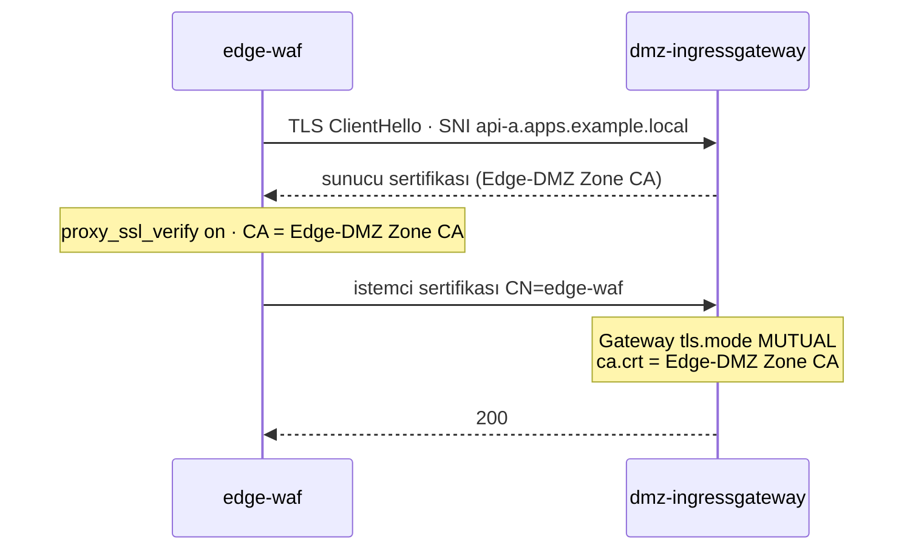

# 03 · Sıkılaştırma (Hardening)

| | |
|---|---|
| **Branch** | `hardening` (açıldığı yer: `zones`) |
| **Durum** | ✅ Tamamlandı, sıfırdan kurulumla doğrulandı (33/33 test) |

## Amaç

Mevcut yapıyı yeni bileşen eklemeden sıkılaştırmak: varsayılan reddet, en az yetki, bilgi sızmasını önleme, zone'lar arası şifrelemenin tamamlanması. [Güvenlik boşluk analizindeki](security-gap-analysis.md) düşük eforlu, yüksek kazançlı maddeler (katman 3, 4, 6).

## Adım sonundaki durum

| Konu | Durum |
|------|-------|
| Cluster'lar | Değişmedi: `dmz`, `cluster-a` (tek node); cluster-b kapalı |
| Edge → DMZ | **Karşılıklı TLS.** WAF, DMZ ingress gateway'e 443 üzerinden istemci sertifikasıyla bağlanıyor; düz HTTP (80) sunucusu yok |
| Edge yanıtları | `Server`, `x-envoy-*` header'ları siliniyor; 5xx gövdeleri tek tip JSON |
| Internal yetkilendirme | api-a namespace'inde **varsayılan reddet**; pod'lara L4'te yalnızca waypoint; servise L7'de yalnızca ingress gateway; egress gateway'e yalnızca waypoint |
| Waypoint | `waypoint-for: service`: pod IP üzerinden L7 yetkilendirmesini atlama açığı kapandı |
| Pod Security | Gateway namespace'leri de `restricted` (gateway pod'larına seccomp eklendi) |
| Uygulama pod'ları | `readOnlyRootFilesystem: true` |
| mTLS | DMZ'de de `PeerAuthentication STRICT` |
| Çıkış kontrolü | `REGISTRY_ONLY` (waypoint ve gateway'lerde etkili). **Pod'ların doğrudan çıkışı hâlâ açık** (NetworkPolicy uygulanamıyor, bkz. sorunlar) |
| Çalışan akışlar | 1 ve 4 (2 ve 3 cluster-b ile askıda) |

## Önceki adıma göre değişenler

| Değişiklik | Neden |
|------------|-------|
| WAF → DMZ ingress arası düz HTTP → **karşılıklı TLS** (ayrı Edge-DMZ Zone CA) | Zone sınırı şifresiz geçiliyordu. mTLS ile hem şifreleme hem de "DMZ ingress'e yalnızca edge-waf bağlanabilir" kuralı kriptografik olarak sağlanıyor (katman 2 ve 5) |
| DMZ ingress'in 80 portu kapatıldı | Edge'i atlayıp DMZ'ye düz HTTP ile girme yolunu kaldırmak |
| HAProxy yanıtlardan iç header'ları siliyor, 5xx gövdelerini değiştiriyor | Hata yanıtlarından iç yapı (Envoy, nginx, hostname, stack trace) sızmasın (katman 4) |
| api-a namespace'inde `allow-nothing` + açık izinler | Zero trust: açıkça izin verilmeyen her şey reddedilsin (katman 6) |
| Egress gateway'e yalnızca waypoint kimliği | Dışarıya çıkış tek ve bilinen bir kimlikten olsun |
| Waypoint `waypoint-for: all` → `service` | Testte bulunan açık: pod IP ile istek atılınca L7 politikası uygulanmıyordu (bkz. sorun 1) |
| Gateway namespace'leri `restricted` Pod Security; gateway'lere seccomp | En az yetki; gateway'ler de uygulama pod'larıyla aynı sıkılıkta |
| Namespace'ler gateway'lerden önce, etiketleriyle oluşturuluyor | Pod Security etiketi sonradan eklenirse mevcut pod'lar denetlenmez |
| Uygulama pod'larında salt okunur kök dosya sistemi | Ele geçirilen container'a araç/dosya bırakılmasını zorlaştırmak (katman 3) |
| DMZ'de `PeerAuthentication STRICT` | Internal cluster'larla tutarlılık |
| `outboundTrafficPolicy: REGISTRY_ONLY` | Waypoint ve gateway'ler kayıtsız hedeflere gidemesin. (Pod'ların doğrudan çıkışını ambient'te engellemiyor, bkz. sorun 2) |
| `08-verify.sh`'a 13 yeni test | Her sıkılaştırmanın, olumsuz senaryolarıyla birlikte otomatik doğrulanması |

## Eklenen bileşenler

Bu adımda yeni bir servis eklenmedi; mevcut yapı sıkılaştırıldı. Eklenen yapılar:

| Yapı | Amacı | Neden gerekli | Muadilleri | Neden bu seçildi |
|------|-------|---------------|------------|------------------|
| **Edge-DMZ Zone CA** + DMZ sunucu sertifikası + WAF istemci sertifikası (`certs/edge-dmz/`) | Edge ile DMZ arasında karşılıklı TLS | Zone sınırında şifreleme ve istemci kimliği | Mesh root CA'sını kullanmak, cert-manager, Vault PKI | Ayrı CA: mesh CA'sı ve public CA ile karışmaz; ileride Vault'a taşınacak (`13 · secrets`) |
| **WAF backend TLS şablonu** (`edge/waf-proxy-backend-ssl.conf.template`) | nginx'in DMZ'ye mTLS ile bağlanması | Image'ın kendi şablonunda güvenilir CA ve SNI ayarı yok | Özel WAF image'ı derlemek | Tek dosyalık bind-mount; image değişmeden kalıyor |
| **AuthorizationPolicy'ler** (`allow-nothing`, `api-a-allow-waypoint`, `allow-only-waypoints`) | Varsayılan reddet ve en az yetki | Zero trust | NetworkPolicy (L3/L4, kimliksiz) | Kimlik tabanlı; ambient'te ztunnel (L4) ve waypoint (L7) uyguluyor |
| **Referans NetworkPolicy** (`infra/network-policies/reference/`) | Egress default-deny'ın gerçek ortamdaki karşılığı | Ambient'te pod'ların doğrudan çıkışını engellemenin yolu | – | Lab'da **uygulanmıyor ve doğrulanmadı**; gerçek ortam (OVN-K/Calico/Cilium) için referans |
| *(Denendi, eklenmedi)* **kube-network-policies** | kindnet'in yanına NetworkPolicy uygulayıcısı | kindnet NetworkPolicy uygulamıyor | Calico, Cilium | WSL2 kernel'inde `CONFIG_NFT_QUEUE` olmadığı için çalışmadı (sorun 4) |

## Yapılanlar

### 1. Edge → DMZ karşılıklı TLS

- `03-generate-certs.sh`: Edge-DMZ Zone CA, DMZ sunucu sertifikası (`*.apps.example.local`, serverAuth) ve WAF istemci sertifikası (`CN=edge-waf`, clientAuth).
- `05-install-gateways.sh`: `istio-ingress/dmz-ingress-mtls` secret'ı (`tls.crt`, `tls.key`, `ca.crt`).
- [manifests/dmz/20-public-gateway.yaml](../manifests/dmz/20-public-gateway.yaml): tek sunucu, 443, `tls.mode: MUTUAL`, `minProtocolVersion: TLSV1_2`.
- `06b-deploy-edge.sh`: WAF `PROXY_SSL=on`, backend `https://<DMZ LB>:443`, sertifikalar ve TLS şablonu bind-mount ile.

### 2. Bilgi sızmasını önleme (edge-lb)

[edge/haproxy.cfg](../edge/haproxy.cfg): `Server`, `X-Powered-By`, `X-Envoy-Upstream-Service-Time`, `X-Envoy-Decorator-Operation` silinir; 500/502/503/504 yanıtlarının gövdesi durum kodu korunarak tek tip JSON'a çevrilir (ör. `{"error":"internal_error"}`). WAF da `SERVER_HEADER=` ile kendi header'ını göndermez.

### 3. Varsayılan reddet (cluster-a)

[manifests/cluster-a/40-security.yaml](../manifests/cluster-a/40-security.yaml):

| Politika | Uygulayan | Kural |
|----------|-----------|-------|
| `allow-nothing` (api-a, seçicisiz) | ztunnel (L4) | Namespace'te açıkça izin verilmeyen her şey reddedilir |
| `api-a-allow-waypoint` | ztunnel (L4) | api-a pod'larına yalnızca `api-a/sa/waypoint` |
| `api-a-allow-ingress` (Service'e bağlı) | waypoint (L7) | api-a servisine yalnızca `istio-ingress/sa/istio-ingressgateway`, `GET`/`POST` |
| `allow-only-waypoints` (istio-egress) | egress gateway | Egress gateway'e yalnızca `api-a/sa/waypoint` |

### 4. Pod Security ve salt okunur dosya sistemi

- Gateway namespace'lerine (`istio-ingress`, `istio-egress`, dmz ve cluster-a) `pod-security.kubernetes.io/enforce: restricted`.
- Gateway pod'larına `seccompProfile: RuntimeDefault` (chart'ın varsayılan sysctl'i korunarak): [ingress-gateway.yaml](../istio/values/ingress-gateway.yaml), [egress-gateway.yaml](../istio/values/egress-gateway.yaml).
- api-a/api-b: `readOnlyRootFilesystem: true`, `/data` ve `/tmp` için `emptyDir` (16 Mi).
- Istio proxy'leri (gateway, waypoint) zaten `readOnlyRootFilesystem: true` ve `drop: ALL` ile çalışıyor.

### 5. Diğer

- [manifests/dmz/40-security.yaml](../manifests/dmz/40-security.yaml): DMZ'de `PeerAuthentication STRICT`.
- [istio/values/istiod.yaml](../istio/values/istiod.yaml): `outboundTrafficPolicy.mode: REGISTRY_ONLY`.

## Değişen dosyalar

| Dosya | Değişiklik |
|-------|------------|
| `edge/waf-proxy-backend-ssl.conf.template` | **Yeni.** WAF → DMZ mTLS ayarları |
| `manifests/dmz/40-security.yaml` | **Yeni.** DMZ `PeerAuthentication STRICT` |
| `infra/network-policies/reference/api-a-network-policy.yaml` | **Yeni.** Referans (uygulanmıyor) |
| `docs/03-hardening.md` | **Yeni.** Bu doküman |
| `scripts/03-generate-certs.sh` | Edge-DMZ Zone CA ve sertifikaları |
| `scripts/05-install-gateways.sh` | Namespace'ler önce ve etiketleriyle; DMZ mTLS secret'ı; namespace oluşturma satırları kaldırıldı |
| `scripts/06b-deploy-edge.sh` | WAF backend HTTPS + mTLS; `SERVER_HEADER=`; şablon ve sertifika bind-mount |
| `scripts/08-verify.sh` | Bilgi sızması, edge-DMZ mTLS, varsayılan reddet, Pod Security testleri; doğrudan çıkış bilgi satırı; waypoint testi servis seviyesine |
| `edge/haproxy.cfg` | Yanıt header'larının silinmesi, tek tip 5xx gövdeleri |
| `istio/values/istiod.yaml` | `REGISTRY_ONLY` |
| `istio/values/ingress-gateway.yaml`, `egress-gateway.yaml` | `securityContext` (seccomp + sysctl) |
| `manifests/dmz/00-namespaces.yaml`, `cluster-a/00-namespaces.yaml`, `cluster-b/00-namespaces.yaml` | Gateway namespace'lerine `restricted` |
| `manifests/dmz/20-public-gateway.yaml` | 80 → 443 `MUTUAL` |
| `manifests/cluster-a/10-api-a.yaml`, `cluster-b/10-api-b.yaml` | `readOnlyRootFilesystem` + `emptyDir` |
| `manifests/cluster-a/20-waypoint.yaml`, `cluster-b/20-waypoint.yaml` | `waypoint-for: service` |
| `manifests/cluster-a/40-security.yaml`, `cluster-b/40-security.yaml` | `allow-nothing`, waypoint ve egress politikaları |

## Tasarım kararları

- **Edge → DMZ için IP kısıtı yerine mTLS.** DMZ ingress'e "yalnızca WAF'ın IP'si" kuralı da yazılabilirdi, ama IP sahtelenebilir ve değişebilir. İstemci sertifikası kriptografik kimlik sağlıyor ve aynı zamanda trafiği şifreliyor.
- **Ayrı Edge-DMZ Zone CA.** Mesh root CA'sı yalnızca mesh içinde, public CA yalnızca internete karşı kullanılıyor. Zone geçişinin kendi CA'sı var; birinin sızması diğerlerini etkilemiyor.
- **Bilgi sızması kontrolü edge'de.** İnternete giden her yanıt edge'den geçtiği için header ve hata gövdesi temizliği tek noktada yapılıyor. Envoy'un `server` header'ını cluster içinde değiştirmek EnvoyFilter gerektirirdi.
- **NetworkPolicy şimdilik yok** (kullanıcı kararı). Manifest referans olarak duruyor; lab'da uygulanmadığı açıkça belgeleniyor.

## Karşılaşılan sorunlar ve çözümler

| # | Belirti | Sebep | Çözüm | Değişen dosya |
|---|---------|-------|-------|---------------|
| 1 | **Güvenlik açığı:** api-a pod IP'sine doğrudan istek 200 dönüyordu; servis adıyla aynı istek 403 | Waypoint `waypoint-for: all` ile pod IP trafiğini de işliyor ve yetkili kimlikle iletiyordu; L7 politikası yalnızca Servis'e bağlı olduğu için pod IP trafiğine uygulanmıyordu | `waypoint-for: service`: pod IP trafiği waypoint'e gitmiyor, ztunnel'deki L4 kuralına (yalnızca waypoint) takılıyor. Negatif test eklendi | `20-waypoint.yaml`, `08-verify.sh` |
| 2 | `REGISTRY_ONLY` açıkken api-a hâlâ `example.com`'a çıkabiliyor | Ambient'te ztunnel `outboundTrafficPolicy`'yi uygulamıyor; ayar yalnızca Envoy tabanlı proxy'leri (waypoint, gateway) etkiliyor | Ayar korundu (waypoint/gateway için faydalı). Pod çıkışı için egress NetworkPolicy gerekiyor (sorun 3-4). Doğrulamaya bilgi satırı eklendi | `istiod.yaml`, `08-verify.sh` |
| 3 | default-deny NetworkPolicy sonrası istek yine geçiyor | kindnet NetworkPolicy uygulamıyor | kube-network-policies denendi (sorun 4) | – |
| 4 | kube-network-policies kuralları yazamıyor: `initial nftables sync failed` | Docker Desktop'ın WSL2 kernel'inde `CONFIG_NFT_QUEUE` yok (nftables `queue` ifadesi) | Kaldırıldı. Kullanıcı kararıyla NetworkPolicy şimdilik atlandı; referans manifest repoda | `infra/network-policies/reference/` |
| 5 | Gateway namespace'lerine `restricted` deneme etiketinde ihlal uyarısı | Gateway pod'larında seccomp profili yok | `securityContext.seccompProfile`. Chart'ın varsayılan sysctl'i bu alan verilince düştüğü için sysctl de açıkça eklendi | `ingress-gateway.yaml`, `egress-gateway.yaml` |
| 6 | Namespace etiketleri sonradan uygulanınca mevcut gateway pod'ları denetlenmiyor; ayrıca `create ns` + `apply` etiketleri silebiliyor | Sıralama: namespace'ler helm kurulumunda etiketsiz oluşturuluyordu | `05-install-gateways.sh` önce `00-namespaces.yaml`'ı uyguluyor; etiketsiz oluşturma satırları kaldırıldı | `05-install-gateways.sh` |
| 7 | WAF image'ının backend TLS şablonunda güvenilir CA ve SNI yok | Image `PROXY_SSL` ile istemci sertifikası destekliyor ama sunucu doğrulaması ve SNI eksik | Şablon kendi dosyamızla değiştirildi (bind-mount) | `edge/waf-proxy-backend-ssl.conf.template` |
| 8 | İlk yazılan HAProxy kuralı 503 ve 504'ü 502'ye çeviriyordu | `status 502:504` için tek bir `return status 502` | Her durum kodu için ayrı kural; kod korunuyor | `edge/haproxy.cfg` |

## STRIDE: bu adımdaki değişim

[02-zones STRIDE tablolarına](02-zones.md#stride-tehdit-modeli) göre güncellenen satırlar:

| Akış | Tehdit | Önce | Şimdi |
|------|--------|------|-------|
| Akış 1 | **T**ampering: WAF → DMZ arası değiştirme | ⚠️ düz HTTP | ✅ karşılıklı TLS |
| Akış 1 | **S**poofing: edge'i atlayıp DMZ ingress'e bağlanma | ⚠️ kind ağındaki herkes 80'e bağlanabiliyordu | ✅ yalnızca Edge-DMZ CA'lı istemci sertifikası (test edildi) |
| Akış 1 | **I**nformation disclosure: hata yanıtları | ⚠️ `server: istio-envoy`, ayrıntılı gövde | ✅ header'lar siliniyor, 5xx gövdeleri tek tip (podinfo'nun normal yanıtındaki hostname hâlâ görünür) |
| Internal | **E**levation of privilege: pod IP ile L7 AuthZ atlama | ❌ (bu adımda bulundu) | ✅ `waypoint-for: service` + L4 varsayılan reddet |
| Internal | **S**poofing: namespace içinden yetkisiz erişim | ⚠️ yalnızca L7 | ✅ L4 (ztunnel) + L7 (waypoint) |
| Akış 4 | **I**nformation disclosure: pod'dan doğrudan veri sızdırma | ❌ `ALLOW_ANY` | ❌ hâlâ açık: `REGISTRY_ONLY` ambient'te pod'u engellemiyor, NetworkPolicy uygulanamıyor |

## Doğrulama

Sıfırdan kurulum: `99-destroy.sh` → `setup.sh` (tek seferde, elle müdahale yok). **Süre: 9 dk. Sonuç: 33 başarılı, 0 başarısız.** Önceki adımın 20 testi de geçti.

Bu adımda eklenen testler:

| Grup | Test | Sonuç |
|------|------|-------|
| Edge / bilgi sızması | 5xx gövdesi tek tip (`{"error":"internal_error"}`) | ✔ |
| | Yanıtta `Server` / `x-envoy-*` header'ı yok | ✔ |
| Edge → DMZ mTLS | kind ağından sertifikasız HTTPS reddediliyor | ✔ |
| | Düz HTTP (80) kapalı | ✔ |
| | WAF istemci sertifikasıyla kabul ediliyor | ✔ |
| Varsayılan reddet | Pod IP ile waypoint'i atlama engelleniyor (ztunnel L4) | ✔ |
| | Servise yetkisiz kimlikle erişim reddediliyor (waypoint L7, `RBAC: access denied`) | ✔ |
| | Egress gateway'e waypoint dışından erişilemiyor | ✔ |
| Pod Security | dmz ve cluster-a'nın `istio-ingress` / `istio-egress` namespace'leri `restricted`, ihlal eden pod yok | ✔ ✔ ✔ ✔ |
| Mesh | api-a pod'ları ambient'te (HBONE); api-a servisi waypoint kullanıyor | ✔ ✔ |
| Bilgi (test değil) | api-a → example.com doğrudan çıkış | ⚠ açık (bilinen kısıt) |

Kurulumda ilk kez sıfırdan çalışan değişiklikler de sorunsuz geçti: namespace'lerin gateway'lerden önce etiketleriyle oluşturulması ve DMZ mTLS secret'ının yüklenmesi.

## Bilinen kısıtlar

- **Pod'ların doğrudan internete çıkışı açık** (yukarıda). Gerçek ortamda egress NetworkPolicy / OpenShift EgressFirewall ile kapatılır.
- Gateway namespace'lerinde NetworkPolicy yok (aynı sebep).
- podinfo normal yanıtlarında pod hostname'ini döndürüyor (uygulama davranışı; örnek servis Go ile yazıldığında düzelecek).
- Edge container'ları salt okunur değil (WAF şablonlardan yapılandırma ürettiği için yazılabilir alan istiyor).
