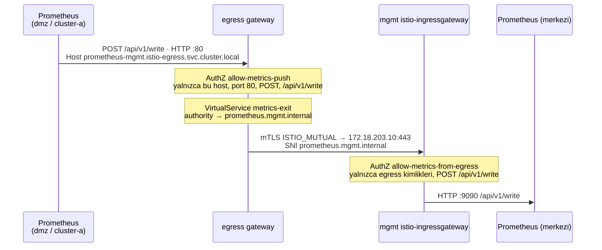
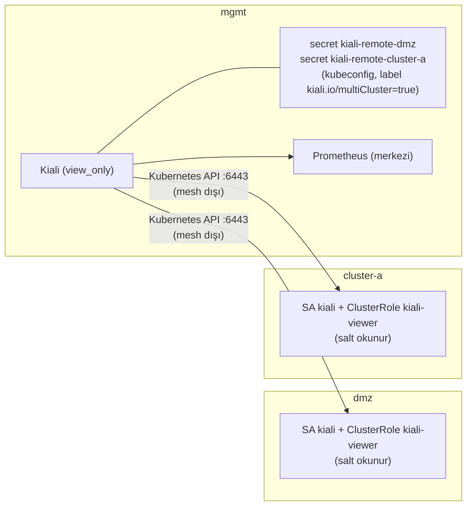

# 04 · Management Cluster ve Merkezi Gözlemlenebilirlik

| | |
|---|---|
| **Branch** | `mgmt` (açıldığı yer: `hardening`) |
| **Durum** | ✅ Tamamlandı, sıfırdan kurulumla doğrulandı (40/40 test, ilk denemede) |

## Amaç

Paylaşılan ürünler için dördüncü bir zone açmak: **mgmt cluster'ı**. İlk iş olarak gözlemlenebilirliği buraya toplamak: tek Kiali, tek Grafana, merkezi Prometheus. Sonraki adımlarda veri (PostgreSQL, Redis), Keycloak ve Vault da buraya gelecek.

## Adım sonundaki durum

| Konu | Durum |
|------|-------|
| Cluster'lar | **`dmz`, `cluster-a`, `mgmt`** (her biri tek node); cluster-b kapalı |
| mgmt | Kendi Istio ambient'i; `istio-ingressgateway` LB `172.18.203.10`; uygulama trafiğine kapalı |
| Metrikler | Her cluster'ın Prometheus'u metrikleri kendi egress gateway'i üzerinden mgmt'e gönderiyor (`remote_write`; cluster'lar arası mTLS). Yerelde yalnızca 2 saat saklanıyor |
| Kiali | **Tek Kiali** (mgmt): üç cluster'ı tek arayüzde gösteriyor; salt okunur |
| Grafana | **Tek Grafana** (mgmt), merkezi Prometheus'a bağlı |
| Host'a açık portlar | 8080/8443 (edge-lb), **20001 (Kiali) ve 3001 (Grafana)**. Önceki 4 yönetim portu 2'ye indi |
| Akışlar | 1 ve 4 (2 ve 3 cluster-b ile askıda) + yeni metrik akışı |

## Önceki adıma göre değişenler

| Değişiklik | Neden |
|------------|-------|
| `mgmt` cluster'ı eklendi (`CLUSTERS="dmz cluster-a mgmt"`) | Paylaşılan ürünler için ayrı, dışarıya kapalı bir zone (kullanıcı kararı; gerçek kurumlardaki "shared services / management zone") |
| Kiali ve Grafana dmz ve cluster-a'dan kaldırıldı; mgmt'te tek kopya | Tek arayüzden tüm cluster'ları görmek; daha az bellek; daha az açık yönetim portu |
| dmz ve cluster-a'daki Prometheus'lar metrikleri mgmt'e `remote_write` ile gönderiyor | Metrikler tek yerde toplansın; Kiali ve Grafana tek kaynağa baksın |
| Gönderim egress gateway'ler üzerinden, mTLS ile (kullanıcı kararı) | Zone'lar arası her trafik tek kapıdan ve şifreli geçsin; mgmt yalnızca egress kimliklerini kabul etsin |
| Yerel Prometheus saklama süresi 15 gün → 2 saat | Asıl saklama merkezde; yerel kopya yalnızca iletim tamponu |
| Kiali diğer cluster'ları Kubernetes API'leri üzerinden okuyor (salt okunur SA) | Kiali çoklu cluster modunun gereği. Bu bağlantı mesh dışında (daha önce konuşulduğu gibi) |
| Kiali `view_only_mode: true` | Yönetim arayüzünden Istio yapılandırması değiştirilemesin (en az yetki) |
| Kiali/Grafana port mapping'leri dmz/cluster-a'dan mgmt'e taşındı | Yönetim arayüzleri yalnızca mgmt'ten açılsın |

## Eklenen bileşenler

| Bileşen | Amacı | Neden gerekli | Muadilleri | Neden bu seçildi |
|---------|-------|---------------|------------|------------------|
| **mgmt cluster'ı** (kind, tek node) | Paylaşılan ürünlerin zone'u | Gözlemlenebilirlik, veri, IdP, kasa gibi ortak ürünleri iş yükü cluster'larından ayırmak | Ürünleri cluster-a'ya koymak; gerçekte OpenShift ACM hub / ayrı "shared services" cluster'ı | DMZ ve internal izolasyonunu bozmuyor; gerçek kurumsal yapıya yakın |
| **Merkezi Prometheus** (remote-write receiver) | Tüm cluster'ların metriklerini toplamak | Kiali ve Grafana'nın tek kaynaktan okuması | Thanos, Grafana Mimir, VictoriaMetrics, OpenShift ACM Observability (Thanos tabanlı) | Ek bileşen gerektirmiyor: Prometheus'un yerleşik `--web.enable-remote-write-receiver` özelliği. Uzun süreli saklama gerekirse Thanos/Mimir'e geçilir |
| **Prometheus `remote_write`** (her cluster) | Metrikleri mgmt'e iletmek | Merkezi toplama | Federation (merkez çeker), Prometheus agent modu, OpenTelemetry Collector | Push modeli: mgmt diğer zone'lara bağlantı açmıyor; zone kuralına uygun |
| **Metrik çıkış yolu** (`60-metrics-exit.yaml`: Service, Gateway, ServiceEntry, DR, VS, AuthZ) | Prometheus → egress gateway → mgmt | Zone geçişinin egress gateway'den ve mTLS ile yapılması | Prometheus'un mgmt LB'sine doğrudan yazması (şifresiz) | Kullanıcı kararı: gateway üzerinden |
| **mgmt girişi** (`10-metrics-entry.yaml`) | mgmt ingress gateway'de metrik kabulü | Merkezi Prometheus'a yalnızca egress kimlikleri yazabilsin | Prometheus'u doğrudan LB ile açmak | AuthZ: yalnızca `dmz-egressgateway` ve `istio-egressgateway`, yalnızca `POST /api/v1/write` |
| **Kiali çoklu cluster** (uzak cluster'larda salt okunur `kiali` SA + mgmt'te kubeconfig secret'ları) | Tek Kiali'den tüm cluster'lar | Kiali'nin uzak cluster'ların kaynaklarını okuması | Cluster başına ayrı Kiali (önceki durum), OpenShift Service Mesh Console | Kiali'nin resmi çoklu cluster yöntemi (`kiali.io/multiCluster=true` etiketli secret'lar) |

## Yapılanlar

### Metrik akışı

- Prometheus mesh dışında olduğu için cluster içi kısım (Prometheus → egress gateway) düz HTTP. Bu kısım egress gateway'de host, port, metot ve yol ile sınırlandırıldı.
- Her cluster'ın metrikleri `external_labels: {cluster: <ad>}` ile etiketleniyor; Istio metrikleri zaten `source_cluster` / `destination_cluster` taşıyor.

### Kiali çoklu cluster

`07-install-observability.sh`: uzak cluster'larda `kiali-server` chart'ını `remote_cluster_resources_only=true` ile kurar (yalnızca SA ve salt okunur ClusterRole), 1 yıllık bir token üretir, API server'ın kind ağındaki IP'siyle bir kubeconfig hazırlayıp mgmt'e etiketli secret olarak yazar.

## Değişen dosyalar

| Dosya | Değişiklik |
|-------|------------|
| `clusters/mgmt.yaml` | **Yeni.** mgmt cluster'ı; Kiali (20001) ve Grafana (3001) port mapping'leri |
| `manifests/mgmt/00-namespaces.yaml`, `10-metrics-entry.yaml`, `40-security.yaml` | **Yeni.** Namespace'ler, metrik girişi, STRICT mTLS ve egress varsayılan reddi |
| `manifests/dmz/60-metrics-exit.yaml`, `manifests/cluster-a/60-metrics-exit.yaml` | **Yeni.** Metrik çıkış yolu |
| `scripts/07-install-observability.sh` | Baştan yazıldı: merkezi/uzak Prometheus, Kiali uzak kaynakları ve secret'ları, mgmt'te Grafana ve Kiali |
| `istio/values/kiali.yaml` | `view_only_mode`, `clustering.autodetect_secrets` |
| `config.env` | `CLUSTERS` += mgmt; `lb_octet mgmt=203`; `KIALI_PORT`, `GRAFANA_PORT`, `METRICS_HOST`; cluster başına port fonksiyonları kaldırıldı |
| `clusters/dmz.yaml`, `cluster-a.yaml`, `cluster-b.yaml` | Kiali/Grafana port mapping'leri kaldırıldı |
| `scripts/08-verify.sh` | Merkezi gözlemlenebilirlik testleri |

## Tasarım kararları

- **Push (remote_write), pull (federation) değil.** Federation'da merkez diğer cluster'lara bağlanır; bu, mgmt'ten DMZ'ye bağlantı açmak demek. Push'ta bağlantıyı her zaman iş yükü cluster'ı başlatır.
- **Merkezi Prometheus = yerleşik receiver.** Thanos/Mimir uzun süreli saklama ve ölçek için doğru araçlar, ama lab'ın RAM bütçesi için ağır.
- **Kiali'nin API erişimi mesh dışında.** Kubernetes API trafiği service mesh'ten geçmez. Erişim salt okunur SA ile sınırlı; Kiali de `view_only_mode`'da.

## STRIDE (yeni akışlar)

| Akış | Tehdit | Senaryo | Kontrol | Durum |
|------|--------|---------|---------|-------|
| Metrik gönderimi | **S**poofing | Biri merkezi Prometheus'a sahte metrik yazar | mgmt girişi yalnızca egress gateway kimliklerini kabul ediyor | ✅ |
| | **S**poofing | Cluster içindeki herhangi bir pod egress gateway'in 80 portuna metrik yazar | Host/yol/metot sınırı; kimlik yok | ⚠️ (Prometheus mesh dışında) |
| | **T**ampering | Metrikler yolda değiştirilir | Cluster'lar arası mTLS | ✅ (cluster içi kısım düz HTTP) |
| | **I**nformation disclosure | mgmt'teki metrikler okunur | mgmt girişi yalnızca `POST /api/v1/write`'a izin veriyor; sorgu kapalı | ✅ |
| Kiali → API | **E**levation of privilege | Kiali token'ı çalınır | Salt okunur ClusterRole (`kiali-viewer`); Kiali `view_only_mode` | ⚠️ token 1 yıllık (`13 · secrets`'te kısa ömürlü olacak) |
| Yönetim UI | **S** / **E** | Anonim erişim | – | ❌ lab istisnası (Kiali anonymous, Grafana anonim admin) |

## Karşılaşılan sorunlar ve çözümler

Bu adımda kurulumu durduran bir sorun çıkmadı; sıfırdan kurulum ilk denemede geçti. Tasarım sırasında çözülen noktalar:

| # | Konu | Çözüm |
|---|------|-------|
| 1 | Prometheus'un `remote_write` isteğinde `Host` header'ı serbestçe ayarlanamıyor; egress gateway'in Gateway sunucusu host'a göre eşleşiyor | Egress gateway pod'larına giden ayrı bir servis adı (`prometheus-mgmt.istio-egress`); Gateway ve VirtualService bu FQDN ile eşleşiyor, VirtualService `authority`'yi `prometheus.mgmt.internal`'a çeviriyor |
| 2 | Prometheus mesh dışında; egress gateway'deki AuthZ kimlik (principal) kullanamıyor | 80 portunda kimlik yerine host + port + metot + yol ile sınırlama (`allow-metrics-push`); cluster'lar arası kısımda kimlik tabanlı AuthZ (mgmt girişi) |
| 3 | Kiali'nin uzak API server'lara erişimi: kind'ın iç kubeconfig'i container adını (`dmz-control-plane`) kullanıyor, mgmt pod'ları bu adı çözemeyebilir | API server'ın `kind` ağındaki IP'si `docker inspect` ile alınıp kubeconfig'e yazılıyor (kind'ın API sertifikası node IP'sini içeriyor) |

## Doğrulama

Sıfırdan kurulum: `99-destroy.sh` → `setup.sh` (tek seferde, elle müdahale yok). **Süre: 11 dk. Sonuç: 40 başarılı, 0 başarısız.** Önceki adımların 31 testi de geçti (Pod Security testleri artık mgmt'in namespace'lerini de kapsıyor).

Bu adımda eklenen testler:

| Test | Sonuç |
|------|-------|
| Kiali http://localhost:20001/kiali | ✔ |
| Grafana http://localhost:3001 | ✔ |
| Merkezi Prometheus'ta dmz metrikleri var (`cluster="dmz"`) | ✔ |
| Merkezi Prometheus'ta cluster-a metrikleri var | ✔ |
| Merkezi Prometheus'ta mesh trafik metrikleri (`istio_requests_total`, cluster-a) | ✔ |
| Kiali dmz, cluster-a ve mgmt cluster'larını görüyor | ✔ ✔ ✔ |
| mgmt girişine mesh sertifikası olmadan erişilemiyor | ✔ |
| mgmt'in `istio-ingress` / `istio-egress` namespace'leri `restricted`, ihlal eden pod yok | ✔ ✔ |

Merkezi Prometheus'taki `istio_requests_total` seri sayıları (cluster ve raporlayan bileşene göre): dmz/source 8, cluster-a/source 6, cluster-a/waypoint 5.

Kiali'nin birleşik graph'ı (üç cluster tek görünümde):

| Kenar | Trafik |
|-------|--------|
| `dmz/dmz-ingressgateway` → `dmz/dmz-egressgateway` → `dmz/cluster-a-gateway` | Akış 1, ~1,5 rps |
| `cluster-a/istio-ingressgateway` → `cluster-a/waypoint` → `cluster-a/api-a` | Akış 1, mTLS |
| `dmz/dmz-egressgateway` → `dmz/mgmt-gateway` | Metrik gönderimi, ~1,1 rps |
| `cluster-a/istio-egressgateway` → `cluster-a/mgmt-gateway` | Metrik gönderimi, ~1 rps |
| `mgmt/istio-ingressgateway` → `mgmt/prometheus` | Merkeze gelen metrikler, ~2 rps |

Kaynak kullanımı:

| | 03-hardening (2 cluster) | 04-mgmt (3 cluster) |
|---|---|---|
| kind node'ları | ~4,5 GB | ~6,1 GB (mgmt 2,2 · cluster-a 2,1 · dmz 1,9) |
| Docker VM'inde kullanılabilir bellek | ~6,7 GB | ~5,2 GB |

## Bilinen kısıtlar

- Prometheus → egress gateway arası düz HTTP (Prometheus mesh dışında).
- Kiali'nin uzak cluster'lara erişimi mesh dışında; token 1 yıllık.
- Merkezi Prometheus tek kopya, uzun süreli saklama yok.
- Yönetim arayüzleri anonim (lab istisnası).
