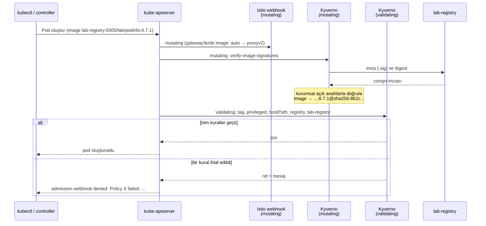
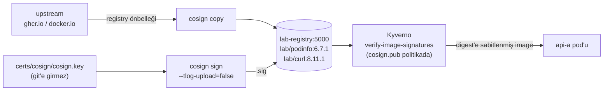

# 05 · Politika (Kyverno ve İmzalı Image)

| | |
|---|---|
| **Branch** | `policy` (açıldığı yer: `mgmt`) |
| **Durum** | ✅ Tamamlandı, sıfırdan kurulumla doğrulandı (57/57 test) |

## Amaç

Cluster'lara kurala uymayan iş yükünün **hiç girmemesini** sağlamak. Şimdiye kadarki kontroller trafiği denetliyordu (mTLS, AuthZ, WAF). Bu adım, pod'ların kendisini Kubernetes API'ye kabul edilirken denetler (admission control):

- `latest` tag'li ya da tag'siz image yasak (hangi kodun çalıştığı belirsiz olmasın).
- Privileged container, yetki yükseltme, host namespace'leri ve hostPath yasak (container'dan node'a kaçış yolları).
- Image'lar yalnızca izinli registry'lerden gelebilir.
- Uygulama namespace'lerinde yalnızca **iç registry'deki, kurumsal anahtarla imzalı** image'lar çalışabilir (tedarik zinciri).

## Adım sonundaki durum

| Konu | Durum |
|------|-------|
| Admission controller | **Kyverno 1.19.2**, üç cluster'da da (dmz, cluster-a, mgmt); Istio'dan önce kurulur |
| Politikalar | 6 politika, **Deny** modunda (`config.env POLICY_ACTION`); yeni CEL tabanlı `policies.kyverno.io/v1` API'si |
| İstisnalar | 5 dar istisna (ztunnel, istio-cni, MetalLB speaker, gateway `image: auto`, waypoint); yalnızca `kyverno` namespace'inde tanımlanabilir |
| İç registry | `lab-registry:5000` (kind ağında, kalıcı). Uygulama image'ları buraya kopyalanıp **cosign** ile imzalanıyor |
| api-a | `lab-registry:5000/lab/podinfo:6.7.1`; Kyverno imzayı doğrulayıp image'ı **digest'e sabitliyor** |
| Webhook davranışı | Fail-closed: Kyverno erişilemezse kapsamdaki pod'lar oluşturulamaz |

## Önceki adıma göre değişenler

| Değişiklik | Neden |
|------------|-------|
| Her cluster'a Kyverno kuruldu (`03c-install-kyverno.sh`) | Pod Security Admission yalnızca namespace etiketine bağlı ve sabit kurallar içeriyor; image tag'i, registry ve imza gibi kuralları uygulayamıyor |
| Kurulum sırası: Kyverno, Istio'dan **önce** | Sonra kurulan her bileşen (Istio, gateway'ler, uygulamalar, gözlemlenebilirlik) admission denetiminden geçsin; "önce kur, sonra denetle" boşluğu olmasın |
| `lab-registry` eklendi; api-a image'ı oradan çekiliyor | Gerçekte uygulama image'ları internetteki registry'den değil, kurumun iç registry'sinden (Harbor/Quay/Nexus) gelir. İmza ve kaynak kontrolü bu registry'ye bağlanır |
| cosign anahtar çifti (`certs/cosign/`, git'e girmez) ve imzalama adımı (`03b-publish-images.sh`) | CI'ın "build → imzala → iç registry'ye it" adımının lab karşılığı |
| api-a namespace'ine `policy.corp.mesh/image-source=lab-registry` etiketi | Bu namespace'te yalnızca imzalı image'lar çalışsın. Etiket, kuralı namespace bazında açıp kapatmayı sağlar |
| `08-verify.sh` test pod'u (`authz-probe`) artık `lab/curl` kullanıyor | api-a namespace'i artık docker.io image'ını kabul etmiyor |
| cluster-b manifest'leri de aynı şekilde güncellendi | 17. adımda geri geldiğinde aynı kurallara uysun |

## Eklenen bileşenler

| Bileşen | Amacı | Neden gerekli | Muadilleri | Neden bu seçildi |
|---------|-------|---------------|------------|------------------|
| **Kyverno** (admission controller + reports controller) | Pod'ları API'ye kabul edilirken kurallara göre reddetmek; mevcut kaynakları raporlamak | PSA sabit kurallarla sınırlı; image tag, registry ve imza kuralları yazılamıyor | OPA Gatekeeper (Rego), Kubewarden (Wasm), Kubernetes yerleşik **ValidatingAdmissionPolicy** (CEL), OpenShift'te SCC + ACM Governance, jsPolicy | Kuralları Kubernetes kaynağı gibi YAML/CEL ile yazıyor, ayrı dil öğrenmek gerekmiyor. Image imza doğrulaması **yerleşik** (Gatekeeper'da ayrı bir eklenti, VAP'ta hiç yok). İstisna (PolicyException) ve raporlama (PolicyReport) hazır |
| **Kyverno CEL politikaları** (`ValidatingPolicy`, `ImageValidatingPolicy`) | Kuralların kendisi | – | Eski `ClusterPolicy` (Kyverno'nun kendi YAML dili) | Kyverno 1.19'da `ClusterPolicy` **deprecated**. Yeni API'ler Kubernetes'in CEL'ini kullanıyor; ValidatingAdmissionPolicy'ye taşınabilir |
| **PolicyException** (`policies.kyverno.io/v1`) | Zorunlu sistem bileşenlerine kural bazında, dar istisna | ztunnel, istio-cni ve MetalLB speaker'ın node erişimi gerekiyor | Namespace'i tamamen kapsam dışı bırakmak | Namespace dışlamak, o namespace'teki her pod'u (ör. istio-system'deki Prometheus) da denetimden çıkarırdı. İstisna yalnızca gereken kuralı ve gereken bileşeni kapsıyor |
| **cosign** (Sigstore, container olarak) | Image imzalamak ve doğrulamak | Image'ın kurumun CI'ından çıktığını ve sonradan değiştirilmediğini kanıtlamak | Notation (Notary v2), Docker Content Trust (Notary v1, artık önerilmiyor), Red Hat Quay/OpenShift imza politikaları | Kubernetes ekosisteminde fiili standart; Kyverno'nun yerleşik desteği var. Ayrıca kurulum gerekmiyor (`docker run`) |
| **lab-registry** (`registry:2.8.3`, kind ağında) | Kurumsal iç registry'nin karşılığı | İmzalı image'ların tutulacağı, kurumun kontrolündeki kaynak | Harbor (imza, tarama, replikasyon), Red Hat Quay, Nexus, Artifactory, OpenShift internal registry | Mevcut önbellek container'larıyla aynı image; ~25 MB bellek. Gerçek bir ürün (Harbor) bu lab'ın bellek bütçesine sığmaz |

## Yapılanlar

### Admission akışı

Kyverno, Deployment, DaemonSet, StatefulSet ve Job'ları da **pod şablonları üzerinden** denetliyor (autogen). Kurala aykırı bir Deployment, pod'ları oluşturulmaya çalışılırken değil, Deployment'ın kendisi oluşturulurken reddediliyor.

### Politikalar

| Politika | Kapsam | Ne reddeder |
|----------|--------|-------------|
| `disallow-latest-tag` | Tüm namespace'ler¹ | `:latest` ya da tag'siz image (digest'li image kabul) |
| `disallow-privileged` | Tüm namespace'ler¹ | `privileged: true`, `allowPrivilegeEscalation: true`, `hostPID` / `hostIPC` / `hostNetwork` |
| `disallow-host-path` | Tüm namespace'ler¹ | `hostPath` volume |
| `restrict-image-registries` | Tüm namespace'ler¹ | docker.io, quay.io, ghcr.io ve lab-registry dışındaki registry'ler |
| `require-lab-registry` | `policy.corp.mesh/image-source=lab-registry` etiketli namespace'ler (api-a) | lab-registry dışından gelen her image |
| `verify-image-signatures` | Tüm namespace'ler¹, lab-registry image'ları | Kurumsal cosign anahtarıyla imzalanmamış image. Kabul edilen image digest'e çevrilir |

¹ Kapsam dışı: `kube-system`, `kube-public`, `kube-node-lease`, `local-path-storage`, `kyverno`. Bunlar Kubernetes'in ve Kyverno'nun kendi bileşenleri. Kyverno'nun kendi namespace'ini denetlemesi, kendisi çöktüğünde yeniden başlamasını engellerdi.

`require-lab-registry` ile `verify-image-signatures` birlikte çalışır. İmza kontrolü yalnızca lab-registry image'larına uygulanır; kaynak kuralı olmasaydı imzasız bir image'ı docker.io'dan çekerek imza kontrolü atlatılabilirdi.

### İstisnalar

Audit modunda bulunan ihlallere göre çıkarıldı. Her istisna yalnızca gereken kuralı kapsar:

| İstisna | Bileşen | Kural | Neden |
|---------|---------|-------|-------|
| `istio-ztunnel` | istio-system / ztunnel | host-path, privileged | Node'daki soketi CNI ile paylaşıyor; pod ağ namespace'lerine girmek için NET_ADMIN/SYS_ADMIN istiyor |
| `istio-cni` | istio-system / istio-cni-node | host-path | CNI eklentisini ve config'ini node'a yazıyor |
| `metallb-speaker` | metallb-system / speaker | privileged (hostNetwork) | L2 ARP duyurusu için node ağında çalışmak zorunda |
| `istio-gateway-image-auto` | Gateway Deployment / ReplicaSet | latest-tag | Şablonda `image: auto`; gerçek image pod oluşturulurken enjekte ediliyor. Pod'un kendisi bu istisnanın dışında |
| `istio-waypoint` | Istio'nun yönettiği waypoint'ler | require-lab-registry | Waypoint'i istiod oluşturuyor, image Istio hub'ından geliyor. Gerçekte Istio image'ları da iç registry'ye alınır ve bu istisna kalkar |

İstisnalar yalnızca `kyverno` namespace'inde tanımlanabiliyor (`features.policyExceptions.namespace`). Böylece hepsi tek yerde görülüyor; uygulama ekipleri kendi namespace'lerinde istisna yazamıyor.

### İmzalı image hattı

- `03-generate-certs.sh` cosign anahtar çiftini bir kez üretir. Gerçekte özel anahtar KMS/HSM'de (ör. `13 · secrets`'teki Vault Transit) durur ve yalnızca CI kullanır.
- `03b-publish-images.sh` her kurulumda image'ları kopyalar, imzalar ve doğrular. Negatif test için bir de imzasız kopya (`lab/curl-unsigned`) koyar.
- İmzalar şeffaflık loguna (Rekor) yazılmaz: iç ortamın internete çıkışı yok. Kyverno'da `ctlog.insecureIgnoreTlog: true`.

## Değişen dosyalar

| Dosya | Değişiklik |
|-------|------------|
| `infra/kyverno/values.yaml` | **Yeni.** Helm değerleri: image'lar ghcr.io'dan, tek replika, background/cleanup controller kapalı, istisnalar yalnızca `kyverno` namespace'inde |
| `infra/kyverno/policies.yaml` | **Yeni.** 6 politika (`__ACTION__`, `__LAB_REGISTRY__`, `__COSIGN_PUB__` script'te doldurulur) |
| `infra/kyverno/exceptions.yaml` | **Yeni.** 5 istisna |
| `scripts/03b-publish-images.sh` | **Yeni.** Kopyala, imzala, doğrula |
| `scripts/03c-install-kyverno.sh` | **Yeni.** Kyverno, politikalar, istisnalar; politikaların hazır olmasını bekler. `03c-install-kyverno.sh Audit` ile yalnızca raporlama moduna alınabilir |
| `scripts/03-generate-certs.sh` | cosign anahtar çifti |
| `scripts/lib.sh` | `start_lab_registry`; node'larda lab-registry için containerd `hosts.toml` (düz HTTP) |
| `scripts/01-create-clusters.sh`, `scripts/99-destroy.sh`, `scripts/setup.sh` | lab-registry başlatma/silme (`--cache`); 03b ve 03c adımları |
| `config.env` | `KYVERNO_CHART_VERSION`, `POLICY_ACTION`, `COSIGN_IMAGE`, `LAB_REGISTRY`, `LAB_IMAGES`, `LAB_UNSIGNED_IMAGE` |
| `manifests/cluster-a/00-namespaces.yaml`, `10-api-a.yaml` (ve cluster-b karşılıkları) | Namespace etiketi; image lab-registry'den |
| `scripts/08-verify.sh` | Politika testleri; test pod'u imzalı image ile |

## Tasarım kararları

- **Önce Audit, sonra Deny.** Politikalar önce yalnızca raporlama modunda kuruldu; PolicyReport'lardaki ihlallere göre istisnalar çıkarıldı, sonra Deny'a geçildi. Gerçek bir ortamda da yol budur: doğrudan Deny, çalışan sistem bileşenlerinin yeniden başlarken reddedilmesine yol açar.
- **Namespace dışlama yerine dar istisna.** `istio-system`'i tamamen kapsam dışı bırakmak kolaydı, ama o zaman aynı namespace'teki Prometheus ve istiod da denetimden çıkardı.
- **Fail-closed webhook.** Kyverno'nun varsayılanı: webhook erişilemezse istek reddedilir. Güvenlik açısından doğru, ama Kyverno'yu kritik yola koyar. Gerçekte admission controller en az 3 replika ve PodDisruptionBudget ile çalışır; lab'da tek replika.
- **PSA kalıyor.** Pod Security Admission (`restricted` etiketleri) Kyverno'dan bağımsız ikinci bir katman olarak duruyor. Kyverno devre dışı kalsa bile gateway namespace'lerindeki temel kısıtlar geçerli.
- **Registry listesi lab için geniş.** Gerçekte izinli tek registry iç registry'dir ve dış image'lar oraya proxy'lenir. Lab'da Istio, Kiali ve MetalLB image'ları önbellekli upstream registry'lerden geliyor.
- **CRD'ler kırpılmadı.** Kyverno 25 CRD kuruyor; kullanılmayanları kurmamak denendi (apiserver belleği için), ancak Kyverno başlangıçta ve çalışırken eski tiplerin hepsini izliyor. Ölçülen kazanç (~50-100 MB) kırılganlığa değmedi.

## STRIDE (yeni akışlar)

| Akış | Tehdit | Senaryo | Kontrol | Durum |
|------|--------|---------|---------|-------|
| Image tedarik zinciri | **S**poofing | Saldırgan iç registry'ye kendi image'ını aynı adla koyar | Kyverno imzayı kurumsal açık anahtarla doğruluyor; imzasız ya da başka anahtarla imzalı image reddediliyor | ✅ |
| | **T**ampering | Tag sonradan başka bir içeriğe taşınır | Kabul edilen image digest'e sabitleniyor (`mutateDigest`); pod imzalanan içerikle çalışıyor | ✅ |
| | **T**ampering | İmza kontrolü başka bir registry kullanılarak atlatılır | `require-lab-registry`: etiketli namespace'lerde yalnızca lab-registry | ✅ (yalnızca etiketli namespace'lerde) |
| | **S**poofing | İmzalama anahtarı çalınır | Özel anahtar `certs/` altında, git'e girmiyor | ⚠️ diskte, parolasız (`13 · secrets`'te Vault Transit) |
| | **T**ampering | Registry trafiği değiştirilir | – | ❌ lab-registry düz HTTP (lab istisnası). İmza doğrulaması içerik değişikliğini yine de yakalar |
| Pod oluşturma | **E**levation of privilege | Privileged / hostPath / hostNetwork pod ile node'a kaçış | `disallow-privileged`, `disallow-host-path` | ✅ |
| | **E**levation of privilege | İstisna etiketini taklit eden pod | İstisnalar namespace + etiketle daraltılmış; bu namespace'lere yazma yetkisi yalnızca platform ekibinde | ⚠️ etiket kontrolü, RBAC'e dayanıyor |
| | **R**epudiation | Kim hangi istisnayla neyi çalıştırdı bilinmez | İstisnalar tek namespace'te, sürüm kontrolünde (`infra/kyverno/exceptions.yaml`); PolicyReport'lar | ⚠️ API audit log'u yok (`10 · logging`) |
| Admission | **D**enial of service | Kyverno çöker, pod oluşturulamaz | Fail-closed; Kyverno'nun kendi namespace'i kapsam dışı | ⚠️ tek replika |
| | **T**ampering | Biri politikayı siler ya da Audit'e çeker | Politikalar cluster kapsamlı; yalnızca cluster-admin değiştirebilir | ⚠️ değişiklik izleme `16 · gitops`'ta |

## Karşılaşılan sorunlar ve çözümler

| # | Sorun | Neden | Çözüm |
|---|-------|-------|-------|
| 1 | Chart image'ları `reg.kyverno.io`'dan çekiyor | Registry önbelleğinde bu registry yok | `global.image.registry: ghcr.io` (aynı image'lar orada da yayınlanıyor) |
| 2 | `ClusterPolicy` deprecated uyarısı | Kyverno 1.19 yeni `policies.kyverno.io` API'lerine geçmiş | Politikalar baştan CEL tabanlı `ValidatingPolicy` / `ImageValidatingPolicy` olarak yazıldı |
| 3 | YAML anchor'ları (`&pods` / `*pods`) çalışmadı | Anchor'lar `---` ile ayrılmış belgeler arasında geçerli değil | Tekrarlanan bloklar açık yazıldı |
| 4 | `cosign verify` "HTTP response to HTTPS client" | `--allow-http-registry` verify'da yetmiyor | `--allow-insecure-registry` eklendi |
| 5 | `cosign copy` upstream'in keyless imzasını da taşıyor | Upstream image'lar Sigstore ile imzalı | Faydalı bir yan etki: imzasız kopya aslında "başkasının anahtarıyla imzalı" image testi. Kopya imzayı ezdiği için imza her kurulumda yeniden atılıyor |
| 6 | Audit'te gateway Deployment'ları `latest-tag` ihlali | Istio gateway şablonunda `image: auto` | Yalnızca Deployment/ReplicaSet seviyesinde, Istio enjeksiyon şablonlu ve tüm image'ları `auto` olanlar için istisna |
| 7 | Kurulumdan sonra kube-apiserver ~1,1 GB | CRD kurulumu sırasında büyüyen Go heap'i geri verilmiyor (yeniden başlatınca ~0,5 GB) | CRD kırpma denendi, Kyverno izin vermedi (bkz. tasarım kararları). Sıfırdan kurulum ölçümü aşağıda |
| 8 | `08-verify.sh` `$3: unbound variable` | `set -u` altında opsiyonel argümanlar | `${3:-}` |
| 9 | İlk sıfırdan kurulum `03c`'de durdu: `failed calling webhook "validate-policy.kyverno.svc" ... connection refused` | `helm --wait` pod'u Ready görünce dönüyor, ama Kyverno'nun politika webhook'u birkaç saniye daha bağlantı kabul etmiyor (MetalLB'deki webhook yarışının aynısı) | Politika ve istisna uygulaması 5 sn arayla 30 kez deneniyor |

## Doğrulama

Sıfırdan kurulum: `99-destroy.sh` → `setup.sh` (ilk deneme `03c`'de webhook yarışına takıldı, sorun #9; düzeltmeden sonra tek seferde, elle müdahale yok). **Süre: 15 dk. Sonuç: 57 başarılı, 0 başarısız.** Önceki adımların 40 testi de geçti; Kyverno Deny modundayken Istio, gateway'ler, uygulamalar ve gözlemlenebilirlik sorunsuz kuruldu.

Bu adımda eklenen testler (`08-verify.sh` → "7) Politika"). Ret testleri sunucu tarafı dry-run ile yapılıyor: istek admission zincirinden geçiyor ama pod oluşturulmuyor.

| Test | Beklenen | Sonuç |
|------|----------|-------|
| dmz / cluster-a / mgmt: 6 politika hazır ve Deny modunda | 6/6 | ✔ ✔ ✔ |
| `curlimages/curl:latest` | `disallow-latest-tag` | ✔ |
| `curlimages/curl` (tag'siz) | `disallow-latest-tag` | ✔ |
| `privileged: true` | `disallow-privileged` | ✔ |
| `hostNetwork: true` | `disallow-privileged` | ✔ |
| hostPath `/etc` | `disallow-host-path` | ✔ |
| `evil.example.com/curl:8.11.1` | `restrict-image-registries` | ✔ |
| Kurala uyan pod (`default` namespace) | kabul | ✔ |
| api-a: `curlimages/curl:8.11.1` | `require-lab-registry` | ✔ |
| api-a: `lab-registry:5000/lab/curl-unsigned:8.11.1` (upstream'in keyless imzası var, bizimki yok) | `verify-image-signatures` | ✔ |
| api-a: `lab-registry:5000/lab/curl:8.11.1` (imzalı) | kabul | ✔ |
| api-a pod'ları imzalı image'ın digest'iyle çalışıyor | `...podinfo:6.7.1@sha256:` | ✔ |
| dmz / cluster-a / mgmt: istisnalı sistem bileşenleri çalışıyor (ztunnel, istio-cni, speaker) | 3 | ✔ ✔ ✔ |

PolicyReport özeti (sıfırdan kurulumdan sonra, arka plan taraması):

| Cluster | pass | skip (istisna) | fail |
|---------|------|----------------|------|
| dmz | 93 | 12 | 0 |
| cluster-a | 132 | 15 | 0 |
| mgmt | 123 | 12 | 0 |

Kaynak kullanımı:

| | 04-mgmt | 05-policy |
|---|---|---|
| kind node'ları | ~6,1 GB | ~7,6 GB (mgmt 2,7 · cluster-a 2,5 · dmz 2,3) |
| Kyverno pod'ları (admission + reports) | – | ~150-175 MB / cluster |
| kube-apiserver | – | ~860 MB / cluster (Kyverno'nun 25 CRD'si dahil; CRD'siz, yeniden başlatılmış apiserver ~490 MB ölçüldü) |
| Docker VM'inde kullanılabilir bellek | ~5,2 GB | ~3,6 GB |

**Bellek uyarısı:** Bu adımın maliyeti ~1,5 GB; çoğu Kyverno'nun kendisi değil, CRD şemalarını tutan kube-apiserver. Sonraki adımlarda mgmt'e gelecek bileşenler (PostgreSQL, Redis, Keycloak, Loki, Tempo, Vault) için kalan pay ~3,6 GB.

## Bilinen kısıtlar

- lab-registry düz HTTP; Kyverno ve containerd'de "insecure registry" açık.
- cosign özel anahtarı diskte ve parolasız (gerçekte KMS/HSM, `13 · secrets`).
- Kyverno tek replika; webhook fail-closed olduğu için Kyverno çökerse kapsamdaki pod'lar oluşturulamaz.
- Istio, Kiali, Prometheus ve MetalLB image'ları imzalı değil ve iç registry'den gelmiyor; kaynak kuralı yalnızca etiketli uygulama namespace'lerinde.
- İstisnalar etiket eşleşmesine dayanıyor; o namespace'lere yazma yetkisi olan biri etiketi taklit edebilir.
- Kyverno'nun kendisi kapsam dışı (bilinçli).
