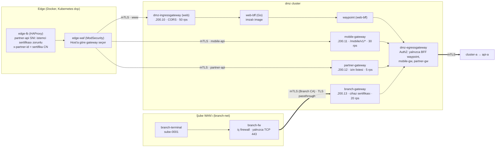
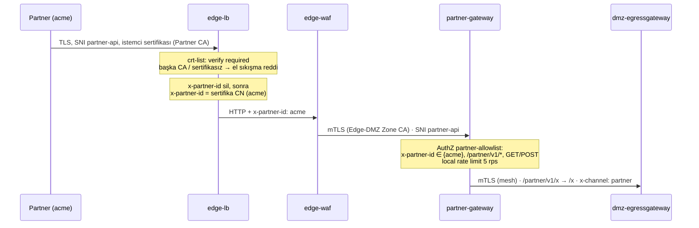
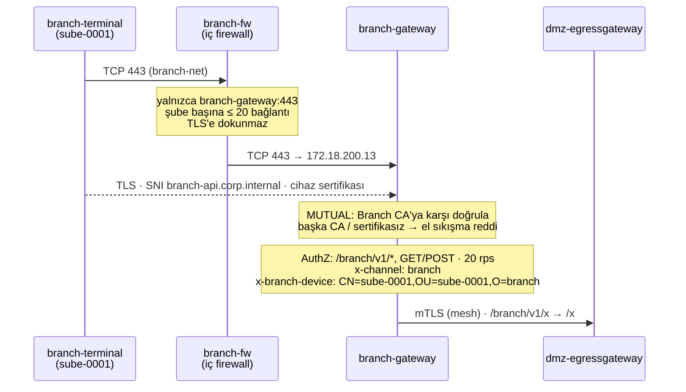

# 06 · DMZ Kanalları (Web BFF, Mobile GW, Partner GW, Şube)

| | |
|---|---|
| **Branch** | `dmz-channels` (açıldığı yer: `policy`) |
| **Durum** | ✅ Tamamlandı, sıfırdan kurulumla doğrulandı (86/86 test) |

## Amaç

DMZ'deki tek giriş kapısını **kanal başına ayrı kapılara** bölmek. Her kanalın riski, istemcisi ve kuralları farklıdır:

| Kanal | İstemci | Kimlik (bugün) | Kapı |
|-------|---------|----------------|------|
| **web** | Tarayıcı | – (08'de oturum/token) | `www.apps.example.local` → web gateway → **Web BFF** |
| **mobile** | Mobil uygulama | – (08'de token) | `mobile-api.apps.example.local` → **mobile-gateway** |
| **partner** | Partner kurumun sunucusu | **İstemci sertifikası** (Partner CA) | `partner-api.apps.example.local` → **partner-gateway** |
| **branch** (şube) | Şube terminali (gişe, operasyon) | **Cihaz sertifikası** (Branch CA); personel kimliği 08'de | `branch-api.corp.internal` → şube WAN'ı → iç firewall → **branch-gateway**. İnternet edge'inden geçmez |

Kanallar ayrılınca her kanala ayrı hız sınırı, ayrı yol izinleri ve ayrı politika uygulanabiliyor. Bir kanaldaki sorun (yük, saldırı, yanlış yapılandırma) diğerlerini etkilemiyor.

## Adım sonundaki durum

| Konu | Durum |
|------|-------|
| Kanallar | 4 kanal, 4 ayrı Istio gateway (web için mevcut `dmz-ingressgateway`; `mobile-gateway`, `partner-gateway` ve `branch-gateway` kendi namespace'lerinde, kendi MetalLB VIP'lerinde) |
| Web | `www` → web gateway → **web-bff** (Go) → waypoint → egress → api-a. Web gateway'in internal'a doğrudan çıkışı yok |
| Mobil | `mobile-api` → mobile-gateway → egress → api-a. Yalnızca `/mobile/v1/*` |
| Partner | `partner-api` → edge'de **istemci sertifikası doğrulaması** → partner-gateway (izin listesi: `acme`) → egress → api-a. Yalnızca `/partner/v1/*` |
| Şube | `branch-api.corp.internal` → şube WAN'ı (`branch-net`) → `branch-fw` (TCP 443) → branch-gateway (**cihaz sertifikası**, Branch CA) → egress → api-a. Yalnızca `/branch/v1/*`. Cihaz kimliği `x-branch-device` ile arka uca |
| Hız sınırı | Kanal başına (gateway'de, Envoy local rate limit): web 50 rps, mobil 30 rps, partner 5 rps, şube 20 rps. Edge'deki IP başına ve iç firewall'daki şube başına bağlantı sınırı da duruyor |
| CORS | Yalnızca web kanalında; izinli origin yalnızca `https://www.apps.example.local` |
| Kanal etiketi | Her gateway `x-channel` header'ını kendisi yazıyor; dışarıdan gelen değer eziliyor |
| `api-a.apps.example.local` | Artık dışarıya açık değil; yalnızca zone'lar arası iç ad (egress gateway ve cluster-a bu adla yönlendiriyor) |

## Detaylı topoloji

Adım sonunda ortamın tamamı: Docker ağları, container'lar, cluster'lar, namespace'ler, VIP'ler ve dört kanalın yolu.

```mermaid
flowchart LR
    subgraph OUT["Dışarısı"]
        direction TB
        browser(["🌐 Tarayıcı<br/>www.apps.example.local"])
        mobileapp(["📱 Mobil uygulama<br/>mobile-api.apps.example.local"])
        partnersys(["🏢 Partner sistemi (acme)<br/>partner-api.apps.example.local<br/>istemci sertifikası: Partner CA"])
    end

    subgraph BRNET["Şube WAN · docker branch-net"]
        direction TB
        term["branch-terminal<br/>sube-0001 · cihaz sertifikası: Branch CA"]
        bfw["branch-fw · HAProxy (TCP)<br/>iç firewall · yalnızca → .200.13:443<br/>şube başına ≤ 20 bağlantı"]
        term -->|"TCP 443"| bfw
    end

    subgraph EDGENET["Dış DMZ · docker edge-net · host :8080 / :8443"]
        direction TB
        lb["edge-lb · HAProxy 3.0<br/>TLS 1.2+ · HSTS · 301<br/>100 istek / 10 sn / IP · 50 bağlantı / IP<br/>X-Forwarded-*, x-user-jwt, x-channel, x-partner-id sil<br/>partner-api: Partner CA doğrula → x-partner-id = CN"]
        waf["edge-waf · ModSecurity + OWASP CRS 4<br/>paranoia 1 · engelleme<br/>Host → kanal gateway'i (map)"]
        lg["loadgen<br/>web · mobil · partner trafiği"]
        lb -->|"HTTP :8080"| waf
        lg -.-> lb
    end

    subgraph KIND["docker kind ağı · 172.18.0.0/16"]
        subgraph DMZ["kind-dmz · İç DMZ · Kyverno (Deny)"]
            direction TB
            subgraph nsI["ns istio-ingress"]
                wgw["dmz-ingressgateway · web<br/>VIP 172.18.200.10<br/>MUTUAL (Edge-DMZ CA) · CORS<br/>x-channel=web · 50 rps"]
            end
            subgraph nsM["ns istio-mobile"]
                mgw["mobile-gateway<br/>VIP 172.18.200.11<br/>MUTUAL (Edge-DMZ CA)<br/>/mobile/v1/* · x-channel=mobile · 30 rps"]
            end
            subgraph nsP["ns istio-partner"]
                pgw["partner-gateway<br/>VIP 172.18.200.12<br/>MUTUAL (Edge-DMZ CA)<br/>izin listesi: acme · /partner/v1/* · 5 rps"]
            end
            subgraph nsB["ns istio-branch"]
                bgw["branch-gateway<br/>VIP 172.18.200.13<br/>MUTUAL (Branch CA)<br/>/branch/v1/* · x-branch-device · 20 rps"]
            end
            subgraph nsW["ns web-bff · ambient"]
                bff["web-bff (Go, imzalı)<br/>/bff/v1/dashboard · güvenlik header'ları"]
                bwp["waypoint<br/>çıkış: yalnızca web-bff"]
                bff -->|"HBONE"| bwp
            end
            subgraph nsE["ns istio-egress"]
                egw["dmz-egressgateway · zone-exit<br/>AuthZ: bff waypoint · mobile · partner · branch"]
            end
            promd["Prometheus (2 saat)"]
            wgw -->|"HBONE :8080"| bff
            bwp ==>|"mTLS"| egw
            mgw ==>|"mTLS"| egw
            pgw ==>|"mTLS"| egw
            bgw ==>|"mTLS"| egw
            promd -->|"remote_write"| egw
        end

        subgraph CA["kind-cluster-a · Internal · Kyverno (Deny)"]
            direction TB
            agw["istio-ingressgateway<br/>VIP 172.18.201.10<br/>AuthZ: yalnızca dmz-egressgateway"]
            subgraph nsA["ns api-a · ambient · yalnızca imzalı image"]
                awp["waypoint<br/>L7 AuthZ: GET/POST"]
                api["api-a ×2<br/>podinfo (imzalı, digest)"]
            end
            aeg["istio-egressgateway<br/>AuthZ: yalnızca waypoint"]
            proma["Prometheus (2 saat)"]
            agw -->|"HBONE"| awp -->|"HBONE"| api
            awp -->|"mTLS"| aeg
            proma -->|"remote_write"| aeg
        end

        subgraph MG["kind-mgmt · Paylaşılan ürünler · Kyverno (Deny)"]
            direction TB
            mgin["istio-ingressgateway<br/>VIP 172.18.203.10<br/>yalnızca egress kimlikleri · POST /api/v1/write"]
            promc["Prometheus (merkezi)"]
            kiali["Kiali (tek, salt okunur)<br/>host :20001"]
            graf["Grafana (tek)<br/>host :3001"]
            mgin --> promc --> kiali & graf
        end

        regs[("lab-registry :5000 (imzalı image'lar)<br/>cache-docker-io · cache-quay-io · cache-ghcr-io")]
    end

    browser & mobileapp & partnersys -->|"HTTPS :8443"| lb
    waf ==>|"mTLS :443 · www"| wgw
    waf ==>|"mTLS :443 · mobile-api"| mgw
    waf ==>|"mTLS :443 · partner-api"| pgw
    bfw ==>|"TCP 443 (TLS passthrough)"| bgw
    egw ==>|"mTLS · SNI api-a.apps.example.local"| agw
    egw ==>|"mTLS · metrikler"| mgin
    aeg ==>|"mTLS · metrikler"| mgin
    aeg -->|"HTTP :80"| httpbin(["httpbin.org"])

    classDef gw fill:#dbeafe,stroke:#2563eb,color:#1e3a8a
    classDef app fill:#dcfce7,stroke:#16a34a,color:#14532d
    classDef edge fill:#fef3c7,stroke:#d97706,color:#78350f
    classDef ext fill:#f3f4f6,stroke:#6b7280,color:#111827
    classDef ops fill:#ede9fe,stroke:#7c3aed,color:#3b0764
    class wgw,mgw,pgw,bgw,egw,agw,aeg,mgin gw
    class bff,bwp,awp,api app
    class lb,waf,lg,bfw edge
    class browser,mobileapp,partnersys,term,httpbin ext
    class promd,proma,promc,kiali,graf,regs ops
```

Docker ağları ve kim nereye bağlı:

| Ağ | Bağlı container'lar | Anlamı |
|----|---------------------|--------|
| `edge-net` | edge-lb, edge-waf, loadgen | İnternet tarafı. Cluster'lara yalnızca WAF üzerinden geçilir |
| `branch-net` | branch-terminal, branch-fw | Şube WAN'ı. Cluster'lara yalnızca branch-fw üzerinden (yalnızca branch-gateway:443) |
| `kind` | kind node'ları (dmz, cluster-a, mgmt), edge-waf, branch-fw, lab-registry, registry önbellekleri | Cluster'lar arası ağ; MetalLB VIP'leri burada |

### Kanal başına yol

| | web | mobile | partner | branch (şube) |
|---|---|---|---|---|
| **Host** | `www.apps.example.local` | `mobile-api.apps.example.local` | `partner-api.apps.example.local` | `branch-api.corp.internal` |
| **Nereden** | İnternet (`edge-net`) | İnternet (`edge-net`) | İnternet (`edge-net`) | Şube WAN'ı (`branch-net`) |
| **Dış kapı** | edge-lb → edge-waf | edge-lb → edge-waf | edge-lb (sertifika) → edge-waf | branch-fw (TCP, TLS'e dokunmaz) |
| **İstemci kimliği** | – (08) | – (08) | Partner CA sertifikası, **edge-lb'de** doğrulanır; CN → `x-partner-id` | Branch CA cihaz sertifikası, **gateway'de** doğrulanır; subject → `x-branch-device` |
| **DMZ kapısı** | `dmz-ingressgateway` (.200.10) | `mobile-gateway` (.200.11) | `partner-gateway` (.200.12) | `branch-gateway` (.200.13) |
| **Kapıya kim bağlanabilir** | yalnızca edge-waf (Edge-DMZ CA) | yalnızca edge-waf | yalnızca edge-waf | Branch CA sertifikalı terminal (branch-fw üzerinden) |
| **Yol izni** | tümü (BFF'e) | `/mobile/v1/*` GET/POST | `/partner/v1/*` GET/POST + izin listesi | `/branch/v1/*` GET/POST |
| **Kanal kuralları** | CORS (kendi origin), BFF güvenlik header'ları | – | – | – |
| **Kota (gateway, pod başına)** | 50 rps | 30 rps | 5 rps | 20 rps |
| **DMZ içi** | gateway → web-bff → waypoint | önek kaldırılır | önek kaldırılır | önek kaldırılır |
| **Egress'te görülen kimlik** | `web-bff/sa/waypoint` | `istio-mobile/sa/mobile-gateway` | `istio-partner/sa/partner-gateway` | `istio-branch/sa/branch-gateway` |
| **Arka uca giden header'lar** | `x-channel: web` | `x-channel: mobile` | `x-channel: partner`, `x-partner-id` | `x-channel: branch`, `x-branch-device` |
| **Internal'a** | dmz-egressgateway → cluster-a ingress (yalnızca `dmz-egressgateway` kimliği) → waypoint (GET/POST) → api-a | ← aynı | ← aynı | ← aynı |

### Segment başına şifreleme ve kontrol

| Segment | Şifreleme | Sunucuyu doğrulayan | İstemciyi doğrulayan | Kontrol |
|---------|-----------|---------------------|----------------------|---------|
| İstemci → edge-lb | TLS 1.2+/1.3 | Lab Public CA (`*.apps.example.local`) | partner-api: Partner CA | Hız/bağlantı sınırı, header temizliği, domain fronting reddi |
| edge-lb → edge-waf | Yok (edge içi, `edge-net`) | – | – | OWASP CRS |
| edge-waf → web / mobile / partner gateway | mTLS | Edge-DMZ Zone CA | Edge-DMZ Zone CA (yalnızca edge-waf) | Gateway `MUTUAL` |
| branch-terminal → branch-gateway | mTLS (branch-fw TLS'e dokunmaz) | Branch CA (`branch-api.corp.internal`) | Branch CA (cihaz) | branch-fw: yalnızca 443, şube başına bağlantı sınırı |
| web gateway → web-bff → waypoint | HBONE (mesh mTLS) | mesh CA (dmz intermediate) | SPIFFE | ztunnel L4: BFF'e yalnızca web gateway; waypoint'e yalnızca BFF |
| Kanal arka ucu → dmz-egressgateway | mTLS (`ISTIO_MUTUAL`) | mesh CA | SPIFFE | Egress AuthZ: 4 kimlik |
| dmz-egressgateway → cluster-a ingress | mTLS (`ISTIO_MUTUAL`) | ortak root CA | SPIFFE | Yalnızca `dmz-egressgateway` |
| cluster-a ingress → waypoint → api-a | HBONE | mesh CA (cluster-a intermediate) | SPIFFE | Waypoint L7: GET/POST; ztunnel: pod'a yalnızca waypoint |
| egress gateway'ler → mgmt ingress | mTLS (`ISTIO_MUTUAL`) | ortak root CA | SPIFFE | Yalnızca egress kimlikleri, yalnızca `POST /api/v1/write` |

## Önceki adıma göre değişenler

| Değişiklik | Neden |
|------------|-------|
| Tek DMZ girişi (`api-a.apps…`) yerine 4 kanal host'u ve 4 gateway | Kanal bazında izolasyon, hız sınırı ve politika (kullanıcı kararı: Mobile GW ve Partner GW ayrı Istio gateway'leri) |
| Web trafiği BFF'ten geçiyor; dmz-egressgateway web gateway'ini artık kabul etmiyor | Web kanalının internal'a tek çıkışı BFF olsun. Tarayıcıya özel iş (yanıt birleştirme, güvenlik header'ları, ileride oturum) DMZ'de, internal servislerden ayrı yapılsın |
| Egress AuthZ: `allow-only-dmz-ingress` → `allow-channel-backends` | Zone kapısından yalnızca kanalların arka uçları geçebilsin |
| `dmz-egressgateway` DestinationRule'u `istio-ingress`'ten `istio-egress`'e taşındı | Servisin kendi namespace'indeki DR tüm istemci namespace'leri için geçerli; kanal sayısı arttıkça her namespace'e kopya gerekmiyor |
| Partner CA ve partner sertifikaları (`certs/partner/`) | Partner'ın kimliği istemci sertifikası (B2B'de yaygın yöntem) |
| HAProxy: `crt-list` ile SNI bazlı istemci sertifikası; `x-partner-id` ve `x-channel` her istekte siliniyor | Partner kimliğini yalnızca edge üretsin; istemci sahte kimlik gönderemesin |
| WAF: Host'a göre hedef gateway (`map`); CORS header'ları kapatıldı | Tek WAF, üç kanal. Image'ın varsayılan CORS header'ları gateway'in CORS kararını eziyordu (bkz. sorunlar) |
| İlk kendi servisimiz: `services/web-bff` (Go); build + imza hattı `03b`'ye eklendi | Kullanıcı kararı: servisler Go ile. 05'teki imza politikası kendi image'ımıza da uygulanıyor |
| lab-registry host'a `127.0.0.1:5001` ile açıldı | Host'ta build edilen image'ı registry'ye itmek için |
| loadgen: web (+BFF dashboard), mobil ve partner trafiği; branch-terminal: şube trafiği | Kiali'de dört kanal da canlı görünsün |
| Şube kanalı: `branch-net`, `branch-fw`, `branch-terminal` (`06c-deploy-branch.sh`), Branch CA, `branch-gateway` | Şube personelinin trafiği internetten değil kurum WAN'ından gelir; ayrı giriş, ayrı kimlik (cihaz), ayrı kurallar |

## Eklenen bileşenler

| Bileşen | Amacı | Neden gerekli | Muadilleri | Neden bu seçildi |
|---------|-------|---------------|------------|------------------|
| **mobile-gateway**, **partner-gateway** (helm `istio/gateway`) | Kanal başına ayrı giriş | Kanal izolasyonu: ayrı hız sınırı, ayrı politika, ayrı ölçekleme, ayrı arıza alanı | Tek gateway + host bazlı yönlendirme; API gateway ürünleri (Kong, Apigee, 3scale/Red Hat API Management, Azure APIM) | Kullanıcı kararı. Mevcut Istio altyapısı; ek ürün ve bellek yok. API ürünlerinin sağladığı geliştirici portalı ve abonelik yönetimi bu lab'ın kapsamında değil |
| **web-bff** (Go, distroless) | Web kanalının arka ucu | Tarayıcıya özel işleri (birleştirme, güvenlik header'ları, ileride oturum) internal servislerden ayırmak; web gateway'in internal'a doğrudan çıkışını kapatmak | GraphQL gateway / federation (Apollo), gateway'de yanıt birleştirme (Envoy/Lua), BFF'siz doğrudan API | Basit ve test edilebilir; kendi kodumuz olduğu için imza hattını uçtan uca gösteriyor. Go: küçük bellek (~10 MB), statik binary, distroless |
| **web-bff waypoint** | BFF'in çıkışını egress gateway'e yönlendirmek; çıkışa L7 yetkilendirme | Ambient'te L7 yönlendirme waypoint ister. Egress gateway'in gördüğü kimlik waypoint'inki | BFF'i sidecar moduna almak | cluster-a'daki egress deseniyle aynı; ambient modda kalınıyor |
| **Envoy local rate limit** (EnvoyFilter) | Kanal başına toplam hız sınırı | Arka ucu kanal bazında korumak (edge'deki sınır IP başına) | Envoy global rate limit + Redis + ratelimit servisi; API gateway ürünlerinin kota özellikleri | Ek bileşen yok. Pod başına çalışır (replika sayısıyla çarpılır); cluster genelinde ortak kota `07 · data`'da Redis ile |
| **Istio CORS** (VirtualService `corsPolicy`) | Tarayıcının çapraz origin isteklerini sınırlamak | Yalnızca kendi web uygulamamız API'yi tarayıcıdan çağırabilsin | BFF'te CORS; WAF'ta CORS | Kanal kuralı gateway'de, tek yerde. Mobil ve partner kanallarına uygulanmıyor |
| **branch-gateway** + **Branch CA** (cihaz sertifikası) | Şube terminallerinin girişi | Şube trafiği internet edge'inden geçmemeli; terminal kimliği (hangi şube, hangi cihaz) doğrulanmalı ve denetim izine girmeli | Şube trafiğini doğrudan internal'a almak; VPN (IPsec) + kullanıcı kimliği; ZTNA (Zscaler, Cloudflare Access) | Tüm dış kaynaklı girişler DMZ'de ve tek egress kapısından geçiyor; cihaz sertifikası gateway'de doğrulanıyor (TLS firewall'dan şifreli geçiyor) |
| **branch-fw** (HAProxy, TCP modu) | Şube WAN'ı ile DMZ arasındaki iç firewall | Şube ağından yalnızca branch-gateway'e, yalnızca 443'e yol olsun | Gerçek firewall (Palo Alto, Fortinet), SD-WAN politikaları | Lab'da L4 kısıtı ve şube başına bağlantı sınırı için yeterli; Docker ağ ayrımıyla birlikte "başka hedefe yol yok" modelini kuruyor |
| **Partner CA + HAProxy `crt-list`** | Partner'ı istemci sertifikasıyla tanımak | B2B kanalında kimlik; sertifikası olmayan partner API'ye hiç ulaşamasın | Partner gateway'de mTLS (edge'de TLS passthrough), API anahtarı, OAuth2 client credentials (mTLS-bound token, RFC 8705) | WAF'ın trafiği görebilmesi için TLS edge'de sonlanmalı; sertifika da orada doğrulanıyor. OAuth2 client credentials `08 · token-exchange`'te eklenebilir |

## Yapılanlar

### Partner kimliği

- **Header'a neden güveniliyor?** `x-partner-id`'yi yalnızca edge-lb yazıyor; dışarıdan geleni her istekte siliyor. Partner gateway'e de yalnızca edge-waf bağlanabiliyor (MUTUAL, Edge-DMZ Zone CA).
- **Domain fronting:** SNI'yı `www` verip Host'u `partner-api` yapan istemciden sertifika istenmez. Bu yüzden HAProxy, partner host'una gelen ve sertifikası olmayan her isteği 403 ile reddediyor.

### Şube kanalı

- **İnternetten erişilemez:** edge'de bu host için kapı yok. Şube ağından da DMZ'nin diğer kapılarına (ör. web gateway VIP'i) yol yok: terminal yalnızca `branch-net`'te, kind ağına yalnızca `branch-fw` bağlı.
- **Cihaz kimliği gateway'den gelir:** `x-branch-device` değeri Envoy'un `%DOWNSTREAM_PEER_SUBJECT%` değişkeninden yazılır; istemcinin gönderdiği değer ezilir.
- **Personel kimliği bu adımda yok:** gişe personelinin kimliği (AD/LDAP → Keycloak personel realm'i) ve rol bazlı yetki `08 · token-exchange`'te.

### Web BFF

`services/web-bff/main.go`, yalnızca standart kütüphane:
- `GET /healthz`
- `GET /bff/v1/dashboard`: api-a'nın `/` ve `/version` uçlarını paralel çağırır, web'e gereken alanları tek yanıtta döner.
- Diğer yollar api-a'ya ters proxy ile iletilir. Bu sayede edge testleri (WAF, header, 5xx) aynı yollarla çalışmaya devam ediyor.
- Her yanıta tarayıcı güvenlik header'ları eklenir: `Content-Security-Policy`, `X-Frame-Options`, `X-Content-Type-Options`, `Referrer-Policy`, `Cache-Control: no-store`.
- Upstream hatasında iç ayrıntı dönmez (`{"error":"upstream_unavailable"}`).
- Image: distroless static, UID 65532, read-only FS, ServiceAccount token'ı bağlanmıyor. Boyut 16,5 MB.

BFF'in çıkışı, seçicisiz bir Service (`api-a.web-bff`, waypoint etiketli) üzerinden yapılır. Waypoint bu trafiği `dmz-egressgateway`'e yönlendirir ve authority'yi `api-a.apps.example.local` yapar. web-bff namespace'inin politikaları:

| Politika | Uygulayan | Kural |
|----------|-----------|-------|
| `allow-nothing` | ztunnel | Varsayılan reddet |
| `web-bff-allow-web-gateway` | ztunnel (L4) | BFF'e yalnızca web gateway, yalnızca 8080 |
| `waypoint-allow-bff` | ztunnel (L4) | Waypoint'e yalnızca BFF |
| `api-a-upstream-allow-bff` | waypoint (L7) | Çıkış servisini yalnızca BFF kullanabilir |

## Değişen dosyalar

| Dosya | Değişiklik |
|-------|------------|
| `services/web-bff/` | **Yeni.** Go kodu, Dockerfile (çok aşamalı, distroless), go.mod |
| `manifests/dmz/10-web-bff.yaml` | **Yeni.** BFF, çıkış Service'i, waypoint, VirtualService, AuthZ |
| `manifests/dmz/21-mobile-channel.yaml`, `22-partner-channel.yaml` | **Yeni.** Gateway, VirtualService, AuthZ |
| `manifests/dmz/23-branch-channel.yaml` | **Yeni.** branch-gateway: Gateway (MUTUAL, Branch CA), VirtualService, AuthZ |
| `manifests/dmz/25-rate-limits.yaml` | **Yeni.** Kanal başına EnvoyFilter |
| `edge/branch-fw.cfg`, `scripts/06c-deploy-branch.sh` | **Yeni.** Şube WAN'ı, iç firewall, şube terminali |
| `manifests/dmz/20-public-gateway.yaml` | Web kanalı: `www` → BFF, CORS, `x-channel` |
| `manifests/dmz/30-internal-clusters.yaml` | Egress AuthZ: kanal arka uçları; DR `istio-egress`'e taşındı |
| `manifests/dmz/00-namespaces.yaml` | `istio-mobile`, `istio-partner`, `istio-branch`, `web-bff` |
| `edge/haproxy.cfg`, `edge/crt-list.txt` | Partner istemci sertifikası, domain fronting engeli, header'lar |
| `edge/waf-channels.conf.template` | **Yeni.** Host → gateway map'i |
| `scripts/05-install-gateways.sh` | Kanal gateway'leri (namespace ve VIP parametreli), secret'lar |
| `scripts/06b-deploy-edge.sh` | WAF hedefi map'ten; CORS header'ları kapalı; partner CA; loadgen üç kanal |
| `scripts/03-generate-certs.sh` | Partner CA, `acme`, `globex`, `rogue`; Branch CA, branch-gateway sunucu sertifikası, `sube-0001` |
| `scripts/setup.sh`, `scripts/99-destroy.sh` | 06c adımı; şube container'ları ve ağı |
| `scripts/03b-publish-images.sh` | Go servisleri: build → push → imza |
| `scripts/lib.sh` | lab-registry host portu (`127.0.0.1:5001`) |
| `config.env` | Kanal host'ları, VIP oktetleri, `LAB_BUILDS`, Go image'ları |
| `scripts/08-verify.sh`, `tests/web-bypass-bff.yaml` | Kanal testleri; edge testleri `www`'ye geçti |
| `manifests/dmz/cluster-b/21-api-b-route.yaml` | 17. adım için not (web gateway artık egress'e çıkamıyor) |

## Tasarım kararları

- **Partner sertifikası edge'de doğrulanıyor.** Partner gateway'de doğrulamak için TLS'in edge'den şifreli geçmesi (passthrough) gerekirdi; o zaman WAF partner trafiğini göremezdi.
- **BFF, tanımadığı yolları iletir.** Gerçek bir BFF yalnızca kendi uçlarını açar. Burada geçiş dönemi için api-a'ya ters proxy de var; 08'de oturum yönetimi gelince daraltılabilir.
- **Local rate limit, global değil.** Kota gateway pod'u başına; replika artınca toplam kota da artar. Gerçek partner kotası (gün/ay bazlı, partner başına) global rate limit ve Redis ister.
- **Kanal gateway'leri ayrı namespace'lerde.** Secret'lar, RBAC ve politikalar kanal bazında ayrılıyor; bir kanalın yöneticisi diğerinin sertifikasına erişemiyor.
- **`api-a.apps.example.local` iç ad olarak kaldı.** Egress gateway ve cluster-a bu adla yönlendiriyor; değiştirmek cluster-a'yı da değiştirmek demekti. Dışarıdan bu host'a gelen istek web gateway'de rota bulamaz (404).

## STRIDE (yeni akışlar)

| Akış | Tehdit | Senaryo | Kontrol | Durum |
|------|--------|---------|---------|-------|
| Partner | **S**poofing | Biri partner gibi davranır | Edge'de Partner CA'ya karşı istemci sertifikası doğrulaması | ✅ |
| | **S**poofing | Geçerli sertifikası olan ama yetkisi olmayan partner | Partner gateway'de izin listesi (CN) | ✅ |
| | **S**poofing | `x-partner-id` header'ı sahte gönderilir | Edge her istekte siler ve sertifikadan yeniden yazar; gateway'e yalnızca WAF bağlanabilir | ✅ |
| | **S**poofing | SNI başka host, Host partner (domain fronting) | Partner host'una sertifikasız istek edge'de 403 | ✅ |
| | **D**enial of service | Partner kotasını aşar | Gateway'de 5 rps (pod başına) | ⚠️ global ve partner başına kota yok (07) |
| | **R**epudiation | Partner "o isteği ben yapmadım" der | Sertifika kimliği ve access log | ⚠️ merkezi log yok (10) |
| Mobil | **E**levation of privilege | Mobil kanaldan partner veya iç yollara erişim | Gateway AuthZ: yalnızca `/mobile/v1/*` | ✅ |
| | **S**poofing | Mobil uygulama kimliği | – | ❌ 08 (token) |
| Web | **T**ampering | Başka bir site kullanıcının tarayıcısından API'yi çağırır | CORS yalnızca kendi origin'imiz | ✅ (CSRF koruması oturumla 08'de) |
| | **E**levation of privilege | Web gateway ele geçirilip internal'a doğrudan çıkılır | Egress AuthZ web gateway kimliğini kabul etmiyor; yalnızca BFF waypoint'i | ✅ |
| | **I**nformation disclosure | BFF hata ayrıntısı sızdırır | Genel hata gövdesi; edge 5xx gövdelerini zaten tek tipe çeviriyor | ✅ |
| Şube | **S**poofing | Şube olmayan bir cihaz şube API'sine bağlanır | Branch CA'ya karşı cihaz sertifikası (gateway'de) | ✅ |
| | **S**poofing | Terminal başka bir cihaz gibi görünür (`x-branch-device`) | Header sertifikadan yazılır, istemcininki ezilir | ✅ |
| | **S**poofing | Çalınan terminal sertifikası | – | ❌ cihaz izin listesi ve iptal (CRL/OCSP) yok |
| | **E**levation of privilege | Şube ağından DMZ'nin diğer kapılarına ya da internal'a erişim | Ağ ayrımı (`branch-net`), iç firewall yalnızca branch-gateway:443; gateway AuthZ `/branch/v1/*` | ✅ |
| | **E**levation of privilege | Personel yetkisinin ötesinde işlem | – | ❌ personel kimliği ve rol bazlı yetki 08'de |
| | **I**nformation disclosure | İnternetten şube API'sinin keşfi | Edge'de bu host için kapı yok | ✅ |
| Tüm kanallar | **S**poofing | `x-channel` sahte gönderilir | Edge siler, her gateway kendi değerini yazar | ✅ |

## Karşılaşılan sorunlar ve çözümler

| # | Sorun | Neden | Çözüm |
|---|-------|-------|-------|
| 1 | Yabancı origin'e verilen 403 yanıtında `access-control-allow-origin: *` | WAF image'ı (`owasp/modsecurity-crs`) her 403'e varsayılan CORS header'ları, her yanıta da `Access-Control-Allow-Headers` ekliyor | `CORS_HEADER_403_*` ve `CORS_HEADER_ACCESS_CONTROL_ALLOW_HEADERS` boş verildi. CORS kararı yalnızca web gateway'inde |
| 2 | Partner testleri `000` | Windows curl (schannel) PEM istemci sertifikası kullanamıyor | Partner testleri edge ağındaki Linux curl container'ından |
| 3 | `03b`'de `verify` fonksiyonu tanımlanmadan çağrılıyordu | Önceki adımdan kalan sıralama hatası | Fonksiyon, kullanıldığı yerin üstüne taşındı |
| 4 | Host'ta build edilen image lab-registry'ye itilemiyor | Registry yalnızca kind ağındaydı | Host'a yalnızca `127.0.0.1:5001`'den açıldı; port yayını olmayan eski container otomatik yeniden oluşturuluyor |
| 5 | Yabancı origin'li preflight'ın 403 alması | Envoy eşleşmeyen preflight'ı upstream'e iletiyor; api-a'nın L7 AuthZ'si `OPTIONS`'a izin vermiyor | Beklenen davranış: tarayıcı `Allow-Origin` görmediği için isteği zaten engeller |

## Doğrulama

Sıfırdan kurulum iki kez yapıldı:
- Önce web, mobil ve partner kanallarıyla: 77/77, 22 dk.
- Şube kanalı eklendikten sonra: `99-destroy.sh` → `setup.sh`, tek seferde, elle müdahale yok. **Süre: 18 dk. Sonuç: 86 başarılı, 0 başarısız.**

Önceki adımların testleri de geçti. Edge testleri artık `www` üzerinden (BFF'ten geçerek) çalışıyor.

Bu adımda eklenen testler:

| Test | Beklenen | Sonuç |
|------|----------|-------|
| Web: BFF dashboard | `"channel":"web"` | ✔ |
| Web: BFF güvenlik header'ları | `x-frame-options: deny` | ✔ |
| Web: sahte `x-channel` ezilir | `web` | ✔ |
| Web: CORS izinli origin | `access-control-allow-origin: https://www…` | ✔ |
| Web: CORS yabancı origin | `Allow-Origin` yok | ✔ |
| Web: web-bff imzalı image digest'iyle | `lab-registry:5000/lab/web-bff:…@sha256` | ✔ |
| Web gateway BFF'i atlayıp egress'e çıkamaz (`tests/web-bypass-bff.yaml`) | 403 RBAC | ✔ |
| Mobil: `/mobile/v1/` → api-a | 200 | ✔ |
| Mobil: sahte `x-channel` ezilir | `mobile` | ✔ |
| Mobil: kanal dışı yol | 403 | ✔ |
| Partner: `acme` kabul, `x-partner-id=acme` | 200 | ✔ |
| Partner: `globex` (izin listesinde yok) | 403 | ✔ |
| Partner: `globex` + sahte `x-partner-id: acme` | 403 | ✔ |
| Partner: başka CA (`rogue`) | TLS reddi (000) | ✔ |
| Partner: sertifikasız | TLS reddi (000) | ✔ |
| Partner: domain fronting (SNI `www`, Host partner) | 403 | ✔ |
| Partner: kota aşımı | 429 + `x-ratelimit-scope: partner` | ✔ |
| Şube: cihaz sertifikasıyla api-a | 200 | ✔ |
| Şube: sahte `x-channel` ezilir | `branch` | ✔ |
| Şube: cihaz kimliği sertifikadan (sahte `x-branch-device` ezilir) | `CN=sube-0001` | ✔ |
| Şube: sertifikasız | TLS reddi (000) | ✔ |
| Şube: başka CA'nın sertifikası (partner) | TLS reddi (000) | ✔ |
| Şube: kanal dışı yol | 403 | ✔ |
| Şube ağından web gateway VIP'ine yol | yok (000) | ✔ |
| İnternetten şube kanalına | erişilemez | ✔ |
| Pod Security: `istio-mobile`, `istio-partner`, `istio-branch`, `web-bff` | restricted, ihlal yok | ✔ ✔ ✔ ✔ |

Kaynak kullanımı:

| | 05-policy | 06-dmz-channels |
|---|---|---|
| dmz node'u | ~2,3 GB | ~2,6 GB (3 yeni gateway, web-bff, waypoint) |
| Edge/şube container'ları | ~0,13 GB | ~0,13 GB (branch-fw ~10 MB, terminal ~1 MB eklendi) |
| Docker VM'inde kullanılabilir bellek | ~3,6 GB | ~3,2 GB |

## Bilinen kısıtlar

- Mobil ve web kanallarında kullanıcı/uygulama kimliği yok (`08 · token-exchange`).
- Hız sınırı pod başına; partner başına ya da cluster genelinde kota yok (`07 · data`, Redis).
- BFF tanımadığı yolları api-a'ya iletiyor (geçiş dönemi).
- Partner izin listesi AuthZ politikasında sabit (yeni partner = manifest değişikliği). Gerçekte partner kaydı bir veri kaynağından (ör. Keycloak client'ları) gelir.
- cluster-b'nin web üzerinden rotası (Akış 2) egress AuthZ'ye takılır; 17. adımda yeniden tasarlanacak.
- Partner ve şube cihaz sertifikalarının iptali (CRL/OCSP) yok; cihaz izin listesi yok (Branch CA'dan sertifikası olan her terminal kabul).
- Şube kanalında personel kimliği ve rol bazlı yetki yok (`08 · token-exchange`).
- Şube WAN'ı ve iç firewall Docker ağı ve L4 HAProxy ile temsil ediliyor; gerçekte SD-WAN/MPLS ve kurumsal firewall.
