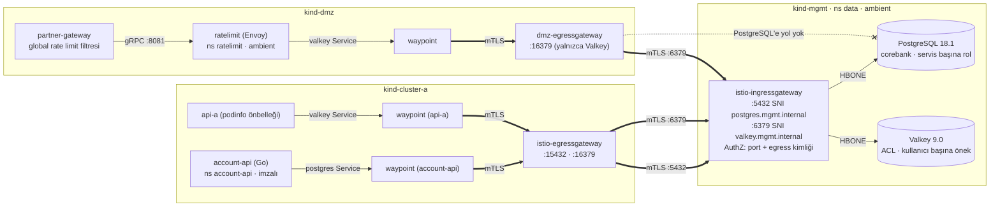
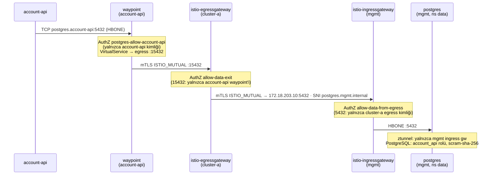

# 07 · Veri Katmanı (PostgreSQL, Valkey, Global Rate Limit)

| | |
|---|---|
| **Branch** | `data` (açıldığı yer: `dmz-channels`) |
| **Durum** | ✅ Tamamlandı, sıfırdan kurulumla doğrulandı (107/107 test) |

## Amaç

Veri katmanını mgmt'te kurmak (kullanıcı kararı: **tüm veri mgmt'te**). Bunu yaparken:
- Internal servisler veriye **yalnızca mesh üzerinden**, kimlikle ve en az yetkiyle erişsin.
- DMZ'den veritabanına yol olmasın.
- 06'da pod başına olan partner kotası cluster genelinde ortak sayaçlı bir **global kotaya** dönüşsün.

## Adım sonundaki durum

| Konu | Durum |
|------|-------|
| PostgreSQL 18.1 | mgmt `data` namespace'i, tek replika StatefulSet, 1 GiB PVC. `corebank` veritabanı; `accounts` (örnek hesaplar) ve `audit` şemaları |
| Valkey 9.0 | mgmt `data` namespace'i, kalıcılık yok (önbellek ve sayaçlar), 48 MB bellek sınırı, ACL dosyasıyla |
| Kullanıcılar | PostgreSQL: `account_api` (yalnızca `accounts.accounts` üzerinde SELECT). Valkey: `api_a` (`cache:api-a:*`), `ratelimit` (`rl:*`), `admin`; `default` kullanıcı kapalı |
| account-api | Yeni Go servisi (cluster-a): hesapları PostgreSQL'den okuyor, IBAN'ları maskeliyor. Tüm kanallardan `…/accounts` ile erişiliyor; yalnızca GET |
| api-a | podinfo'nun Valkey önbelleği açık (`/cache/{anahtar}`) |
| Cluster'lar arası veri yolu | İstemci → kendi namespace'indeki seçicisiz Service → waypoint → egress gateway (`:15432` / `:16379`) → mTLS → mgmt ingress (`:5432` / `:6379`) → `data` |
| Global rate limit | DMZ'de Envoy ratelimit servisi; partner başına kota (acme 1000/dk, initech 5/dk), sayaçlar mgmt Valkey'de |
| Kimlik bilgileri | `certs/data/` altında üretilen parolalar (git'e girmez); her secret yalnızca onu kullanan cluster/namespace'te |

## Önceki adıma göre değişenler

| Değişiklik | Neden |
|------------|-------|
| mgmt'e `data` namespace'i, PostgreSQL ve Valkey | Kullanıcı kararı: tüm veri mgmt'te. İş yükü cluster'ları durumsuz kalır |
| mgmt ingress gateway'e 5432 ve 6379 portları, `data-entry` Gateway (TLS `ISTIO_MUTUAL`) ve port bazlı AuthZ | Veri girişi de metrikler gibi yalnızca egress gateway kimliklerinden, mTLS ile |
| Egress gateway'lere 15432 ve 16379 portları, `data-exit` Gateway | Zone'lar arası her bağlantı egress gateway'den geçsin |
| cluster-a: `account-api` (Go, PostgreSQL) ve `account-api` namespace'i; internal gateway'de `/accounts` → account-api | Veritabanını gerçekten kullanan bir servis; servis başına DB kullanıcısını göstermek |
| api-a: `PODINFO_CACHE_SERVER` (Secret'tan) | Valkey'in uygulama önbelleği olarak kullanımı ve ACL ile önek kısıtı |
| DMZ: `ratelimit` namespace'i, Envoy ratelimit servisi; partner gateway'e global rate limit filtresi | 06'daki local kota pod başınaydı; sözleşmedeki partner kotası tüm pod'larda ortak olmalı |
| Partner izin listesine `initech` (düşük kotalı test partner'ı) | Global kotayı test edebilmek |
| Egress AuthZ'ler port bazlı: kanallar ve api-a waypoint'i yalnızca 443; veri portları ayrı politikada | Yeni portlar açılınca mevcut kimliklerin veri portlarına da erişebilmesini engellemek |
| Waypoint geneline (`targetRefs: Gateway`) yazılan ALLOW politikaları kaldırıldı; yalnızca Service'e bağlı politikalar | Güvenlik açığı bulundu: aynı waypoint'teki ALLOW'lar birleşiyor (bkz. sorunlar #1) |
| `05b-create-data-secrets.sh`, Kyverno için yeni imzalı image'lar (postgres, valkey, ratelimit, account-api) | Parolalar repoda yok; tüm veri ve platform image'ları imzalı iç registry'den |

## Eklenen bileşenler

| Bileşen | Amacı | Neden gerekli | Muadilleri | Neden bu seçildi |
|---------|-------|---------------|------------|------------------|
| **PostgreSQL 18.1** (StatefulSet) | İlişkisel veri (hesaplar) | Servislerin kalıcı verisi | Oracle, MS SQL Server, IBM Db2 (bankalarda yaygın); operator'lü PostgreSQL: **CloudNativePG**, Crunchy PGO, Zalando; OpenShift'te Crunchy | Açık kaynak, kurumsal kullanımda yaygın. Operator yedekleme, failover ve sertifika yönetimi verir, ama ek CRD ve bellek maliyeti var (05'te CRD'lerin apiserver maliyetini gördük). Gerçek ortamda CloudNativePG/Crunchy önerilir |
| **Valkey 9.0** | Önbellek ve rate limit sayaçları | Hızlı, paylaşılan, geçici veri | Redis (8.x AGPL/SSPL lisanslı), KeyDB, Dragonfly, Memcached; yönetilen: ElastiCache | Redis ile protokol ve komut uyumlu; BSD lisanslı, Linux Foundation altında. Lisans riski olmadığı için bankalarda tercih ediliyor |
| **Envoy ratelimit** (`envoyproxy/ratelimit`) | Global (cluster genelinde ortak) rate limit | Partner kotası tüm gateway pod'larında ortak sayılmalı | API gateway ürünlerinin kota özelliği (Kong, Apigee, 3scale), Istio'nun eski Mixer quota'sı (kaldırıldı) | Envoy'un resmi referans servisi; Istio gateway'leriyle doğrudan gRPC uyumlu |
| **account-api** (Go, pgx) | Veritabanını kullanan örnek internal servis | Servis başına DB kullanıcısı ve en az yetkiyi uçtan uca göstermek | – | Kullanıcı kararı: servisler Go ile. Tek dış bağımlılık `pgx` (PostgreSQL sürücüsü) |
| **Seçicisiz Service + waypoint + egress `data-exit`** | Uygulamanın mgmt'e mesh üzerinden ve kimlikle bağlanması | Uygulama zone'lar arası adresi bilmesin; çıkış kimlik bazlı denetlensin | Uygulamanın doğrudan mgmt LB IP'sine bağlanması; Istio multicluster | 02'den beri kullanılan "tek kapı" deseni; TCP için de çalışıyor |

## Yapılanlar

### Veri bağlantısı (account-api → PostgreSQL)

Aynı yol Valkey için de geçerli: api-a'nın waypoint'i `:16379` üzerinden, DMZ'deki ratelimit'in waypoint'i `dmz-egressgateway :16379` üzerinden geçiyor.

### En az yetki

| Katman | Kural |
|--------|-------|
| Ağ (mesh) | mgmt ingress: 5432 yalnızca cluster-a egress; 6379 cluster-a ve DMZ egress. `data` namespace'inde varsayılan reddet; pod'lara yalnızca mgmt ingress gateway |
| Çıkış (egress) | cluster-a: 15432 yalnızca account-api waypoint'i, 16379 yalnızca api-a waypoint'i. DMZ: 16379 yalnızca ratelimit waypoint'i; **PostgreSQL çıkışı tanımlı değil** |
| PostgreSQL | `account_api`: `CONNECT` + `accounts` şemasında yalnızca `SELECT`; `public` ve `audit`'e erişimi yok; en fazla 10 bağlantı |
| Valkey | `api_a`: yalnızca `cache:api-a:*` (+ podinfo'nun sağlık anahtarı `api-a-*`); `ratelimit`: yalnızca `rl:*`; ikisinde de `-@dangerous` (FLUSHALL, CONFIG, KEYS vb. yok); `default` kapalı |
| Uygulama | account-api: L7'de yalnızca `GET /accounts*`; IBAN maskeli; DB hatasının ayrıntısı istemciye dönmüyor |

Mesh, kaynak olarak yalnızca egress gateway'in kimliğini görüyor; mgmt hangi servisin bağlandığını ayırt edemiyor. Bu boşluğu servis başına veritabanı kullanıcısı kapatıyor.

### Global rate limit

- partner-gateway her istekte `x-partner-id` header'ını `partner_id` tanımlayıcısı olarak ratelimit servisine soruyor (gRPC). Bu header'ı edge, sertifikanın CN'inden yazıyor.
- Sayaçlar mgmt Valkey'de `rl:` önekiyle tutuluyor.
- Kota aşılınca yanıt `429` + `x-envoy-ratelimited: true` oluyor.
- **Fail-open:** ratelimit servisine ulaşılamazsa istek geçiyor (`failure_mode_deny: false`). Kota kontrolü erişilebilirliği düşürmesin diye; local rate limit her durumda koruma sağlıyor.

| Partner | Global kota | Local (pod başına) |
|---------|-------------|--------------------|
| acme | 1000 / dk | 5 rps, anlık 10 |
| initech | 5 / dk | 5 rps, anlık 10 |

## Değişen dosyalar

| Dosya | Değişiklik |
|-------|------------|
| `manifests/mgmt/20-data.yaml` | **Yeni.** PostgreSQL (init betiği: roller, şemalar, örnek veri), Valkey, `data` AuthZ |
| `manifests/mgmt/25-data-entry.yaml` | **Yeni.** mgmt veri girişi: Gateway, VirtualService (TCP), port bazlı AuthZ |
| `manifests/cluster-a/15-account-api.yaml` | **Yeni.** account-api, waypoint, AuthZ |
| `manifests/cluster-a/55-data-exit.yaml` | **Yeni.** Seçicisiz Service'ler (postgres, valkey), egress `data-exit`, ServiceEntry, DR, AuthZ |
| `manifests/dmz/26-global-rate-limit.yaml` | **Yeni.** ratelimit servisi, Valkey çıkışı, waypoint, AuthZ, partner gateway EnvoyFilter |
| `services/account-api/` | **Yeni.** Go kodu, Dockerfile, go.mod/go.sum (pgx v5.7.6) |
| `scripts/05b-create-data-secrets.sh` | **Yeni.** Parolalar ve Secret'lar |
| `manifests/*/00-namespaces.yaml` | `data` (mgmt), `account-api` (cluster-a), `ratelimit` (dmz) |
| `manifests/cluster-a/10-api-a.yaml`, `30-internal-gateway.yaml`, `40-security.yaml` | api-a önbellek secret'ı; `/accounts` rotası; egress AuthZ yalnızca 443 |
| `manifests/dmz/30-internal-clusters.yaml`, `22-partner-channel.yaml`, `10-web-bff.yaml` | DMZ veri çıkışı (yalnızca Valkey); kanal AuthZ yalnızca 443; `initech`; waypoint politikası Service'e bağlandı |
| `istio/values/egress-gateway.yaml`, `istio/values/ingress-gateway-mgmt.yaml` | Veri portları |
| `config.env`, `scripts/03-generate-certs.sh`, `scripts/05-install-gateways.sh`, `scripts/setup.sh` | Yeni imzalı image'lar, `account-api` build'i, veri host'ları; `initech` sertifikası; mgmt ingress değerleri; 05b adımı |
| `scripts/08-verify.sh` | Veri katmanı testleri |

## Tasarım kararları

- **Operator yok, düz StatefulSet.** Lab'da bellek ve CRD maliyetini düşük tutmak için. Gerçek ortamda CloudNativePG veya Crunchy: yedekleme (WAL arşivi), PITR, failover, sertifika rotasyonu.
- **Veritabanının kendi TLS'i yok.** Taşıma şifrelemesi mesh mTLS'inde (uçtan uca: client waypoint → egress → mgmt ingress → postgres, hepsi mTLS/HBONE). Gerçekte DB tarafında da TLS istenebilir (çift katman, DB'nin istemci sertifikasıyla doğrulama).
- **Uygulama mgmt adresini bilmiyor.** account-api `postgres.account-api.svc` adresine bağlanıyor; nereye gideceğini mesh yapılandırması belirliyor. Veritabanı taşınırsa uygulama değişmiyor.
- **Valkey kalıcı değil.** Önbellek ve sayaçlar kaybolabilir; yeniden başlatmada kota sayaçları sıfırlanır. Kalıcı veri yalnızca PostgreSQL'de.
- **Global rate limit fail-open.** Kota servisi çökerse kanal kapanmasın; local limit koruyor.

## STRIDE (yeni akışlar)

| Akış | Tehdit | Senaryo | Kontrol | Durum |
|------|--------|---------|---------|-------|
| Servis → veritabanı | **S**poofing | Başka bir servis account-api gibi bağlanır | Waypoint: postgres çıkışı yalnızca account-api kimliğine; DB'de servis başına kullanıcı ve parola | ✅ |
| | **E**levation of privilege | account-api başka servisin verisini okur ya da yazar | Rol yalnızca `accounts.accounts` SELECT (test: `audit` okuma ve `UPDATE` reddedildi) | ✅ |
| | **T**ampering / **I**nformation disclosure | Veri yolda okunur ya da değiştirilir | Tüm segmentler mTLS/HBONE | ✅ (DB'nin kendi TLS'i yok) |
| | **E**levation of privilege | DMZ ele geçirilip veritabanına erişilir | DMZ egress'te PostgreSQL çıkışı yok; mgmt 5432'yi DMZ egress kimliğine açmıyor | ✅ |
| | **S**poofing | Mesh dışından mgmt veri portlarına bağlanma | mgmt ingress TLS `ISTIO_MUTUAL` (test: sertifikasız 000) | ✅ |
| Kimlik bilgileri | **I**nformation disclosure | Parola sızar | Secret'lar yalnızca ilgili namespace'te; repoda yok | ⚠️ Kubernetes Secret (şifresiz, base64), uzun ömürlü parolalar; **podinfo bağlantı URL'ini parolasıyla loga yazıyor** (bkz. sorunlar #4). Vault ve dinamik kimlik: `13 · secrets` |
| Valkey | **T**ampering | Bir istemci diğerinin anahtarlarını değiştirir | ACL: kullanıcı başına önek; `-@dangerous` | ✅ |
| | **D**enial of service | Önbellek belleği doldurulur | `maxmemory 48mb`, `allkeys-lru` | ⚠️ Kullanıcı başına bellek sınırı yok |
| Global kota | **D**enial of service | Partner kotayı aşar | Global kota (429) + local kota | ✅ |
| | **D**enial of service | ratelimit ya da Valkey çöker | Fail-open; local kota geçerli | ⚠️ Bilinçli tercih |
| Veri | **R**epudiation | Kim hangi veriyi okudu bilinmez | account-api isteği `x-channel` ve `x-request-id` ile logluyor | ⚠️ DB audit log'u (pgaudit) ve merkezi log yok (`10 · logging`) |
| | **I**nformation disclosure | Disk/yedek ele geçer | – | ❌ Şifreli disk ve yedek yok |

## Karşılaşılan sorunlar ve çözümler

| # | Sorun | Neden | Çözüm |
|---|-------|-------|-------|
| 1 | **Güvenlik açığı:** account-api'ye POST, waypoint'te 403 yerine servise ulaştı (405) | Waypoint'e bağlı ALLOW politikaları birleşiyor (OR). Waypoint'in tamamına (`targetRefs: Gateway`) yazılan "ingress gateway'e izin ver" politikası, servis bazlı "yalnızca GET" kısıtını genişletti | Waypoint geneli politikalar kaldırıldı; tüm politikalar Service'e bağlı. 06'daki web-bff politikası da aynı desene çevrildi. Test bu açığı yakalıyor |
| 2 | Waypoint pod'una `selector` ile yazılan L4 politikaları etkisiz | Waypoint pod'ları ambient'te değil (`dataplane-mode: none`); ztunnel onlara politika uygulamıyor | Bkz. #1: koruma Service'e bağlı L7 politikalarıyla |
| 3 | `multiple hosts provided with non-HTTP, non-TLS ports` | Istio, TCP portlu ServiceEntry'de tek host'a izin veriyor | PostgreSQL ve Valkey için ayrı ServiceEntry'ler |
| 4 | **Bulgu:** podinfo, Valkey'e ulaşamadığında `redis://api_a:<parola>@…` URL'ini loga yazıyor | Üçüncü taraf örnek uygulamanın davranışı | Dokümante edildi; kendi Go servislerimiz kimlik bilgisini loglamıyor. Log maskeleme: `10 · logging`. Kalıcı çözüm: parola yerine kısa ömürlü kimlik (`13 · secrets`) |
| 5 | ratelimit hazır olmuyor, portları açılmıyor | Valkey (mgmt) henüz yokken başladı ve bağlantıda takıldı; sıfırdan kurulumda DMZ, mgmt'ten önce kurulur | `livenessProbe`: takılırsa yeniden başlatılıyor |
| 6 | ratelimit kotası uygulanmıyor (istekler hep 200) | ConfigMap'in gizli `..data` kopyası da yüklenince "duplicate domain" hatası; yapılandırma hiç yüklenmemiş | `RUNTIME_IGNOREDOTFILES=true` |
| 7 | ratelimit her saniye debug istatistik logu | İstatistik hedefi yokken varsayılan "logging sink" | `DISABLE_STATS=true` |
| 8 | podinfo sağlık kontrolü ACL'e takılıyor (`NOPERM`) | podinfo pod adını anahtar olarak yazıyor | ACL'e `~api-a-*` |

## Doğrulama

Sıfırdan kurulum: `99-destroy.sh` → `setup.sh` (tek seferde, elle müdahale yok). **Süre: 18 dk. Sonuç: 107 başarılı, 0 başarısız.** Önceki adımların 86 testi de geçti.

Bu adımda eklenen testler (`08-verify.sh` → "8) Veri katmanı"):

| Test | Beklenen | Sonuç |
|------|----------|-------|
| Mobil: hesaplar PostgreSQL'den | `"source":"postgresql"` | ✔ |
| Web (BFF üzerinden): hesap sorgusu | `Acme Ltd.` | ✔ |
| Partner (acme): hesap sorgusu | `Acme Ltd.` | ✔ |
| IBAN maskeli (tam IBAN yanıtta yok) | yok | ✔ |
| account-api'ye POST (waypoint L7) | 403 | ✔ (ilk denemede 405: sorun #1) |
| PostgreSQL: `account_api` kendi tablosu | 4 satır | ✔ |
| PostgreSQL: `account_api` → `audit.events` | permission denied | ✔ |
| PostgreSQL: `account_api` → `UPDATE` | permission denied | ✔ |
| Valkey: api-a kendi önekinde yaz/oku | değer döner | ✔ |
| Valkey: api-a başka önekte yazma | `cache set failed` (ACL) | ✔ |
| Valkey: `ratelimit` kullanıcısı api-a anahtarını okuma | `NOPERM` | ✔ |
| Valkey: kimliksiz bağlantı | `NOAUTH` | ✔ |
| Global kota: initech (5/dk) | 429 + `x-envoy-ratelimited` | ✔ |
| Kota sayaçları Valkey'de yalnızca `rl:` önekiyle | `rl:partner_partner_id_…` | ✔ |
| mgmt 5432 / 6379'a mesh sertifikası olmadan | 000 | ✔ ✔ |
| DMZ egress'te yalnızca Valkey çıkışı (PostgreSQL yok) | `16379` | ✔ |
| PostgreSQL ve Valkey imzalı image'larla (digest) | 2 | ✔ |
| Pod Security: `data` (mgmt), `account-api` (cluster-a), `ratelimit` (dmz) | restricted, ihlal yok | ✔ ✔ ✔ |

Kaynak kullanımı:

| | 06-dmz-channels | 07-data |
|---|---|---|
| mgmt node'u | ~2,7 GB | ~2,8 GB (PostgreSQL, Valkey) |
| cluster-a node'u | ~2,5 GB | ~2,5 GB (account-api + waypoint) |
| dmz node'u | ~2,6 GB | ~2,7 GB (ratelimit + waypoint) |
| Docker VM'inde kullanılabilir bellek | ~3,2 GB | ~3,0 GB |

## Bilinen kısıtlar

- PostgreSQL tek replika; yedekleme, PITR ve failover yok. Disk şifrelemesi yok.
- Parolalar Kubernetes Secret'ta ve uzun ömürlü (`13 · secrets`: Vault, dinamik DB kimlikleri).
- Veritabanı erişim denetimi (pgaudit) ve merkezi log yok (`10 · logging`).
- mgmt, veri bağlantısının kaynağını yalnızca egress gateway kimliği olarak görüyor; servis ayrımı DB kullanıcısıyla.
- Global rate limit fail-open; Valkey yeniden başlarsa sayaçlar sıfırlanır.
- podinfo kimlik bilgisini loga yazabiliyor (örnek uygulama).
