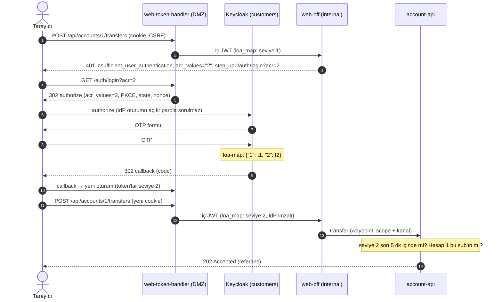

# 09b · L7 yetki: scope, doğrulama seviyesi (step-up), nesne seviyesinde yetki, partner bazlı yetki

| | |
|---|---|
| **Branch** | `l7-policies` (açıldığı yer: `idp-token-exchange`) |
| **Durum** | ✅ Tamamlandı, sıfırdan kurulumla doğrulandı (173/173 test) |

## Amaç

09a'da internal'a giren her istek IdP imzalı bir iç JWT taşıyordu, ama yetki kararları kabaydı: geçerli bir JWT ve uygun bir rol, servisin bütün uçlarını açıyordu. Bu adımda yetki dört katmana ayrıldı:

- **Scope (ne yapılabilir):** API scope'ları (`accounts:read`, `transfers:write`, `products:read`, `info:read`) client başına Keycloak'ta atanır, iç JWT'ye taşınır ve waypoint'te uç başına kontrol edilir.
- **Doğrulama seviyesi (ne kadar emin):**
  - Seviye 1 = parola, seviye 2 = parola + OTP.
  - Para transferi son 5 dk içinde seviye 2 ister.
  - Seviye yetmezse istemci RFC 9470 step-up ipucu alır ve yalnızca OTP girer.
- **Nesne seviyesinde yetki (kimin verisi, BOLA):**
  - Müşteri yalnızca kendi hesaplarını, partner yalnızca kendisine bağlı hesapları görür.
  - Personel hepsini görür ve her erişimi loglanır.
  - Bu karar uygulamada: hesabın kime ait olduğunu mesh bilemez.
- **Partner bazlı yetki (kullanıcının isteği):**
  - Partnerler client ID + client secret ile bağlanır (token sertifikalarına bağlı kalır).
  - Her partner yalnızca sözleşmesindeki işlemleri yapabilir; her servise izin verilmez.
  - Yeni yetki kod değişikliği gerektirmez: Keycloak'ta client'a scope atanır.

## Adım sonundaki durum

| Konu | Durum |
|------|-------|
| Keycloak client scope'ları | Realm'lerde yalnızca tanımladıklarımız var: `basic` (sub), `acr`, `roles` + API scope'ları. Dış client'lara kanalına göre varsayılan atanır; exchange client'larına opsiyonel |
| Partner yetkileri | `acme` → `info:read`, `accounts:read` · `initech` → `info:read`, `products:read`. Atanmamış scope istenirse Keycloak `invalid_scope` döner |
| Doğrulama seviyeleri (customers) | Özel tarayıcı akışı (Level of Authentication): seviye 1 parola, seviye 2 OTP (5 dk geçerli). `acr_values=2` ile step-up; açık IdP oturumunda yalnızca OTP sorulur. Test kullanıcısında TOTP tanımlı |
| İç JWT | `scope` (dış token'ınkiyle aynı), `loa_map` (IdP oturumunda ulaşılan seviyeler ve zamanları, IdP imzalı). **`acr` yok:** Keycloak token exchange `acr`'yi taşımıyor (bkz. bulgular) |
| auth-service 0.3.0 | Exchange'e tam olarak dış token'ın scope'unu gönderir, sonucun alt küme olduğunu doğrular. Partner kanalında yol + metot ↔ scope tablosu (listede olmayan reddedilir) |
| account-api 0.4.0 | BOLA (`owner_sub`, `partner_id`), `POST /accounts/{id}/transfers` (örnek; işlem yapmaz, kaydeder), `GET /products`. Seviye 2 tazeliği `loa_map`'ten |
| Waypoint kuralları | account-api: okuma `accounts:read`, ürün `products:read`, transfer `transfers:write` + kanal (web/mobil) ya da kanal şube + gişe/operasyon rolü. api-a: müşteri ve personel kanalları; partner yalnızca `info:read` ile GET |
| web-bff 0.4.0 / web-token-handler 0.2.0 | Transfer öncesi seviye kontrolü: 401 + `WWW-Authenticate: ... insufficient_user_authentication, acr_values="2"` + `step_up` adresi. Handler'da `/auth/login?acr=2` |

## Önceki adıma göre değişenler

| Değişiklik | Neden |
|------------|-------|
| Realm JSON'larında `clientScopes` (`basic`, `acr`, `roles`, API scope'ları), client başına `defaultClientScopes` | Yetki client başına tanımlansın; realm'de istenmeyen varsayılan scope (profile, email…) olmasın |
| Partner client'larına sözleşme scope'ları | Kullanıcının isteği: partner her servise erişmesin |
| customers realm'inde LoA akışı, OTP politikası (±1 periyot tolerans), lab direct grant akışı (OTP'siz), ayse'ye TOTP ve sabit ID | Step-up; testlerin OTP üretebilmesi; hesap sahipliği init SQL'de sabit sub ile |
| Exchange client'larında `acr` yerine `loa_map` (user session note mapper) | Exchange `acr`'yi hep `1` yapıyor; yanlış bir claim iç JWT'de olmamalı |
| auth-service: exchange'de `scope`, alt küme kontrolü, partner yol ↔ scope | Scope yükseltme açığı (bulgu); DMZ'de erken ret |
| `accounts.accounts`'a `owner_sub`, `partner_id` | BOLA |
| account-api: süzülmüş sorgular, transfer ve ürün uçları; web-bff: step-up ipucu; handler: `?acr=2` | Yeni yetki modeli |
| Waypoint: account-api ve api-a kuralları claim bazlı; RequestAuthentication'da `spaceDelimitedClaims: [scope]` | Scope tek tek eşleşsin (`"accounts:read transfers:write"` → liste) |
| int-ingressgw: `/products` → account-api | Ürün kataloğu |
| Testler: global kota initech için `/products` üzerinden | initech'in hesaplara yetkisi yok |

## Eklenen bileşenler ve özellikler

| Bileşen | Amacı | Neden gerekli | Muadilleri | Neden bu seçildi |
|---------|-------|---------------|------------|------------------|
| **OAuth scope'ları (client başına)** | Hangi client'ın hangi işlemi yapabileceği | Partner bazlı yetki; en az yetki | Rol bazlı (realm/client rolleri), Keycloak Authorization Services (UMA, politikalar), harici PDP (OPA, Cerbos) | Standart (RFC 6749), token'da taşınır, waypoint'te doğrudan kontrol edilir. Rol "kim", scope "ne" sorusunu yanıtlar |
| **Keycloak Level of Authentication akışı + TOTP** | Doğrulama seviyeleri ve step-up | Transfer gibi riskli işlemlerde ek doğrulama (CH-08, IAM-08) | Keycloak varsayılan OTP akışı (hep OTP), WebAuthn/passkey, push onayı (CIBA), harici MFA | Keycloak'ta yerleşik; `acr_values` ile standart step-up. Gerçekte seviye 2 = push onayı veya passkey, seviye 3 = işlem imzası |
| **RFC 9470 step-up yanıtı** | İstemcinin hangi seviyeyle yeniden doğrulaması gerektiğini bilmesi | Yalnızca 403 dönseydi istemci ne yapacağını bilemezdi | Uygulamaya özel hata kodu | Standart başlık: `WWW-Authenticate: Bearer error="insufficient_user_authentication", acr_values="2"` |
| **BOLA kontrolü (uygulamada)** | Nesne seviyesinde yetki | OWASP API Top 10 #1; mesh hesabın sahibini bilemez | Veritabanında satır seviyesi güvenlik (PostgreSQL RLS), Keycloak Authorization Services, OPA (veriyle) | En basit ve açık yer; sorgu kullanıcıya göre süzülür. Sahibi olmayan hesap 404 döner (varlığı sızdırılmaz). RLS ileride derinlemesine savunma olarak eklenebilir |

## Yapılanlar

### Yetki katmanları

| Katman | Nerede | Ne kontrol eder | Örnek |
|--------|--------|-----------------|-------|
| 1. Keycloak | IdP | Client'a hangi scope'lar verilebilir | initech `accounts:read` isteyemez (`invalid_scope`) |
| 2. auth-service | DMZ | Kanal kuralları; partner için yol + metot ↔ scope; scope yükseltme yok | initech → `/partner/v1/accounts`: 403 `insufficient_scope` |
| 3. Waypoint | internal (servis başına) | Kimlik + iç JWT + uç + claim (scope, kanal, rol) | mobil token → `/products`: 403 (scope yok) |
| 4. Servis | internal | Seviye tazeliği (`loa_map`), nesne sahipliği (BOLA) | Ayşe → hesap 2: 404; seviye 1 ile transfer: 401 |

### Scope ataması

| Realm | Client | Scope'lar |
|-------|--------|-----------|
| customers | `web-app`, `mobile-app` | `info:read`, `accounts:read`, `transfers:write` |
| partners | `acme` | `info:read`, `accounts:read` |
| partners | `initech` | `info:read`, `products:read` |
| staff | `branch-teller` | `info:read`, `accounts:read`, `transfers:write` |

Exchange client'larının (`auth-*`) API scope'ları opsiyoneldir. auth-service, introspection'da gördüğü scope'u aynen ister. Sonuçta fazladan scope varsa istek reddedilir (`scope_escalation`).

### Partner yol ↔ scope tablosu (auth-service)

| Metot | Yol | Gereken scope |
|-------|-----|---------------|
| GET | `/partner/v1/accounts*` | `accounts:read` |
| GET | `/partner/v1/products*` | `products:read` |
| GET | `/partner/v1/*` (api-a: bilgi uçları) | `info:read` |
| diğer | – | **izin yok** (partner yazamaz) |

### account-api waypoint kuralları

| Kural | İşlem | Koşul |
|-------|-------|-------|
| Hesap okuma | `GET /accounts`, `/accounts/*` | `scope` ∋ `accounts:read` |
| Ürün kataloğu | `GET /products` | `scope` ∋ `products:read` |
| Müşteri transferi | `POST /accounts/{*}/transfers` | `scope` ∋ `transfers:write`, `channel` ∈ {web, mobile} |
| Şube transferi | `POST /accounts/{*}/transfers` | `scope` ∋ `transfers:write`, `channel` = branch, `roles` ∋ teller/operations |

Her kuralda ayrıca:
- Kaynak kimliği: `istio-ingressgateway` veya `channel-bff/web-bff`.
- 3 realm'den birinin iç JWT'si (`requestPrincipals`).

### Step-up akışı (web)

## Bulgular

1. **Keycloak token exchange `acr`'yi taşımıyor.**
   - Dış token `acr=2` olsa bile exchange sonucu hep `acr=1`. Exchange yeni bir client oturumu açıyor ve doğrulama seviyesi o oturuma yazılmıyor.
   - Çözüm: kullanıcı oturumunun `loa-map` notu (seviye → doğrulama zamanı) bir user session note mapper'ıyla iç JWT'ye `loa_map` olarak konuyor. IdP imzalı olduğu için DMZ uyduramaz. Yanlış değer taşıyan `acr` claim'i iç JWT'den çıkarıldı.
   - Bedeli: `loa_map` bir JSON metni. Istio'nun `when` koşulu yalnızca tam, önek ya da sonek eşleşmesi yapabildiği için waypoint bunu okuyamıyor. Seviye kontrolü bu yüzden serviste (account-api) ve step-up ipucu için BFF'te. Bu, dokümandaki "waypoint `acr` ile karar verir" hedefinden bir sapma.
2. **Exchange'de scope yükseltme.**
   - Exchange isteğinde fazla scope istenirse Keycloak, dış token'da olmasa bile exchange client'ının opsiyonel scope'larının hepsini veriyor: initech'in token'ı `accounts:read transfers:write` ile çevrildi.
   - Çözüm: auth-service tam olarak introspection'da gördüğü scope'u istiyor ve sonucun alt küme olduğunu ayrıca kontrol ediyor.
3. **Realm JSON'unda `clientScopes` verilince varsayılan scope'lar oluşmuyor.** `basic` olmadan token'da `sub` bile yok. Gereken scope'lar açıkça tanımlandı. Akışlarda (`authenticationFlows`) durum farklı: varsayılan akışlar korunuyor.
4. **OTP tolerans penceresi 0.**
   - Varsayılan `otpPolicyLookAheadWindow` import'ta 0 geliyor. Host saati Docker VM'inden 6 sn geride olduğu için periyot sınırında kod geçersiz sayıldı.
   - Test betiği aynı kodu tekrar gönderince brute force koruması kullanıcıyı kilitledi.
   - Çözüm: ±1 periyot tolerans; test betiği OTP'yi bir kez gönderiyor.

## Değişen dosyalar

| Dosya | Değişiklik |
|-------|------------|
| `infra/keycloak/realm-*.json` | Client scope'ları, client başına scope'lar; customers: LoA akışı, direct grant akışı, OTP politikası, ayse'ye TOTP + sabit ID; exchange client'larında `loa_map` |
| `services/auth-service/` | 0.3.0: exchange'de scope, alt küme kontrolü, partner yol ↔ scope |
| `services/account-api/` | 0.4.0: BOLA, transfer ve ürün uçları, seviye tazeliği |
| `services/web-bff/` | 0.4.0: transfer öncesi seviye kontrolü, step-up ipucu |
| `services/web-token-handler/` | 0.2.0: `/auth/login?acr=2` |
| `manifests/mgmt/20-data.yaml` | `owner_sub`, `partner_id` sütunları |
| `manifests/cluster-a/15-account-api.yaml`, `40-security.yaml`, `30-internal-gateway.yaml`, `45-request-authentication.yaml` | Claim bazlı kurallar; `/products`; `spaceDelimitedClaims` |
| `scripts/05b-create-data-secrets.sh` | OTP gizi (`certs/data/kc-customer-ayse-otp.pw`) |
| `scripts/08-verify.sh`, `tests/web-login.sh` | TOTP üretimi (bash + openssl), step-up girişi, "10) L7 yetki" bölümü; sürümler `LAB_BUILDS`'ten |
| `config.env` | Build sürümleri |

## Tasarım kararları

- **Rol "kim", scope "ne".**
  - Rol (customer, partner, teller) kullanıcının kim olduğunu, scope client'ın hangi işlemlere yetkili olduğunu söyler.
  - Waypoint ikisini birlikte kullanır: transferde müşteri kanalı için scope + kanal, şube için scope + rol.
- **Partnerde client secret (lab).** Kullanıcının kararı. Token yine sertifikaya bağlı: secret sızsa bile partnerin sertifikası olmadan kullanılamaz. Prod hedefi `private_key_jwt` (FAPI 2.0); sapma olarak yazıldı.
- **Sahibi olmayan hesap 404, 403 değil.** Başkasının hesap numarasının var olup olmadığı sızdırılmaz.
- **Personel her hesabı görür, her erişim loglanır.** Gerçekte personel erişimi de daraltılır (şube, müşteri yetkisi, dört göz) ve UEBA'ya gider.
- **Transfer ucu gerçek işlem yapmaz.** account-api'nin veritabanı kullanıcısı yalnızca okuyabiliyor (07'deki en az yetki korunuyor). Uç yetki kararını ve kaydı gösteriyor; gerçek işlem core-adapter ile yapılır.
- **Seviye 2 tazeliği 5 dk.** Step-up bir kez yapılınca sonsuza kadar geçerli değil (`loa-max-age` ve servisteki kontrol aynı süre).

## STRIDE (yeni ve değişen akışlar)

| Akış | Tehdit | Senaryo | Kontrol | Durum |
|------|--------|---------|---------|-------|
| Partner → API | **E**levation of privilege | Partner sözleşmesi dışındaki API'yi çağırır | Client başına scope (Keycloak) + DMZ yol ↔ scope + waypoint (test: initech hesaplara 403, acme ürünlere 403) | ✅ |
| | **E**levation of privilege | Partner yazma işlemi dener | Partner için yazma kuralı yok (test: 403) | ✅ |
| | **S**poofing | Çalınan client secret | Token sertifikaya bağlı (08) | ✅ (lab: secret; hedef `private_key_jwt`) |
| DMZ → IdP | **E**levation of privilege | Exchange'de fazla scope istenir | Scope dış token'ınkiyle aynı + alt küme kontrolü | ✅ |
| Müşteri → hesap | **I**nformation disclosure | Başka müşterinin hesabını okur (BOLA) | Sorgu `owner_sub` ile süzülür (test: 404) | ✅ |
| | **T**ampering | Başka müşterinin hesabından transfer | Sahiplik kontrolü (test: step-up sonrası bile 404) | ✅ |
| Transfer | **S**poofing | Çalınan parola veya oturumla transfer | Seviye 2 (OTP) son 5 dk içinde (test: seviye 1 ile 401) | ✅ |
| | **E**levation of privilege | DMZ seviyeyi uydurur | `loa_map` IdP imzalı | ✅ |
| | **R**epudiation | İşlemi kim yaptı | account-api: sub, kanal, seviye, referans loglanıyor | ⚠️ merkezi log yok (`10`) |
| Personel | **I**nformation disclosure | Personel gereksiz hesaplara bakar | Her erişim loglanıyor | ⚠️ kısıt yok (şube / dört göz sonraki adımlarda) |

## Karşılaşılan sorunlar ve çözümler

| # | Sorun | Neden | Çözüm |
|---|-------|-------|-------|
| 1 | Step-up sonrası iç JWT'de `acr=1` | Keycloak exchange `acr`'yi taşımıyor | `loa_map` claim'i; seviye kontrolü serviste (bulgu 1) |
| 2 | initech'in iç JWT'si `accounts:read transfers:write` taşıyabiliyor (deneme) | Exchange fazla scope veriyor | Scope sabit + alt küme kontrolü (bulgu 2) |
| 3 | Özel scope'larla realm'de `sub` yok (deneme) | `clientScopes` varsayılanları siliyor | `basic`, `acr`, `roles` açıkça tanımlandı (bulgu 3) |
| 4 | Step-up'ta OTP reddedildi, kullanıcı kilitlendi | Tolerans penceresi 0 + saat farkı; test aynı kodu tekrarladı | ±1 periyot; OTP bir kez gönderiliyor (bulgu 4) |
| 5 | Port-forward üzerinden tarayıcı akışı denemesi 400 | Keycloak cookie'leri `Secure` ve dış ada bağlı | Tarayıcı akışı edge üzerinden (gerçek yol) denendi |
| 6 | Doğrulamada image testleri kırıldı | Testte sürüm sabit yazılmıştı | Sürüm `LAB_BUILDS`'ten okunuyor |

## Doğrulama

Sıfırdan kurulum: `99-destroy.sh` → `setup.sh` (tek seferde, elle müdahale yok). **Süre: ~24 dk.** **Sonuç: 173 başarılı, 0 başarısız.**
- 150'den 173'e: 21 yeni test ("10) L7 yetki"), iç JWT'ye 2 yeni test (`acr` yok, API scope'ları).
- Önceki adımların testleri yeni yetki modeliyle geçiyor. Değişen beklentiler: web hesap sorgusu artık kendi hesabı; initech kota testi `/products` üzerinden.
- Kurulumdan önce çalışan ortama da uygulandı. Yükseltmede yaşanan sorunlar yukarıdaki tabloda.

Kaynak kullanımı (kurulumdan hemen sonra, node başına): mgmt ~3,1 GB, cluster-a ~2,4 GB, dmz ~2,5 GB. 09a ile aynı seviye.

Bu adımda eklenen testler (`08-verify.sh` → "10) L7 yetki"):

| Test | Beklenen | Sonuç |
|------|----------|-------|
| acme: kendi kurumsal hesabı / başka müşterinin hesabı / ürünler / transfer | 200 / 404 / 403 / 403 | ✔ ✔ ✔ ✔ |
| initech: ürünler / hesaplar | 200 / 403 | ✔ ✔ |
| Keycloak initech'e `accounts:read` vermiyor | `invalid_scope` | ✔ |
| İç JWT (initech): yalnızca kendi scope'ları | – | ✔ |
| Waypoint: mobil token ile `/products` | 403 | ✔ |
| BOLA: mobil listede yalnızca kendi hesabı; mobil ve web'de başka müşterinin hesabı | – / 404 / 404 | ✔ ✔ ✔ |
| Personel tüm hesapları görüyor | 4 | ✔ |
| Mobil (seviye 1) transfer | 401 insufficient_user_authentication | ✔ |
| Web (seviye 1) transfer | 401 + `acr_values="2"` | ✔ |
| Step-up: yalnızca OTP soruluyor; iç JWT'de seviye 2 | – | ✔ ✔ |
| Step-up sonrası transfer / başka müşterinin hesabından | 202 / 404 | ✔ ✔ |
| Şube (gişe) transfer | 202 | ✔ |
| account-api transferi logluyor | – | ✔ |
| İç JWT: `sid` + `loa_map`; `acr` yok; API scope'ları | – | ✔ ✔ ✔ |

## Bilinen kısıtlar

- Seviye kontrolü waypoint'te değil serviste (Keycloak `acr` kısıtı, bulgu 1). Waypoint scope, kanal ve rolü kontrol ediyor.
- Seviye 3 (cihaz anahtarıyla işlem imzası, dinamik bağlama) yok: mobil cihaz bağlama ve DPoP adımında.
- Mobil uygulama step-up'ı direct grant ile yapamaz (lab'de mobil yalnızca seviye 1). Gerçekte mobil de tarayıcı/uygulama içi authorize ile step-up yapar.
- Personel erişimi daraltılmıyor (yalnızca log); dört göz onayı yok.
- Kullanıcı bazlı global kota bu adıma alınmadı: kanal ve partner kotası var, kullanıcı başına kota sonraki adımlarda.
- Partner kimlik doğrulaması client secret (lab kararı); hedef `private_key_jwt` + mTLS (FAPI 2.0).
- BOLA yalnızca uygulamada; veritabanında satır seviyesi güvenlik (RLS) yok.
