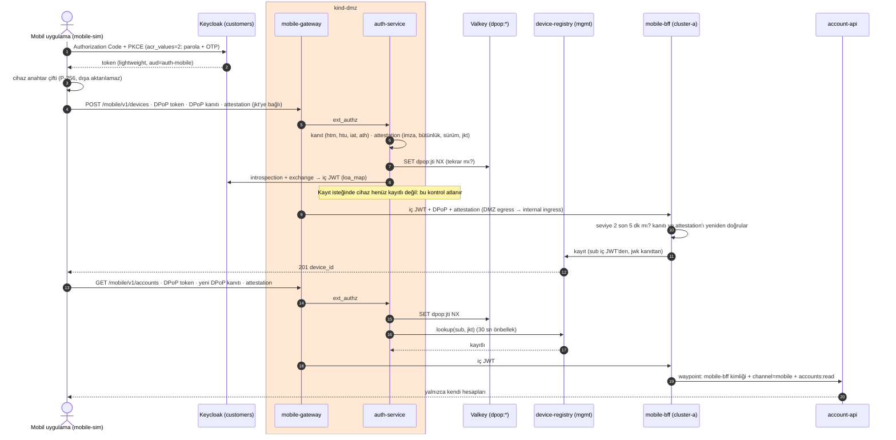

# 09c · Mobil cihaz bağlama: DPoP, attestation, device-registry, mobile-bff

| | |
|---|---|
| **Branch** | `mobile-binding` (açıldığı yer: `l7-policies`) |
| **Durum** | ✅ Tamamlandı, sıfırdan kurulumla doğrulandı (191/191 test) |

## Amaç

Mobil kanalda token'ı cihaza bağlamak (hedef: CH-02..04, GW-04, GW-06, IAM-04, INT-07, AC-04):
- Cihaz ilk kurulumda bir anahtar çifti üretir. Private key cihazdan çıkmaz (gerçekte Secure Enclave / StrongBox); public key kullanıcıya bağlanır.
- Her istek bu anahtarla imzalanmış bir **DPoP kanıtı** taşır (RFC 9449): bu istek, bu adres, bu token için, tek kullanımlık. Çalınan token, cihazın anahtarı olmadan işe yaramaz.
- Her istek bir **uygulama bütünlük kanıtı** (attestation) taşır: gerçek uygulama, bütünlüğü bozulmamış cihaz, minimum sürüm.
- Mobil trafik internal'da **mobile-bff** üzerinden gider; domain servisleri mobil kanalı yalnızca BFF kimliğinden kabul eder.

Bu adımdaki kullanıcı kararları:
- Cihaz kayıtları ayrı bir **device-registry** servisinde tutulur.
- Attestation lab'de **imzalı test JWT'si** ile simüle edilir.
- Keycloak cihaz bilgisini iç JWT'ye taşıyamazsa cihaz **DMZ'de doğrulanır** ve bu durum kısıt olarak yazılır.
- **Tüm mobil trafik** mobile-bff'ten geçer.

## Adım sonundaki durum

| Konu | Durum |
|------|-------|
| Cihaz bağlama | `device-registry` (Go, mgmt `iam`, PostgreSQL `devices` veritabanı): `device_id` ↔ `sub` ↔ public key (JWK, RFC 7638 thumbprint `jkt`); kullanıcı başına en fazla 3 cihaz. Kayıt mobile-bff üzerinden ve yalnızca seviye 2 ile (son 5 dk). Silme var |
| DPoP | Mobil kanalda `Authorization: DPoP <token>` zorunlu, Bearer reddedilir. auth-service her istekte kanıtı doğrular: imza (ES256), `htm`, `htu`, `iat` (±60 sn), `ath` (token'ın özeti). `jti` tekrarı mgmt Valkey'de (`dpop:*`, ayrı ACL kullanıcısı); depo erişilemezse istek reddedilir |
| Kayıtlı cihaz kontrolü | Kanıtı imzalayan anahtar bu kullanıcıya kayıtlı ve etkin bir cihaza ait olmalı (device-registry sorgusu, DMZ'de 30 sn önbellek) |
| Attestation | `x-app-attestation`: lab sağlayıcısının anahtarıyla imzalı ES256 JWT; uygulama kimliği, sürüm, cihaz bütünlüğü ve **cihaz anahtarına bağ (`jkt`)**. Minimum sürümün altı 426 |
| mobile-bff | cluster-a `channel-bff`. Mobil trafiğin tamamı buradan geçer; cihaz uçları (`/devices`); transfer öncesi seviye 2 kontrolü |
| Domain servisleri | Her kanal yalnızca kendi kapısından: web → web-bff, mobil → mobile-bff, partner ve şube → internal ingress |
| Mobil simülatör | `mobile-sim` (Go, imzalı image): gerçek uygulama gibi giriş (Authorization Code + PKCE, OTP), cihaz anahtarı, DPoP, attestation. Testler ve yük üretici (`mobile-loadgen`, kullanıcı `mehmet`) kullanır |

## Önemli bulgu: Keycloak DPoP ve token exchange birlikte çalışmıyor

Keycloak 26.8'de DPoP varsayılan olarak açık ve çalışıyor: token cihaz anahtarına bağlanıyor (`cnf.jkt`), introspection bunu dönüyor. Fakat DPoP'a bağlı bir token başka bir client tarafından exchange edilemiyor:

> `Sender-constrained token exchange rejected as the token was not issued for the requesting client`

auth-service'in exchange client'ı (`auth-mobile`), mobil uygulamanın client'ından (`mobile-app`) farklı. IdP tabanlı iç JWT modeli (09a) bu yüzden Keycloak'ın DPoP bağlamasıyla birlikte kullanılamıyor.

**Seçilen yol** (kullanıcının önceden onayladığı yedek):
- Keycloak token'ları DPoP'a bağlı değil.
- **Bağlamayı DMZ yapar:** her mobil istekte DPoP kanıtı zorunlu ve kanıtı imzalayan anahtar device-registry'de bu kullanıcıya kayıtlı olmalı.
- **Sonuç:** çalınan token, kayıtlı cihazın (dışa aktarılamayan) anahtarı olmadan kullanılamaz (AC-04).

**Bedeli:**
- **Bağın kapsamı:** token tek bir cihaza değil, kullanıcının kayıtlı cihazlarından herhangi birine bağlı. Aynı kullanıcının iki cihazı arasında token taşınabilir.
- **İç JWT'de cihaz yok:** `device_id` / `cnf` iç JWT'de yer almıyor. Kullanıcının kararıyla IdP imzası olmayan bir değer iç JWT'ye konmadı.

## Önceki adıma göre değişenler

| Değişiklik | Neden |
|------------|-------|
| Yeni `device-registry` (mgmt `iam`), kendi veritabanı (`devices`) ve mgmt girişi (`devices.mgmt.internal`) | Cihaz kayıtları; DMZ'ye yalnızca sorgu, internal'a kayıt / liste / silme |
| auth-service 0.4.0: mobil kanalda DPoP şeması ve kanıtı, `jti` tekrar kontrolü, attestation, minimum sürüm, kayıtlı cihaz | Token cihaza bağlı (DMZ'de) |
| ext_authz'ye `dpop`, `x-app-attestation` header'ları | auth-service kanıtları görsün |
| Yeni `mobile-bff` (channel-bff); mobil rota `mobile-bff.apps.example.local` | INT-07: tüm mobil trafik BFF'ten |
| account-api ve api-a kuralları kanal ↔ kapı eşlemeli | Mobil token'la gateway'den doğrudan domain servisine gidilemez |
| cluster-a egress: channel-bff waypoint'i yalnızca `devices.mgmt.internal`'a; api-a waypoint'inin çıkışından bu host hariç | Cihaz kayıtlarını yalnızca mobile-bff değiştirebilir |
| Valkey ACL: `dpop` kullanıcısı (yalnızca `dpop:*`, yalnızca SET) | DPoP `jti` tekrar deposu |
| Attestation sağlayıcı anahtarı (`certs/attest/`) | Lab'de Play Integrity / App Attest yerine |
| customers realm'ine `mehmet` (OTP'li) | Yük üretici testlerle aynı OTP'yi kullanıp birbirini kilitlemesin |
| Yeni `mobile-sim`; loadgen'in mobil kısmı `mobile-loadgen`'e taşındı | Mobil kanal artık cihaz kanıtı istiyor |
| Doğrulama: mobil istekler mobile-sim üzerinden; OTP pencere takibi; "11) Mobil cihaz bağlama" | – |

## Eklenen bileşenler

| Bileşen | Amacı | Neden gerekli | Muadilleri | Neden bu seçildi |
|---------|-------|---------------|------------|------------------|
| **DPoP (RFC 9449)** | Token'ı istemcinin anahtarına bağlamak (sender-constrained) | Çalınan token tek başına işe yaramasın (IAM-04, AC-04) | mTLS ile bağlı token (RFC 8705), uygulama içi istek imzası (HTTP Message Signatures), cihaz bağlı oturum çerezi | Standart, mobilde anahtar güvenli donanımda tutulabilir, ek TLS altyapısı istemez |
| **device-registry** (Go, PostgreSQL) | Cihaz ↔ kullanıcı ↔ anahtar kaydı | Hangi anahtarın kime ait olduğunu bilmek; kayıp cihazı iptal | Keycloak kullanıcı attribute'u, Keycloak WebAuthn / passkey kayıtları, ticari mobil güvenlik platformları (ör. cihaz bağlama SDK'ları) | Kullanıcının kararı; Keycloak'a özel kod yok; listeleme ve silme kolay |
| **Attestation (lab: imzalı test JWT'si)** | Gerçek uygulama ve bütünlüğü bozulmamış cihaz | Sahte istemci, emülatör, root / jailbreak (CH-04, GW-04) | Google Play Integrity API, Apple App Attest, ticari RASP / anti-tamper SDK'ları | Gerçek servislerin "verdict" mantığıyla aynı (imzalı, kısa ömürlü, uygulama kimliği, bütünlük, cihaza bağ) |
| **mobile-bff** | Mobil kanalın BFF'i | INT-07; cihaz uçları; domain servislerine tek kapı | API gateway'de birleştirme, GraphQL | web-bff ile aynı desen |
| **mobile-sim** | Mobil uygulama simülatörü | Gerçek uygulama yok; testler ve yük üretici cihaz gibi davranmalı | Gerçek uygulama + otomasyon (Appium), cihaz çiftliği | Lab'de tekrarlanabilir; saldırı senaryolarını (başka anahtar, tekrar, eski sürüm) üretebiliyor |

## Yapılanlar

### Cihaz bağlama ve istek akışı

### Doğrulama kuralları (auth-service, mobil kanal)

| Kontrol | Başarısızlıkta |
|---------|----------------|
| `Authorization: DPoP <token>` (Bearer değil) | 401 `missing_token` |
| DPoP kanıtı: `typ=dpop+jwt`, ES256, `jwk` header'da, imza, `htm` = metot, `htu` = `https://mobile-api…:8443` + yol, `iat` ±60 sn, `ath` = SHA-256(token) | 401 `invalid_dpop_proof` |
| `jti` daha önce görülmedi (Valkey `SET NX EX 120`; depo yoksa reddet) | 401 `dpop_replay` |
| Attestation: lab sağlayıcısının imzası, `iss`, `app_id`, `integrity=MEETS_DEVICE_INTEGRITY`, `exp`, `jkt` = kanıtın anahtarı | 403 `attestation_failed` |
| Uygulama sürümü ≥ `MIN_APP_VERSION` (3.0.0) | 426 `app_update_required` |
| Introspection, kanal kuralları, exchange (09a/09b) | 401 / 403 |
| Anahtar bu kullanıcıya kayıtlı (kayıt isteği hariç) | 403 `device_not_registered` |

### Kim neye erişebilir

| Kaynak | Hedef | İzin |
|--------|-------|------|
| auth-service (DMZ, waypoint) | device-registry | yalnızca `GET /v1/devices/lookup` (DMZ egress → mgmt girişi kuralı) |
| mobile-bff (cluster-a, waypoint) | device-registry | `GET/POST/DELETE /v1/devices*` (cluster-a egress → mgmt girişi) |
| api-a (waypoint) | device-registry | yok (egress'te `notHosts`) |
| internal ingress | mobile-bff | customers realm JWT'si, `channel=mobile` |
| mobile-bff | account-api, api-a | `channel=mobile` ve scope kuralları |

## Değişen dosyalar

| Dosya | Değişiklik |
|-------|------------|
| `services/device-registry/` | **Yeni** |
| `services/mobile-bff/` | **Yeni** (`dpop.go` auth-service ile aynı) |
| `services/mobile-sim/` | **Yeni** |
| `services/auth-service/` | 0.4.0: `dpop.go` (DPoP, attestation), `valkey.go` (jti deposu), mobil kontroller |
| `manifests/mgmt/32-device-registry.yaml` | **Yeni**: registry + mgmt girişi + AuthZ |
| `manifests/mgmt/20-data.yaml` | `device_registry` rolü ve `devices` veritabanı; PostgreSQL erişimi |
| `manifests/dmz/12-auth-service.yaml`, `21-mobile-channel.yaml`, `30-internal-clusters.yaml` | auth-service ortamı, attestation anahtarı, registry ve Valkey çıkışları; mobil rota mobile-bff'e, DELETE; devices çıkışı |
| `manifests/cluster-a/16-channel-bff.yaml`, `56-devices-exit.yaml`, `30-internal-gateway.yaml`, `45-request-authentication.yaml`, `15-account-api.yaml`, `40-security.yaml` | mobile-bff; registry çıkışı; rota; JWT doğrulama; kanal ↔ kapı kuralları |
| `istio/values/istiod-dmz.yaml` | ext_authz'ye `dpop`, `x-app-attestation` |
| `infra/keycloak/realm-customers.json` | `mehmet` (OTP) |
| `scripts/03-generate-certs.sh`, `05b-create-data-secrets.sh`, `06b-deploy-edge.sh`, `99-destroy.sh`, `08-verify.sh` | Attestation anahtarı; registry, DPoP deposu ve attestation secret'ları; `mobile-loadgen`; mobil testler |

## Tasarım kararları

- **Bağlama DMZ'de** (bulgu yukarıda): IdP tabanlı exchange (09a) korunuyor, Keycloak DPoP bağlaması kullanılmıyor.
- **Attestation cihaz anahtarına bağlı (`jkt`).** Başka bir cihazın geçerli attestation'ı kopyalanıp kullanılamaz.
- **Kayıt yalnızca internal'dan.** DMZ device-registry'ye yalnızca sorgu atabilir. DMZ ele geçirilse bile saldırgan kendi anahtarını bir kullanıcıya kaydedemez. mobile-bff kanıtları kendisi de doğrular: DMZ'nin kararına güvenmez.
- **Kayıt için seviye 2 (son 5 dk).** Çalınan parolayla yeni cihaz eklenemez (OTP gerekir).
- **`jti` deposu fail-closed.** Valkey erişilemezse mobil istekler reddedilir; tekrar saldırısı sessizce açılmaz.
- **Kayıtlı cihaz önbelleği 30 sn.** Silinen cihaz en geç 30 sn'de reddedilir (test). Daha kısa süre her istekte registry çağrısı demek.

## STRIDE (yeni ve değişen akışlar)

| Akış | Tehdit | Senaryo | Kontrol | Durum |
|------|--------|---------|---------|-------|
| Mobil → DMZ | **S**poofing | Çalınan token başka cihazdan (AC-04) | Kayıtlı cihaz anahtarıyla DPoP kanıtı (test: 403) | ✅ |
| | **T**ampering / tekrar | Yakalanan istek tekrar gönderilir | `jti` tek kullanımlık, `iat` ±60 sn, `htu` / `htm` / `ath` bağı (test) | ✅ |
| | **S**poofing | Sahte uygulama / emülatör / root'lu cihaz | Attestation (test: kanıtsız ve bütünlüğü bozuk 403) | ✅ (lab: simüle) |
| | **E**levation of privilege | Güvenlik açığı olan eski uygulama sürümü | Minimum sürüm (test: 426) | ✅ |
| Cihaz kaydı | **S**poofing | Çalınan parolayla saldırganın cihazını kaydetmek | Seviye 2 (OTP) son 5 dk (test: seviye 1 ile 401) | ✅ |
| | **E**levation of privilege | DMZ ele geçirilip cihaz kaydedilir | DMZ'ye yalnızca sorgu; kayıt internal'dan, kanıtlar yeniden doğrulanır | ✅ |
| | **R**epudiation | Kayıp telefon kullanılmaya devam eder | Cihaz silme, 30 sn içinde etkili (test) | ✅ |
| Mobil → internal | **E**levation of privilege | Mobil token'la BFF atlanıp domain servisine gidilir | Domain servisleri mobil kanalı yalnızca mobile-bff kimliğinden kabul eder | ✅ |
| | **I**nformation disclosure | Internal hangi cihazdan geldiğini bilmez | `device_id` iç JWT'de yok | ⚠️ kısıt |
| DPoP deposu | **D**enial of service | Valkey erişilemez | Fail-closed (mobil kanal kapanır) | ⚠️ tek replika |

## Karşılaşılan sorunlar ve çözümler

| # | Sorun | Neden | Çözüm |
|---|-------|-------|-------|
| 1 | DPoP'a bağlı token exchange edilemiyor | Keycloak kuralı (bulgu) | Bağlama DMZ'de |
| 2 | Port-forward üzerinden DPoP denemesi "HTTP URL mismatch" | Keycloak `htu`'yu isteğin geldiği adrese göre doğruluyor | Deneme kanıtında port-forward adresi |
| 3 | `mobile-sim daemon` hemen çöktü | Go: `select {}` başka goroutine yoksa deadlock sayılıyor | Uyku döngüsü |
| 4 | `docker exec ... /mobile-sim` "C:/Program Files/Git/mobile-sim" | Git Bash yol dönüşümü | `MSYS_NO_PATHCONV=1` |
| 5 | Yük üreticinin cihazı kayıtlı değildi | Kurulum sırasındaki ilk bağlama denemesi başarısız oldu ve döngü sonucu kontrol etmiyordu | Kayıt başarısızsa tekrar; 401/403'te yeniden giriş ve kayıt |
| 6 | api-a'nın waypoint'i device-registry'ye de çıkabiliyordu | cluster-a egress kuralı yalnızca port bazlıydı | `notHosts: devices.mgmt.internal` |
| 7 | Cihaz silme (DELETE) edge'de 403 (nginx sayfası) | OWASP CRS'in izinli metotları varsayılan olarak GET, HEAD, POST, OPTIONS | WAF'a `ALLOWED_METHODS=... DELETE` |
| 8 | mobile-sim'in gövdeli istekleri WAF'ta 403 | İçerik tipi olmayan gövde CRS'te reddediliyor (curl `-d` ile varsayılanı kendisi ekler) | mobile-sim de curl gibi `application/x-www-form-urlencoded` ekliyor |
| 9 | Seviye testleri ters sonuç verdi (seviye 1 testi 202, seviye 2 testi 401) | Mobil oturum kurulumda seviye 2 ile açılıyor ve 5 dk sonra seviye 2 tazeliği bitiyor | Seviye 1 testi ayrı bir seviye 1 oturumuyla; bölüm 11 taze seviye 2 girişle başlıyor |

## Doğrulama

Sıfırdan kurulum: `99-destroy.sh` → `setup.sh` → `08-verify.sh` (tek seferde, elle müdahale yok). **Süre: ~28 dk (silme + kurulum + doğrulama).** **Sonuç: 191 başarılı, 0 başarısız.**
- 173'ten 191'e: 17 yeni test ("11) Mobil cihaz bağlama"), mobil kanalın mobile-bff üzerinden gitmesine göre güncellenen önceki testler.
- Kurulumdan önce çalışan ortama da uygulandı (191/191). Yükseltmede yaşanan sorunlar yukarıdaki tabloda.

Kaynak kullanımı (kurulumdan hemen sonra, node başına): mgmt ~3,1 GB, cluster-a ~2,5 GB, dmz ~2,5 GB. 09b ile aynı seviye (device-registry ve mobile-bff küçük Go servisleri).

Bu adımda eklenen testler (`08-verify.sh` → "11) Mobil cihaz bağlama"):

| Test | Beklenen | Sonuç |
|------|----------|-------|
| Uygulama girişi (Authorization Code + PKCE, seviye 2) ve cihaz kaydı | `device_id` | ✔ |
| Kayıtlı cihaz, geçerli kanıtlar | 200 | ✔ |
| AC-04: çalınan token, kayıtsız anahtar | 403 | ✔ |
| DPoP yok / Bearer şeması / kanıt tekrarı / başka adres | 401 ×4 | ✔ ✔ ✔ ✔ |
| Attestation yok / bütünlüğü bozuk | 403 / 403 | ✔ ✔ |
| Eski sürüm | 426 | ✔ |
| Seviye 1 ile cihaz kaydı | 401 step-up | ✔ |
| Cihaz listesi | uygulama sürümüyle | ✔ |
| Mobil transfer (seviye 2) | 202 | ✔ |
| Silinen cihaz 30 sn içinde | 200 → 403 | ✔ |
| Mobil rota mobile-bff'e; mgmt girişi DMZ'ye yalnızca sorgu | – | ✔ ✔ |
| DPoP deposu ACL; device-registry ve mobile-bff imzalı image | – | ✔ ✔ |

## Bilinen kısıtlar

- Token tek bir cihaza değil, kullanıcının kayıtlı cihazlarından herhangi birine bağlı (Keycloak DPoP + exchange kısıtı).
- `device_id` iç JWT'de yok: internal hangi cihazdan geldiğini bilmiyor (kullanıcı kararı: IdP imzasız değer konmaz).
- Attestation simüle: gerçek Play Integrity / App Attest doğrulaması (Google / Apple sunucuları) yok.
- Cihaz anahtarı gerçek güvenli donanımda değil (mobile-sim dosyada tutuyor); biyometrik kilit yok.
- Cihaz bağlama için ilk kurulumdaki "kimlik + OTP" adımı seviye 2 giriş olarak uygulandı; ayrı bir aktivasyon kodu / SMS akışı yok.
- Kayıtlı cihaz önbelleği 30 sn: silinen cihaz bu süre içinde kullanılabilir.
- DPoP `jti` deposu ve device-registry tek replika.
- Mobil seviye 3 (işlem imzası) yok: `09d · tx-signing`.
