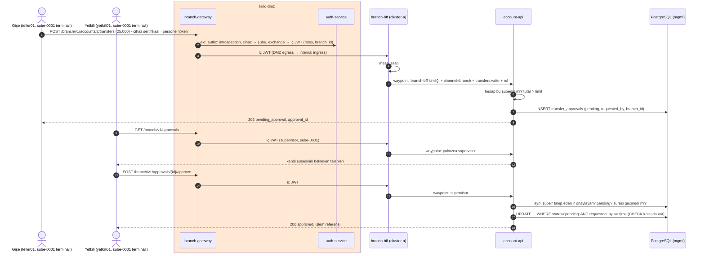

# 09e · Şube kontrolleri: branch-bff, şube kapsamı, dört göz onayı, mesai saati

| | |
|---|---|
| **Branch** | `branch-controls` (açıldığı yer: `mobile-binding`; `09d · tx-signing` atlandı, açık nokta) |
| **Durum** | ✅ Tamamlandı, sıfırdan kurulumla doğrulandı (211/211 test) |

## Amaç

Şube kanalına bankacılıkta beklenen personel kontrollerini eklemek (hedef: CH-13, INT-07):
- **branch-bff:** Şube trafiğinin tamamı internal'da şube kanalının BFF'inden geçer. Domain servisleri şube kanalını yalnızca bu BFF'in kimliğinden kabul eder (web-bff ve mobile-bff ile aynı desen).
- **Şube kapsamı:** Personel yalnızca kendi şubesinin hesaplarını görür ve yalnızca onlardan işlem yapar. Önceden tüm hesapları görüyordu.
- **Dört göz onayı:** Limit üstü işlem doğrudan yapılmaz, onay bekler. Onaylayan kişi:
  - yetkili rolünde olmalı,
  - aynı şubede olmalı,
  - talep edenden farklı olmalı.
- **Mesai saati:** Şube kanalı yalnızca mesai saatlerinde çalışır.

Bu adımdaki karar: limit, onay süresi, mesai saatleri ve hangi rolün onaylayabileceği **iş kararıdır**. Mimari bunları konfigürasyon olarak taşır; lab varsayılanlarla gelir.

## Adım sonundaki durum

| Konu | Durum |
|------|-------|
| branch-bff | cluster-a `channel-bff` (Go, imzalı image). Rota `branch-bff.apps.example.local`; `/accounts*`, `/products`, `/approvals*` → account-api, diğerleri → api-a. Mesai saati kontrolü burada |
| Personel rolleri | staff realm: `teller` (gişe), `operations` (operasyon), `supervisor` (yetkili, yeni). Kullanıcılar: `teller01` (sube-0001), `yetkili01` (sube-0001), `yetkili02` (sube-0002) |
| Şubeler | `sube-0001`, `sube-0002` (Keycloak grubu, `branch_id` attribute'u). Her şubenin terminal sertifikası (`certs/branch/sube-000N.crt`). Hesapların şubesi `accounts.branch_id` |
| Şube kapsamı (BOLA) | account-api: personel `branch_id = iç JWT'deki branch_id` olan hesapları görür. `branch_id`, IdP'deki grup attribute'u ve DMZ'de cihaz sertifikasıyla eşleşmiş (08) |
| Dört göz | Limit (`APPROVAL_LIMIT`, lab: 10.000) üstü şube transferi `accounts.transfer_approvals`'a "pending" yazılır. Onay süresi `APPROVAL_TTL` (lab: 30 dk). `GET /approvals` (yetkili, kendi şubesi), `POST /approvals/{id}/approve` |
| Veritabanı kısıtları | `CHECK (decided_by <> requested_by)`; account-api rolü onay tablosunda yalnızca `SELECT`, `INSERT` ve karar kolonlarında `UPDATE` (silme yok) |
| Mesai saati | `BRANCH_HOURS` (Türkiye saati, UTC+3). Lab'de `00:00-24:00` (yük üretici ve testler gün boyu çalışıyor); gerçekte ör. `09:00-17:30`. Dışında 403 `outside_business_hours` |
| Waypoint kuralları | Şube kanalı: kapı `branch-bff`, issuer yalnızca staff realm'i. Transfer: `teller` / `operations` / `supervisor`. Onay: yalnızca `supervisor`, scope `transfers:write` |

## Önceki adıma göre değişenler

| Değişiklik | Neden |
|------------|-------|
| Yeni `branch-bff`; DMZ şube rotası `branch-bff.apps.example.local`'e | INT-07: tüm şube trafiği BFF'ten; kanal kuralları (mesai) atlanamasın |
| account-api ve api-a'da şube kuralları: kapı internal ingress yerine `branch-bff`, issuer yalnızca staff | Personel token'ıyla BFF atlanamasın |
| account-api 0.5.0: şube kapsamı, limit üstü onay akışı, onay uçları | CH-13 |
| PostgreSQL: `accounts.branch_id`, `accounts.transfer_approvals`, yeni yetkiler | Şube kapsamı ve onay kaydı |
| staff realm: `supervisor` rolü, `sube-0002` grubu, `yetkili01`, `yetkili02`; client'ların rol eşlemesine `supervisor` | Onay veren personel; başka şube senaryosu |
| auth-service 0.4.1: şube kanalında `supervisor` rolü de kabul | Yetkili şube kanalına girebilsin |
| İkinci şube terminal sertifikası (`sube-0002`) | Başka şubenin yetkilisi onay veremez testi |
| Doğrulama: `staff_token [kullanıcı] [cihaz]`; personel hesap testi artık 2 hesap (kendi şubesi); "12) Şube kontrolleri" | – |

## Eklenen bileşenler

| Bileşen | Amacı | Neden gerekli | Muadilleri | Neden bu seçildi |
|---------|-------|---------------|------------|------------------|
| **branch-bff** (Go) | Şube kanalının BFF'i | INT-07; kanal kuralları (mesai) için atlanamayan tek nokta | API gateway'de birleştirme, gişe uygulamasının kendi sunucusu | web-bff ve mobile-bff ile aynı desen |
| **Dört göz onayı** (account-api + PostgreSQL) | Limit üstü işlemde ikinci yetkilinin onayı | Personel suistimali ve hata (CH-13); bankacılık düzenlemelerinde görevler ayrılığı | İş akışı motoru (Camunda, Flowable), core banking'in onay modülü, ayrı `approval-service` | Lab'de tek domain (hesap) var; kayıt ve kural domain servisinin yanında. Birden fazla domain onay isterse ayrı servise çıkarılır |
| **Mesai saati kontrolü** (branch-bff) | Şube kanalının zaman penceresi | Mesai dışı personel erişimi riskli (CH-13) | Keycloak'ta zaman koşullu politika, gateway'de zaman bazlı kural, PAM | Kanal kuralı, kanal BFF'inde; konfigürasyonla değişir |

## Yapılanlar

### Dört göz onayı akışı

### Onay kuralları (account-api)

| Kontrol | Başarısızlıkta |
|---------|----------------|
| Şube kanalı, `supervisor` rolü, `branch_id` dolu (waypoint'te de) | 403 `forbidden` |
| Talep var ve onaylayanın şubesinde | 404 `not_found` (başka şubenin talebi sızdırılmaz) |
| Talep eden ≠ onaylayan | 403 `four_eyes_violation` (loglanır) |
| Durum `pending` | 409 `already_approved` |
| Talep `APPROVAL_TTL` içinde | 410 `approval_expired` |
| Aynı anda iki onay (yarış) | Koşullu `UPDATE`: yalnızca biri başarılı, diğeri 409 |

### Kim neye erişebilir (şube kanalı)

| Rol | Hesaplar | Transfer (limit altı) | Transfer (limit üstü) | Onay |
|-----|----------|-----------------------|-----------------------|------|
| `teller` | Kendi şubesi | Doğrudan | Onaya düşer | Yok |
| `operations` | Kendi şubesi | Doğrudan | Onaya düşer | Yok |
| `supervisor` | Kendi şubesi | Doğrudan | Onaya düşer (kendisi onaylayamaz) | Kendi şubesi, başkasının talebi |

## Değişen dosyalar

| Dosya | Değişiklik |
|-------|------------|
| `services/branch-bff/` | **Yeni** |
| `services/account-api/main.go` | 0.5.0: şube kapsamı, onay akışı, `/approvals` uçları |
| `services/auth-service/main.go` | 0.4.1: şube kanalında `supervisor` rolü |
| `manifests/cluster-a/16-channel-bff.yaml`, `30-internal-gateway.yaml`, `45-request-authentication.yaml` | branch-bff, rota, JWT doğrulama (yalnızca staff) |
| `manifests/cluster-a/15-account-api.yaml`, `40-security.yaml` | Şube kuralları branch-bff'ten; onay kuralı; `APPROVAL_LIMIT`, `APPROVAL_TTL` |
| `manifests/dmz/23-branch-channel.yaml`, `30-internal-clusters.yaml` | Şube rotası branch-bff'e; zone çıkışında yeni host |
| `manifests/mgmt/20-data.yaml` | `branch_id`, `transfer_approvals`, yetkiler |
| `infra/keycloak/realm-staff.json` | `supervisor`, `sube-0002`, `yetkili01`, `yetkili02` |
| `config.env` | Sürümler, `branch-bff`, `BRANCH_DEVICE2`, `BRANCH_BFF_HOST` |
| `scripts/03-generate-certs.sh`, `05b-create-data-secrets.sh`, `08-verify.sh` | İkinci terminal sertifikası; yeni personel parolaları; şube testleri |

## Tasarım kararları

- **Kural domain servisinde, kapı mesh'te.** Waypoint "kim bu uca gelebilir" sorusunu yanıtlar: branch-bff, staff issuer, rol, scope. "Bu talebi bu kişi onaylayabilir mi" sorusu ise talebin verisine bağlı: aynı şube mi, talep eden kim. Mesh bunu bilemez, kontrol account-api'de.
- **Veritabanında da kısıt.** `decided_by <> requested_by` CHECK kısıtı ve silme yetkisinin olmaması, uygulamadaki bir hatanın ya da ele geçirilmiş account-api'nin dört gözü atlamasını zorlaştırır.
- **Başka şubenin talebi 404.** 403 dönseydi talebin varlığı sızardı (BOLA ile aynı yaklaşım).
- **Mesai saati branch-bff'te.** Kanal kuralıdır, domain servisi kanalı bilmek zorunda kalmaz. Domain servisleri şube kanalını yalnızca branch-bff'ten kabul ettiği için kontrol atlanamaz.
- **`branch_id` güvenilir kaynaktan.** IdP imzalı iç JWT'de (grup attribute'u) ve DMZ'de cihaz sertifikasıyla eşleşmiş (08). Personel başka şubenin terminalinden çalışamaz (test).
- **Yetkili de işlem başlatabilir, ama kendi işlemini onaylayamaz.** Dört göz rolle değil kişiyle (`sub`) uygulanır.

## STRIDE (yeni ve değişen akışlar)

| Akış | Tehdit | Senaryo | Kontrol | Durum |
|------|--------|---------|---------|-------|
| Şube → internal | **E**levation of privilege | Personel token'ıyla BFF atlanıp domain servisine gidilir (mesai kontrolü atlanır) | Domain servisleri şube kanalını yalnızca branch-bff kimliğinden kabul eder (test) | ✅ |
| | **S**poofing | Başka realm'in token'ı şube kanalında | branch-bff ve şube kuralları yalnızca staff issuer'ı | ✅ |
| Hesap erişimi | **I**nformation disclosure | Personel başka şubenin müşteri hesabını görür | Şube kapsamı (test: 404) | ✅ |
| Transfer | **E**levation of privilege | Gişe personeli limit üstü transferi tek başına yapar | Onaya düşer (test) | ✅ |
| Onay | **E**levation of privilege | Kişi kendi talebini onaylar | Uygulama (test: 403) + veritabanı CHECK (test) | ✅ |
| | **E**levation of privilege | Gişe personeli onaylar | Waypoint: yalnızca `supervisor` (test: 403) | ✅ |
| | **S**poofing | Başka şubenin yetkilisi onaylar | Aynı şube kontrolü (test: 404); başka şubenin terminali reddedilir (test: 403) | ✅ |
| | **T**ampering | Aynı talep iki kez onaylanır / yarış | Koşullu UPDATE (test: 409) | ✅ |
| | **R**epudiation | "Ben onaylamadım" | Talep eden ve onaylayan `sub`, zaman damgası veritabanında ve logda; kayıt silinemez (test) | ✅ |
| Mesai | **E**levation of privilege | Mesai dışı işlem | branch-bff 403 (test) | ✅ (lab: tüm gün açık) |

## Karşılaşılan sorunlar ve çözümler

Sıfırdan kurulum ilk denemede hatasız geçti. Geliştirme sırasında yakalananlar:

| # | Sorun | Neden | Çözüm |
|---|-------|-------|-------|
| 1 | Mesai dışı testinde aralık hep `13:00-14:00` seçilecekti | Bash'te `x=$(( koşul )) && x=a \|\| x=b`: atama her zaman başarılı, koşul değerlendirilmiyor | `(( koşul )) && x=a \|\| x=b` |
| 2 | Çalışan ortama yükseltme yapılmadı | Veritabanı şeması (`postgres-init` yalnızca ilk açılışta çalışır) ve realm importu (var olan realm'i güncellemez) değişti; elle migrasyon gerekirdi | Doğrudan sıfırdan kurulumla doğrulandı. Gerçek ortamda şema değişikliği migrasyon aracıyla (Flyway / Liquibase), realm değişikliği keycloak-config-cli ya da Terraform ile yapılmalı |

## Doğrulama

Sıfırdan kurulum: `99-destroy.sh` → `setup.sh` → `08-verify.sh` (tek seferde, elle müdahale yok). **Süre: ~31 dk (silme + kurulum + doğrulama).** **Sonuç: 211 başarılı, 0 başarısız.**
- 191'den 211'e: 20 yeni test ("12) Şube kontrolleri").
- Değişen beklenti: personel artık 4 değil, kendi şubesinin 2 hesabını görüyor. Önceki şube testleri (cihaz sertifikası, iç JWT, gişe transferi) branch-bff üzerinden geçiyor.

Kaynak kullanımı (kurulumdan hemen sonra, node başına): mgmt ~3,1 GB, cluster-a ~2,5 GB, dmz ~2,5 GB. 09c ile aynı seviye (branch-bff küçük bir Go servisi).

Bu adımda eklenen testler (`08-verify.sh` → "12) Şube kontrolleri"):

| Test | Beklenen | Sonuç |
|------|----------|-------|
| Şube rotası branch-bff'e; şube kanalı domain servislerine yalnızca branch-bff'ten | – | ✔ ✔ |
| Başka şubenin hesabı / hesabından transfer | 404 / 404 | ✔ ✔ |
| Limit altı transfer | accepted | ✔ |
| Limit üstü transfer | pending_approval | ✔ |
| Gişe personeli onay | 403 | ✔ |
| Yetkili kendi şubesinin bekleyenlerini görüyor; başka şubenin yetkilisi görmüyor | – | ✔ ✔ |
| Başka şubenin yetkilisi onay / başka şubenin terminali | 404 / 403 | ✔ ✔ |
| Aynı şubenin yetkilisi onay; ikinci onay | approved / 409 | ✔ ✔ |
| Talep eden kendi işlemini onaylıyor | 403 `four_eyes_violation` | ✔ |
| Veritabanı CHECK kısıtı; onay kaydı silinemiyor | – | ✔ ✔ |
| Onay logu (talep eden, onaylayan) | – | ✔ |
| Mesai dışı / tekrar mesai içi | 403 / 200 | ✔ ✔ |
| branch-bff imzalı image | digest | ✔ |

## Bilinen kısıtlar

- Mesai saati lab'de tüm gün açık. Hafta sonu, resmi tatil ve şube bazlı farklı saatler yok.
- Reddetme (`reject`) ve talebi geri çekme uçları yok; süresi geçen talep yalnızca onaylanamaz hale gelir.
- Onay için ek doğrulama (yetkilinin OTP'si ya da işlem imzası) yok. İşlem imzası açık nokta (`09d` atlandı).
- Limit tek ve sabit. Rol, işlem tipi ve para birimine göre limit tablosu yok.
- Merkezi operasyon personeli (tüm şubeler) senaryosu yok; `operations` rolü de kendi şubesiyle sınırlı.
- Onay kaydı account-api'nin veritabanında. Birden fazla domain (kart, kredi) onay isterse ayrı bir onay servisine çıkarılmalı.
- Personel girişinde OTP yok (lab'de direct grant).
