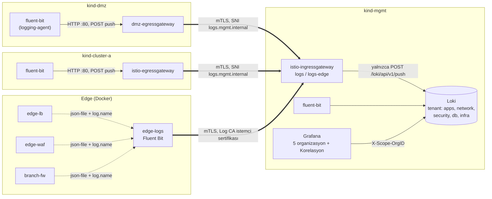

# 10 · Merkezi loglama: Loki, Grafana, Fluent Bit, kategoriler, audit log

| | |
|---|---|
| **Branch** | `logging` (açıldığı yer: `branch-controls`; `09f · consent` ertelendi) |
| **Durum** | ✅ Tamamlandı, sıfırdan kurulumla doğrulandı (240/240 test) |

## Amaç

Tüm zone'ların loglarını tek yerde toplamak ve bir isteğin izini, geçtiği her zone'da aynı kimlikle (`request_id`) sürebilmek. Hedef gereksinimler: SOC-01..03, SOC-09, EDGE-13, AC-10.

Kullanıcı kararları:
- Loglar beş kategoriye ayrılır: **apps, network, security, db, infra.** Her kategorinin ayrı deposu ve ayrı görünümü var; her ekip yalnızca kendi kategorisini görür.
- **Önce ELK seçildi, sonra Loki'ye geçildi.** Hedef mimari ELK diyor. Bellek bir denemeyle ölçüldü ve sığdığı görüldü. Ancak sıfırdan kurulumda **CPU** yetmedi; Loki'ye geçildi. Ayrıntılar aşağıdaki bölümde.
- **WORM arşivi** ayrı bir alt adımda yapılacak (`10b`).

## ELK denemesi ve Loki'ye geçiş

| Aşama | Bulgu |
|-------|-------|
| Bellek denemesi (çalışan ortamda, 10 dk) | Elasticsearch (heap 512 MB) + Kibana: mgmt +1,6 GiB, sabit. VM'de ~1,4 GB boş kalıyordu. Sığıyor görüldü |
| Sıfırdan kurulum (1. deneme) | Kurulum sırasında makine uykuya geçti (Modern Standby); helm zaman aşımı |
| Sıfırdan kurulum (2. deneme) | Elasticsearch ve Kibana 06'da diğer bileşenlerle aynı anda açıldı. mgmt'in API sunucusu yavaşladı, Kyverno yeniden başladı ve webhook'u yanıt vermediği için Grafana kurulumu reddedildi. ELK 07b'ye taşındı |
| Sıfırdan kurulum (3. deneme) | Kurulum geçti, doğrulamada sistem çöktü. Ölçümler aşağıda |
| Kök neden | Log hacmi denemedekinin ~3 katıydı (saniyede ~170 kayıt). En büyük kaynak **geri besleme döngüsüydü**: log gönderiminin kendisi egress gateway'lerde access log üretiyor, o da gönderiliyordu. Elasticsearch ve Kibana log almadan, boştayken bile zaman zaman 1 çekirdeğin üstüne çıkıyordu |
| Karar (kullanıcı) | Loki. Tek binary, ~0,2–0,3 GB, düşük CPU; arayüz zaten var olan Grafana. 11 · tracing'deki Tempo ile log ↔ iz geçişi de doğal |

3. denemedeki ölçümler:
- Makinenin toplam yükü %97'ydi. İşlemci 12 çekirdek, 1,7 GHz.
- etcd isteklerinin bir kısmı 1 saniyeyi aşıyordu; en uzunu 4,8 saniye.
- kube-scheduler, controller-manager ve Kyverno lider seçimini kaybedip tekrar tekrar yeniden başlıyordu.

Loki'ye geçişle birlikte hacim de kaynakta azaltıldı (aşağıda). Ayrıca sürekli çalışan yük üreticilerinin aralığı 1 saniyeden 5 saniyeye çıkarıldı.

## Adım sonundaki durum

| Konu | Durum |
|------|-------|
| Loki 3.7.8 | mgmt `logging`, tek binary, dosya sistemi (PVC), çok tenant'lı. **Her kategori ayrı tenant**; veriler tenant'lar arasında tamamen ayrı. Saklama 24 saat (compactor; Loki'nin en kısa süresi, kullanıcı 2 saat istedi). Yalnızca cluster içinden ve mgmt girişinin push ucundan erişilir |
| Grafana | http://localhost:3001. **Anonim erişim kapalı**, veritabanı kalıcı (PVC). Kategori başına **organizasyon** (Apps, Network, Security, DB, Infra); her birinde yalnızca kendi tenant'ının Loki veri kaynağı ve ekip kullanıcısı. Main Org'da yönetici için "Korelasyon" (tüm tenant'lar) |
| Fluent Bit 5.1.3 | Her cluster'da DaemonSet (`logging-agent`). Container logları + kube-apiserver audit log'u → zenginleştirme (namespace, container, zone, cluster) → maskeleme → örnekleme / süzme → kategori → Loki tenant'ı. Etiketler: `category`, `zone`, `cluster`, `namespace`, `container`; geri kalan alanlar satırda JSON (`\| json`) |
| Taşıma | mgmt: doğrudan. dmz / cluster-a: HTTP ile kendi egress gateway'ine, oradan mTLS ile mgmt girişine (`logs.mgmt.internal`), yalnızca `POST /loki/api/v1/push`. Edge: `edge-logs` container'ı, Log CA istemci sertifikasıyla mTLS (`logs-edge.mgmt.internal`) |
| Envoy access log | Gateway ve waypoint'lerde JSON. Alanlar: `request_id`, `channel`, `method`, `authority`, `path` (sorgu dizesiz), `response_code`, `response_flags`, `response_code_details`, süre, upstream, iki tarafın SPIFFE kimliği, `partner_id`, `log_force`. Log ve metrik gönderim trafiği access log'a yazılmaz (Istio Telemetry filtresi) |
| Hacim kontrolü | network: hatalı / reddedilen (≥ 400), Envoy bayraklı ve `x-log-force` başlıklı istekler hep; başarılı istekler `request_id`'ye göre 1/10. infra: yalnızca uyarı ve hata satırları |
| Kubernetes audit | Her cluster'da (`clusters/audit-policy.yaml`), Metadata seviyesi, gövde yok. İnsanların ve uygulamaların değişiklikleri, secret / configmap / token / exec / port-forward erişimleri loglanır. Platform bileşenlerinin (Kyverno, Istio, Kiali, MetalLB, kube-system) rutin işlemleri loglanmaz; **secret değişiklikleri ise kim yaparsa yapsın** loglanır |
| Yük üreticileri | `LOADGEN_INTERVAL=5`: loadgen, mobile-loadgen ve branch-terminal 5 saniyede bir |
| Keycloak yönetim konsolu | Yalnızca port-forward ile: `KC_HOSTNAME_ADMIN=http://localhost:8080`, master realm'in `frontendUrl`'i localhost. DMZ'den yine kapalı |

### Kategoriler

| Kategori (tenant) | Kaynaklar |
|-------------------|-----------|
| **apps** | `api-a`, `account-api`, `channel-bff` (web / mobile / branch BFF), `auth` (auth-service), `edge-web` (token handler), `iam/device-registry` |
| **network** | Tüm `istio-proxy` container'ları (gateway'ler, waypoint'ler; JSON access log), ztunnel, kanal ve egress gateway namespace'leri, edge (`edge-lb`, `edge-waf`, `branch-fw`) |
| **security** | Kubernetes audit (`namespace="kube-audit"`); `iam/keycloak` (giriş olayları); WAF engellemeleri (kopya); uygulama loglarındaki güvenlik olayları (kopya): auth-service reddi (`RED`), dört göz ihlali, personel erişimi, mesai dışı istek, `LOGIN_ERROR` |
| **db** | `data` namespace'i: PostgreSQL, Valkey |
| **infra** | Geri kalan her şey (yalnızca uyarı / hata): kube-system, istiod, CNI, MetalLB, Kyverno, Prometheus, Grafana, Kiali, Loki |

Bir kayıt iki kategoriye birden gidebilir: örneğin auth-service'in reddi hem apps'te hem security'de görünür. Kopyada `copied_from` alanı vardır.

### Grafana

| Organizasyon | Veri kaynağı (tenant) | Kullanıcı (rol) |
|--------------|-----------------------|-----------------|
| Apps | `logs-apps` (apps) | `dev01` (Editor) |
| Network | `logs-network` (network) | `netops01` (Editor) |
| Security | `logs-security` (security) | `soc01` (Editor) |
| DB | `logs-db` (db) | `dba01` (Editor) |
| Infra | `logs-infra` (infra) | `platform01` (Editor) |
| Main Org | `logs-all` "Korelasyon" (`apps\|network\|security\|db\|infra`) + Prometheus | `admin` |

- Parolalar: `certs/data/grafana-<kullanıcı>.pw`, yönetici için `certs/data/grafana-admin.pw`.
- Ekip kullanıcıları Editor rolündedir, çünkü Explore'u kullanabilmek için gerekiyor. Ancak yalnızca kendi organizasyonlarındalar; Main Org'a ve başka organizasyonlara üye değiller.
- Bir isteğin izi Korelasyon'da şöyle aranır: `{category=~".+"} | json | request_id="<kimlik>"`.

## Önceki adıma göre değişenler

| Değişiklik | Neden |
|------------|-------|
| mgmt'te `logging` namespace'i: Loki (07b uygular) | Merkezi log deposu |
| Grafana: anonim erişim kapalı, yönetici parolası secret'ta, veritabanı PVC'de, organizasyon başına kullanıcı; Kiali Grafana'ya bu parolayla bağlanır | Kategori bazında erişim ayrımı |
| Her cluster'da `logging-agent` namespace'i ve Fluent Bit DaemonSet'i (PSA `privileged`, yalnızca bu namespace) | Node'daki log dosyalarını okumak hostPath ister |
| Kyverno istisnası `fluent-bit`: yalnızca `logging-agent`, yalnızca `/var/log/` altı hostPath | İstisna mümkün olduğunca dar (test: `/etc` reddediliyor) |
| mgmt girişi `logs.mgmt.internal` (ISTIO_MUTUAL) ve `logs-edge.mgmt.internal` (MUTUAL, Log CA). dmz / cluster-a: `61-logs-exit.yaml` | Metriklerle aynı desen: zone'lar arası tek kapı, yalnızca yazma |
| istiod: JSON access log biçimi; Telemetry `mesh-default`: log / metrik gönderim trafiği access log'a yazılmaz | Alan bazında arama; geri besleme döngüsünü kırmak |
| kind yapılandırmaları: audit politikası ve log dizini; `01-create-clusters.sh` mutlak yolu doldurur | Kubernetes audit log |
| Edge container'larına `log.name` / `log.category` etiketleri (06b, 06c) | Edge toplayıcısı yalnızca bu container'ları alır |
| `LAB_PULLS`: çok mimarili image'ların yalnızca amd64 manifesti kopyalanıp imzalanır (03b) | Tüm mimarileri kopyalamak büyük image'larda kopuyordu |
| `LOADGEN_INTERVAL=5`; mobile-sim 0.1.1 (`LOOP_INTERVAL`) | CPU bütçesi |
| Keycloak: `KC_HOSTNAME_ADMIN`; 07b'de master realm `frontendUrl` | Yönetim konsoluna yalnızca yöneticinin makinesinden erişim (kullanıcı isteği) |
| Yeni `07b-setup-logging.sh` (setup'ta 07'den sonra) | Loki, Grafana organizasyonları, Fluent Bit, edge-logs, Keycloak yönetim erişimi |
| Doğrulama: "13) Merkezi loglama"; personel token'ı alma yeniden deneniyor; account-api log kontrolleri zaman penceresiyle | – |

## Eklenen bileşenler

| Bileşen | Amacı | Neden gerekli | Muadilleri | Neden bu seçildi |
|---------|-------|---------------|------------|------------------|
| **Loki** | Log deposu ve sorgu (LogQL) | SOC-01, AC-10: tüm zone'ların logları tek yerde | Elasticsearch / OpenSearch, Splunk, ClickHouse tabanlı çözümler, Graylog | Elasticsearch denendi, bu makinede CPU'ya sığmadı. Loki yalnızca etiketleri indeksler, satırları sıkıştırıp saklar; tenant'lar verileri ayırır. Bedeli: etiket dışı alanlarda arama sorgu anında ayrıştırma ister, büyük hacimde yavaşlar |
| **Grafana organizasyonları** | Kategori başına ayrı görünüm ve ekip erişimi | Ekipler yalnızca kendi loglarını görmeli | Kibana Space + rol, Grafana Enterprise veri kaynağı izinleri, ayrı Grafana kurulumları | Açık kaynak Grafana'da veri kaynağı izni yok; organizasyon, veri kaynağını ve kullanıcıyı tamamen ayırıyor |
| **Fluent Bit** | Toplama, ayrıştırma, zenginleştirme, maskeleme, örnekleme, yönlendirme | SOC-02: her cluster'da normalize edip güvenli kanalla gönderme | Logstash, Fluentd, Vector, OpenTelemetry Collector, Grafana Alloy | Küçük (cluster başına ~30–50 MB). Kategori, kopya, maskeleme ve örnekleme Lua + `rewrite_tag` ile yapılıyor. Hedefte bu işi Logstash ya da SIEM'in toplayıcısı yapar |
| **Kubernetes audit** | Kim, neyi, ne zaman değiştirdi / okudu | SOC-01 (Kubernetes audit), olay sonrası analiz | Falco (çalışma zamanı), bulut sağlayıcının audit servisleri | Kubernetes'in yerleşik özelliği |
| **edge-logs** | Kubernetes dışındaki edge'in logları | EDGE-13: WAF, LB, firewall logları SIEM'e | F5 / firewall'ların syslog-TLS çıkışı, SIEM'in kendi toplayıcısı | Aynı Fluent Bit; Docker'ın log dosyalarını okur, mTLS ile gönderir |

## Yapılanlar

### Akış

### Fluent Bit işleme hattı

1. **Girdi:**
   - `/var/log/containers/*.log` (CRI biçimi). Fluent Bit kendi loglarını almaz.
   - `/var/log/kubernetes/audit/audit.log` (JSON).
2. **Envoy access log:** `istio-proxy` satırları JSON olarak alanlara ayrılır.
3. **`enrich.lua`:**
   - Namespace, pod ve container dosya adından alınır. Kubernetes API'ye gidilmez, bu yüzden servis hesabı token'ı da yok.
   - `cluster`, `zone` ve `category` alanları eklenir.
   - Maskeleme: `Bearer …`, `DPoP …`, JWT (`eyJ…`) ve `__Host-sid=…` değerleri yıldızlanır.
   - Süzme:
     - Başarılı access log'lar `request_id` özetine göre 1/10 tutulur; aynı istek her proxy'de aynı kararı alır.
     - infra kategorisinde uyarı / hata dışındaki satırlar atılır.
4. **Güvenlik kopyası:** İşaretli uygulama satırları (`rewrite_tag`) security'ye de yazılır.
5. **Çıktı:** Kategoriye göre etiketlenir (`cat.<kategori>`) ve kategori başına bir Loki çıkışına gider (`tenant_id`, düşük kardinaliteli etiketler, satır JSON).

## Değişen dosyalar

| Dosya | Değişiklik |
|-------|------------|
| `infra/logging/loki.yaml`, `manifests/mgmt/51-logs-entry.yaml` | **Yeni**: Loki (07b uygular); mgmt log girişi |
| `manifests/dmz/61-logs-exit.yaml`, `manifests/cluster-a/61-logs-exit.yaml` | **Yeni**: log çıkışı |
| `manifests/*/62-access-log-filter.yaml` | **Yeni**: Telemetry, gönderim trafiği access log'a yazılmaz |
| `manifests/*/00-namespaces.yaml` | `logging-agent` (tüm cluster'lar), `logging` (mgmt) |
| `manifests/mgmt/30-keycloak.yaml` | `KC_HOSTNAME_ADMIN` |
| `infra/logging/fluent-bit.yaml`, `infra/logging/edge/` | **Yeni**: Fluent Bit şablonu (DaemonSet, yapılandırma, Lua); edge toplayıcısı |
| `infra/observability/grafana-storage.yaml` | **Yeni**: Grafana PVC |
| `infra/kyverno/exceptions.yaml` | `fluent-bit` istisnası |
| `clusters/audit-policy.yaml`, `clusters/*.yaml` | **Yeni** audit politikası; apiserver audit ayarları |
| `istio/values/istiod.yaml` | JSON access log biçimi |
| `config.env` | `LAB_PULLS`, `LOGS_HOST`, `LOGS_EDGE_HOST`, `LOG_CATEGORIES`, `LOADGEN_INTERVAL`, mobile-sim 0.1.1 |
| `services/mobile-sim/main.go` | `LOOP_INTERVAL` |
| `scripts/01`, `03`, `03b`, `05b`, `06b`, `06c`, `07`, `99`, `setup.sh` | Audit politikası yolu; Log CA; amd64 kopyalama + imza; Grafana yönetici secret'ı; edge etiketleri ve yük aralığı; Grafana girişli ve kalıcı; edge-logs silme; 07b |
| `scripts/07b-setup-logging.sh` | **Yeni** |
| `scripts/08-verify.sh` | "13) Merkezi loglama"; sağlamlaştırmalar |

## Tasarım kararları

- **Logstash ve Elasticsearch yok.** Denendi, bu makinenin CPU'suna sığmadı. Toplama tarafı (Fluent Bit, alanlar, maskeleme, mTLS taşıma) hedefle aynı; hedefte yalnızca Fluent Bit'in çıkışı değişir (K-Kaynak).
- **Yalnızca yazma kapısı.** Diğer zone'lar mgmt'e yalnızca `POST /loki/api/v1/push` ile ulaşır; sorgu, silme ve yönetim uçları dışarıya kapalı (test: DMZ'den sorgu 403). DMZ ele geçirilse bile loglar okunamaz ve silinemez.
- **Kategori = tenant, ekip = organizasyon.** Loki'de tenant verileri birbirinden ayrı. Grafana'da her ekip yalnızca kendi tenant'ının veri kaynağını görür (test: soc01 → apps erişemiyor). Yönetici tüm tenant'ları birlikte sorgular.
- **Hacim kaynağında kontrol edilir.**
  - Gönderim trafiği hiç loglanmaz.
  - Başarılı istekler örneklenir; hata ve red her zaman tutulur.
  - Örnekleme `request_id`'ye göre: bir isteğin izi ya tümüyle vardır ya hiç yoktur.
  - Hata ayıklama ve testler için `x-log-force` başlığı örneklemeden muaf. Bu başlık ancak istemcinin kendi isteklerini loglatır ve kanal kotalarıyla sınırlıdır.
- **Güvenlik olayları kopyalanır.** Uygulama ekibi kendi akışını, SOC güvenlik olaylarını kendi organizasyonunda görür.
- **Hassas veri log formatına hiç konmaz.** Access log'a `Authorization`, cookie ve `x-user-jwt` yazılmaz; yol sorgu dizesizdir (OIDC `code` / `state`). Uygulama loglarında kaçan olursa Fluent Bit maskeler (test: loglarda JWT yok).
- **Audit Metadata seviyesinde,** platform bileşenlerinin rutini hariç. Secret değişiklikleri her zaman loglanır; gövde hiç yazılmaz (test).

## STRIDE (yeni ve değişen akışlar)

| Akış | Tehdit | Senaryo | Kontrol | Durum |
|------|--------|---------|---------|-------|
| Toplayıcı → mgmt | **S**poofing | Sahte kaynak mgmt'e log yazar | Mesh'ten yalnızca egress gateway kimlikleri; edge'den yalnızca Log CA sertifikası | ✅ |
| | **S**poofing | Yetkili bir toplayıcı başka kategorinin tenant'ına sahte kayıt yazar | Loki'nin kendi kimlik doğrulaması yok; tenant'ı toplayıcı seçer | ⚠️ kısıt |
| | **T**ampering | Loglar yolda değiştirilir | Zone'lar arası mTLS | ✅ |
| | **T**ampering | Saldırgan geçmiş logları siler | Dışarıya yalnızca push; silme API'si mgmt içinden bile kapalı (compactor yalnızca saklama süresiyle siler) | ⚠️ WORM yok (`10b`) |
| | **I**nformation disclosure | DMZ'den loglar okunur | Sorgu uçları dışarıya kapalı (test: 403) | ✅ |
| Log içeriği | **I**nformation disclosure | Token, cookie, secret loglarda | Formatta yok, Fluent Bit maskeler, audit gövdesiz (test) | ✅ |
| | **I**nformation disclosure | Bir ekip başka ekibin loglarını okur | Organizasyon + tenant (test: soc01 → apps ve Korelasyon erişemiyor) | ✅ |
| | **I**nformation disclosure | mgmt içindeki bir pod Loki'yi doğrudan sorgular | Loki mesh dışında (Prometheus gibi), NetworkPolicy uygulanamıyor (K-Platform) | ⚠️ kısıt |
| | **R**epudiation | "Bu secret'ı ben okumadım" | Kubernetes audit (kim, ne zaman, hangi kaynak) | ✅ |
| Log altyapısı | **D**enial of service | Log hacmi makineyi doyurur (yaşandı) | Gönderim trafiği loglanmıyor, örnekleme, infra süzmesi, Loki kotası (4 MB/sn), 24 saat | ✅ |
| | **D**enial of service | Loki çöker | Fluent Bit 5 kez yeniden dener; tek replika | ⚠️ tek replika |
| | **E**levation of privilege | Fluent Bit'in hostPath yetkisi kötüye kullanılır | Salt okunur, yalnızca `/var/log/`, yetenek yok, kök dosya sistemi salt okunur; Kyverno istisnası dar (test) | ✅ |

## Karşılaşılan sorunlar ve çözümler

| # | Sorun | Neden | Çözüm |
|---|-------|-------|-------|
| 1 | Elasticsearch image'ı lab registry'ye kopyalanırken "unexpected EOF" (21 dk sonra) | `cosign copy` çok mimarili index'in tüm mimarilerini ve upstream eklerini taşıyor | `LAB_PULLS`: yalnızca amd64 manifesti (`cosign copy --platform linux/amd64`); `docker pull --platform` + push Docker Desktop'ın containerd deposunda çalışmadı |
| 2 | Kibana yeniden başlıyordu (çıkış 134) | `--max-old-space-size=512`: "JavaScript heap out of memory" | Heap 768 MB (ELK'den vazgeçilmeden önce) |
| 3 | Fluent Bit node loglarını okuyamaz (Kyverno: hostPath yasak) | Politika gereği | Dar istisna: yalnızca `logging-agent`, yalnızca `/var/log/` |
| 4 | Edge container'larının adı Docker log dosyasında yok | json-file yalnızca container ID'si ile yazar | `--label log.name=…` + `--log-opt labels=…`: etiket her satırın `attrs` alanında |
| 5 | Sıfırdan kurulum istiod beklerken durdu | Makine gece Modern Standby'a (uyku) geçti | Yeniden çalıştırıldı (kodla ilgisi yok) |
| 6 | Sıfırdan kurulum 07'de durdu (Kyverno webhook'una ulaşılamadı) | Elasticsearch ve Kibana 06'da diğer bileşenlerle aynı anda açılıyordu | Log deposu 07b'de, her şey ayaktayken kurulur |
| 7 | Doğrulamada sistem çöktü: CPU %97, etcd 4,8 sn, kontrol düzlemi ve Kyverno sürekli yeniden başlıyor | Log geri besleme döngüsü + ELK'nin CPU'su + saniyede bir istek atan yük üreticileri | Loki; Telemetry filtresi; örnekleme ve infra süzmesi; audit daraltıldı; yük üreticileri 5 sn |
| 8 | Kyverno çökükken DaemonSet yamalanamadı | Kyverno webhook'u `failurePolicy: Fail`; yama reddedildi | Silme webhook'tan geçmiyor: DaemonSet silindi, sonra yeniden kuruldu |
| 9 | Keycloak yönetim konsolu SSL hatası (kullanıcı) | Konsol `sso.apps…` adına yönleniyor; orada `/admin` ve master realm DMZ'de kapalı | `KC_HOSTNAME_ADMIN=http://localhost:8080` + master realm `frontendUrl`; yalnızca port-forward |
| 10 | DMZ testinin çıktısı boş | Windows kubectl'de `run --rm -i` çıktıyı yakalayamıyor | Pod oluştur, bitmesini bekle, logunu oku |
| 11 | account-api log testleri ara sıra boş | Şube terminali sürekli "PERSONEL ERİŞİMİ" yazıyor; son N satır doluyor | Zaman penceresi (`--since`) |
| 12 | Doğrulamanın ilk şube isteği boş döndü | Yük altında Keycloak yavaşladı, personel token'ı alınamadı | Token alma 3 kez deneniyor |
| 13 | Sıfırdan kurulum 07b'de durdu | Grafana'da organizasyon henüz yokken arama boş dönüyor; `grep` başarısız, `pipefail` betiği bitiriyordu | Aramalara `\|\| true` |
| 14 | Her ekip kullanıcısına ayrıca kişisel organizasyon açıldı (kullanıcı orada Admin) | Grafana'da otomatik organizasyon ataması kapatılınca yeni kullanıcıya kendi organizasyonu açılıyor | Otomatik atama açık; 07b kullanıcıyı Main Org'dan çıkarıyor |
| 15 | Saklama testi başarısız (`48h` aranıyordu) | Loki süreyi gün olarak gösteriyor (`2d`) | Test düzeltildi |
| 16 | Kullanıcı 2 saat saklama istedi | Loki'de saklama index periyodunun (24 saat) katı olmalı | 24 saat (Loki'nin en kısa süresi) |

## Doğrulama

Sıfırdan kurulum: `99-destroy.sh` → `setup.sh` (içinde `08-verify.sh`), tek seferde, elle müdahale yok. **Süre: ~37 dk (silme + kurulum + doğrulama).** **Sonuç: 240 başarılı, 0 başarısız.**
- 211'den 240'a: 29 yeni test ("13) Merkezi loglama").
- Önceki adımların testleri değişmeden geçiyor. Personel token'ı alma yeniden deneniyor; account-api log kontrolleri zaman penceresiyle.
- Doğrulama sırasında kontrol düzlemi ve Kyverno yeniden başlamadı. Node CPU'ları ~%90–150, ELK denemesindeki çöküş anında makine %97'deydi.

Kaynak kullanımı (doğrulamadan hemen sonra, node başına): mgmt ~3,3 GB, cluster-a ~2,5 GB, dmz ~2,5 GB. ELK'li ölçümde mgmt ~4,6–4,9 GB'tı; Loki ile 09e seviyesine (~3,1 GB) yakın.

Bu adımda eklenen testler (`08-verify.sh` → "13) Merkezi loglama"):

| Test | Beklenen | Sonuç |
|------|----------|-------|
| Loki hazır; 24 saat saklama; Grafana anonim erişim kapalı (401); 5 organizasyon | – | ✔ ✔ ✔ ✔ |
| 5 kategori tenant'ı dolu | – | ✔ ×5 |
| Korelasyon: aynı `request_id` DMZ ve cluster-a access log'larında ve auth-service logunda; access log alanları | – | ✔ ✔ ✔ ✔ |
| WAF engellemesi security'de; edge logları (3 container) | – | ✔ ✔ |
| Audit: secret oluştur / oku / sil security'de; gövde yok | – | ✔ ✔ |
| Başarısız PostgreSQL girişi db'de; auth-service reddi security'de; loglarda JWT yok; gönderim trafiği access log'da yok | – | ✔ ✔ ✔ ✔ |
| Yetki: soc01 security ✔, apps ✘, Korelasyon ✘; dba01 network ✘ | – | ✔ ✔ ✔ ✔ |
| DMZ'den sorgu 403, tenant'sız push 401; Kyverno istisnası dar; imzalı image'lar | – | ✔ ✔ ✔ ✔ |

## Bilinen kısıtlar

- **WORM yok.** Loglar değiştirilemez arşivde değil (`10b`).
- **Loki'nin kendi kimlik doğrulaması yok.**
  - Yazma hakkı ağ seviyesinde: mTLS kimliği ya da istemci sertifikası ve yol. Yetkili bir toplayıcı başka kategorinin tenant'ına yazabilir.
  - mgmt içinden Loki'ye doğrudan erişilebilir; Prometheus'la aynı durum. NetworkPolicy uygulanamıyor.
  - Gerçekte önüne kimlik doğrulayan bir gateway (ör. Loki gateway + OIDC) konur.
- **Tek replika, 24 saat saklama** (kaynak bütçesi). Gerçekte nesne deposuyla (S3) dağıtık Loki ya da kurumsal SIEM, yasal saklama süresiyle.
- **Örnekleme:** Başarılı isteklerin 9/10'u network kategorisinde yok. Hatalar, redler ve zorunlu loglananlar tam. Gerçekte örnekleme oranı iş kararıdır.
- **Logstash ve SIEM yok.** Korelasyon kuralları (SOC-04), alarmlar ve SOAR (SOC-05) sonraki iş.
- **Edge loglarında `request_id` yok.** HAProxy ve WAF isteğe kimlik eklemiyor; kimliği ilk üreten DMZ gateway'i.
- **Kişisel veri maskelemesi sınırlı.** Yalnızca token, JWT ve oturum çerezi maskeleniyor (SOC-09).
- **Log kaybı alarmı yok.** Fluent Bit 5 kez yeniden dener, sonra bırakır (SOC-02).
- **Makine sınırda.** CPU bu ortamın darboğazı. 17. adımda (cluster-b) yük yeniden ölçülmeli.
