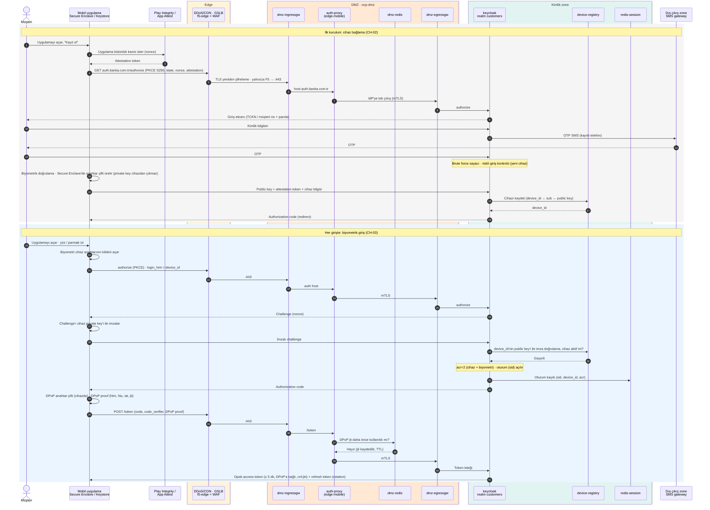
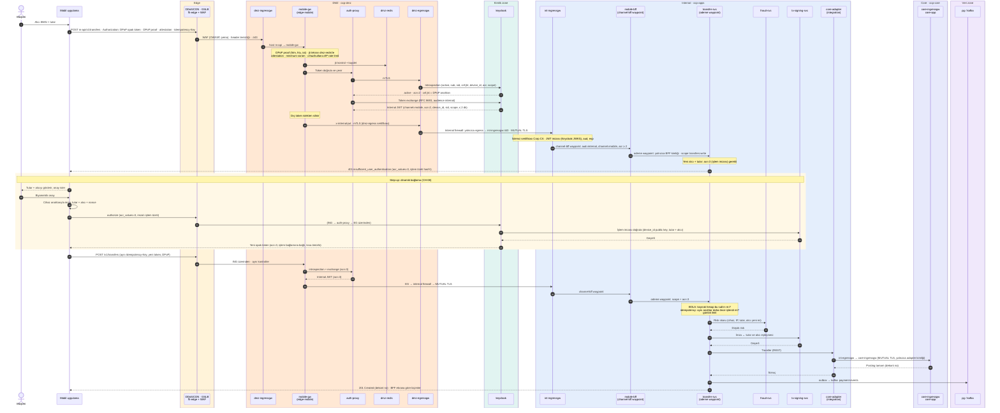
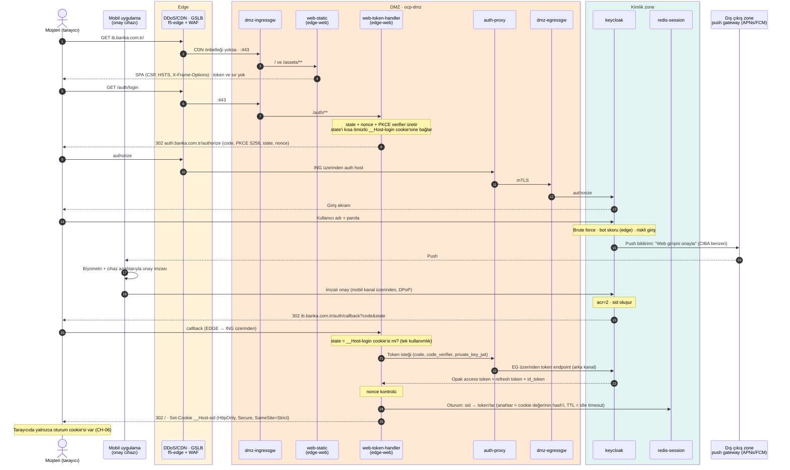
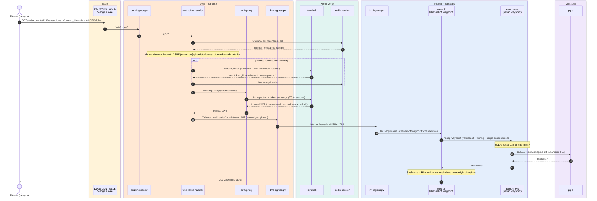
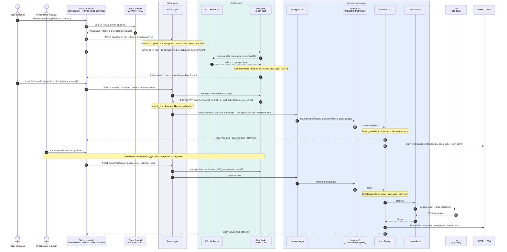
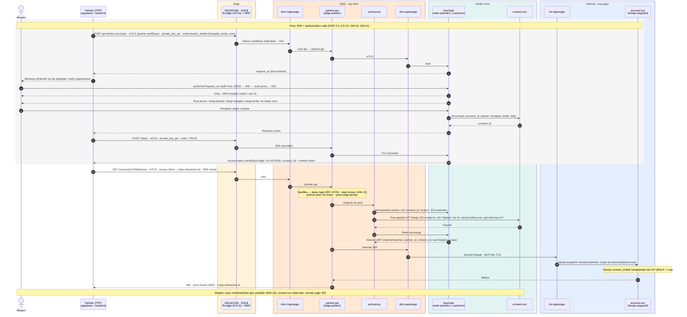
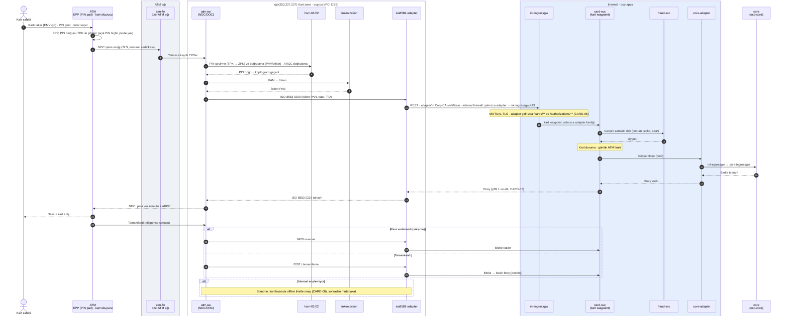
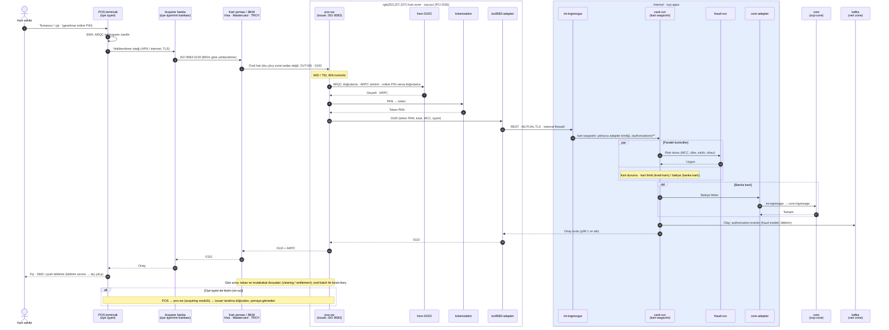

# Kurumsal hedef mimari — Gereksinimler

Oct 31, 2026 · @Olgun · son güncelleme Nov 1, 2026 (bkz. Değişiklik geçmişi)

## Kapsam

Bu sekme 6 kanalın (mobil, web, partner, şube, ATM, POS) internal sistemlere nasıl güvenle gireceğini tanımlar. Hiyerarşi şöyledir: internete yalnızca edge katmanı bakar, DMZ cluster dışarıya kapalıdır, internal A/B cluster'larına yalnızca mTLS ile ve token exchange sonrası girilir.

**Zone'lar:** Sağlayıcı katmanı · Dış DMZ (edge) · İç DMZ (DMZ cluster) · Şube zone · ATM · POS ağı · Kart zone (PCI CDE) · Kimlik zone · Internal A (DC1) / B (DC2) · Core banking zone (legacy) · Veri zone · Dış çıkış zone (outbound DMZ) · SOC / yönetim zone.

**ID önekleri:** CH kanal · EDGE kenar · GW DMZ gateway · IAM kimlik/oturum · INT internal ve süreklilik · CORE core banking · DATA veri · CARD kart · OUT dış çıkış · NET ağ akışı · SOC izleme · AC kabul.

**Öncelik:** Must (canlıya çıkış koşulu) · Should (ilk 6 ay) · Could (yol haritası). Hedef rakamlar (süre, RTO/RPO, limitler) öneridir; iş birimi ve uyum ekibiyle kesinleştirilmelidir.

## Zone mimarisi

DMZ cluster internete kapalıdır; yalnızca edge'den gelen trafiği alır. Şube ve kart trafiği DMZ'ye hiç uğramaz, kendi zone'larından doğrudan internal ingress'e mTLS ile gelir. Core banking (legacy) ayrı bir zone'dadır ve yalnızca internal'daki `core-adapter` üzerinden erişilir. Bankanın dışarıya (kurumlar, SMS/push, SaaS) çıkışı yalnızca dış çıkış zone'undan yapılır; kart şemalarına bağlantı ise kart zone'undan özel hatla kurulur.

## Detaylı topoloji ve isimlendirme

Her zone her DC'de ayrı bir OpenShift cluster'ıdır (A = DC1, B = DC2): `ocp-dmz`, `ocp-apps` (internal, modern mikroservisler), `ocp-core` (core banking legacy; konteynere taşınamayan kısım VM'de), `ocp-pci` (kart zone), `ocp-data` (konteyner veri servisleri; Oracle ve MSSQL VM / Exadata üzerinde) ve `ocp-mgmt` (gözlem, yönetim): toplam 12 cluster. Edge, şube gateway ve kart switch'leri appliance / VM'dir. Mesh ambient modda çalışır: sidecar yoktur, her node'daki ztunnel L4 mTLS'i, namespace başına waypoint ise L7 politikalarını (JWT claim'leri) uygular.

| Katman | Bileşen | İsim (A / B) | Namespace / yer |
| --- | --- | --- | --- |
| Kanal | Mobil API | `m-api.banka.com.tr` | DNS → GSLB |
| Kanal | İnternet şubesi | `ib.banka.com.tr` | DNS → GSLB |
| Kanal | Partner / açık bankacılık | `api.banka.com.tr` | DNS → GSLB |
| Kanal | Giriş uç noktaları | `auth.banka.com.tr` | DNS → GSLB → F5 VIP → auth-proxy |
| Edge | GSLB, LB + WAF | `gslb-01/02`, `f5-edge-dc1` / `f5-edge-dc2` | Dış DMZ (appliance) |
| Cluster | DMZ | `ocp-dmz-a` / `ocp-dmz-b` | DC1 / DC2 |
| Cluster | Internal (modern mikroservisler) | `ocp-apps-a` / `ocp-apps-b` | DC1 / DC2 |
| Cluster | Core banking (legacy) | `ocp-core-a` / `ocp-core-b` (+ VM) | DC1 / DC2 |
| Cluster | Kart zone (PCI) | `ocp-pci-a` / `ocp-pci-b` | DC1 / DC2 |
| Cluster | Veri | `ocp-data-a` / `ocp-data-b` (+ VM / Exadata) | DC1 / DC2 |
| Cluster | Yönetim ve gözlem | `ocp-mgmt-a` / `ocp-mgmt-b` | DC1 / DC2 |
| Platform | Kubernetes control plane | 3 master + etcd (her cluster) | Ayrı master node'ları |
| Platform | Istio control plane | `istiod` | `istio-system` |
| Platform | L4 mTLS | `ztunnel` (DaemonSet) | `istio-system` |
| Platform | L7 politika | `waypoint` | Uygulama namespace'i başına |
| DMZ | Ingress gateway | `dmz-ingressgw` | `istio-ingress` |
| DMZ | Mobil gateway, IdP proxy | `mobile-gw`, `auth-proxy` | `edge-mobile` |
| DMZ | Web statik, token handler | `web-static`, `web-token-handler` | `edge-web` |
| DMZ | Partner gateway | `partner-gw` | `edge-partner` |
| DMZ | Geçici durum cache'i | `dmz-redis` | `edge-cache` |
| DMZ | Global rate limit | `ratelimit` | `ratelimit` |
| DMZ | Egress gateway | `dmz-egressgw` | `istio-egress` |
| Internal | Ingress gateway | `int-ingressgw` | `istio-ingress` |
| Internal | Kanal BFF'leri | `mobile-bff`, `web-bff`, `branch-bff` | `channel-bff` |
| Internal | Domain servisleri | `account-svc`, `transfer-svc`, `customer-svc`, `card-svc`, `loan-svc`, `notification-svc`, `report-svc` | Domain bazlı: `hesap`, `odeme`, `musteri`, `kart`, `kredi`, `bildirim`, `raporlama` |
| Internal | Güvenlik servisleri | `tx-signing-svc`, `fraud-svc` | `security` |
| Internal | Core ve kurum entegrasyonu | `core-adapter`, kurum adaptörleri (EFT/FAST, SWIFT, KKB) | `integration` |
| Internal | Olay yayımı | outbox → Kafka (Debezium), Schema Registry | `olay` |
| Internal | Egress gateway | `int-egressgw` | `istio-egress` |
| Şube | Şube gateway | `branch-gw-a` / `branch-gw-b` | Şube zone |
| Kart | Switch'ler, HSM, adapter | `atm-sw`, `pos-sw`, `hsm-01/02`, `iso8583-adapter` | Kart zone (PCI) |
| Kimlik | IdP, cihaz kaydı, rıza | `keycloak-a/b`, `device-registry`, `consent-svc` | Kimlik zone |
| Kimlik | Oturum deposu | `redis-session-a/b` | Kimlik zone |
| Core | Giriş, uygulama, batch | `core-ingressgw`, `core-app`, `eod-batch` | Core banking zone (`ocp-core`) |
| Veri | İlişkisel DB (servisler) | `pg-a` (primary) / `pg-b` (replica), Patroni / CloudNativePG | Veri zone |
| Veri | Core DB | Oracle RAC, Data Guard | Veri zone (Exadata / VM) |
| Veri | Legacy DB | MSSQL Always On (CRM, raporlama) | Veri zone (VM) |
| Veri | Olay akışı | `kafka-a` / `kafka-b`, MirrorMaker 2 | Veri zone |
| Veri | Kuyruk (legacy entegrasyon) | RabbitMQ (quorum queues) | Veri zone |
| Veri | Uygulama cache'i | `redis-a` / `redis-b` (Valkey) | Veri zone |
| Veri | Nesne depolama, yedek | ODF / MinIO (S3), immutable yedek | Veri zone |
| Dış çıkış | Firewall, proxy, kurum hatları | outbound NGFW, forward proxy / SWG, VPN, SMTP relay, SMS / push gateway | Dış çıkış zone |
| Gözlem | Log toplama ve arama | `fluent-bit` (DaemonSet), `logstash`, `elasticsearch`, `kibana` | Her cluster + gözlem zone |
| Gözlem | Metrik, iz, panolar | `prometheus` (cluster başına), `thanos`, `tempo`, `grafana` | Her cluster + gözlem zone |
| Gözlem | Güvenlik izleme | `siem`, `soar`, WORM arşiv, NTP | SOC |
| Yönetim | GitOps, sırlar, erişim | `argocd`, `vault`, `bastion` | Yönetim zone |

## Kanal bazında istek yolu

Her durak bir öncekine güvenmez ve kendi kontrolünü yapar. Tüm duraklar `correlationId` ile `fluent-bit` → `logstash` → Elasticsearch ve SIEM'e log, `prometheus` / `tempo`'ya metrik ve iz gönderir. Tablolarda bu ortak iş tekrar yazılmadı.

### Mobil — `m-api.banka.com.tr`

| # | Zone | Servis | Yapılan işlem |
| --- | --- | --- | --- |
| 1 | Sağlayıcı | DDoS / CDN | Volumetrik saldırı temizleme, bot skoru, IP itibar ve coğrafi filtre |
| 2 | Edge | `gslb-01/02` | DNS ile sağlıklı ve yakın DC'yi seçme (DC1 / DC2) |
| 3 | Edge | `f5-edge-dc1/dc2` (LB + WAF) | Dış TLS sonlandırma; WAF (OWASP, API şeması); bağlantı ve boyut limitleri; dışarıdan gelen `X-Forwarded-*` header'larını silip yeniden yazma; DMZ node'larına dağıtım ve TLS'i yeniden şifreleme |
| 4 | İç firewall | – | Yalnızca F5 → `dmz-ingressgw:443` |
| 5 | DMZ | `dmz-ingressgw` | İç TLS; host'a göre `mobile-gw`'ye yönlendirme; header/body limitleri; trace ve `correlationId` başlatma |
| 6 | DMZ | `ztunnel` + `edge-mobile` waypoint | Pod'lar arası L4 mTLS; L7 kuralı: `mobile-gw`'ye yalnızca ingress gateway erişebilir |
| 7 | DMZ | `mobile-gw` | DPoP proof doğrulama (`jti` tekrar kontrolü `dmz-redis`'te); uygulama bütünlük kanıtı; minimum uygulama sürümü; cihaz/kullanıcı/IP rate limit; token introspection (`auth-proxy` → `keycloak`); token exchange ile internal JWT (`channel=mobile`); dış token'ı isteğden silme |
| 8 | DMZ | `dmz-egressgw` | `dmz-egress` sertifikasıyla mTLS başlatma; A/B'ye dağıtım ve failover; izinli hedef listesi |
| 9 | Internal firewall | – | Yalnızca egress → `int-ingressgw:443` |
| 10 | Internal | `int-ingressgw` | MUTUAL TLS (yalnızca Corp CA istemcisi); internal JWT doğrulama (Keycloak JWKS); `mobile-bff`'ye yönlendirme |
| 11 | Internal | `channel-bff` waypoint | L7 kuralı: `aud=internal`, `channel=mobile`, geçerli `acr` |
| 12 | Internal | `mobile-bff` | Ekran için veri birleştirme; timeout, retry, circuit breaker; idempotency key'i iletme |
| 13 | Internal | domain namespace waypoint'leri | Yalnızca BFF servis kimliklerine izin; işlem türüne göre `scope` ve `acr` (transfer için `acr=3`) |
| 14 | Internal | `transfer-svc`, `account-svc` vb. | Nesne seviyesinde yetki (bu hesap bu kullanıcının mı?); limit kuralları; `fraud-svc` risk skoru; `tx-signing-svc` ile imza doğrulama; Kafka'ya olay |
| 15 | Veri / core | `pg-a`, `kafka-a` (`int-egressgw` üzerinden); `core-adapter` → `core-ingressgw` (`ocp-core`) | mTLS; servis başına ayrı DB kullanıcısı; erişim kaydı |

### Web — `ib.banka.com.tr`

Web'de tarayıcı hiç token görmez: elinde yalnızca oturum cookie'si vardır. Cookie'yi token'a çeviren durak `web-token-handler`'dır.

| # | Zone | Servis | Yapılan işlem |
| --- | --- | --- | --- |
| 1 | Sağlayıcı | DDoS / CDN | Statik dosyaları cache'ten sunma; volumetrik saldırı ve bot koruması |
| 2 | Edge | `gslb-01/02` | DC seçimi |
| 3 | Edge | `f5-edge-dc1/dc2` (LB + WAF) | Dış TLS, WAF, limitler, header temizliği; oturum sürdürülebilirliği için sticky session **gerekmez** (oturum Redis'te) |
| 4 | İç firewall | – | Yalnızca F5 → `dmz-ingressgw:443` |
| 5 | DMZ | `dmz-ingressgw` | Yol bazında yönlendirme: `/` ve `/assets/**` → `web-static`; `/api/**` ve `/auth/**` → `web-token-handler` |
| 6 | DMZ | `web-static` | Yalnızca derlenmiş SPA dosyaları; CSP, HSTS, X-Frame-Options header'ları; sır ve iş mantığı yok |
| 7 | DMZ | `web-token-handler` | Giriş: OIDC Authorization Code + PKCE (`auth-proxy` → `keycloak`), MFA olarak mobil push onayı (CIBA) · `__Host-` önekli, `HttpOnly; Secure; SameSite=Strict` cookie · token'ları `redis-session`'da oturuma bağlı saklama · CSRF kontrolü · idle ve absolute timeout · oturum bazında rate limit · token exchange ile internal JWT (`channel=web`) |
| 8 | DMZ | `dmz-egressgw` | mTLS başlatma; A/B failover; hem internal'a hem `redis-session` / `keycloak`'a tek çıkış |
| 9 | Internal firewall | – | Yalnızca egress → `int-ingressgw:443` |
| 10 | Internal | `int-ingressgw` | MUTUAL TLS; JWT doğrulama; `web-bff`'ye yönlendirme |
| 11 | Internal | `channel-bff` waypoint | `aud=internal`, `channel=web`, `acr` kontrolü |
| 12 | Internal | `web-bff` | Ekran için veri birleştirme; sayfalama; hassas alanları maskeleme (IBAN, kart no) |
| 13 | Internal | domain namespace waypoint'leri + servisler | Mobil ile aynı: servis kimliği, `scope`/`acr`, nesne seviyesinde yetki, fraud skoru; transfer için mobilde işlem imzası (step-up) |
| 14 | Veri / core | `pg-a`, `kafka-a`, `core-adapter` → `ocp-core` | Mobil ile aynı |

### Şube — kurumsal MPLS

Şube trafiği internete ve DMZ'ye hiç uğramaz. Kimlik iki katmanlıdır: terminal (cihaz sertifikası) ve personel (AD SSO).

| # | Zone | Servis | Yapılan işlem |
| --- | --- | --- | --- |
| 1 | Şube ağı | Şube firewall / SD-WAN | NAC (802.1X) ile yalnızca kayıtlı cihazları ağa alma; şubeden internete doğrudan çıkış kapalı |
| 2 | Şube ağı | Şube terminali | Personel Windows/AD oturumu (Kerberos); terminalde EDR; cihaz sertifikası TPM'de |
| 3 | MPLS → DC | İç DNS / iki DC'deki iç LB VIP'leri | Sağlıklı DC'ye yönlendirme; MPLS üzerinde de TLS (ağa güvenilmez) |
| 4 | Şube zone | `branch-gw-a/b` | Terminal sertifikasıyla mTLS (sertifika ↔ şube kodu eşleşmesi) · Kerberos/AD → Keycloak personel realm'i ile OIDC girişi · rol ve yetki seviyesini (gişe, yetkili, müdür) token'a koyma · mesai saati ve şube IP kontrolü · rate limit · token exchange ile internal JWT (`channel=branch`, `branch_id`, `staff_role`) |
| 5 | Internal firewall | – | Yalnızca `branch-gw` → `int-ingressgw:443` |
| 6 | Internal | `int-ingressgw` | MUTUAL TLS (`branch-gw` istemci sertifikası); JWT doğrulama; `branch-bff`'ye yönlendirme |
| 7 | Internal | `channel-bff` waypoint | `aud=internal`, `channel=branch` ve personel rolü kontrolü |
| 8 | Internal | `branch-bff` | Gişe ekranları için birleştirme; limit üstü işlemde ikinci personel onayı (4 göz) akışı |
| 9 | Internal | domain namespace waypoint'leri + servisler | Personelin yetki seviyesine göre limit; müşteri kimlik doğrulaması (kimlik kartı / imza) kaydı; "kim, hangi şubede, kimin adına ne yaptı" denetim izi |
| 10 | Veri / core | `pg-a`, `kafka-a`, `core-adapter` → `ocp-core` | Mobil ile aynı; personel işlemleri ayrıca UEBA'ya (içeriden tehdit analizi) gider |

**Üç kanalın ortak noktası:** internal'a giriş her zaman `int-ingressgw` üzerinden, mTLS ve kısa ömürlü internal JWT ile olur. Fark yalnızca giriş kapısındadır: mobil ve web için `dmz-egressgw`, şube için `branch-gw`.

## Login ve servis akışları (hedef, sequence diyagramları)

Bu bölüm altı kanalın prod hedefindeki giriş (login) ve örnek servis akışlarını adım adım gösterir. Ortak kurallar:

- **Ortak katmanlar:**
  - Sağlayıcı katmanı (DDoS/CDN) ve edge (`gslb-01/02`, `f5-edge-dc1/dc2` + WAF) internet kanallarında her istekte yer alır.
  - Diyagramlarda bu katmanlar tek kutuda gösterildi ("Edge").
  - İç firewall (edge → DMZ) ve internal firewall (DMZ / şube / kart zone → internal) yalnızca NET tablosundaki akışlara izin verir.
- **Kimlik:**
  - Dış token her zaman opaktır (phantom token).
  - DMZ'de `auth-proxy` IdP'de introspection yapar, internal JWT'yi RFC 8693 token exchange ile IdP'den alır (IAM-05).
  - Internal JWT: ömür ≤ 2 dk, `aud=internal`; claim'ler `sub`, `channel`, `acr`, `device_id`, `scope`, `sid` ve kanala özel olanlar.
- **Internal tarafta doğrulama:**
  - `int-ingressgw` MUTUAL TLS'i ve internal JWT'yi (Keycloak JWKS) doğrular.
  - Her namespace'in waypoint'i JWT'yi yeniden doğrular ve claim bazlı L7 kararı verir.
  - Servisler nesne seviyesinde yetki (BOLA) uygular.
- **Kayıt:** tüm duraklar `correlationId` ile log, metrik ve iz üretir; diyagramlarda tekrar yazılmadı.
- **İsimler:** "Detaylı topoloji ve isimlendirme" tablosundaki adlar kullanıldı (A/B eki yazılmadı).

### Mobil: ilk kurulum (cihaz bağlama) ve biyometrik giriş

### Mobil: para transferi (step-up ve işlem imzası)

### Web: giriş (sunucu tarafında OIDC, mobil push onayı)

### Web: hesap hareketleri sorgusu

### Şube: personel girişi ve limit üstü işlemde dört göz onayı

### Partner (açık bankacılık): rıza (FAPI 2.0) ve hesap bilgisi sorgusu

### ATM: kendi kartıyla nakit çekim

### POS: kart ödemesi yetkilendirme (bankamızın kartı, başka bankanın POS'u)

## Kanal gereksinimleri (CH)

İnternet kanalları (mobil, web, partner) DMZ'den, kapalı ağ kanalları (şube, ATM, POS) kendi zone'larından girer. Hiçbir kanal internal'a doğrudan bağlanamaz.

| ID | Kanal | Gereksinim | Öncelik |
| --- | --- | --- | --- |
| CH-01 | Mobil | Giriş OIDC Authorization Code + PKCE ile yapılır; uygulama içinde şifre saklanmaz | Must |
| CH-02 | Mobil | İlk kurulumda cihaz bağlama yapılır: kimlik + OTP doğrulamasından sonra Secure Enclave / Keystore'da anahtar çifti üretilir, public key IdP'ye kaydedilir | Must |
| CH-03 | Mobil | Biyometrik giriş cihaz private key'inin kilidini açar ve IdP challenge'ını imzalar; biyometrik veri cihazdan çıkmaz | Must |
| CH-04 | Mobil | Her istek Play Integrity / App Attest kanıtı taşır; root/jailbreak, emulator ve hook tespitinde riskli işlemler engellenir | Must |
| CH-05 | Mobil | TLS sertifika pinning uygulanır; pin rotasyonu için yedek pin uygulamada bulunur | Should |
| CH-06 | Web | Tarayıcıya token verilmez; oturum yalnızca `HttpOnly; Secure; SameSite=Strict` cookie ile taşınır | Must |
| CH-07 | Web | Girişte ikinci faktör zorunludur (mobil push onayı veya OTP) | Must |
| CH-08 | Mobil, Web | Para transferi, yeni alıcı, limit artışı gibi işlemler step-up doğrulama ister; imza tutar ve alıcıyı içerir (dinamik bağlama) | Must |
| CH-09 | Partner | Partner trafiği ayrı domain (örn. `api.banka.com.tr`) ve ayrı gateway üzerinden gelir; müşteri kanallarıyla karışmaz | Must |
| CH-10 | Partner | Partner kimliği mTLS sertifikası + `private_key_jwt` ile doğrulanır (FAPI 2.0) | Must |
| CH-11 | Şube | Şube uygulamaları kurumsal MPLS üzerinden şube zone gateway'ine bağlanır; personel AD/Kerberos SSO ile girer | Must |
| CH-12 | Şube | Her şube terminali cihaz sertifikası taşır; sertifikasız cihazdan gelen istek reddedilir | Must |
| CH-13 | Şube | Personel yetki seviyesi (gişe, yetkili, müdür) token'da taşınır; limit üstü işlemler ikinci personel onayı (4 göz) ister | Must |
| CH-14 | ATM | ATM'ler özel ATM ağı üzerinden yalnızca ATM switch'e bağlanır (NDC/DDC); internet ve DMZ üzerinden geçmez | Must |
| CH-15 | POS | POS işlemleri POS switch / BKM üzerinden ISO 8583 ile gelir; terminal ID ve EMV kriptogramı doğrulanır | Must |
| CH-16 | Tüm | Her istek `channel` bilgisini taşır; internal'da yetki kararları kanal bazında verilir | Must |

## Edge katmanı gereksinimleri (EDGE)

Edge katmanı cluster'ların dışında durur ve internetten gelen paketi doğrudan alan tek katmandır. Hazır ürünlerle kurulur; Kubernetes üzerinde çalışmaz.

| ID | Bileşen | Gereksinim | Öncelik |
| --- | --- | --- | --- |
| EDGE-01 | DDoS / CDN | Volumetrik saldırılar sağlayıcı tarafında temizlenir (scrubbing); bankanın internet hattına yalnızca temiz trafik ulaşır | Must |
| EDGE-02 | DDoS / CDN | Bot yönetimi credential stuffing ve scraping'i login/OTP uç noktalarında tespit eder | Must |
| EDGE-03 | DDoS / CDN | Dış TLS private key'i sağlayıcıya verilmez (keyless SSL) ya da TLS on-prem'de sonlandırılır | Should |
| EDGE-04 | Dış firewall | İnternetten yalnızca edge LB VIP'lerine 443 açıktır; diğer tüm portlar kapalıdır | Must |
| EDGE-05 | GSLB / LB | DNS tabanlı GSLB trafiği sağlıklı DC'ye (DC1/DC2) yönlendirir; DC kaybında failover ≤ 60 sn | Must |
| EDGE-06 | GSLB / LB | Gerçek istemci IP'si `X-Forwarded-For` veya PROXY protocol ile güvenilir şekilde aktarılır; dışarıdan gelen aynı header'lar silinir | Must |
| EDGE-07 | GSLB / LB | Bağlantı limitleri ve slow-loris koruması uygulanır | Must |
| EDGE-08 | WAF | OWASP CRS kuralları önce detect, false positive temizliğinden sonra block modunda çalışır | Must |
| EDGE-09 | WAF | OpenAPI şemasına uymayan istekler reddedilir (pozitif güvenlik modeli) | Should |
| EDGE-10 | WAF | Kritik CVE yayımlandığında virtual patch kuralı ≤ 24 saat içinde devreye alınır | Should |
| EDGE-11 | İç firewall | Dış firewall'dan farklı üretici kullanılır; edge'den DMZ cluster'a yalnızca ingress gateway portu açıktır | Must |
| EDGE-12 | Tüm edge | Edge bileşenleri ve kural değişiklikleri ağ/güvenlik ekibi tarafından, cluster deploy döngüsünden bağımsız yönetilir | Must |
| EDGE-13 | Tüm edge | Edge logları (DDoS, WAF, LB) gerçek zamanlı SIEM'e gönderilir | Must |

## DMZ gateway gereksinimleri (GW)

DMZ cluster'da iş mantığı ve veri bulunmaz; yalnızca doğrulama, dönüştürme ve yönlendirme yapılır. Gateway'ler üründür, custom kod Web token handler ile sınırlıdır.

| Bileşen | Tip | Aday ürünler |
| --- | --- | --- |
| Ingress gateway | Ürün | OpenShift Router, Istio Gateway, Envoy Gateway |
| Mobile API GW | Ürün + eklenti | Kong Enterprise, Apigee, Axway, IBM API Connect |
| Web token handler | Custom | Spring Boot / Spring Security OAuth2 Client |
| Partner / Open API GW | Ürün + portal | Apigee, Axway Amplify, IBM API Connect, WSO2 APIM |
| Egress gateway | Ürün | Istio Egress Gateway |

| ID | Bileşen | Gereksinim | Öncelik |
| --- | --- | --- | --- |
| GW-01 | Ingress | TLS sonlandırır; host bazında (`m.`, `www.`, `api.`) doğru gateway'e yönlendirir | Must |
| GW-02 | Ingress | Max body boyutu, header temizliği ve timeout'lar uygulanır; trace ve correlation ID başlatılır | Must |
| GW-03 | Mobile GW | Dış opak token'ı IdP'de doğrular ve RFC 8693 token exchange ile internal JWT'ye çevirir (phantom token) | Must |
| GW-04 | Mobile GW | DPoP kanıtını ve app attestation token'ını doğrular; geçersizse 401 döner | Must |
| GW-05 | Mobile GW | Cihaz, kullanıcı ve IP bazında rate limit; login/OTP uçlarında daha sıkı limit | Must |
| GW-06 | Mobile GW | Minimum uygulama sürümü kontrolü ve API versiyon yönlendirmesi (`/v1`, `/v2`) | Should |
| GW-07 | Token handler | OIDC akışını sunucu tarafında yürütür; token'ları Redis'te oturuma bağlı saklar | Must |
| GW-08 | Token handler | CSRF koruması, CSP, HSTS ve X-Frame-Options uygulanır | Must |
| GW-09 | Token handler | Ekran için veri birleştirme yapmaz; bu iş internal'daki web-bff'tedir | Must |
| GW-10 | Partner GW | FAPI 2.0: mTLS sertifika ↔ client eşleşmesi, PAR, sender-constrained token | Must |
| GW-11 | Partner GW | Her istekte consent servisinden rıza (hesap, kapsam, süre) kontrol edilir | Must |
| GW-12 | Partner GW | Partner bazında plan ve kota; geliştirici portalı ve sandbox ortamı | Must |
| GW-13 | Partner GW | İstek/yanıt imzalama (JWS veya HTTP Message Signatures) ile inkar edilemezlik | Should |
| GW-14 | Egress | Internal'a giden tek çıkış noktasıdır; Corp CA istemci sertifikasıyla mTLS başlatır | Must |
| GW-15 | Egress | Yalnızca internal ingress (A/B) ve IdP'ye çıkış; diğer hedefler `REGISTRY_ONLY` ile kapalıdır | Must |
| GW-16 | Egress | A/B arasında locality-aware yük dağıtımı ve outlier detection ile otomatik failover | Must |
| GW-17 | Tüm GW | Dış token, parola, OTP ve kart verisi loglara yazılmaz (maskeleme) | Must |

## Kimlik ve oturum gereksinimleri (IAM)

Tüm kanallar tek merkezi IdP'yi (OIDC / OAuth 2.1) kullanır. Oturumun asıl kaydı IdP'de ve Redis'tedir; internal servisler yalnızca kısa ömürlü internal JWT görür.

| ID | Gereksinim | Öncelik |
| --- | --- | --- |
| IAM-01 | IdP her iki DC'de aktif çalışır; IdP erişilemezse yeni giriş yapılamaz ama mevcut geçerli token'lar süresi dolana kadar çalışır | Must |
| IAM-02 | Her kanal ayrı OAuth client'ıdır (`mobile-app`, `web-bff`, `branch-app`, `partner-<ad>`); kapsamlar (scope) client bazında sınırlanır | Must |
| IAM-03 | Dış access token opaktır, ömrü ≤ 5 dk; refresh token her kullanımda yenilenir (rotation) ve tekrar kullanımı tüm oturumu iptal eder | Must |
| IAM-04 | Mobil token'lar DPoP ile cihaza bağlıdır (sender-constrained) | Must |
| IAM-05 | Internal JWT'yi IdP RFC 8693 token exchange ile üretir ve kendi anahtarıyla imzalar (gateway imzalamaz); ömrü ≤ 2 dk, `aud` = internal, claim'leri: `sub`, `channel`, `acr`, `device_id`, `scope`, `sid` (+ kanala özel: `partner_id`, `branch_id`, `staff_role`) | Must |
| IAM-06 | Web oturumu: idle ve absolute timeout uygulanır (süreler BDDK ve iş birimiyle belirlenecek); timeout'ta IdP oturumu da sonlanır | Must |
| IAM-07 | Müşteri "tüm cihazlardan çıkış" yapabilir; iptal ≤ 5 sn içinde tüm gateway'lerde etkili olur | Must |
| IAM-08 | Doğrulama seviyeleri tanımlanır: `acr=1` görüntüleme, `acr=2` 2FA, `acr=3` işlem imzası. Internal policy'ler bu seviyeye göre karar verir | Must |
| IAM-09 | Personel kimliği AD / Entra ile federe edilir; müşteri ve personel ayrı realm'lerde tutulur | Must |
| IAM-10 | Consent servisi rızaları (partner, hesap, kapsam, süre) saklar; müşteri rızayı mobil/web'den geri çekebilir | Must |
| IAM-11 | Başarısız giriş denemelerinde artımı gecikme ve hesap kilitleme uygulanır; kilitlenme SIEM'e olay olarak gider | Must |
| IAM-12 | Riskli giriş tespiti: yeni cihaz, yeni ülke, imkansız seyahat durumunda step-up istenir | Should |
| IAM-13 | İmza ve şifreleme anahtarları HSM'de tutulur; JWKS rotasyonu kesintisiz yapılır | Must |

## Internal A/B cluster ve iş sürekliliği (INT)

A (DC1) ve B (DC2) aynı servisleri active-active çalıştırır. Bir DC tamamen kaybedildiğinde diğeri tüm yükü tek başına taşıyabilmelidir.

| ID | Gereksinim | Öncelik |
| --- | --- | --- |
| INT-01 | A ve B aynı servis setini aynı sürümle çalıştırır; deploy GitOps (Argo CD) ile iki cluster'a eş zamanlı yapılır | Must |
| INT-02 | Her cluster tek başına toplam tepe yükün %100'ünü taşıyacak kapasitede boyutlandırılır | Must |
| INT-03 | DC kaybında hedef RTO ≤ 15 dk, RPO ≤ 1 dk (öneri; iş birimiyle kesinleşecek) | Must |
| INT-04 | Internal ingress yalnızca DMZ egress, şube gateway ve ISO 8583 adapter'ın Corp CA sertifikalarını kabul eder (MUTUAL TLS) | Must |
| INT-05 | Ingress, internal JWT'yi Istio `RequestAuthentication` ile doğrular; JWT'siz istek reddedilir | Must |
| INT-06 | `AuthorizationPolicy` deny-by-default çalışır; kararlar servis kimliği + `channel` + `acr` + `scope` ile verilir | Must |
| INT-07 | Kanal başına ayrı BFF: `mobile-bff`, `web-bff`, `branch-bff`; BFF'ler domain servislerine yalnızca izinli uçlardan erişir | Must |
| INT-08 | Servisler arası trafik STRICT mTLS'tir; kullanıcı JWT'si çağrı zinciri boyunca taşınır | Must |
| INT-09 | Para hareketi yapan işlemler idempotency key ile korunur; DC failover sırasında çift işlem oluşmaz | Must |
| INT-10 | PostgreSQL DC1 primary ↔ DC2 replica; failover otomatik ve tek komutluk geri dönüş prosedürü vardır | Must |
| INT-11 | Kafka DC'ler arası MirrorMaker 2 ile çoğaltılır; consumer offset'leri senkronize edilir | Should |
| INT-12 | Core banking'e erişim yalnızca adapter servisler üzerinden; core'un kendi API'si internal dışına açılmaz | Must |
| INT-13 | Yılda en az 2 kez planlı DC geçiş tatbikatı yapılır ve raporlanır | Must |
| INT-14 | Pod'lar restricted SCC (non-root, read-only FS, no privilege escalation) ile çalışır; image'lar imzalı ve taranmıştır | Must |
| INT-15 | Modern servisler `ocp-apps`'te domain bazlı namespace'lerde çalışır; core banking (legacy) ayrı cluster'dadır (`ocp-core`) ve strangler deseniyle kademeli taşınır (CORE-04) | Must |
| INT-16 | Internal'dan veri zone'una, core'a ve dış çıkış zone'una giden trafik yalnızca `int-egressgw` üzerinden çıkar (`REGISTRY_ONLY`) | Must |

## Core banking gereksinimleri (CORE)

Core banking (legacy) modern servislerden ayrı bir cluster'da (`ocp-core`, gerekirse VM) çalışır. Internal'dan tek giriş noktası vardır ve yalnızca adapter kullanabilir.

| ID | Gereksinim | Öncelik |
| --- | --- | --- |
| CORE-01 | Core banking `ocp-core` cluster'ında / VM'lerde çalışır; tek giriş `core-ingressgw` (MUTUAL TLS) | Must |
| CORE-02 | `core-ingressgw` yalnızca `integration` namespace'indeki `core-adapter` kimliğini kabul eder; kanallar, BFF'ler ve domain servisleri core'a doğrudan erişemez | Must |
| CORE-03 | `core-adapter` anti-corruption layer'dır: core protokolünü (MQ, SOAP, REST) iç REST modeline çevirir; core veri modeli internal'a sızmaz | Must |
| CORE-04 | Strangler: yeni işlevler internal domain servislerinde yazılır; core'dan taşınan uçlar adapter arkasında kademeli olarak yeni servise yönlendirilir | Should |
| CORE-05 | Gün sonu (EOD) penceresinde core yazmaya kapalıysa işlemler kuyruğa alınır (store-and-forward) ve pencere sonrası mutabakat yapılır | Should |
| CORE-06 | Core değişiklikleri CDC (Debezium) ile Kafka'ya olay olarak yayımlanır; internal servisler core DB'ye doğrudan bağlanmaz | Should |

## Veri zone gereksinimleri (DATA)

Veri zone internete ve DMZ'ye kapalıdır. Modern servisler `int-egressgw` üzerinden, core ise doğrudan bağlanır; DC1 ⇄ DC2 replikasyonu yalnızca bu zone içinde yapılır.

| ID | Gereksinim | Öncelik |
| --- | --- | --- |
| DATA-01 | Veri zone'una yalnızca `int-egressgw` (mTLS) ve core zone bağlanır; DMZ, kanal zone'ları ve internet erişemez | Must |
| DATA-02 | Servis başına ayrı veritabanı ve kullanıcı; bir servis başka servisin veritabanına erişemez | Must |
| DATA-03 | Oracle RAC (core DB, Data Guard sync), MSSQL Always On (legacy CRM / raporlama), PostgreSQL (servis DB'leri, sync replika + PITR) | Must |
| DATA-04 | Kafka'da topic başına ACL; RabbitMQ quorum queue ve vhost başına kullanıcı; Valkey / Redis ACL'leri anahtar öneki bazlıdır | Must |
| DATA-05 | Durağan veri şifrelidir (TDE / disk şifreleme); anahtarlar HSM / Vault'ta tutulur | Must |
| DATA-06 | Yedekler değiştirilemez (immutable / WORM) ve şifreli saklanır; geri dönüş testi en az çeyrekte bir yapılır | Must |
| DATA-07 | Veritabanı kimlik bilgileri dinamik ve kısa ömürlüdür (Vault database secrets engine) | Should |
| DATA-08 | Test ortamlarına yalnızca maskelenmiş / anonimleştirilmiş veri aktarılır (KVKK) | Must |

## Kart zone gereksinimleri (CARD)

ATM ve POS trafiği PCI-DSS kapsamındaki ayrı bir kart zone'unda (CDE) karşılanır. Bu zone internete ve DMZ'ye hiç dokunmaz; internal'a yalnızca adapter üzerinden ve tokenize veriyle girer.

| ID | Gereksinim | Öncelik |
| --- | --- | --- |
| CARD-01 | Kart zone diğer zone'lardan firewall ile ayrılır ve PCI-DSS kapsamı bu zone ile sınırlı tutulur | Must |
| CARD-02 | ATM switch NDC/DDC protokolünü, POS switch ISO 8583 / BKM bağlantısını karşılar | Must |
| CARD-03 | PIN doğrulama, PIN translation ve anahtar yönetimi yalnızca HSM'de yapılır; açık PIN hiçbir sistemde görünmez | Must |
| CARD-04 | ATM ve POS terminal anahtarları (TMK/TPK) uzaktan anahtar yükleme (RKL) ile HSM üzerinden yönetilir | Must |
| CARD-05 | ISO 8583 adapter mesajı internal REST/gRPC çağrısına çevirir; PAN internal'a token olarak geçer | Must |
| CARD-06 | Adapter internal ingress'e kendi Corp CA sertifikasıyla mTLS bağlanır; yalnızca `/cards/**` ve `/authorizations/**` uçlarına erişebilir | Must |
| CARD-07 | Yetkilendirme (authorization) yanıt süresi p99 < 1 sn (öneri; switch timeout'una göre ayarlanacak) | Must |
| CARD-08 | Internal erişilemezse stand-in kuralları (limit bazında offline onay) devreye girer ve sonradan mutabakat yapılır | Should |
| CARD-09 | Kart verisi loglarda maskelenir (ilk 6 + son 4); CVV, PIN blok ve track verisi saklanmaz | Must |
| CARD-10 | Kart zone'una erişen tüm personel işlemleri kayıt altına alınır ve yıllık PCI denetimine sunulur | Must |

## Dış çıkış gereksinimleri (OUT)

Bankadan dışarıya giden trafik (kurumlar, SMS / push, e-posta, SaaS, yazılım güncellemeleri) yalnızca dış çıkış zone'undan (outbound DMZ) çıkar. Hiçbir zone'dan internete doğrudan route yoktur.

| ID | Gereksinim | Öncelik |
| --- | --- | --- |
| OUT-01 | Dışarıya giden tüm trafik dış çıkış zone'undan çıkar; diğer zone'lardan internete doğrudan route yoktur | Must |
| OUT-02 | Dış çıkış zone'una yalnızca egress gateway'ler (`int-egressgw`; OCSP / CRL için `dmz-egressgw`) ve yönetim zone'u (CI/CD, registry upstream) bağlanabilir | Must |
| OUT-03 | Hedefler izin listesiyle (FQDN + port) tanımlanır; liste dışı hedef reddedilir ve SIEM'e olay gider | Must |
| OUT-04 | HTTP(S) çıkışı forward proxy / SWG üzerinden yapılır; TLS inceleme uygulanır (kurum hatları ve sertifika sabitlemeli hedefler hariç) | Should |
| OUT-05 | Kurum bağlantıları (EFT/FAST, SWIFT, KKB, GİB, MERNİS / KPS) kiralık hat veya IPsec VPN ile kurulur; kurum başına ayrı sertifika ve kaynak IP | Must |
| OUT-06 | SMTP relay ve SMS / push gateway yalnızca bildirim servisinden gelen istekleri kabul eder | Must |
| OUT-07 | DNS çözümlemesi yalnızca iç resolver'dan yapılır; dışarıya doğrudan DNS (53) kapalıdır (DNS tünelleme önlemi) | Must |
| OUT-08 | Kart şeması bağlantıları (Visa, Mastercard, TROY, BKM) dış çıkış zone'undan değil, kart zone'undan özel hatla kurulur (PCI kapsamı) | Must |
| OUT-09 | Çıkış logları (proxy, NGFW, VPN) SIEM'e gönderilir; hacim anomalisi veri sızıntısı alarmı üretir | Must |

## Ağ akış kuralları (NET)

Varsayılan kural her zone arasında "her şeyi reddet"tir. Aşağıdaki tablo açık olan akışların tamamını listeler; burada olmayan her akış kapalıdır.

| ID | Kaynak | Hedef | Port / protokol | Not |
| --- | --- | --- | --- | --- |
| NET-01 | İnternet | Edge LB VIP | 443 / HTTPS | DDoS/CDN arkasından |
| NET-02 | Edge LB / WAF | DMZ ingress gateway | 443 / HTTPS | Yalnızca edge kaynak IP'leri |
| NET-03 | DMZ egress | Internal ingress A ve B | 443 / mTLS | Tek kapı |
| NET-04 | DMZ egress | IdP (kimlik zone) | 443 / mTLS | Introspection, token exchange |
| NET-05 | DMZ egress | OCSP / CRL sunucuları | 80, 443 | Sertifika iptal kontrolü; dış çıkış zone proxy'si üzerinden |
| NET-06 | Şube MPLS | Şube gateway | 443 / mTLS | Cihaz sertifikası zorunlu |
| NET-07 | Şube gateway | Internal ingress A ve B | 443 / mTLS |  |
| NET-08 | ATM ağı | ATM switch | NDC/DDC (TCP) | Özel hat / VPN |
| NET-09 | BKM / POS ağı | POS switch | ISO 8583 (TCP) | Özel hat |
| NET-10 | ISO 8583 adapter | Internal ingress A ve B | 443 / mTLS | Yalnızca kart uçları |
| NET-11 | Internal A/B (`int-egressgw`) | Veri zone (PostgreSQL, Kafka, RabbitMQ, Valkey) | DB/Kafka portları, mTLS | Yalnızca egress gateway'den |
| NET-12 | Internal A ↔ B | – | Kafka/DB replikasyon portları | Yalnızca veri zone üzerinden |
| NET-13 | Tüm zone'lar | SIEM toplayıcı | 6514 (syslog/TLS), 443 | Yalnızca dışarı (tek yön) |
| NET-14 | Yönetim zone (bastion) | Tüm cluster API'leri | 6443 | MFA + PAM oturum kaydı |
| NET-15 | Internal `core-adapter` (`int-egressgw`) | `core-ingressgw` (core zone) | 443 / mTLS | Yalnızca adapter kimliği |
| NET-16 | Core zone (`core-app`, batch) | Veri zone (Oracle, MSSQL, RabbitMQ, MQ) | DB/MQ portları, TLS | Core'un kendi verisi |
| NET-17 | Internal `int-egressgw` | Dış çıkış zone (proxy, kurum hatları) | 443 / mTLS | Kurum adaptörleri, bildirim |
| NET-18 | Dış çıkış zone | Dış kurumlar (TCMB EFT/FAST, SWIFT, KKB, GİB) | Kiralık hat / IPsec VPN | Kurum başına izin |
| NET-19 | Dış çıkış zone (proxy) | İnternet servisleri (SMS, APNs/FCM, SaaS) | 443 | FQDN izin listesi |
| NET-20 | Kart zone | Kart şemaları (Visa, Mastercard, TROY, BKM) | Özel hat | Dış çıkış zone'undan geçmez |
| NET-21 | Yönetim zone (CI/CD, registry) | Dış çıkış zone (proxy) | 443 | Bağımlılık ve image upstream'i |

**Açıkça yasak olanlar:** İnternet → DMZ cluster · DMZ → internet (NET-05 hariç) · Internal → DMZ (bağlantıyı yalnızca DMZ başlatır) · DMZ → veri zone · DMZ → core zone · Kart zone → internet · Internal, core, veri zone → internet (yalnızca dış çıkış zone üzerinden) · `core-adapter` dışında herhangi bir kaynak → core zone · Herhangi bir zone → HSM (kart zone ve IdP hariç).

## Güvenlik izleme gereksinimleri (SOC)

Tüm zone'lar loglarını tek yönlü olarak SIEM'e gönderir. SOC 7/24 izler; SOAR playbook'ları edge ve IdP üzerinde otomatik aksiyon alabilir.

| ID | Gereksinim | Öncelik |
| --- | --- | --- |
| SOC-01 | Log kaynakları: DDoS/WAF/LB, firewall'lar, tüm gateway access logları, Istio authz retleri, mTLS handshake hataları, IdP olayları, Kubernetes audit, DB erişim logları, kart switch ve HSM logları | Must |
| SOC-02 | Her cluster'da Fluent Bit / OpenTelemetry Collector logları normalize edip TLS ile gönderir; log kaybı alarm üretir | Must |
| SOC-03 | Tüm loglarda ortak alanlar: `timestamp` (UTC, NTP senkron), `zone`, `channel`, `correlationId`, `sub` (hash), `src_ip`, `action`, `result` | Must |
| SOC-04 | Korelasyon kuralları en az şu senaryoları kapsar: credential stuffing, imkansız seyahat, internal ingress'te sertifikasız/geçersiz mTLS denemesi, DMZ'den beklenmeyen hedef, refresh token tekrar kullanımı, mesai dışı personel işlemi, kart zone'una yetkisiz erişim | Must |
| SOC-05 | SOAR playbook'ları: IP'yi WAF'ta engelle, kullanıcı oturumlarını IdP'de iptal et, partner client'ını askıya al | Should |
| SOC-06 | Loglar değiştirilemez (WORM) saklanır; saklama süresi düzenleyici gereksinimlere göre belirlenir | Must |
| SOC-07 | Olay yönetimi NIST 800-61'e göre: tespit → analiz → sınırlama → temizleme → kurtarma → olay sonrası analiz | Must |
| SOC-08 | KPI'lar raporlanır: MTTD, MTTR, false positive oranı, kapatılan olay sayısı | Should |
| SOC-09 | Kişisel veri (TCKN, kart, telefon) loglarda maskelenir veya hash'lenir (KVKK) | Must |

## Kabul kriterleri

Mimari, aşağıdaki testlerin hepsi pen-test ve DR tatbikatında geçtiğinde kabul edilir.

| # | Senaryo | Beklenen sonuç | Doğruladığı |
| --- | --- | --- | --- |
| AC-01 | İnternetten DMZ cluster node IP'lerine ve Kubernetes API'sine port taraması | Hiçbir port yanıt vermez | EDGE-04, NET-01/02 |
| AC-02 | DMZ'deki bir pod'dan internete ve veri zone'una bağlantı | Reddedilir | GW-15, NET |
| AC-03 | Geçerli bir dış token ile doğrudan internal ingress çağrısı | Reddedilir (mTLS ve audience uyuşmaz) | GW-03, INT-04/05 |
| AC-04 | Çalınmış mobil access token'ı başka cihazdan kullanma | 401 (DPoP uyuşmaz) | IAM-04, GW-04 |
| AC-05 | Kullanılmış refresh token'ı tekrar gönderme | Tüm oturum iptal, SIEM alarmı | IAM-03, SOC-04 |
| AC-06 | `acr=1` oturumla para transferi | 403, step-up istenir | CH-08, IAM-08, INT-06 |
| AC-07 | Web'de tarayıcı depolaması ve JS ile token arama | Hiçbir token bulunmaz | CH-06, GW-07 |
| AC-08 | ISO 8583 adapter sertifikasıyla `/accounts/**` çağrısı | 403 | CARD-06, INT-06 |
| AC-09 | DC1'in tamamen kapatılması (tatbikat) | RTO/RPO hedefleri içinde DC2 tüm kanalları taşır, çift işlem yok | EDGE-05, INT-02/03/09 |
| AC-10 | Bir isteğin SIEM'de izlenmesi | Edge'den DB'ye kadar aynı `correlationId` ile tüm zone logları bulunur | SOC-01/03 |
| AC-11 | SOC playbook ile kullanıcı oturumu iptali | ≤ 5 sn içinde tüm kanallarda etkili | IAM-07, SOC-05 |

## Açık sorular

- [ ] Web ve mobil oturum süreleri (idle / absolute) kaç dakika olacak? BDDK ve iş birimi görüşü gerekli.
- [ ] RTO/RPO önerileri (15 dk / 1 dk) iş birimi tarafından onaylanıyor mu?
- [ ] DDoS/CDN için bulut sağlayıcı kullanılabilir mi, yoksa yalnızca operatör ve on-prem çözüm mü? (Veri yerelliği)
- [ ] Mevcut API gateway / WAF ürün lisansları var mı? Ürün seçimi bunlara göre yapılmalı.
- [ ] IdP ürünü: mevcut bir kurumsal IAM var mı, yoksa yeni mi seçilecek?
- [ ] Core banking hangi protokolleri sunuyor (MQ, SOAP, REST)? Adapter tasarımını belirler.
- [ ] A ve B gerçekten iki ayrı DC mi, yoksa aynı DC'de iki ayrı cluster mı?
- [ ] Log saklama süresi ve SIEM ürünü ne olacak?

**Çizimlerde kullanılan varsayımlar** (sorular yanıtlanana kadar): A ve B iki ayrı DC'dir · IdP Keycloak / Red Hat build of Keycloak'tur · core banking MQ ve SOAP sunar, adapter ikisini de destekler · SIEM QRadar veya Splunk'tır · Oracle ve MSSQL VM / Exadata üzerinde, diğer veri servisleri `ocp-data`'dadır.

## Lab ile ilişki ve sapmalar

Bu mimari, [service-mesh-lab](../README.md) deposunda kind üzerinde küçültülmüş olarak doğrulanır. Lab bilinçli olarak şu noktalarda hedeften sapar:

| Konu | Hedef | Lab'deki durum | Plan |
| --- | --- | --- | --- |
| Şube gateway yeri | Ayrı şube zone'u (`branch-gw-a/b`) | `branch-gateway` DMZ cluster'ında, ayrı namespace ve VIP ile (bellek bütçesi) | Sapma kalıcı; zone ayrımı firewall konteyneri (`branch-fw`) ve ayrı ağla temsil edilir |
| Internal JWT'yi kim üretir | IdP (RFC 8693 token exchange, IAM-05) | ✅ Keycloak üretiyor (`09a`): auth-service introspection + token exchange yapıyor, DMZ'de imza anahtarı yok. Keycloak V2 exchange realm içinde çalıştığı için realm başına issuer (3 issuer) | – |
| Internal JWT ömrü ve claim'ler | ≤ 2 dk; `acr`, `scope`, `device_id`, `sid` dahil | 2 dk; `sub`, `channel`, `acr`, `sid`, `roles`, `scope` (+ `partner_id`, `branch_id`); kişisel veri yok (`09a`). `scope` boş, `acr` tek seviye; `device_id` yok (istek anındaki cihazı IdP bilemiyor) | Scope'lar ve `acr` seviyeleri `09b`; `device_id` DPoP / cihaz bağlama adımında |
| BFF yeri | Internal `channel-bff` (INT-07, GW-09) | ✅ `web-bff` internal'da (`channel-bff`); DMZ'de `web-token-handler` (cookie oturumu, CSRF), tarayıcıda token yok (`09a`). Oturum deposu mgmt Valkey'de (hedefte kimlik zone'unda `redis-session`) | `mobile-bff`, `branch-bff` sonraki adımlarda |
| Cluster sayısı ve node | Zone başına cluster, her DC'de, çok node | Tek node'lu kind cluster'ları: `dmz`, `cluster-a`, `mgmt`; `cluster-b` kapalı | `cluster-b` A/B adımında geri gelir; core, PCI ve veri ayrı cluster olarak temsil edilmez (veri `mgmt`'te) |
| Edge | DDoS / CDN, GSLB, F5 + WAF | Docker konteynerinde HAProxy + ModSecurity (OWASP CRS) | Ürün davranışı temsil edilir, ürün değil |

## Değişiklik geçmişi

| Tarih | Değişiklik |
| --- | --- |
| Oct 31, 2026 | İlk sürüm |
| Nov 1, 2026 (3) | Yeni bölüm "Login ve servis akışları": mobil (cihaz bağlama, biyometrik giriş, step-up ve işlem imzalı transfer), web (sunucu tarafında OIDC + mobil push onayı, hesap hareketleri), şube (Kerberos/AD girişi, dört göz onayı), partner (FAPI 2.0 PAR + rıza, hesap sorgusu), ATM (nakit çekim, reversal, stand-in) ve POS (issuer yetkilendirme, on-us) için Mermaid sequence diyagramları |
| Nov 1, 2026 (2) | Lab sapmaları güncellendi: iç JWT'yi IdP üretiyor (2 dk, `channel`/`acr`/`sid`), web-bff internal'da, web'de token handler (`09a · idp-token-exchange`) |
| Nov 1, 2026 | Çizimlerle karşılaştırma sonrası güncelleme: core banking zone, dış çıkış zone ve ATM · POS ağı zone listesine eklendi; cluster listesi zone başına cluster olarak yazıldı (`ocp-dmz`, `ocp-apps`, `ocp-core`, `ocp-pci`, `ocp-data`, `ocp-mgmt`); topoloji tablosuna domain namespace'leri, core, veri (Oracle, MSSQL, RabbitMQ, nesne depolama) ve dış çıkış bileşenleri eklendi; görseller `zone-ozet.png` ve `topology-prod-full.png` ile değiştirildi; yeni CORE, DATA ve OUT bölümleri; INT-15, INT-16 ve NET-15..21 eklendi, NET-05, NET-11 ve yasak akışlar güncellendi; IAM-05'e internal JWT'yi IdP'nin ürettiği ve kanala özel claim'ler eklendi; varsayımlar ile lab sapmaları bölümleri eklendi |
