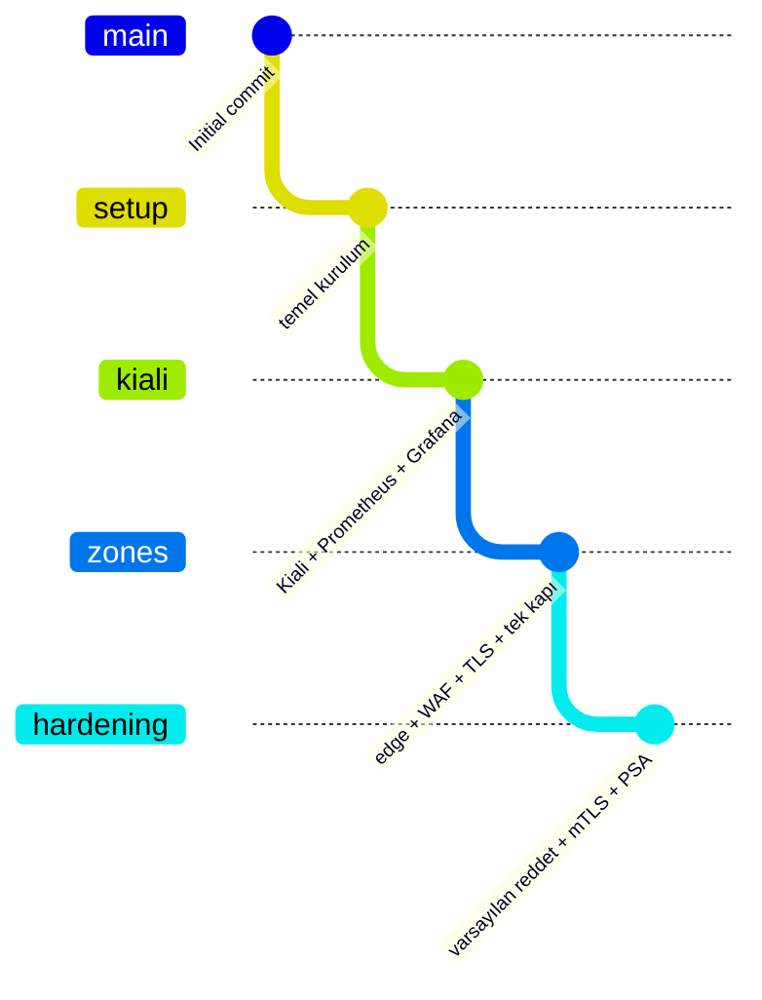

# Adım Dokümanları

Her yol haritası maddesi ayrı bir branch'te yapılır. Her branch bir önceki biten branch'ten açılır, bu yüzden her adım öncekilerin hepsini içerir:

Her adım bittiğinde ortam sıfırlanır ve baştan kurulur (`99-destroy.sh` → `setup.sh` → `08-verify.sh`). Böylece o adımın elle müdahale olmadan, sıfırdan çalıştığı doğrulanır.

Ana [README](../README.md) ortamın güncel ve toplu halini anlatır. Bu klasördeki dokümanlar ise her adımda **ne yapıldığını, hangi dosyaların değiştiğini, hangi sorunlarla karşılaşıldığını ve doğrulama sonucunu** gösterir.

## Her adım dokümanının yapısı

| Bölüm | İçerik |
|-------|--------|
| **Amaç** | Adımın neden yapıldığı |
| **Adım sonundaki durum** | Adım bittiğinde ortamın hali: cluster'lar, bileşenler, giriş noktaları, çalışan akışlar |
| **Önceki adıma göre değişenler** | Her değişiklik ve nedeni |
| **Eklenen bileşenler** | Her yeni servis/yapı için amacı, neden gerekli olduğu, muadilleri ve neden bu seçildiği |
| Yapılanlar · Değişen dosyalar · Tasarım kararları | Ayrıntılar |
| Karşılaşılan sorunlar ve çözümler | Belirti, sebep, çözüm, değişen dosya |
| STRIDE tehdit modeli | `02-zones`'tan itibaren |
| Doğrulama · Bilinen kısıtlar | Sıfırdan kurulum test sonuçları ve açık kalan noktalar |

## Adımlar

| # | Adım | Branch | Durum |
|---|------|--------|-------|
| 00 | [Temel kurulum](00-setup.md) | `setup` | ✅ Tamamlandı |
| 01 | [Gözlemlenebilirlik: Kiali, Prometheus, Grafana](01-kiali.md) | `kiali` | ✅ Tamamlandı (tek node, cluster-b kapalı) |
| 02 | [Zone'lar: Edge, WAF, TLS ve tek kapı](02-zones.md) | `zones` | ✅ Tamamlandı (20/20 test) |
| 03 | [Sıkılaştırma (hardening)](03-hardening.md) | `hardening` | ✅ Tamamlandı (33/33 test) |

## Diğer dokümanlar

| Doküman | İçerik |
|---------|--------|
| [Güvenlik boşluk analizi](security-gap-analysis.md) | 13 katmanlı derinlemesine savunma gereksinimlerinin mevcut ortamla karşılaştırması ve eylem planı |
