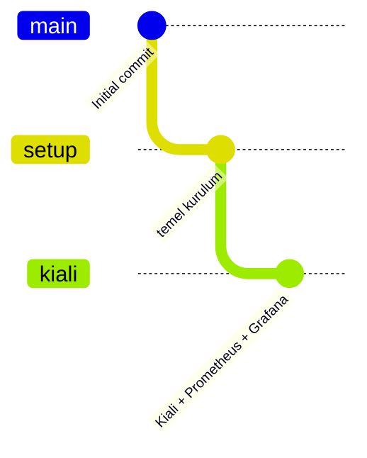

# Adım Dokümanları

Her yol haritası maddesi ayrı bir branch'te yapılır. Her branch bir önceki biten branch'ten açılır, bu yüzden her adım öncekilerin hepsini içerir:

Her adım bittiğinde ortam sıfırlanır ve baştan kurulur (`99-destroy.sh` → `setup.sh` → `08-verify.sh`). Böylece o adımın elle müdahale olmadan, sıfırdan çalıştığı doğrulanır.

Ana [README](../README.md) ortamın güncel ve toplu halini anlatır. Bu klasördeki dokümanlar ise her adımda **ne yapıldığını, hangi dosyaların değiştiğini, hangi sorunlarla karşılaşıldığını ve doğrulama sonucunu** gösterir.

| # | Adım | Branch | Durum |
|---|------|--------|-------|
| 00 | [Temel kurulum](00-setup.md) | `setup` | ✅ Tamamlandı |
| 01 | [Gözlemlenebilirlik: Kiali, Prometheus, Grafana](01-kiali.md) | `kiali` | ✅ Tamamlandı (tek node, cluster-b kapalı) |

## Diğer dokümanlar

| Doküman | İçerik |
|---------|--------|
| [Güvenlik boşluk analizi](security-gap-analysis.md) | 13 katmanlı derinlemesine savunma gereksinimlerinin mevcut ortamla karşılaştırması ve eylem planı |
