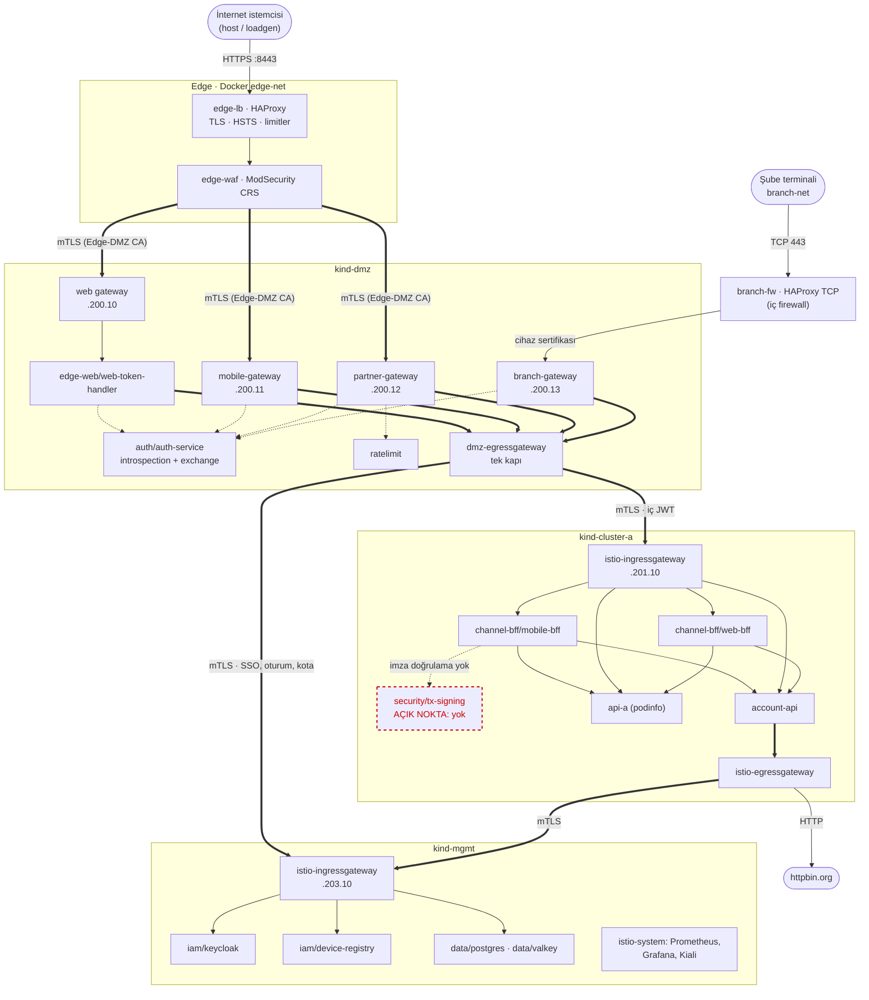
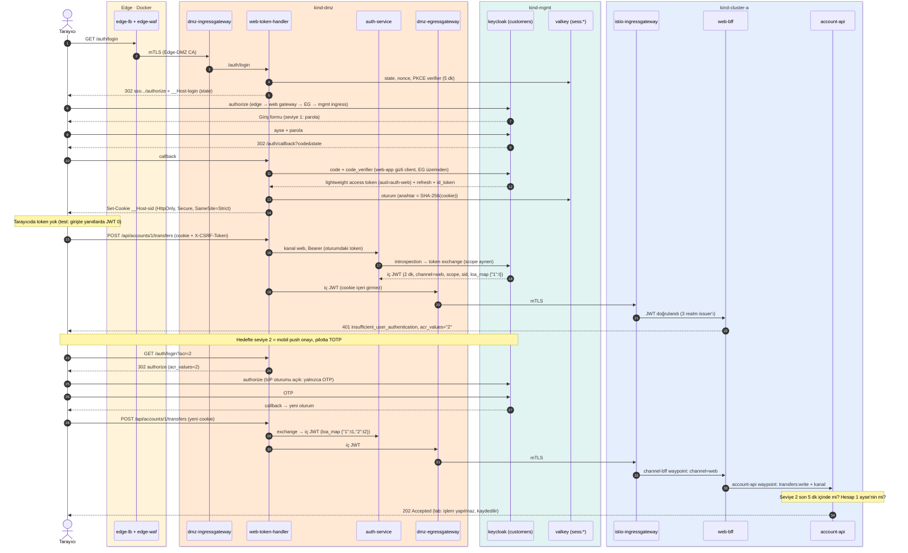
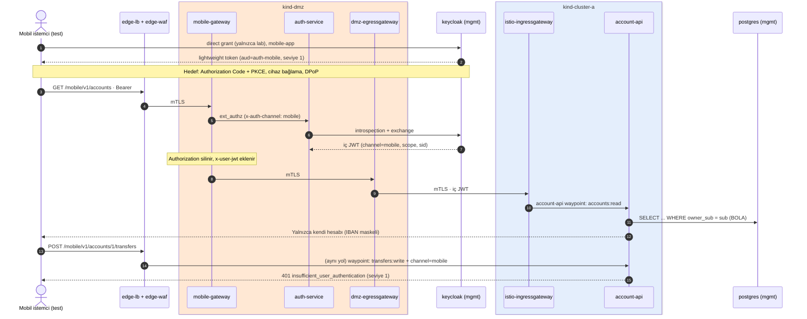
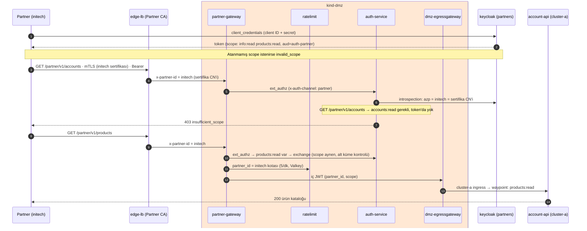
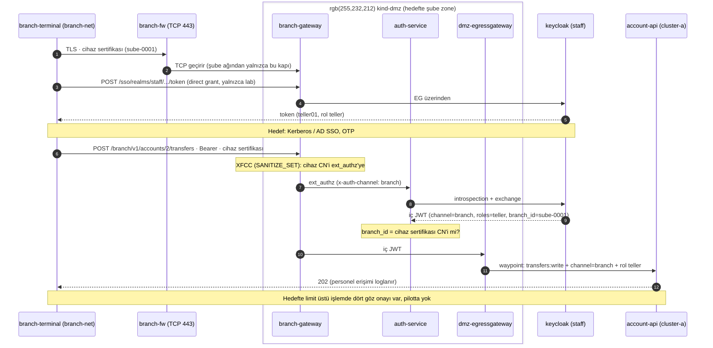

# Pilot mimari — Hedef gereksinimlerin pilotta karşılanması

Nov 1, 2026 · @Olgun · hedef doküman: [Kurumsal hedef mimari](target-architecture.md)

## Kapsam

Pilot, [kurumsal hedef mimarinin](target-architecture.md) güvenlik modelini uçtan uca çalışan ve testlerle doğrulanan küçük bir ortamda kanıtlar. Bu depo (`service-mesh-lab`) pilotun kendisidir:
- Tek bir Windows makinesinde Docker Desktop üzerinde kind cluster'ları çalışır.
- Kurulum tek komutla yapılır (`setup.sh`).
- Her adım sıfırdan kurulup otomatik testlerle (`08-verify.sh`) doğrulanır.

**Pilotun amacı:** hedefteki kararların gerçekte çalıştığını ve nerede ürün ya da platform kısıtına takıldığını erken görmek. Örnekler:
- Zone'lar arası tek kapı.
- IdP'nin ürettiği internal JWT.
- Tarayıcıda token olmaması.
- Claim bazlı L7 yetki.
- İmzalı image zorunluluğu.

Performans, kapasite ve iş sürekliliği pilotun konusu değildir.

**Pilotta olanlar:**
- 4 kanal: web, mobil, partner, şube.
- 3 aktif cluster: `dmz`, `cluster-a`, `mgmt`. `cluster-b` hazır ama kapalı.
- Edge Docker konteynerlerinde.
- Kimlik (Keycloak), veri (PostgreSQL, Valkey) ve gözlem (Prometheus, Grafana, Kiali) `mgmt`'te.

**Pilotta olmayanlar:** ATM ve POS kanalları, kart zone'u, core banking, dış çıkış zone'u, SIEM. Nedenleri aşağıda.

**Durum işaretleri:**

| İşaret | Anlamı |
|--------|--------|
| ✅ | Karşılanıyor ve testle doğrulanıyor |
| 🟡 | Kısmen ya da farklı yoldan karşılanıyor |
| ❌ | Henüz yok (yol haritasında) |
| ➖ | Pilot kapsamı dışı |

**Farkların genel nedenleri** (tabloda kısaltma olarak kullanılır):

| Kısaltma | Neden |
|----------|-------|
| **K-Kaynak** | Tek makine, 15,7 GB RAM, cluster başına tek node. Aynı anda en fazla 3 cluster çalışabiliyor |
| **K-Ürün** | Hedefteki bileşen ticari bir ürün ya da appliance (DDoS/CDN, F5, GSLB, HSM, SIEM, ticari API gateway). Pilotta açık kaynak bir muadil davranışı temsil eder ya da bileşen yoktur |
| **K-Platform** | kind / WSL2 / Docker Desktop kısıtı (ör. NetworkPolicy uygulanamıyor) |
| **K-IdP** | Keycloak 26'nın davranışı hedefteki tasarımdan farklı (pilotta bulundu) |
| **K-Kapsam** | Bilinçli olarak sonraki adımlara bırakıldı (yol haritası) |
| **K-Karar** | Pilotta kullanıcının verdiği ve hedeften farklı karar |

## Zone eşlemesi

| Hedef zone | Pilottaki karşılığı | Fark | Neden |
|------------|---------------------|------|-------|
| Sağlayıcı katmanı (DDoS / CDN) | Yok | Volumetrik koruma, bot yönetimi yok | K-Ürün |
| Dış DMZ (edge): GSLB, dış firewall, F5 LB + WAF | Docker `edge-net`: `edge-lb` (HAProxy 3.0) + `edge-waf` (ModSecurity + OWASP CRS 4.25) | GSLB ve ayrı dış firewall yok. TLS, HSTS, header temizliği, hız ve bağlantı limitleri, WAF var | K-Ürün |
| İç firewall (edge → DMZ) | Ayrı cihaz yok. Yerine edge → DMZ karşılıklı TLS (Edge-DMZ Zone CA): yalnızca WAF'ın sertifikası kabul edilir, düz HTTP kapalı | Kural farklı üretici bir firewall'da değil gateway'de | K-Ürün |
| İç DMZ (DMZ cluster) | `kind-dmz` | Tek cluster, tek node (hedef: DC başına) | K-Kaynak |
| Şube zone | `branch-net` (Docker) + `branch-fw` (HAProxy TCP, iç firewall'u temsil eder) + `branch-gateway` **DMZ cluster'ında** ayrı namespace ve VIP | Şube gateway'i ayrı zone'da değil | K-Kaynak (hedef karar 4) |
| ATM · POS ağı, kart zone (PCI) | Yok | – | K-Kapsam (`14 · pci-zone`) |
| Kimlik zone | `kind-mgmt` / `iam`: Keycloak 26.8 | Ayrı zone değil, mgmt içinde | K-Kaynak |
| Internal A (DC1) / B (DC2) | `kind-cluster-a`; `cluster-b` kapalı | A/B yok | K-Kaynak (`17 · cluster-b`) |
| Core banking zone | Yok (`api-a`, core'u değil genel bir internal servisi temsil eder) | – | K-Kapsam |
| Veri zone | `kind-mgmt` / `data`: PostgreSQL 18, Valkey 9 | Ayrı zone değil; Oracle, MSSQL, Kafka, RabbitMQ yok | K-Kaynak |
| Dış çıkış zone | Yok: `cluster-a`'nın egress gateway'i internete (`httpbin.org`) doğrudan çıkar | Proxy, NGFW, izin listesi zone'u yok; çıkış yine tek kapıdan | K-Kapsam |
| SOC / yönetim zone | `kind-mgmt` / `istio-system`: merkezi Prometheus (6 saat), Grafana, Kiali | SIEM, log toplama, iz yok | K-Kapsam (`10 · logging`, `11 · tracing`) |

## Pilot topolojisi ve isimlendirme

Kalın oklar mTLS'tir. Kırmızı kesikli kutu **açık noktadır**: hedefte olan ama pilotta bilinçli olarak atlanan bileşen. Cluster'lar birbirine yalnızca gateway'lerin LoadBalancer IP'leri (MetalLB) üzerinden ulaşır.

| Katman | Pilottaki bileşen | Pilottaki ad | Hedefteki karşılığı |
|--------|-------------------|--------------|---------------------|
| Kanal | Web | `www.apps.example.local:8443` | `ib.banka.com.tr` |
| Kanal | Mobil API | `mobile-api.apps.example.local:8443/mobile/v1/*` | `m-api.banka.com.tr` |
| Kanal | Partner | `partner-api.apps.example.local:8443/partner/v1/*` (istemci sertifikası) | `api.banka.com.tr` |
| Kanal | Giriş uçları (IdP) | `sso.apps.example.local:8443` | `auth.banka.com.tr` |
| Kanal | Şube | `branch-api.corp.internal` (yalnızca `branch-net`'ten) | Şube zone'u, MPLS |
| Edge | LB + WAF | `edge-lb`, `edge-waf` (Docker) | `gslb-01/02`, `f5-edge-dc1/dc2` |
| Cluster | DMZ / internal / yönetim | `kind-dmz`, `kind-cluster-a`, `kind-mgmt` | `ocp-dmz-a/b`, `ocp-apps-a/b`, `ocp-mgmt-a/b` |
| Platform | Kubernetes / mesh | kind 0.33 (k8s 1.36), Istio 1.30 ambient (ztunnel + waypoint), MetalLB | OpenShift, Istio / OSSM ambient |
| DMZ | Ingress gateway (web) | `istio-ingress/dmz-ingressgateway` | `dmz-ingressgw` |
| DMZ | Mobil, partner, şube gateway'leri | `istio-mobile/mobile-gateway`, `istio-partner/partner-gateway`, `istio-branch/branch-gateway` | `mobile-gw`, `partner-gw`, `branch-gw` (şube zone'unda) |
| DMZ | Web token handler | `edge-web/web-token-handler` (Go) | `edge-web/web-token-handler` |
| DMZ | IdP proxy (introspection + exchange) | `auth/auth-service` (Go, Envoy ext_authz) | `auth-proxy` |
| DMZ | Global kota | `ratelimit/ratelimit` (Envoy ratelimit) | gateway ürününün kotası |
| DMZ | Egress gateway | `istio-egress/dmz-egressgateway` | `dmz-egressgw` |
| Internal | Ingress gateway | `istio-ingress/istio-ingressgateway` | `int-ingressgw` |
| Internal | Kanal BFF'leri | `channel-bff/web-bff`, `channel-bff/mobile-bff` (Go) | `channel-bff` (`mobile-bff`, `web-bff`, `branch-bff`) |
| Kimlik | Cihaz kayıtları | `iam/device-registry` (Go, PostgreSQL `devices`) | `device-registry` |
| Internal | İşlem imzası doğrulama | **Yok — açık nokta** (`09d` atlandı) | `security/tx-signing-svc` |
| Internal | Domain servisleri | `account-api/account-api` (Go, hesaplar), `api-a/api-a` (podinfo, genel bilgi uçları) | domain namespace'leri (`hesap`, `odeme` …) |
| Internal | Egress gateway | `istio-egress/istio-egressgateway` | `int-egressgw` |
| Kimlik | IdP | `iam/keycloak` (realm'ler: `customers`, `partners`, `staff`) | `keycloak-a/b` (RHBK) |
| Kimlik | Oturum deposu | `data/valkey` (`sess:*`, `web_session` kullanıcısı) | `redis-session-a/b` |
| Veri | İlişkisel DB | `data/postgres` (servis başına rol) | `pg-a/b`, Oracle, MSSQL |
| Veri | Önbellek | `data/valkey` (önek bazlı ACL) | `redis-a/b` |
| Gözlem | Metrik, panolar, mesh görünümü | `istio-system`: Prometheus (merkezde 6 saat; diğer cluster'larda agent), Grafana, Kiali | Prometheus + Thanos, Grafana, Kiali, ELK, Tempo, SIEM |
| Yönetim | Politika, imza, registry | Kyverno 1.19 (her cluster), cosign anahtarı, `lab-registry:5000` | Kyverno / Gatekeeper, Harbor + cosign |

## Kanal bazında istek yolu (pilot)

Hedefteki tablolarla aynı biçimde. Ortak işler (log, metrik) tekrar yazılmadı; pilotta log merkezi değil, metrikler merkezi Prometheus'ta.

### Web — `www.apps.example.local`

| # | Zone | Servis | Yapılan işlem | Hedeften fark |
|---|------|--------|---------------|---------------|
| 1 | Edge | `edge-lb` | TLS 1.2+/1.3, HSTS, HTTP → HTTPS; IP başına hız (100/10 sn) ve bağlantı limiti; dışarıdan gelen `X-Forwarded-*`, `x-user-jwt`, `x-partner-id`, `x-channel` silinir | DDoS/CDN, GSLB yok (K-Ürün) |
| 2 | Edge | `edge-waf` | OWASP CRS (paranoia 1, engelleme modu); Host'a göre kanal gateway'i; 403'lerde tek tip gövde | Şema doğrulaması yok |
| 3 | Edge → DMZ | – | Karşılıklı TLS (Edge-DMZ Zone CA) | Ayrı iç firewall yok (K-Ürün) |
| 4 | DMZ | `dmz-ingressgateway` | `www` → `web-token-handler`; `x-channel: web`; `Authorization` ve `x-user-jwt` silinir; CORS; 50 rps | – |
| 5 | DMZ | `web-token-handler` | Cookie → oturum (Valkey); idle 15 dk / absolute 8 saat; CSRF; gerekirse refresh (rotation); auth-service'e sorar; yalnızca izinli header'larla `web-bff`'e | `web-static` ayrı değil (handler'ın küçük sayfası) |
| 6 | DMZ | `auth-service` | Introspection + Keycloak token exchange → iç JWT (customers realm'i, 2 dk, `channel=web`, `scope`, `sid`, `loa_map`) | `acr` yerine `loa_map` (K-IdP) |
| 7 | DMZ | `dmz-egressgateway` | Yalnızca token handler'ın waypoint'i ve kanal gateway'leri; cluster-a'ya mTLS | A/B yük dağıtımı yok (K-Kaynak) |
| 8 | Internal | `istio-ingressgateway` | Yalnızca `dmz-egressgateway` kimliği + Keycloak imzalı iç JWT; `web-bff.apps.example.local` → `channel-bff/web-bff` | – |
| 9 | Internal | `channel-bff` waypoint | customers realm'inin JWT'si, `channel=web` | – |
| 10 | Internal | `web-bff` | Ekran birleştirme (dashboard); transfer öncesi seviye kontrolü (step-up ipucu) | – |
| 11 | Internal | `account-api` waypoint + servis | Scope (`accounts:read`, `transfers:write`); BOLA; transferde seviye 2 son 5 dk içinde | Seviye kontrolü waypoint'te değil serviste (K-IdP) |
| 12 | Veri | `postgres` (mgmt) | `istio-egressgateway` → mgmt ingress → PostgreSQL; servis başına rol, yalnızca okuma | – |

### Mobil — `mobile-api.apps.example.local`

| # | Zone | Servis | Yapılan işlem | Hedeften fark |
|---|------|--------|---------------|---------------|
| 1–3 | Edge | `edge-lb`, `edge-waf` | Web ile aynı | – |
| 4 | DMZ | `mobile-gateway` | Yalnızca `/mobile/v1/*` (önek kaldırılır); `x-channel: mobile`; 30 rps; ext_authz | – |
| 5 | DMZ | `auth-service` | `Authorization: DPoP`; DPoP kanıtı (cihaz anahtarı, `htm`/`htu`/`iat`/`ath`), `jti` tekrarı (Valkey); attestation (imza, bütünlük, cihaza bağ, minimum sürüm); introspection + exchange; anahtar bu kullanıcıya kayıtlı mı (device-registry) | Token'ı Keycloak değil DMZ cihaza bağlar (K-IdP: DPoP'lu token exchange edilemiyor); attestation simüle (K-Ürün) |
| 6–7 | DMZ → Internal | `dmz-egressgateway` → `istio-ingressgateway` | Web ile aynı | – |
| 8 | Internal | `mobile-bff` → `account-api` / `api-a` | Tüm mobil trafik mobile-bff'ten; domain servisleri mobil kanalı yalnızca mobile-bff kimliğinden kabul eder; scope, BOLA; transfer seviye 2 | `device_id` iç JWT'de yok (K-IdP, kullanıcı kararı) |

### Partner — `partner-api.apps.example.local`

| # | Zone | Servis | Yapılan işlem | Hedeften fark |
|---|------|--------|---------------|---------------|
| 1 | Edge | `edge-lb` | Partner CA istemci sertifikası zorunlu (başka CA veya sertifikasız: bağlantı kurulmaz); sertifika CN'i → `x-partner-id` | – |
| 2 | DMZ | `partner-gateway` | İzin listesi (`acme`, `initech`); `/partner/v1/*`; 5 rps (local) + partner başına global kota (ratelimit, Valkey) | Geliştirici portalı, sandbox yok (K-Ürün) |
| 3 | DMZ | `auth-service` | Client credentials token'ı (client ID + **client secret**) introspection; `azp` = sertifika CN'i (token sertifikaya bağlı); yol + metot ↔ scope; exchange (scope aynen) | `private_key_jwt`, PAR, consent yok (K-Karar, `09f · consent`) |
| 4 | Internal | `account-api` / `api-a` waypoint + servis | `accounts:read` / `products:read` / `info:read`; partner yalnızca kendisine bağlı hesapları görür | İstek/yanıt imzası (JWS) yok |

### Şube — `branch-api.corp.internal`

| # | Zone | Servis | Yapılan işlem | Hedeften fark |
|---|------|--------|---------------|---------------|
| 1 | Şube ağı | `branch-terminal` (Docker, `branch-net`) | Cihaz sertifikası (Branch CA) | NAC, EDR, TPM yok (K-Ürün) |
| 2 | Şube ağı | `branch-fw` | Yalnızca TCP 443 → `branch-gateway` VIP; şube ağından DMZ'nin diğer kapılarına yol yok | – |
| 3 | DMZ (hedefte şube zone) | `branch-gateway` | Cihaz sertifikasıyla mTLS (XFCC, `SANITIZE_SET`); `/branch/v1/*`; personel token'ı için `/sso/realms/staff/*` | Şube zone'unda değil DMZ'de (K-Kaynak) |
| 4 | DMZ | `auth-service` | staff realm'i, `branch-teller`; iç JWT'deki `branch_id` (IdP'deki şube) = cihaz sertifikası | Kerberos / AD SSO yok, personel direct grant ile (lab); mesai saati kontrolü yok |
| 5 | Internal | `account-api` | Personel tüm hesapları görür (her erişim loglanır); gişe rolüyle transfer | Dört göz onayı yok (K-Kapsam) |

## Login ve servis akışları (pilot, sequence diyagramları)

Hedefteki diyagramların pilotta gerçekten çalışan karşılıkları. Farklar notlarla işaretlendi.

### Web: giriş, API çağrısı ve step-up ile transfer

### Mobil: hesap sorgusu ve seviye 1 ile transfer denemesi

### Partner: client credentials ve partner bazlı yetki

### Şube: personel token'ı, cihaz ↔ şube kontrolü, transfer

ATM ve POS akışlarının pilotta karşılığı yoktur (kart zone'u: `14 · pci-zone`).

## Gereksinimlerin pilottaki durumu

### Kanal (CH)

| ID | Durum | Pilotta | Fark ve neden |
|----|-------|---------|---------------|
| CH-01 | ✅ | Web'de token handler, mobilde uygulama (mobile-sim) Authorization Code + PKCE ile | Direct grant yalnızca lab test istemcileri için açık |
| CH-02 | 🟡 | Cihaz anahtar çifti, public key device-registry'de; kayıt seviye 2 (parola + OTP) ister (test) | Anahtar gerçek güvenli donanımda değil (mobile-sim); ayrı aktivasyon / SMS akışı yok |
| CH-03 | 🟡 | Her istek cihaz anahtarıyla imzalı (DPoP) | Biyometri yok; girişte cihaz anahtarıyla challenge imzası yok (Keycloak'ta özel authenticator gerekir) |
| CH-04 | 🟡 | Her istekte attestation (imza, uygulama kimliği, bütünlük, cihaz anahtarına bağ); kanıtsız ve bütünlüğü bozuk 403 (test) | Play Integrity / App Attest yerine lab sağlayıcısı (K-Ürün) |
| CH-05 | ➖ | – | Uygulama tarafı |
| CH-06 | ✅ | Tarayıcıda yalnızca `__Host-sid`; giriş boyunca yanıtlarda token yok (test) | – |
| CH-07 | 🟡 | İkinci faktör (TOTP) seviye 2'de; seviye 1 girişte yalnızca parola | Pilotta ikinci faktör transfer için step-up'ta isteniyor, girişte değil; mobil push onayı yok |
| CH-08 | 🟡 | Transfer seviye 2 (son 5 dk) ister; RFC 9470 step-up (test) | **Açık nokta (atlandı):** işlem imzası / dinamik bağlama yok (seviye 3). Çalınmış oturumla ya da araya girip tutar / alıcı değiştirerek transfer engellenmiyor |
| CH-09 | ✅ | Ayrı host, ayrı gateway, ayrı VIP; domain fronting reddi (test) | – |
| CH-10 | 🟡 | mTLS (Partner CA) + client **secret**; token sertifikaya bağlı | `private_key_jwt` yerine client secret (K-Karar) |
| CH-11 | 🟡 | Şube ağı → branch-fw → branch-gateway | MPLS ve AD / Kerberos SSO yok; personel direct grant ile (K-Ürün) |
| CH-12 | ✅ | Cihaz sertifikası zorunlu; sertifikasız veya başka CA reddediliyor (test) | – |
| CH-13 | 🟡 | Personel rolü (`teller`) ve `branch_id` iç JWT'de | Dört göz onayı yok (K-Kapsam) |
| CH-14 / CH-15 | ➖ | – | ATM ve POS pilot kapsamı dışında |
| CH-16 | ✅ | `channel` IdP'nin imzaladığı claim; sahte `x-channel` eziliyor (test); waypoint'te kanal kuralları | – |

### Edge (EDGE)

| ID | Durum | Pilotta | Fark ve neden |
|----|-------|---------|---------------|
| EDGE-01 / 02 / 03 | ➖ | – | DDoS / CDN / bot yönetimi sağlayıcı ürünü (K-Ürün) |
| EDGE-04 | 🟡 | Host'ta yalnızca 8443 (ve yönlendirme için 8080) açık | Dış firewall yok; tek host (K-Ürün) |
| EDGE-05 | ❌ | – | GSLB ve ikinci DC yok (K-Ürün, K-Kaynak) |
| EDGE-06 | ✅ | Dışarıdan gelen `X-Forwarded-For` ve iç header'lar siliniyor (test) | – |
| EDGE-07 | ✅ | Bağlantı ve hız limitleri, slow-loris zaman aşımları; ani 150 istekte 429 (test) | – |
| EDGE-08 | 🟡 | CRS engelleme modunda (XSS, SQLi 403, test) | Detect → block geçiş süreci yok, doğrudan engelleme |
| EDGE-09 | ❌ | – | OpenAPI şema doğrulaması yok |
| EDGE-10 | ➖ | – | Operasyonel süreç |
| EDGE-11 | 🟡 | Edge → DMZ karşılıklı TLS (yalnızca WAF sertifikası) | Farklı üretici firewall yok (K-Ürün) |
| EDGE-12 | 🟡 | Edge Docker'da, cluster'lardan bağımsız script'le (`06b`) kuruluyor | Ayrı ekip ve süreç yok |
| EDGE-13 | ❌ | – | SIEM yok (`10 · logging`) |

### DMZ gateway (GW)

| ID | Durum | Pilotta | Fark ve neden |
|----|-------|---------|---------------|
| GW-01 | ✅ | Edge'de TLS, DMZ'de mTLS; Host → kanal gateway'i | – |
| GW-02 | ✅ | Gövde ≤ 1 MB, header temizliği, timeout'lar; `x-request-id` | – |
| GW-03 | ✅ | Introspection + RFC 8693 exchange (Keycloak), lightweight dış token (test) | Opak yerine lightweight token: Keycloak gerçek opak token üretmiyor (K-IdP) |
| GW-04 | ✅ | DPoP kanıtı ve attestation her istekte; geçersizse 401 / 403 (test) | Attestation simüle (K-Ürün) |
| GW-05 | 🟡 | Kanal başına local kota (30 rps), edge'de IP başına | Cihaz ve kullanıcı bazlı kota yok |
| GW-06 | ✅ | `/mobile/v1/*` sürüm öneki; minimum uygulama sürümü (426, test) | – |
| GW-07 | ✅ | Token handler, oturum Valkey'de | Oturum deposu mgmt'te, kimlik zone'unda değil (K-Kaynak) |
| GW-08 | ✅ | CSRF header'ı, CSP, HSTS, X-Frame-Options (test) | – |
| GW-09 | ✅ | DMZ'de BFF yok; web-bff internal'da (test) | – |
| GW-10 | 🟡 | Sertifika ↔ client eşleşmesi (sender-constrained benzeri) | PAR yok; token `cnf` ile değil azp ↔ CN kuralıyla bağlı |
| GW-11 | ❌ | – | Consent servisi yok (`09f · consent`) |
| GW-12 | 🟡 | Partner başına plan: client scope'ları; partner başına global kota (test) | Portal ve sandbox yok (K-Ürün) |
| GW-13 | ❌ | – | İstek/yanıt imzası yok |
| GW-14 | ✅ | `dmz-egressgateway` tek kapı; yalnızca kanal arka uçları (test: web gateway'den doğrudan çıkış 403) | – |
| GW-15 | 🟡 | DMZ'den yalnızca internal ingress, IdP ve Valkey (oturum, kota) | DMZ'den Valkey'e çıkış hedefte yasak (DMZ → veri zone); pilotta oturum deposu ve kota sayaçları mgmt Valkey'de (K-Kaynak) |
| GW-16 | ❌ | – | B cluster'ı kapalı (K-Kaynak) |
| GW-17 | 🟡 | Dış token, parola ve OTP loglanmıyor; IBAN maskeli | Envoy access log'larında maskeleme kuralı yok (log merkezi değil) |

### Kimlik ve oturum (IAM)

| ID | Durum | Pilotta | Fark ve neden |
|----|-------|---------|---------------|
| IAM-01 | 🟡 | IdP erişilemezse iç JWT önbellekte en fazla 30 sn çalışır | Tek replika, tek DC (K-Kaynak) |
| IAM-02 | ✅ | Kanal başına client; client başına scope (partner bazlı yetki, test) | – |
| IAM-03 | 🟡 | Dış token 5 dk; refresh rotation (web) | Tekrar kullanımda tüm oturumun iptali ve SIEM alarmı test edilmedi |
| IAM-04 | 🟡 | Mobil token, kullanıcının kayıtlı cihaz anahtarıyla DPoP kanıtı olmadan kullanılamaz (test) | Bağ token'da (`cnf`) değil DMZ'de; tek cihaza değil kullanıcının kayıtlı cihazlarına (K-IdP) |
| IAM-05 | 🟡 | IdP üretiyor (exchange), 2 dk, `aud=internal-apis`, `sub`, `channel`, `sid`, `scope`, `partner_id`, `branch_id` | `acr` yerine `loa_map` (K-IdP); `device_id` yok; 3 issuer (Keycloak exchange realm içi, K-IdP) |
| IAM-06 | ✅ | Idle 15 dk, absolute 8 saat; logout IdP oturumunu kapatıyor (test) | Süreler örnek |
| IAM-07 | 🟡 | IdP'de kapatılan oturum en geç 30 sn'de reddediliyor (test) | Hedef ≤ 5 sn: oturum olaylarıyla önbellek temizliği yok |
| IAM-08 | 🟡 | Seviye 1 (parola), seviye 2 (OTP); transfer seviye 2 | Seviye 3 (işlem imzası) yok, açık nokta (`09d` atlandı); karar waypoint'te değil serviste (K-IdP) |
| IAM-09 | 🟡 | Müşteri, partner ve personel ayrı realm'lerde | AD / Entra federasyonu yok |
| IAM-10 | ❌ | – | `09f · consent` |
| IAM-11 | ✅ | Brute force koruması (müşteri 5, personel 3 deneme) | SIEM'e olay yok |
| IAM-12 | ❌ | – | Riskli giriş tespiti yok |
| IAM-13 | 🟡 | Realm imza anahtarları kurulumda üretiliyor, internal'a inline JWKS | HSM yok; rotasyon elle (`13 · secrets`) |

### Internal ve iş sürekliliği (INT)

| ID | Durum | Pilotta | Fark ve neden |
|----|-------|---------|---------------|
| INT-01 | ❌ | Script'lerle kurulum | GitOps yok (`16 · gitops`), B yok |
| INT-02 / 03 / 13 | ➖ | – | Kapasite, RTO/RPO ve DR tatbikatı pilotun konusu değil |
| INT-04 | ✅ | Internal ingress yalnızca `dmz-egressgateway` kimliği (test: DMZ ingress'ten doğrudan gidiş 403) | Şube trafiği de DMZ egress'ten geliyor (şube gateway'i DMZ'de) |
| INT-05 | ✅ | RequestAuthentication (3 realm issuer'ı), JWT'siz istek reddi (`requestPrincipals`) | – |
| INT-06 | 🟡 | Deny-by-default; servis kimliği + `channel` + `scope` (+ rol) | `acr` waypoint'te değil (K-IdP) |
| INT-07 | 🟡 | `web-bff`, `mobile-bff` | `branch-bff` yok (`09e`) |
| INT-08 | ✅ | STRICT mTLS; iç JWT her waypoint'te yeniden doğrulanıyor | – |
| INT-09 | ❌ | – | Örnek transfer ucu gerçek işlem yapmıyor |
| INT-10 / 11 | ❌ | Tek PostgreSQL | Replika, Kafka yok (K-Kaynak) |
| INT-12 | ➖ | – | Core yok |
| INT-14 | ✅ | Restricted Pod Security, non-root, read-only FS; Kyverno: imzalı image, digest'e sabitleme (test) | Tarama (CI) yok (`15 · ci`) |
| INT-15 | 🟡 | Domain bazlı namespace'ler (`account-api`, `api-a`, `channel-bff`) | Core cluster'ı yok |
| INT-16 | 🟡 | Veri ve internet çıkışı `istio-egressgateway`'den | Pod'ların doğrudan çıkışı kapatılamıyor: NetworkPolicy uygulanamıyor (K-Platform) |

### Core (CORE), veri (DATA), kart (CARD), dış çıkış (OUT)

| ID | Durum | Pilotta | Fark ve neden |
|----|-------|---------|---------------|
| CORE-01..06 | ➖ | – | Core banking pilot kapsamı dışında |
| DATA-01 | 🟡 | PostgreSQL yalnızca cluster-a egress'inden; DMZ'den PostgreSQL'e yol yok (test) | DMZ'den Valkey'e yol var (oturum, kota; GW-15 notu) |
| DATA-02 | ✅ | Servis başına rol; başka şema ve yazma reddi; Valkey önek bazlı ACL (test) | – |
| DATA-03 | ➖ | PostgreSQL tek replika | Oracle, MSSQL, replika yok (K-Kaynak) |
| DATA-04 | 🟡 | Valkey ACL önek bazlı (test) | Kafka, RabbitMQ yok |
| DATA-05 / 06 / 07 | ❌ | – | TDE, yedek, dinamik kimlik yok (`13 · secrets`) |
| DATA-08 | ➖ | Lab verisi sentetik | – |
| CARD-01..10 | ➖ | – | `14 · pci-zone` |
| OUT-01..09 | ➖ | `istio-egressgateway` → internete doğrudan | Dış çıkış zone'u yok (K-Kapsam) |

### Ağ akışları (NET)

| ID | Durum | Pilotta | Fark ve neden |
|----|-------|---------|---------------|
| NET-01 / 02 | ✅ | Host → edge → DMZ (yalnızca WAF sertifikası) | – |
| NET-03 / 04 | ✅ | DMZ egress → cluster-a ingress, mgmt (Keycloak) | – |
| NET-05 | ❌ | – | OCSP / CRL kontrolü yok |
| NET-06 / 07 | 🟡 | Şube ağı → branch-fw → branch-gateway → DMZ egress → internal | Şube gateway'i DMZ'de (K-Kaynak) |
| NET-08 / 09 / 10 | ➖ | – | Kart kanalları yok |
| NET-11 | ✅ | cluster-a egress → mgmt veri (5432, 6379), mTLS, port + kimlik bazlı | – |
| NET-12 | ➖ | – | B yok |
| NET-13 | 🟡 | Metrikler tek yönlü merkeze (remote_write, egress üzerinden) | Log / SIEM yok |
| NET-14 | ➖ | Host'tan kubectl | Bastion, PAM yok |
| NET-15..21 | ➖ | – | Core, dış çıkış, kart yok |

**Yasak akışlar:**
- Pilotta testle doğrulananlar: internetten DMZ cluster'ına doğrudan yol yok; DMZ'den internal'a egress dışı yol yok; DMZ'den PostgreSQL'e yol yok; şube ağından DMZ'nin diğer kapılarına yol yok; mgmt girişine mesh sertifikası olmadan erişim yok.
- Testle doğrulanamayan: pod'ların internete doğrudan çıkışı açık (NetworkPolicy, K-Platform).

### Güvenlik izleme (SOC)

| ID | Durum | Pilotta | Fark ve neden |
|----|-------|---------|---------------|
| SOC-01..09 | ❌ | Yalnızca metrikler (Prometheus), mesh görünümü (Kiali), servis logları pod'da | `10 · logging`, `11 · tracing`; SIEM ürünü (K-Ürün) |

## Kabul kriterleri (pilot)

| # | Senaryo | Pilotta | Test |
|---|---------|---------|------|
| AC-01 | İnternetten DMZ node'larına ve API'ye tarama | 🟡 DMZ'ye yalnızca WAF sertifikasıyla (sertifikasız HTTPS ve düz HTTP reddi) | ✔ |
| AC-02 | DMZ pod'undan internete ve veri zone'una | 🟡 PostgreSQL'e yol yok; internet çıkışı NetworkPolicy olmadan kapatılamıyor | ✔ (veri) |
| AC-03 | Dış token ile doğrudan internal ingress | ✅ mTLS ve iç JWT zorunlu; DMZ ingress'ten doğrudan gidiş 403 | ✔ |
| AC-04 | Çalınmış mobil token başka cihazdan | ✅ 403 (kayıtsız anahtar) | ✔ |
| AC-05 | Refresh token tekrar kullanımı | ❌ test edilmedi | – |
| AC-06 | Seviye 1 oturumla transfer | ✅ 401 + step-up ipucu (hedefte 403) | ✔ |
| AC-07 | Tarayıcıda token arama | ✅ yanıtlarda token yok, yalnızca HttpOnly cookie | ✔ |
| AC-08 | Adapter sertifikasıyla `/accounts/**` | ➖ kart zone yok. Karşılığı: partner sertifikası + yetkisiz uç → 403 | ✔ |
| AC-09 | DC1 kapatma tatbikatı | ➖ | – |
| AC-10 | Bir isteğin uçtan uca izlenmesi | ❌ merkezi log ve iz yok | – |
| AC-11 | Oturum iptali | 🟡 ≤ 30 sn (hedef ≤ 5 sn) | ✔ |

Pilot doğrulaması her adımda sıfırdan kurulumla yapılır (`99-destroy.sh` → `setup.sh` → `08-verify.sh`). Güncel sonuç ve test listesi: [docs/README.md](README.md).

## Pilotta öğrenilenler (hedefe geri bildirim)

Pilotta ortaya çıkan ve hedef dokümanı etkileyebilecek bulgular:

| # | Bulgu | Hedefe etkisi |
|---|-------|---------------|
| 1 | Keycloak 26 standard token exchange realm içinde çalışıyor | Internal birden fazla issuer kabul etmeli (realm başına) ya da tek issuer için STS / farklı IdP gerekir |
| 2 | Keycloak exchange `acr`'yi taşımıyor (hep `1`) | IAM-08 / INT-06: `acr`'ye waypoint'te karar verilecekse IdP bu claim'i doğru üretmeli. Pilotta `loa_map` (IdP imzalı) ile servis karar veriyor |
| 3 | Exchange, istenirse dış token'da olmayan scope'ları da veriyor | auth-proxy tam olarak dış token'ın scope'unu istemeli ve sonucu doğrulamalı (GW-03'e ek kural) |
| 4 | Keycloak gerçek opak token üretmiyor | "Phantom token" lightweight access token ile yaklaşık sağlanıyor: içerik yalnızca introspection'da |
| 5 | Introspection her istekte IdP'ye yük; aynı token'la eşzamanlı istekler IdP'yi zorluyor | auth-proxy'de kısa önbellek + istek birleştirme (singleflight); iptal süresi önbellek süresiyle sınırlı (IAM-07 ile dengelenmeli) |
| 6 | Tek replikalı Keycloak'ta rolling update kilitleniyor (cluster üyeliği, mesh politikası) | Çok replikada Infinispan trafiği (7800) için mesh politikası açıkça tanımlanmalı |
| 7 | Kyverno digest'i Deployment şablonuna yazıyor; aynı etiketle yeniden build edilen image eski digest'le çalışmaya devam ediyor | Etiketler değişmez olmalı (her build yeni sürüm) |
| 8 | Ambient'te ingress gateway, Service'te `istio.io/ingress-use-waypoint` yoksa waypoint'i atlıyor | Internal servis şablonlarında zorunlu etiket |
| 9 | Ambient'te `REGISTRY_ONLY` pod'un doğrudan çıkışını engellemiyor | INT-16 / OUT-01 için NetworkPolicy (ya da OpenShift EgressFirewall) zorunlu |
| 10 | Keycloak DPoP'a bağlı token'ı başka client exchange edemiyor ("Sender-constrained token exchange rejected") | IAM-04 + IAM-05 birlikte: ya IdP exchange'i bağlı token'la destekleyen bir ürün, ya bağlamanın gateway'de yapılması (pilotta bu) |
| 11 | OWASP CRS varsayılan olarak DELETE'i ve içerik tipsiz gövdeyi engelliyor | WAF metot listesi API tasarımıyla birlikte yönetilmeli |

## Pilottan hedefe geçiş

| Konu | Pilottaki adım (yol haritası) |
|------|-------------------------------|
| Consent (GW-11, IAM-10) | `09f · consent` |
| Merkezi log, iz, SIEM'e hazırlık (SOC, EDGE-13, AC-10) | `10 · logging`, `11 · tracing` |
| Trafik yönetimi, outlier detection (GW-16'nın bir kısmı) | `12 · traffic-mgmt` |
| HSM / Vault, dinamik DB kimlikleri, anahtar rotasyonu (IAM-13, DATA-05..07) | `13 · secrets` |
| Kart zone'u (CARD) | `14 · pci-zone` |
| CI güvenlik taramaları (INT-14) | `15 · ci` |
| GitOps (INT-01) | `16 · gitops` |
| A/B cluster (INT, GW-16) | `17 · cluster-b` |
| ~~Mobil cihaz bağlama, DPoP, attestation, `mobile-bff`~~ | ✅ `09c · mobile-binding` |
| Seviye 3 işlem imzası, dinamik bağlama (CH-08, IAM-08) | **Açık nokta:** `09d · tx-signing` atlandı. Mimaride yeri belli (`tx-signing-svc`, cihaz anahtarı device-registry'de), eşik ve onay kuralları iş kararı |
| `branch-bff`, dört göz onayı, mesai saati (CH-13) | `09e · branch-controls` |
| Henüz yol haritasında olmayanlar | OCSP/CRL, dış çıkış zone'u, kullanıcı bazlı kota, refresh token tekrar kullanım testi, partner `private_key_jwt` + PAR (lab kararı: client secret) |

## Değişiklik geçmişi

| Tarih | Değişiklik |
| --- | --- |
| Nov 1, 2026 (3) | `09d · tx-signing` atlandı: işlem imzası açık nokta olarak topolojide, isimlendirmede, CH-08 / IAM-08'de; topoloji diyagramına `mobile-bff`, `device-registry` eklendi |
| Nov 1, 2026 (2) | `09c · mobile-binding`: CH-01..04, GW-04, GW-06, IAM-04, INT-07, AC-04 güncellendi; mobil istek yolu; bulgu 10-11 |
| Nov 1, 2026 | İlk sürüm: pilot (`service-mesh-lab`, `09b · l7-policies` sonu) hedef dokümanla aynı yapıda; zone eşlemesi, isimlendirme, kanal istek yolları, sequence diyagramları, gereksinim bazında durum ve fark nedenleri, kabul kriterleri, pilot bulguları |
