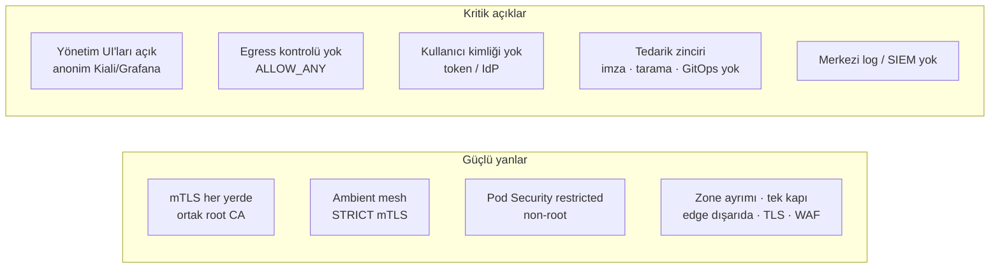

# Güvenlik Boşluk Analizi: Derinlemesine Savunma

> **Temel ilke (defense in depth):** Her katman bir öncekinin aşıldığını varsayar ve kendi kontrolünü yapar.

Bu doküman, bankacılık ortamı için tanımlanmış 13 katmanlı güvenlik gereksinimlerini lab ortamının **bugünkü haliyle** karşılaştırır. Her madde için üç şey belirtilir: şu anki durum, kanıt (dosya veya yapılandırma) ve lab'da nasıl karşılanacağı.

Analiz tarihi: 2026-11-01 · Kapsam: `token-exchange` branch'i (00-setup → 08-token-exchange). ✅/⚠️ işaretli maddelerin yanında hangi adımda değiştiği yazar.

## Gösterim

| İşaret | Anlamı |
|--------|--------|
| ✅ | Var ve çalışıyor |
| ⚠️ | Kısmen var veya lab'da zayıflatılmış |
| ❌ | Yok; lab'da yapılabilir |
| 📅 | Yok; yol haritasındaki bir adımda planlandı |
| ➖ | Lab kapsamı dışında: fiziksel/ticari altyapı, organizasyonel süreç veya kind ile anlamlı simüle edilemez |

## Özet

| # | Katman | ✅ | ⚠️ | ❌ | 📅 | ➖ | Genel durum |
|---|--------|---|---|---|---|---|-------------|
| 1 | Sağlayıcı / internet kenarı | 1 | 0 | 0 | 0 | 3 | Kapsam dışı; TLS on-prem sonlanıyor (`02-zones`) |
| 2 | Edge (dış DMZ) | 4 | 2 | 0 | 0 | 1 | `02-zones` ve `03-hardening` ile büyük ölçüde kapandı; yönetim UI'ları ve gerçek firewall eksik |
| 3 | DMZ cluster (platform) | 2 | 1 | 1 | 0 | 2 | Pod Security tamam; pod'ların doğrudan çıkışı ve secret yönetimi eksik |
| 4 | API gateway / BFF / token handler | 2 | 2 | 2 | 2 | 0 | Kanal gateway'leri, Web BFF, CORS, kanal kotası (`06`); token ve girdi doğrulama eksik |
| 5 | Zone geçişi (DMZ → internal) | 3 | 2 | 1 | 0 | 0 | Tek kapı var (`02-zones`); yön kısıtı ağ seviyesinde eksik |
| 6 | Internal cluster / service mesh | 2 | 0 | 2 | 1 | 2 | STRICT mTLS + varsayılan reddet (`03`); admission ve audit eksik; NetworkPolicy bu lab'da uygulanamıyor |
| 7 | Uygulama (Spring Boot) | 0 | 0 | 0 | 0 | 6 | Örnek uygulama podinfo; gerçek servis yazılınca geçerli |
| 8 | Kimlik ve oturum (IdP) | 3 | 2 | 0 | 0 | 1 | Keycloak mgmt'te (`08`): kanal başına client, en az yetki, 5 dk token, brute force; MFA yalnızca personel realm'inde, refresh rotasyonu yok |
| 9 | Veri katmanı | 0 | 2 | 2 | 0 | 1 | PostgreSQL ve Valkey mgmt'te, mesh mTLS, servis başına kullanıcı (`07`); durağan şifreleme, yedek ve alan şifrelemesi eksik |
| 10 | Kart zone (PCI) | 0 | 0 | 1 | 0 | 3 | Kapsam dışı; segment simülasyonu yapılabilir |
| 11 | Tedarik zinciri (CI/CD) | 0 | 1 | 5 | 0 | 0 | **Hiç ele alınmadı** |
| 12 | İzleme ve müdahale (SOC) | 0 | 1 | 2 | 0 | 2 | Metrik var, merkezi log yok |
| 13 | Süreç ve yönetişim | 0 | 0 | 1 | 0 | 4 | Organizasyonel; tehdit modeli dokümanı yazılabilir |

---

## 1. Sağlayıcı / internet kenarı

| Gereksinim | Durum | Mevcut hal | Lab'da nasıl |
|------------|-------|------------|--------------|
| Volumetrik DDoS scrubbing | ➖ | Yok | Telekom/CDN hizmeti; simüle edilemez |
| Bot yönetimi (login/OTP'de credential stuffing) | ➖ | Yok | Ticari ürün. Kısmi karşılık: edge ve kanal gateway'lerinde IP/kullanıcı bazlı rate limit (bkz. katman 4) |
| DNS koruması (DNSSEC, CAA, registrar kilidi) | ➖ | Lab `*.apps.example.local`, `Host` header ile çalışıyor | Gerçek alan adı gerektirir |
| TLS private key dışarı verilmesin / on-prem sonlandırma | ✅ `02` | TLS edge-lb'de (on-prem) sonlanıyor; anahtar `certs/edge/` altında | Gerçekte HSM / keyless SSL |

## 2. Edge (dış DMZ)

| Gereksinim | Durum | Mevcut hal | Lab'da nasıl |
|------------|-------|------------|--------------|
| Dış firewall'da yalnızca LB VIP'e 443; yönetim portları internetten görünmesin | ⚠️ `04` | Uygulama yalnızca edge-lb'de: 8443 (TLS) ve 8080 (yalnızca 301). Yönetim arayüzleri tek noktada: mgmt'te Kiali (20001) ve Grafana (3001); anonim erişim (lab istisnası) | Gerçekte yalnızca yönetim ağından, bastion üzerinden, OpenID ile |
| WAF: OWASP CRS + API şema doğrulaması; önce detect sonra block; virtual patch | ⚠️ `02` | ModSecurity v3 + OWASP CRS 4 (paranoia 1), **engelleme modunda**; SQLi ve XSS testleri 403 | API şema doğrulaması yok (katman 4). Gerçekte önce `DetectionOnly` (`WAF_MODE`) |
| TLS 1.2+/1.3, zayıf cipher kapalı, HSTS preload, OCSP stapling | ✅ `02` | TLS 1.2/1.3, yalnızca ECDHE + AEAD; TLS 1.1 reddediliyor (test edildi); HSTS `preload` | OCSP stapling ➖ (lab CA'sının OCSP'si yok) |
| Dışarıdan gelen X-Forwarded-* header'larını sil, yeniden yaz | ✅ `02` | HAProxy `X-Forwarded-*`, `X-Real-IP`, `Forwarded`, `x-user-jwt` siliyor, yeniden yazıyor; Envoy `numTrustedProxies: 2` (test edildi) | – |
| Bağlantı/istek boyutu limitleri, slow-loris koruması | ✅ `02` | IP başına 100 istek/10 sn (429, test edildi) ve 50 bağlantı; `timeout http-request 5s`; gövde ≤ 1 MB | Birden çok edge kopyası olursa limit paylaşımı (peers) |
| İç firewall dış firewall'dan farklı üreticide | ➖ | Firewall yok | Fiziksel. Benzetim: edge'de HAProxy, DMZ'de Envoy; farklı yazılımlar |
| Edge'den DMZ'ye yalnızca ingress portu açık | ✅ `03` | WAF → DMZ ingress **karşılıklı TLS**: DMZ yalnızca Edge-DMZ Zone CA'lı istemci sertifikasını (yalnızca edge-waf'ta) kabul ediyor; düz HTTP (80) kapalı. Ayrıca edge ayrı `edge-net` ağında | Ağ seviyesinde gerçek firewall ➖ |

## 3. DMZ cluster (platform)

| Gereksinim | Durum | Mevcut hal | Lab'da nasıl |
|------------|-------|------------|--------------|
| İş mantığı ve veri yok; yalnızca doğrulama, dönüştürme, yönlendirme | ✅ `06` | DMZ'de kanal gateway'leri, egress gateway ve Web BFF (yalnızca birleştirme ve iletme; veri tutmuyor) | Korunmalı: BFF'e iş mantığı eklenmemeli |
| Kubernetes API internete kapalı; bastion + MFA + PAM | ➖ | kind API server'ı yalnızca `127.0.0.1`'de | Bastion/PAM organizasyonel; lab'da API zaten dışarıya kapalı |
| Dışarı çıkış kapalı (`REGISTRY_ONLY`); tek çıkış egress gateway | ⚠️ `03` | `REGISTRY_ONLY` açık (`03`) ve egress gateway'e yalnızca waypoint girebiliyor. Ama **ambient'te pod'ların doğrudan çıkışı engellenmiyor** (ztunnel `REGISTRY_ONLY` uygulamıyor) | Egress NetworkPolicy (bu lab'da uygulanamıyor; gerçek ortamda OVN-K / EgressFirewall) |
| Node sertleştirme (CIS), SSH kapalı, otomatik yama | ➖ | kind node'ları container | Gerçek node gerektirir. `kube-bench` ile CIS raporu alınabilir (bilgi amaçlı) |
| Pod Security restricted: non-root, read-only FS, capability yok | ✅ `03` | Uygulama ve gateway namespace'leri `restricted`; gateway'lere seccomp; api pod'ları `readOnlyRootFilesystem`; Istio proxy'leri zaten salt okunur. `istio-system` istisna (istio-cni ve ztunnel ayrıcalık gerektirir) | – |
| Secret'lar dış kasada (Vault / External Secrets), rotasyonlu | ❌ | Istio CA anahtarı Kubernetes secret'ı (`cacerts`); **root CA private key diskte** (`certs/root-key.pem`, gitignore'da) | mgmt'e HashiCorp Vault Community + External Secrets Operator. Istio CA için cert-manager + istio-csr ile Vault entegrasyonu |

## 4. API gateway / BFF / token handler

| Gereksinim | Durum | Mevcut hal | Lab'da nasıl |
|------------|-------|------------|--------------|
| Token doğrulama: imza, exp, aud, iss, DPoP | ✅ `08` | auth-service (DMZ, ext_authz): RS256 imza (Keycloak JWKS), `iss` (realm), `azp` (kanal client'ı), `exp`/`nbf`, `typ`. Internal'da iç JWT: RequestAuthentication (imza, iss, aud, exp) + `requestPrincipals` zorunlu (test edildi). DPoP yok | DPoP: auth-service'te proof doğrulaması |
| Token exchange: dış token internal'a geçmesin | ✅ `08` | Gateway `Authorization`'ı siler; içeri yalnızca DMZ'nin imzaladığı iç JWT (5 dk, `x-user-jwt`) girer; imza anahtarı yalnızca DMZ'de (test edildi) | – |
| Kullanıcı, cihaz, IP, partner bazında rate limit ve kota | ⚠️ `07` | Edge'de IP başına; kanal gateway'lerinde kanal toplamı (local, `06`); **partner başına global kota** (Envoy ratelimit, sayaçlar mgmt Valkey'de, `07`; test edildi). Kullanıcı/cihaz bazlı kota yok (kimlik 08'de) | `08 · token-exchange` sonrası `sub`/cihaz tanımlayıcılarıyla |
| Girdi doğrulama: şema, boyut, content-type; bilinmeyen alan reddi | ❌ | Yok | Coraza'da body/content-type kuralları; OpenAPI şema doğrulaması BFF'te veya gateway'de (Envoy ext_proc) |
| Genel hata yanıtları; stack trace / iç IP sızmasın | ✅ `03` | Edge'de `Server`/`x-envoy-*` siliniyor, 5xx gövdeleri tek tip JSON (test edildi) | podinfo normal yanıtta hostname döndürüyor (örnek servis Go ile yazılınca) |
| Cookie HttpOnly/Secure/SameSite=Strict, CSRF, CSP, X-Frame-Options | ⚠️ `06` | Web BFF her yanıta CSP (`default-src 'none'`), `X-Frame-Options: DENY`, `nosniff`, `Referrer-Policy`, `Cache-Control: no-store` ekliyor. Oturum (cookie) ve CSRF yok | `08 · token-exchange`: BFF'te oturum cookie'si (HttpOnly/Secure/SameSite=Strict) ve CSRF koruması |
| CORS yalnızca izinli origin'lere, `*` yok | ✅ `06` | Yalnızca web kanalında, VirtualService `corsPolicy` ile `https://www.apps.example.local`. WAF image'ının 403'lere eklediği `Allow-Origin: *` kapatıldı (test edildi) | – |
| Loglarda token, parola, OTP, kart verisi maskelensin | ❌ | Envoy access log'ları stdout'a varsayılan formatla yazıyor. **Bulgu (`07`):** podinfo, Valkey bağlantı URL'ini parolasıyla loga yazıyor | Access log formatından `authorization` header'ının çıkarılması; uygulama loglarında maskeleme |

## 5. Zone geçişi (DMZ → internal)

| Gereksinim | Durum | Mevcut hal | Lab'da nasıl |
|------------|-------|------------|--------------|
| Tek kapı: egress → internal ingress | ✅ `02` | DMZ ingress → DMZ egress → internal ingress; internal yalnızca `dmz-egressgateway` kimliğini kabul ediyor. Doğrudan gidiş 403 `RBAC: access denied` (negatif test) | – |
| mTLS, yalnızca kurumsal CA'nın imzaladığı istemci sertifikası | ✅ | `ISTIO_MUTUAL`; sertifikalar ortak kurumsal root CA altındaki intermediate CA'lardan. Mesh dışı istemci reddediliyor (test edildi) | `MUTUAL` + harici CA isteniyorsa cert-manager ile ayrı gateway sertifikaları (`credentialName`) |
| Kısa ömürlü sertifikalar, otomatik yenileme (cert-manager) | ⚠️ | Workload sertifikaları Istio tarafından **24 saatlik** üretilip otomatik yenileniyor ✅. Intermediate CA'lar 2 yıllık ve elle üretildi; cert-manager yok | cert-manager + istio-csr (mgmt'teki Vault'a bağlı) |
| İptal kontrolü (CRL/OCSP) | ❌ | Yok | Istio'da CRL desteği sınırlı; kısa ömürlü sertifika stratejisi iptal ihtiyacını azaltır. Gateway sertifikalarında CRL dağıtımı denenebilir |
| Bağlantıyı yalnızca DMZ başlatsın | ⚠️ | AuthZ yönü kısmen sağlıyor (internal gateway yalnızca DMZ kimliğini kabul ediyor). Ama ağ seviyesinde internal'dan DMZ LB IP'sine bağlantı **engellenmiyor** | DMZ ingress'te internal kaynaklı istekleri reddeden AuthZ; ağ seviyesinde docker ağı ayrımı |
| Sertifika tabanlı kimlik: SPIFFE | ✅ | `spiffe://corp.mesh/ns/<ns>/sa/<sa>` | – |

## 6. Internal cluster / service mesh

| Gereksinim | Durum | Mevcut hal | Lab'da nasıl |
|------------|-------|------------|--------------|
| Zero trust: STRICT mTLS | ✅ `03` | `PeerAuthentication STRICT`: cluster-a/b ve DMZ (`03`) | – |
| Deny-by-default AuthorizationPolicy | ✅ `03` | api-a'da `allow-nothing` + açık izinler (L4 ztunnel: yalnızca waypoint; L7 waypoint: yalnızca ingress gw). Egress gw'ye yalnızca waypoint. Pod IP ile L7 atlama açığı bulunup kapatıldı (`waypoint-for: service`) | – |
| İki kimlik birlikte: SPIFFE + kullanıcı claim'leri (channel, acr, scope) | 📅 | Yalnızca servis kimliği | `token-exchange`: `when: request.auth.claims[channel]` vb. |
| Namespace'ler arası default-deny NetworkPolicy | ➖ `03` | Bu lab'da uygulanamıyor: kindnet NetworkPolicy uygulamıyor; kube-network-policies WSL2 kernel'inde `CONFIG_NFT_QUEUE` olmadığı için çalışmadı | Referans manifest: `infra/network-policies/reference/` (gerçek ortam için, doğrulanmadı) |
| prod / test / dev ayrı cluster'larda | ➖ | Lab tek ortam | Gerçek ortamda ayrı cluster/hesap |
| Kubernetes audit log → SIEM | ❌ | Kapalı | kind config'te `audit-policy` + log dosyası; merkezi log sistemine gönderim (katman 12) |
| Admission kontrolü: imzasız image, `latest`, privileged, hostPath reddi | ✅ `05` | Kyverno (Deny), üç cluster'da: `disallow-latest-tag`, `disallow-privileged` (privileged, yetki yükseltme, host namespace'leri), `disallow-host-path`, `restrict-image-registries`, `require-lab-registry`, `verify-image-signatures`. Sistem bileşenleri için kural bazında dar istisnalar. Tek replika, fail-closed | Gerçekte 3 replika + PDB; Kubernetes audit log'u ayrı madde |

## 7. Uygulama (Spring Boot servisleri)

Şu an örnek uygulama olarak **podinfo** kullanılıyor; bu maddeler gerçek Spring Boot servisleri yazıldığında uygulanabilir. `token-exchange` adımında yazılacak örnek mikroservis bu kuralların bir kısmını göstermek için iyi bir fırsat.

| Gereksinim | Durum | Not |
|------------|-------|-----|
| Nesne seviyesinde yetkilendirme (BOLA/IDOR) | ➖ | Örnek serviste `sub` claim'i ile kaynak sahibi kontrolü gösterilebilir |
| Parametreli SQL, çıktı encode | ✅ `07` | account-api yalnızca parametreli sorgu kullanıyor (pgx `$1`); JSON encode |
| Idempotency key, step-up onay | ➖ | `acr` claim'i ile step-up örneği yapılabilir |
| İş kuralı limitleri sunucuda | ➖ | Uygulama mantığı |
| Actuator dışarı kapalı, ayrı port | ➖ | Ayrı management portu + mesh AuthZ ile yalnızca Prometheus'a izin |
| Bağımlılıklar güncel (SCA), minimum kütüphane | ➖ | Katman 11 ile birlikte |

## 8. Kimlik ve oturum (IdP)

Keycloak 26.8 `mgmt` cluster'ında (`08 · token-exchange`): `customers`, `partners`, `staff` realm'leri.

| Gereksinim | Durum | Lab'da nasıl (Keycloak) |
|------------|-------|-------------------------|
| MFA zorunlu, oltalamaya dayanıklı (passkey) | ⚠️ `08` | `staff` realm'inde OTP politikası ve yeni kullanıcılar için zorunlu kurulum (test kullanıcısı muaf). Müşteri realm'inde MFA ve passkey yok |
| Kısa ömürlü access token; refresh rotasyonu ve tekrar kullanım tespiti | ⚠️ `08` | Access token 5 dk, iç JWT en fazla 5 dk ve dış token'dan uzun yaşamaz. Refresh rotasyonu ayarlanmadı |
| Kanal başına ayrı client, en az yetki scope | ✅ `08` | `web-bff`, `mobile-app`, `acme`/`initech`, `branch-teller`; `fullScopeAllowed: false` + scope eşlemeleri: token yalnızca client'ın rolünü taşır; auth-service kanal ↔ client eşleşmesini zorlar (test edildi) |
| Oturum idle/absolute timeout; merkezi iptal | ✅ `08` | SSO Session Idle: müşteri 15 dk, personel 30 dk. Merkezi iptal Keycloak yönetim API'siyle (konsol yalnızca mgmt içinden) |
| Artan gecikme, hesap kilitleme, risk bazlı step-up | ✅ `08` | Brute force koruması (müşteri 5, personel 3 deneme). Risk bazlı step-up (`acr`) yok: `09 · l7-policies` |
| İmza anahtarları HSM'de; kesintisiz JWKS rotasyonu | ➖ | HSM fiziksel. Anahtar rotasyonu Keycloak'ta (birden çok aktif key) gösterilebilir |

## 9. Veri katmanı

`07 · data` adımında PostgreSQL 18 ve Valkey 9 (Redis uyumlu) mgmt'e kuruldu.

| Gereksinim | Durum | Lab'da nasıl |
|------------|-------|--------------|
| İletimde TLS, durağanken şifreleme (TDE / disk) | ⚠️ `07` | **İletim:** uçtan uca mesh mTLS (servis → waypoint → egress → mgmt ingress → DB). Durağan şifreleme yok (kind volume'ları ➖); DB'nin kendi TLS'i yok. pgcrypto ile alan seviyesi gösterilebilir |
| Servis başına DB kullanıcısı, en az yetki; insan erişimi PAM | ⚠️ `07` | PostgreSQL: `account_api` yalnızca `accounts.accounts` SELECT (başka şema ve yazma testle reddedildi). Valkey: ACL ile kullanıcı başına anahtar öneki, `default` kapalı. Parolalar uzun ömürlü Kubernetes Secret (Vault: `13`). PAM ➖ |
| TCKN ve kart verisi tokenize / alan seviyesinde şifreli | ❌ | pgcrypto veya uygulama seviyesinde şifreleme (Vault Transit) |
| Şifreli, immutable yedek; geri dönüş testi | ❌ | `pg_dump` + şifreleme; immutable depolama ➖ |
| DB erişim logları SIEM'e | ➖ | `pgaudit` + merkezi log (katman 12) |

## 10. Kart zone (PCI)

| Gereksinim | Durum | Not |
|------------|-------|-----|
| CDE'nin diğer zone'lardan segmentasyonu, minimum kapsam | ❌ | Ayrı bir `cde` cluster'ı/namespace'i + yalnızca belirli servise mTLS ile izin olarak simüle edilebilir |
| PIN ve anahtar işlemleri yalnızca HSM'de | ➖ | Fiziksel HSM |
| PAN tokenizasyonu; CVV/track verisi saklanmaz | ➖ | Uygulama tasarımı |
| PCI denetimi, ASV taraması | ➖ | Süreç |

## 11. Tedarik zinciri (CI/CD)

**Hiç ele alınmamış katman.** Bugün manifest'ler ve script'ler elle çalıştırılıyor.

| Gereksinim | Durum | Mevcut hal | Lab'da nasıl |
|------------|-------|------------|--------------|
| Minimal image (distroless / UBI-micro) + cosign imzası; cluster yalnızca imzalı image kabul etsin | ⚠️ `05` | **İmza doğrulaması var:** uygulama image'ları iç registry'ye (`lab-registry`) kopyalanıp cosign ile imzalanıyor; Kyverno api-a namespace'inde yalnızca imzalı image'ı kabul edip digest'e sabitliyor. İmzalama elle (script), anahtar diskte; platform image'ları (Istio, Kiali) imzasız; kendi distroless servislerimiz yok | `15 · ci`: imzalama CI'da, anahtar Vault Transit'te (`13`); Go servisleri distroless |
| Pipeline'da SAST, SCA, secret, image (Trivy), IaC taraması | ❌ | CI yok | GitHub Actions: Trivy (image + IaC/config), gitleaks, Semgrep |
| SBOM üretimi ve saklanması | ❌ | Yok | Syft / Trivy ile SBOM, artifact olarak |
| Branch koruması: zorunlu review, imzalı commit | ❌ | `main`/`setup` korumasız; commit'ler imzasız | GitHub branch protection kuralları (repo ayarı) |
| Pipeline'da kalıcı kimlik yok; OIDC federasyonu | ❌ | Pipeline yok | GitHub Actions OIDC |
| GitOps (Argo CD); cluster'a elle değişiklik yok | ⚠️ | Her şey repo'da tanımlı ve her adımda sıfırdan kuruluyor (yeniden üretilebilir). Ama uygulama `kubectl/helm` ile elle | mgmt'e Argo CD; dört cluster'ı tek yerden yönetir. Sıfırlama kuralımızla da uyumlu |

## 12. İzleme ve müdahale (SOC)

| Gereksinim | Durum | Mevcut hal | Lab'da nasıl |
|------------|-------|------------|--------------|
| Tüm katmanlardan ortak alanlarla (correlationId, zone, channel) SIEM'e log; NTP | ⚠️ `04` | **Metrikler merkezde** (mgmt Prometheus, `cluster` etiketiyle). Merkezi log yok. Envoy `x-request-id` üretiyor ama uçtan uca taşınmıyor | `10 · logging`: mgmt'e Loki + Fluent Bit; access log'lara `zone`, `channel`, `x-request-id`. NTP ➖ (host saati) |
| Loglar değiştirilemez (WORM) | ➖ | – | Object lock'lu depolama gerektirir |
| Korelasyon kuralları, SOAR playbook (IP engelleme, oturum iptali) | ❌ | Yok | Grafana alerting + basit otomasyon (ör. edge'de IP engelleme listesi). Tam SOAR ➖ |
| Olay müdahale planı, tatbikat | ➖ | – | Organizasyonel |
| Kubernetes audit log | ❌ | Kapalı | Bkz. katman 6 |

## 13. Süreç ve yönetişim

| Gereksinim | Durum | Not |
|------------|-------|-----|
| Tehdit modelleme (STRIDE) her yeni akış için | ❌ | Her adım dokümanına (`docs/NN-*.md`) bir STRIDE bölümü eklenebilir; lab'da yapılabilecek tek madde |
| Pen-test, red team, bug bounty | ➖ | Organizasyonel |
| En az yetki, çeyreklik gözden geçirme, PAM + JIT | ➖ | Organizasyonel |
| Yama SLA'ları (kritik ≤ 72 saat) | ➖ | Süreç; Trivy taramaları SLA takibine girdi sağlar |
| Düzenleyici uyum (BDDK, KVKK, PCI-DSS, TCMB açık bankacılık) | ➖ | Hukuki/organizasyonel |

---

## Önerilen eylem planı

### Mevcut yol haritası adımlarının kapattığı maddeler

| Adım | Kapanan / ilerleyen maddeler |
|------|------------------------------|
| **02 · `zones`** | Edge'in Kubernetes dışına alınması · TLS 1.2+/1.3, HSTS · WAF (Coraza + OWASP CRS, önce detect) · X-Forwarded-* temizliği · istek/bağlantı limitleri, slow-loris · DMZ egress gateway · zone geçişinde tek kapı · internal AuthZ sıkılaştırması |
| **03 · `mgmt`** | Yönetim UI'larının tek noktaya toplanması · merkezi metrikler |
| **04 · `dmz-channels`** | Kanal bazlı rate limit · kanal başına ayrı gateway kimliği · CORS / güvenlik header'ları |
| **05 · `data`** | İletimde şifreleme (mesh mTLS) · servis başına DB kullanıcısı |
| **06 · `token-exchange`** | Token doğrulama · token exchange · çift kimlikli AuthZ (SPIFFE + claim) · Keycloak ile MFA, kısa ömürlü token, kanal client'ları, brute force koruması |

### Yol haritasına eklenmesi önerilen yeni adımlar

| Öneri | Kapsam | Kapattığı katmanlar | Öncelik |
|-------|--------|---------------------|---------|
| **`hardening`** | `readOnlyRootFilesystem` · namespace başına `allow-nothing` AuthZ · default-deny NetworkPolicy · gateway namespace'lerine `restricted` · DMZ'de STRICT mTLS · `REGISTRY_ONLY` · `server` header gizleme, tek tip hata yanıtları | 3, 4, 6 | Yüksek: düşük efor, büyük kazanç |
| **`policy`** | Kyverno: latest tag, privileged, hostPath reddi; cosign ile imza doğrulama | 6, 11 | Yüksek |
| **`logging`** | mgmt'te Loki + Fluent Bit; access log'lara `x-request-id`, `zone`, `channel`; Kubernetes audit log | 6, 12 | Orta |
| **`secrets`** | mgmt'te HashiCorp Vault Community + External Secrets; cert-manager + istio-csr ile Istio CA'nın Vault'a taşınması (root key diskten kalkar) | 3, 5 | Orta |
| **`ci`** | GitHub Actions: Trivy (image + IaC), gitleaks, Semgrep, SBOM; branch protection | 11 | Orta |
| **`gitops`** | mgmt'te Argo CD; dört cluster'ın repo'dan yönetimi | 11 | Düşük-orta |
| **`threat-model`** | Mevcut 4 akış için STRIDE dokümanı; sonraki her adım dokümanına STRIDE bölümü | 13 | Düşük efor; hemen yapılabilir |

### Önerilen sıra

Bu sıra yol haritasına eklendi ([README](../README.md#yol-haritası)):

```mermaid
flowchart LR
    k["01 kiali"] --> z["02 zones"] --> h["03 hardening"] --> m["04 mgmt"] --> p["05 policy"]
    p --> c["06 dmz-channels"] --> d["07 data"] --> t["08 token-exchange"] --> l7["09 l7-policies"]
    l7 --> l["10 logging"] --> tr["11 tracing"] --> tm["12 traffic-mgmt"] --> s["13 secrets"]
    s --> pci["14 pci-zone"] --> ci["15 ci"] --> g["16 gitops"]
```

Kart zone (katman 10) `14 · pci-zone` adımında, ayrı cluster yerine **mgmt içinde sıkı izole namespace'ler** olarak simüle edilir (RAM sınırı nedeniyle).

Gerekçe: `zones` en büyük açığı (edge, TLS, WAF, tek kapı) kapatır. `hardening` düşük eforla mevcut her şeyi sıkılaştırır ve sonraki adımlar sıkı bir zeminde kurulur. `policy` erken gelirse sonradan eklenen her bileşen kurallara uymak zorunda kalır.

## Lab istisnaları (bilinçli zayıflatmalar)

Bunlar bilerek bırakıldı ve gerçek ortamda kabul edilemez:

| İstisna | Neden | Gerçek ortamda |
|---------|-------|----------------|
| Kiali `anonymous`, Grafana anonim admin | Kolay erişim | OpenID / OpenShift OAuth, rol bazlı erişim |
| Yönetim UI'ları host'a açık (20001-3, 3001-3) | Tarayıcıdan izleme | Yalnızca yönetim ağından, bastion üzerinden |
| Root CA private key diskte (`certs/`) | Basitlik | HSM / Vault; offline root |
| Tüm cluster'lar tek docker ağında | kind kısıtı | Zone'lar arası fiziksel/mantıksal firewall |
| Ortak trust domain (`corp.mesh`) | Basitlik | Zone başına trust domain veya ayrıştırılmış SA adları |
| Registry önbelleği HTTP (TLS'siz) | Yerel geliştirme | İç registry, TLS + imzalı image |
