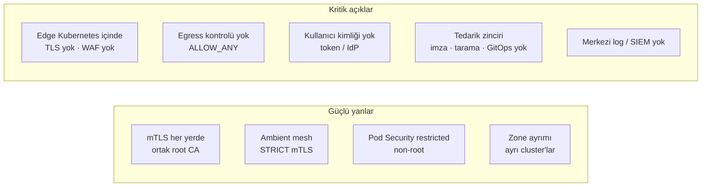

# Güvenlik Boşluk Analizi: Derinlemesine Savunma

> **Temel ilke (defense in depth):** Her katman bir öncekinin aşıldığını varsayar ve kendi kontrolünü yapar.

Bu doküman, bankacılık ortamı için tanımlanmış 13 katmanlı güvenlik gereksinimlerini lab ortamının **bugünkü haliyle** karşılaştırır. Her madde için üç şey belirtilir: şu anki durum, kanıt (dosya veya yapılandırma) ve lab'da nasıl karşılanacağı.

Analiz tarihi: 2026-10-31 · Kapsam: `kiali` branch'i (00-setup + 01-kiali adımları)

## Gösterim

| İşaret | Anlamı |
|--------|--------|
| ✅ | Var ve çalışıyor |
| ⚠️ | Kısmen var veya lab'da zayıflatılmış |
| ❌ | Yok; lab'da yapılabilir |
| 📅 | Yok; yol haritasındaki bir adımda planlandı |
| ➖ | Lab kapsamı dışında: fiziksel/ticari altyapı, organizasyonel süreç veya kind ile anlamlı simüle edilemez |

## Özet

| # | Katman | ✅ | ⚠️ | ❌ | 📅 | ➖ | Genel durum |
|---|--------|---|---|---|---|---|-------------|
| 1 | Sağlayıcı / internet kenarı | 0 | 0 | 0 | 1 | 3 | Kapsam dışı; TLS planlı |
| 2 | Edge (dış DMZ) | 0 | 3 | 1 | 2 | 1 | **En büyük açık**: edge henüz Kubernetes içinde, TLS ve WAF yok |
| 3 | DMZ cluster (platform) | 1 | 1 | 1 | 1 | 2 | Temel iyi; egress kontrolü ve secret yönetimi eksik |
| 4 | API gateway / BFF / token handler | 0 | 1 | 4 | 3 | 0 | Büyük ölçüde planlı adımlara bağlı |
| 5 | Zone geçişi (DMZ → internal) | 2 | 2 | 1 | 1 | 0 | mTLS var; tek kapı ve yön kısıtı eksik |
| 6 | Internal cluster / service mesh | 1 | 1 | 3 | 1 | 1 | STRICT mTLS var; default-deny ve admission eksik |
| 7 | Uygulama (Spring Boot) | 0 | 0 | 0 | 0 | 6 | Örnek uygulama podinfo; gerçek servis yazılınca geçerli |
| 8 | Kimlik ve oturum (IdP) | 0 | 0 | 0 | 5 | 1 | Keycloak mgmt'te planlı |
| 9 | Veri katmanı | 0 | 0 | 2 | 2 | 1 | `data` adımında planlı |
| 10 | Kart zone (PCI) | 0 | 0 | 1 | 0 | 3 | Kapsam dışı; segment simülasyonu yapılabilir |
| 11 | Tedarik zinciri (CI/CD) | 0 | 1 | 5 | 0 | 0 | **Hiç ele alınmadı** |
| 12 | İzleme ve müdahale (SOC) | 0 | 1 | 2 | 0 | 2 | Metrik var, merkezi log yok |
| 13 | Süreç ve yönetişim | 0 | 0 | 1 | 0 | 4 | Organizasyonel; tehdit modeli dokümanı yazılabilir |

---

## 1. Sağlayıcı / internet kenarı

| Gereksinim | Durum | Mevcut hal | Lab'da nasıl |
|------------|-------|------------|--------------|
| Volumetrik DDoS scrubbing | ➖ | Yok | Telekom/CDN hizmeti; simüle edilemez |
| Bot yönetimi (login/OTP'de credential stuffing) | ➖ | Yok | Ticari ürün. Kısmi karşılık: edge ve kanal gateway'lerinde IP/kullanıcı bazlı rate limit (bkz. katman 4) |
| DNS koruması (DNSSEC, CAA, registrar kilidi) | ➖ | Lab `*.apps.example.local`, `Host` header ile çalışıyor | Gerçek alan adı gerektirir |
| TLS private key dışarı verilmesin / on-prem sonlandırma | 📅 | **TLS hiç yok**; giriş düz HTTP (`localhost:8080`) | `zones`: TLS edge appliance'ta (on-prem) sonlandırılacak |

## 2. Edge (dış DMZ)

| Gereksinim | Durum | Mevcut hal | Lab'da nasıl |
|------------|-------|------------|--------------|
| Dış firewall'da yalnızca LB VIP'e 443; yönetim portları internetten görünmesin | ⚠️ | Uygulama 8080 (HTTP) ile açık. **Kiali (20001-3) ve Grafana (3001-3) de host'a açık**, anonim erişimle | `zones`: yalnızca 443. Yönetim UI'ları `mgmt` adımında tek noktaya toplanacak; host'a açık kalmaları lab istisnası olarak işaretlenmeli |
| WAF: OWASP CRS + API şema doğrulaması; önce detect sonra block; virtual patch | 📅 | Yok | `zones`: HAProxy + Coraza (OWASP CRS). Önce `DetectionOnly`, sonra `On`. Şema doğrulama katman 4'te |
| TLS 1.2+/1.3, zayıf cipher kapalı, HSTS preload, OCSP stapling | 📅 | TLS yok | `zones`: `ssl-min-ver TLSv1.2`, yalnızca modern cipher'lar, HSTS header. OCSP stapling gerçek CA gerektirir (➖) |
| Dışarıdan gelen X-Forwarded-* header'larını sil, yeniden yaz | ⚠️ | HAProxy yalnızca `X-Forwarded-Proto`'yu yazıyor. İstemcinin gönderdiği `X-Forwarded-For` **olduğu gibi geçiyor** ([10-edge-lb.yaml](../manifests/dmz/10-edge-lb.yaml)) | `zones`: `http-request del-header X-Forwarded-*` + `option forwardfor`; Istio gateway'de `numTrustedProxies: 1` |
| Bağlantı/istek boyutu limitleri, slow-loris koruması | ⚠️ | Yalnızca `timeout client/server 30s` | `zones`: `timeout http-request 5s`, `maxconn`, istek boyutu limiti, `stick-table` ile IP başına bağlantı sınırı |
| İç firewall dış firewall'dan farklı üreticide | ➖ | Firewall yok | Fiziksel. Benzetim: edge'de HAProxy, DMZ'de Envoy; farklı yazılımlar |
| Edge'den DMZ'ye yalnızca ingress portu açık | ❌ | Tüm container'lar tek bir docker ağında (`kind`); her şey birbirine erişebiliyor | Edge container'ı ile DMZ arasında ayrı docker ağı ve yalnızca LB IP'si:443. Tam izolasyon için host iptables kuralları gerekir |

## 3. DMZ cluster (platform)

| Gereksinim | Durum | Mevcut hal | Lab'da nasıl |
|------------|-------|------------|--------------|
| İş mantığı ve veri yok; yalnızca doğrulama, dönüştürme, yönlendirme | ✅ | DMZ'de yalnızca edge-lb, ingress gateway ve loadgen (test aracı) var | Korunmalı. `dmz-channels` adımındaki Web BFF yalnızca birleştirme/dönüştürme yapmalı |
| Kubernetes API internete kapalı; bastion + MFA + PAM | ➖ | kind API server'ı yalnızca `127.0.0.1`'de | Bastion/PAM organizasyonel; lab'da API zaten dışarıya kapalı |
| Dışarı çıkış kapalı (`REGISTRY_ONLY`); tek çıkış egress gateway | 📅 | `outboundTrafficPolicy: ALLOW_ANY`; **DMZ'de egress gateway yok** | `zones`: `dmz-egressgateway`. Sonra `REGISTRY_ONLY` (yol haritasında aday) |
| Node sertleştirme (CIS), SSH kapalı, otomatik yama | ➖ | kind node'ları container | Gerçek node gerektirir. `kube-bench` ile CIS raporu alınabilir (bilgi amaçlı) |
| Pod Security restricted: non-root, read-only FS, capability yok | ⚠️ | `edge-lb`, `loadgen`, `api-a/b` namespace'leri `restricted`; non-root ve `drop: ALL` var. **`readOnlyRootFilesystem` hiçbir yerde yok**; `istio-ingress`/`istio-egress` namespace'leri etiketsiz | Tüm manifest'lere `readOnlyRootFilesystem: true` (gerekirse `emptyDir`); gateway namespace'lerine `restricted` etiketi (istio-cni ve ztunnel ayrıcalık gerektirdiği için `istio-system` istisna) |
| Secret'lar dış kasada (Vault / External Secrets), rotasyonlu | ❌ | Istio CA anahtarı Kubernetes secret'ı (`cacerts`); **root CA private key diskte** (`certs/root-key.pem`, gitignore'da) | mgmt'e HashiCorp Vault Community + External Secrets Operator. Istio CA için cert-manager + istio-csr ile Vault entegrasyonu |

## 4. API gateway / BFF / token handler

| Gereksinim | Durum | Mevcut hal | Lab'da nasıl |
|------------|-------|------------|--------------|
| Token doğrulama: imza, exp, aud, iss, DPoP | 📅 | Kullanıcı kimliği yok | `token-exchange`: `RequestAuthentication` (imza, iss, aud, exp). DPoP ❌: auth-service'te `DPoP` proof doğrulaması ayrıca yazılmalı |
| Token exchange: dış token internal'a geçmesin | 📅 | Planlandı | `token-exchange` adımı ([README](../README.md#planlanan-kullanıcı-kimliği-yayılımı-token-exchange)) |
| Kullanıcı, cihaz, IP, partner bazında rate limit ve kota | 📅 | Yok | `dmz-channels`: kanal gateway'lerinde Envoy local rate limit; kullanıcı bazlı için global rate limit servisi (Redis, mgmt) |
| Girdi doğrulama: şema, boyut, content-type; bilinmeyen alan reddi | ❌ | Yok | Coraza'da body/content-type kuralları; OpenAPI şema doğrulaması BFF'te veya gateway'de (Envoy ext_proc) |
| Genel hata yanıtları; stack trace / iç IP sızmasın | ⚠️ | Envoy hataları kısa ama `server: istio-envoy` header'ı dönüyor; podinfo ayrıntılı JSON (hostname dahil) döndürüyor | Gateway'de `server` header'ını gizleme; `local_reply_config` ile tek tip hata gövdesi |
| Cookie HttpOnly/Secure/SameSite=Strict, CSRF, CSP, X-Frame-Options | ❌ | Web kanalı yok | `dmz-channels` Web BFF'te; güvenlik header'ları gateway'de `response.headers.add` ile |
| CORS yalnızca izinli origin'lere, `*` yok | ❌ | Tanımsız | VirtualService `corsPolicy` ile açık origin listesi |
| Loglarda token, parola, OTP, kart verisi maskelensin | ❌ | Envoy access log'ları stdout'a varsayılan formatla yazıyor | Access log formatından `authorization` header'ının çıkarılması; uygulama loglarında maskeleme |

## 5. Zone geçişi (DMZ → internal)

| Gereksinim | Durum | Mevcut hal | Lab'da nasıl |
|------------|-------|------------|--------------|
| Tek kapı: egress → internal ingress | 📅 | Şu an **DMZ ingress gateway** internal'a doğrudan gidiyor | `zones`: DMZ egress gateway; internal AuthZ yalnızca `dmz-egressgateway` + karşı internal egress |
| mTLS, yalnızca kurumsal CA'nın imzaladığı istemci sertifikası | ✅ | `ISTIO_MUTUAL`; sertifikalar ortak kurumsal root CA altındaki intermediate CA'lardan. Mesh dışı istemci reddediliyor (test edildi) | `MUTUAL` + harici CA isteniyorsa cert-manager ile ayrı gateway sertifikaları (`credentialName`) |
| Kısa ömürlü sertifikalar, otomatik yenileme (cert-manager) | ⚠️ | Workload sertifikaları Istio tarafından **24 saatlik** üretilip otomatik yenileniyor ✅. Intermediate CA'lar 2 yıllık ve elle üretildi; cert-manager yok | cert-manager + istio-csr (mgmt'teki Vault'a bağlı) |
| İptal kontrolü (CRL/OCSP) | ❌ | Yok | Istio'da CRL desteği sınırlı; kısa ömürlü sertifika stratejisi iptal ihtiyacını azaltır. Gateway sertifikalarında CRL dağıtımı denenebilir |
| Bağlantıyı yalnızca DMZ başlatsın | ⚠️ | AuthZ yönü kısmen sağlıyor (internal gateway yalnızca DMZ kimliğini kabul ediyor). Ama ağ seviyesinde internal'dan DMZ LB IP'sine bağlantı **engellenmiyor** | DMZ ingress'te internal kaynaklı istekleri reddeden AuthZ; ağ seviyesinde docker ağı ayrımı |
| Sertifika tabanlı kimlik: SPIFFE | ✅ | `spiffe://corp.mesh/ns/<ns>/sa/<sa>` | – |

## 6. Internal cluster / service mesh

| Gereksinim | Durum | Mevcut hal | Lab'da nasıl |
|------------|-------|------------|--------------|
| Zero trust: STRICT mTLS | ✅ | `PeerAuthentication STRICT` (cluster-a/b, mesh geneli) | DMZ'ye de eklenmeli (HAProxy dışarı alınınca mümkün) |
| Deny-by-default AuthorizationPolicy | ⚠️ | Gateway'lerde ve api servislerinde `ALLOW` politikaları var (hedefe gelen diğer trafiği dolaylı olarak reddeder). **Namespace genelinde `allow-nothing` politikası yok** | Her namespace'e boş `spec: {}` AuthorizationPolicy + açık izinler |
| İki kimlik birlikte: SPIFFE + kullanıcı claim'leri (channel, acr, scope) | 📅 | Yalnızca servis kimliği | `token-exchange`: `when: request.auth.claims[channel]` vb. |
| Namespace'ler arası default-deny NetworkPolicy | ❌ | Yok | kindnet NetworkPolicy destekliyor; her namespace'e default-deny + gerekli izinler. Ambient'te HBONE portu (15008) açık bırakılmalı |
| prod / test / dev ayrı cluster'larda | ➖ | Lab tek ortam | Gerçek ortamda ayrı cluster/hesap |
| Kubernetes audit log → SIEM | ❌ | Kapalı | kind config'te `audit-policy` + log dosyası; merkezi log sistemine gönderim (katman 12) |
| Admission kontrolü: imzasız image, `latest`, privileged, hostPath reddi | ❌ | Yok. Versiyonlar sabitlenmiş (latest kullanılmıyor), ama zorunlu kılan bir mekanizma yok | Kyverno: `disallow-latest-tag`, `disallow-privileged`, `disallow-host-path`, `verify-images` (cosign) |

## 7. Uygulama (Spring Boot servisleri)

Şu an örnek uygulama olarak **podinfo** kullanılıyor; bu maddeler gerçek Spring Boot servisleri yazıldığında uygulanabilir. `token-exchange` adımında yazılacak örnek mikroservis bu kuralların bir kısmını göstermek için iyi bir fırsat.

| Gereksinim | Durum | Not |
|------------|-------|-----|
| Nesne seviyesinde yetkilendirme (BOLA/IDOR) | ➖ | Örnek serviste `sub` claim'i ile kaynak sahibi kontrolü gösterilebilir |
| Parametreli SQL, çıktı encode | ➖ | `data` adımından sonra |
| Idempotency key, step-up onay | ➖ | `acr` claim'i ile step-up örneği yapılabilir |
| İş kuralı limitleri sunucuda | ➖ | Uygulama mantığı |
| Actuator dışarı kapalı, ayrı port | ➖ | Ayrı management portu + mesh AuthZ ile yalnızca Prometheus'a izin |
| Bağımlılıklar güncel (SCA), minimum kütüphane | ➖ | Katman 11 ile birlikte |

## 8. Kimlik ve oturum (IdP)

Keycloak `mgmt` cluster'ında planlandı (`token-exchange` adımı). Maddelerin çoğu Keycloak ayarıyla gösterilebilir.

| Gereksinim | Durum | Lab'da nasıl (Keycloak) |
|------------|-------|-------------------------|
| MFA zorunlu, oltalamaya dayanıklı (passkey) | 📅 | Authentication flow'da OTP/WebAuthn zorunlu |
| Kısa ömürlü access token; refresh rotasyonu ve tekrar kullanım tespiti | 📅 | Access token 5 dk; "Revoke Refresh Token" + reuse count 0 |
| Kanal başına ayrı client, en az yetki scope | 📅 | `mobile-app`, `web-bff`, `partner-*` client'ları; client scope'lar |
| Oturum idle/absolute timeout; merkezi iptal | 📅 | SSO Session Idle/Max; admin API ile logout-all |
| Artan gecikme, hesap kilitleme, risk bazlı step-up | 📅 | Brute Force Detection; step-up için `acr` / LoA |
| İmza anahtarları HSM'de; kesintisiz JWKS rotasyonu | ➖ | HSM fiziksel. Anahtar rotasyonu Keycloak'ta (birden çok aktif key) gösterilebilir |

## 9. Veri katmanı

`data` adımında PostgreSQL ve Redis mgmt'e kurulacak.

| Gereksinim | Durum | Lab'da nasıl |
|------------|-------|--------------|
| İletimde TLS, durağanken şifreleme (TDE / disk) | 📅 | İletim: mesh mTLS (internal → mgmt gateway). Durağan şifreleme ➖ (kind volume'ları); pgcrypto ile alan seviyesi gösterilebilir |
| Servis başına DB kullanıcısı, en az yetki; insan erişimi PAM | 📅 | Servis başına rol ve şema. PAM ➖ |
| TCKN ve kart verisi tokenize / alan seviyesinde şifreli | ❌ | pgcrypto veya uygulama seviyesinde şifreleme (Vault Transit) |
| Şifreli, immutable yedek; geri dönüş testi | ❌ | `pg_dump` + şifreleme; immutable depolama ➖ |
| DB erişim logları SIEM'e | ➖ | `pgaudit` + merkezi log (katman 12) |

## 10. Kart zone (PCI)

| Gereksinim | Durum | Not |
|------------|-------|-----|
| CDE'nin diğer zone'lardan segmentasyonu, minimum kapsam | ❌ | Ayrı bir `cde` cluster'ı/namespace'i + yalnızca belirli servise mTLS ile izin olarak simüle edilebilir |
| PIN ve anahtar işlemleri yalnızca HSM'de | ➖ | Fiziksel HSM |
| PAN tokenizasyonu; CVV/track verisi saklanmaz | ➖ | Uygulama tasarımı |
| PCI denetimi, ASV taraması | ➖ | Süreç |

## 11. Tedarik zinciri (CI/CD)

**Hiç ele alınmamış katman.** Bugün manifest'ler ve script'ler elle çalıştırılıyor.

| Gereksinim | Durum | Mevcut hal | Lab'da nasıl |
|------------|-------|------------|--------------|
| Minimal image (distroless / UBI-micro) + cosign imzası; cluster yalnızca imzalı image kabul etsin | ❌ | Upstream image'lar (podinfo, haproxy alpine, curl); imza doğrulaması yok | Kyverno `verifyImages` + cosign; kendi servislerimiz distroless |
| Pipeline'da SAST, SCA, secret, image (Trivy), IaC taraması | ❌ | CI yok | GitHub Actions: Trivy (image + IaC/config), gitleaks, Semgrep |
| SBOM üretimi ve saklanması | ❌ | Yok | Syft / Trivy ile SBOM, artifact olarak |
| Branch koruması: zorunlu review, imzalı commit | ❌ | `main`/`setup` korumasız; commit'ler imzasız | GitHub branch protection kuralları (repo ayarı) |
| Pipeline'da kalıcı kimlik yok; OIDC federasyonu | ❌ | Pipeline yok | GitHub Actions OIDC |
| GitOps (Argo CD); cluster'a elle değişiklik yok | ⚠️ | Her şey repo'da tanımlı ve her adımda sıfırdan kuruluyor (yeniden üretilebilir). Ama uygulama `kubectl/helm` ile elle | mgmt'e Argo CD; dört cluster'ı tek yerden yönetir. Sıfırlama kuralımızla da uyumlu |

## 12. İzleme ve müdahale (SOC)

| Gereksinim | Durum | Mevcut hal | Lab'da nasıl |
|------------|-------|------------|--------------|
| Tüm katmanlardan ortak alanlarla (correlationId, zone, channel) SIEM'e log; NTP | ⚠️ | Metrikler Prometheus'ta (cluster başına). **Merkezi log yok.** Envoy `x-request-id` üretiyor ama uçtan uca taşınmıyor | mgmt'e Loki (veya OpenSearch) + Fluent Bit; access log'lara `zone`, `channel`, `x-request-id` alanları. NTP ➖ (host saati) |
| Loglar değiştirilemez (WORM) | ➖ | – | Object lock'lu depolama gerektirir |
| Korelasyon kuralları, SOAR playbook (IP engelleme, oturum iptali) | ❌ | Yok | Grafana alerting + basit otomasyon (ör. edge'de IP engelleme listesi). Tam SOAR ➖ |
| Olay müdahale planı, tatbikat | ➖ | – | Organizasyonel |
| Kubernetes audit log | ❌ | Kapalı | Bkz. katman 6 |

## 13. Süreç ve yönetişim

| Gereksinim | Durum | Not |
|------------|-------|-----|
| Tehdit modelleme (STRIDE) her yeni akış için | ❌ | Her adım dokümanına (`docs/NN-*.md`) bir STRIDE bölümü eklenebilir; lab'da yapılabilecek tek madde |
| Pen-test, red team, bug bounty | ➖ | Organizasyonel |
| En az yetki, çeyreklik gözden geçirme, PAM + JIT | ➖ | Organizasyonel |
| Yama SLA'ları (kritik ≤ 72 saat) | ➖ | Süreç; Trivy taramaları SLA takibine girdi sağlar |
| Düzenleyici uyum (BDDK, KVKK, PCI-DSS, TCMB açık bankacılık) | ➖ | Hukuki/organizasyonel |

---

## Önerilen eylem planı

### Mevcut yol haritası adımlarının kapattığı maddeler

| Adım | Kapanan / ilerleyen maddeler |
|------|------------------------------|
| **02 · `zones`** | Edge'in Kubernetes dışına alınması · TLS 1.2+/1.3, HSTS · WAF (Coraza + OWASP CRS, önce detect) · X-Forwarded-* temizliği · istek/bağlantı limitleri, slow-loris · DMZ egress gateway · zone geçişinde tek kapı · internal AuthZ sıkılaştırması |
| **03 · `mgmt`** | Yönetim UI'larının tek noktaya toplanması · merkezi metrikler |
| **04 · `dmz-channels`** | Kanal bazlı rate limit · kanal başına ayrı gateway kimliği · CORS / güvenlik header'ları |
| **05 · `data`** | İletimde şifreleme (mesh mTLS) · servis başına DB kullanıcısı |
| **06 · `token-exchange`** | Token doğrulama · token exchange · çift kimlikli AuthZ (SPIFFE + claim) · Keycloak ile MFA, kısa ömürlü token, kanal client'ları, brute force koruması |

### Yol haritasına eklenmesi önerilen yeni adımlar

| Öneri | Kapsam | Kapattığı katmanlar | Öncelik |
|-------|--------|---------------------|---------|
| **`hardening`** | `readOnlyRootFilesystem` · namespace başına `allow-nothing` AuthZ · default-deny NetworkPolicy · gateway namespace'lerine `restricted` · DMZ'de STRICT mTLS · `REGISTRY_ONLY` · `server` header gizleme, tek tip hata yanıtları | 3, 4, 6 | Yüksek: düşük efor, büyük kazanç |
| **`policy`** | Kyverno: latest tag, privileged, hostPath reddi; cosign ile imza doğrulama | 6, 11 | Yüksek |
| **`logging`** | mgmt'te Loki + Fluent Bit; access log'lara `x-request-id`, `zone`, `channel`; Kubernetes audit log | 6, 12 | Orta |
| **`secrets`** | mgmt'te HashiCorp Vault Community + External Secrets; cert-manager + istio-csr ile Istio CA'nın Vault'a taşınması (root key diskten kalkar) | 3, 5 | Orta |
| **`ci`** | GitHub Actions: Trivy (image + IaC), gitleaks, Semgrep, SBOM; branch protection | 11 | Orta |
| **`gitops`** | mgmt'te Argo CD; dört cluster'ın repo'dan yönetimi | 11 | Düşük-orta |
| **`threat-model`** | Mevcut 4 akış için STRIDE dokümanı; sonraki her adım dokümanına STRIDE bölümü | 13 | Düşük efor; hemen yapılabilir |

### Önerilen sıra

Bu sıra yol haritasına eklendi ([README](../README.md#yol-haritası)):

```mermaid
flowchart LR
    k["01 kiali"] --> z["02 zones"] --> h["03 hardening"] --> m["04 mgmt"] --> p["05 policy"]
    p --> c["06 dmz-channels"] --> d["07 data"] --> t["08 token-exchange"] --> l7["09 l7-policies"]
    l7 --> l["10 logging"] --> tr["11 tracing"] --> tm["12 traffic-mgmt"] --> s["13 secrets"]
    s --> pci["14 pci-zone"] --> ci["15 ci"] --> g["16 gitops"]
```

Kart zone (katman 10) `14 · pci-zone` adımında, ayrı cluster yerine **mgmt içinde sıkı izole namespace'ler** olarak simüle edilir (RAM sınırı nedeniyle).

Gerekçe: `zones` en büyük açığı (edge, TLS, WAF, tek kapı) kapatır. `hardening` düşük eforla mevcut her şeyi sıkılaştırır ve sonraki adımlar sıkı bir zeminde kurulur. `policy` erken gelirse sonradan eklenen her bileşen kurallara uymak zorunda kalır.

## Lab istisnaları (bilinçli zayıflatmalar)

Bunlar bilerek bırakıldı ve gerçek ortamda kabul edilemez:

| İstisna | Neden | Gerçek ortamda |
|---------|-------|----------------|
| Kiali `anonymous`, Grafana anonim admin | Kolay erişim | OpenID / OpenShift OAuth, rol bazlı erişim |
| Yönetim UI'ları host'a açık (20001-3, 3001-3) | Tarayıcıdan izleme | Yalnızca yönetim ağından, bastion üzerinden |
| Root CA private key diskte (`certs/`) | Basitlik | HSM / Vault; offline root |
| Tüm cluster'lar tek docker ağında | kind kısıtı | Zone'lar arası fiziksel/mantıksal firewall |
| Ortak trust domain (`corp.mesh`) | Basitlik | Zone başına trust domain veya ayrıştırılmış SA adları |
| Registry önbelleği HTTP (TLS'siz) | Yerel geliştirme | İç registry, TLS + imzalı image |
